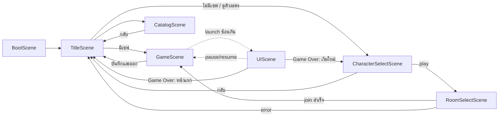

# Survivor Isles — เอกสารออกแบบเกม & โครงสร้างโค้ด

> เกมเอาชีวิตรอดภาพ pixel art มุมกล้อง 2.5D บนเว็บ (Phaser 3.90 + TypeScript บน Next.js 15 static export → GitHub Pages · เซิร์ฟเวอร์ Google Apps Script + Google Sheet)
> เอกสารนี้เขียนจากซอร์สโค้ดจริง ณ **2026-10-14** (ในเกมแสดงเวอร์ชัน `Survivor Isles v0.5` · ชื่อเดิมระหว่างพัฒนา "Last Pixel" — คีย์ `lastpixel.*` ใน localStorage และชื่อ `last-pixel` ที่ backend ตอบ ยังคงเดิมเพื่อให้เซฟเก่าใช้ได้) ถ้าตัวเลขในเอกสารไม่ตรงกับโค้ด ให้ยึดโค้ดใน `src/data/`, `src/config/balance.ts` และ `src/core/` เป็นหลัก
> วิธีรันและปุ่มควบคุมแบบย่ออยู่ใน [README.md](README.md)

## สารบัญ
1. [ภาพรวมเกมและเสาหลักของดีไซน์](#1-ภาพรวมเกมและเสาหลักของดีไซน์)
2. [โฟลว์ผู้เล่น](#2-โฟลว์ผู้เล่น)
3. [โลก](#3-โลก)
4. [ดันเจี้ยนใต้เกาะร้าง (พิชิตเกาะ)](#4-ดันเจี้ยนใต้เกาะร้าง-พิชิตเกาะ)
5. [ตัวละครและความก้าวหน้า](#5-ตัวละครและความก้าวหน้า)
6. [การต่อสู้และความตาย](#6-การต่อสู้และความตาย) (รวม 6.6 เขตผจญภัย & PvP)
7. [เศรษฐกิจ](#7-เศรษฐกิจ)
8. [การสร้างและฐาน](#8-การสร้างและฐาน)
9. [ระบบช่วยเล่น การควบคุม และการตั้งค่า](#9-ระบบช่วยเล่น-การควบคุม-และการตั้งค่า)
10. [บัญชีและเซฟ](#10-บัญชีและเซฟ)
11. [สถาปัตยกรรมโค้ด](#11-สถาปัตยกรรมโค้ด)
12. [ข้อจำกัดปัจจุบันและงานถัดไป](#12-ข้อจำกัดปัจจุบันและงานถัดไป)
13. [สมดุลเกม (Balance)](#13-สมดุลเกม-balance)
14. [กิจกรรมตามเวลาจริง](#14-กิจกรรมตามเวลาจริง) (นาฬิกาโลก · เกาะกลาง/มหาสมบัติเปิด-ปิด · เกาะกิจกรรม · กล่องฟรีรายวัน · เก็บได้ทุกอย่าง)
15. [สมดุลร่างกาย](#15-สมดุลร่างกาย) (โปรตีน/พลังงาน/วิตามิน · ป่วย · หุ่นยนต์)

---

## 1. ภาพรวมเกมและเสาหลักของดีไซน์

ปี 2099 โลกจมอยู่ใต้ทะเล เครื่องบินอพยพตก ผู้เล่นร่อนลงบน **เกาะส่วนตัว** ของตัวเอง ต้องหาอาหาร น้ำ สร้างฐาน และรอดจาก **ภัยพิบัติที่มาทุกคืน** เกาะของผู้เล่นทุกคนอยู่บน **แผนที่โลกแผนที่เดียวกัน** ไปมาหาสู่กันได้ด้วยเรือ และพบกันที่ **เกาะกลาง** ซึ่งเป็นตลาดและห้ามต่อสู้

| เสาหลัก | ความหมายในเกม | อยู่ในโค้ดที่ |
|---|---|---|
| เนื้อเรื่องอย่างเดียว | ไม่มีโหมดอื่น มีฉากเปิด 5 หน้า (`INTRO_SLIDES`) กับบทสอน 10 ขั้น (`STORY`) จากนั้นเล่นอิสระ | `data/quests.ts`, `systems/QuestSystem.ts` |
| เกาะส่วนตัว | แต่ละบัญชีได้ 1 ช่องเกาะบนตาราง สร้าง ปรับพื้น และปลูกได้เฉพาะเกาะตัวเอง เป็น **เกาะร้าง ไม่มีหมู่บ้านหรือชาวบ้าน** ใต้เกาะมีดันเจี้ยน 3 แห่งให้พิชิต | `world/WorldGenerator.ts`, `world/Interiors.ts` |
| แผนที่โลกเดียว | มีห้องเดียวชื่อ `WORLD_ROOM = 'world'` รับได้ 100 คน แผนที่ขยายเป็นวงตามจำนวนคน (โครงสร้างแบบหลายห้องยังเก็บไว้ แต่ปิดอยู่) | `core/RoomService.ts` |
| ไม่มีสายอาชีพ | ตัวละคร 7 แบบต่างกันแค่หน้าตา ค่าเริ่มต้นเท่ากันหมด (HP 180, speed 62, stamina 100) และมีสกิลเดียวกันคือ "ปฐมพยาบาล" | `data/characters.ts` |
| เก่งได้ด้วยความขยัน | พลังมาจาก เลเวล + อุปกรณ์ 12 ช่อง + อัพเกรด 10 ระดับ + บัฟจากสิ่งก่อสร้าง + ผลึกพลัง | `data/level.ts`, `data/equipment.ts`, `data/buildables.ts` |
| ความตายมีราคา | ตายแล้วเลเวลลด 1 ขั้น ถ้าตายตอน Lv.1 ต้องซื้อชีวิต ไม่งั้นตายถาวร (เซฟถูกลบ เกาะถูกคืนให้คนอื่น) · **ตายในเขตผจญภัย = ตายถาวรทันที** | `scenes/GameScene.ts` (`respawn`, `offerRevive`, `permaDeath`) |
| บ้านปลอดภัย ข้างนอกของดี | เกาะเราให้แค่กล่องไม้ (บอส = เหล็ก) · กล่องทอง/เพชรและแปลนหายากอยู่ใน **เขตผจญภัย** (PvP · ตายถาวร) | `GameScene.capBox`, `data/loot.ts` (`capBoxTier`), `systems/RivalSystem.ts` |
| เล่นได้ทุกอุปกรณ์ | รองรับคอม มือถือ และจอยเกม มีมุมกล้อง 2.5D แบบ Mode-7 | `core/InputManager.ts`, `core/ControlMode.ts`, `gfx/TiltPipeline.ts` |
| ภาพและเสียงสร้างจากโค้ด | ไม่มีไฟล์รูปหรือไฟล์เสียง sprite ทั้งหมดวาดด้วย `PixelCanvas` เสียงสังเคราะห์ด้วย WebAudio | `gfx/`, `core/AudioManager.ts` |

---

## 2. โฟลว์ผู้เล่น

```mermaid
flowchart TD
  A[เปิดเกม → BootScene<br/>สร้าง texture ทั้งหมด + รอฟอนต์ ≤3 วิ] --> B[TitleScene]
  B -->|ยังไม่เข้าระบบ| C{ฟอร์มบัญชี}
  C -->|สมัครสมาชิก| D[register: ตรวจชื่อ/รหัส → แฮช PBKDF2 → เข้าระบบอัตโนมัติ]
  C -->|เข้าสู่ระบบ| E[login: ตรวจแฮช · ติ๊ก 'จำฉันไว้']
  D --> F{มีเซฟ RunSave v3 ของบัญชีนี้?}
  E --> F
  B -->|เข้าระบบอยู่แล้ว| M[เมนูหลัก]
  M -->|ไปเกาะของฉัน / เริ่มผจญภัย| F
  M --> CAT[CatalogScene คลังอุปกรณ์ & ร้านค้า]
  M --> CS0[ดูตัวละครทั้งหมด]
  M --> SET[ตั้งค่า / ความสำเร็จ / วิธีเล่น]
  M -->|ออกจากระบบ| B
  F -->|มี| G[GameScene restore=true<br/>ไปเกาะของฉันทันที]
  F -->|ไม่มี: บัญชีใหม่| H[CharacterSelectScene play=true<br/>ขั้น 1/2: เลือกหน้าตา + ตั้งชื่อ ≥2 ตัวอักษร]
  H --> I[RoomSelectScene ขั้น 2/2<br/>leave ช่องเดิม → join WORLD_ROOM<br/>วงล้อสุ่ม 22 จังหวะ → ได้ช่องเกาะ]
  I --> J[GameScene เกาะใหม่<br/>ฉากเปิด 5 หน้า → บทสอน 10 ขั้น]
  G --> K[เล่น: เซฟอัตโนมัติทุก 60 วิ + ทุกเช้า]
  J --> K
  K -->|Esc → บันทึกและออก| B
  K -->|HP หมด, Lv > 1| L[ลด 1 เลเวล · ของในกระเป๋าตกเป็นถุง · เสียเหรียญ 10%<br/>เกิดที่เตียง/บ้าน หรือจุดเกิด]
  L --> K
  K -->|HP หมด ตอน Lv.1| N{เงินพอซื้อชีวิต?}
  N -->|พอ: จ่ายเหรียญหรือเพชร| O[ฟื้นที่ Lv.1 · ราคาครั้งหน้าแพงขึ้น]
  O --> K
  N -->|ยอมแพ้ หรือเงินไม่พอ| P[ตายถาวร: RoomService.leave + SaveManager.clear]
  K -->|HP หมด ในเขตผจญภัย (เกาะอื่น)| P
  P -->|เริ่มใหม่| H
  P -->|กลับหน้าแรก| B
```

รายละเอียดแต่ละขั้น

- **BootScene** สร้าง texture ทั้งเกมผ่าน `buildAllTextures()` ลงทะเบียนชุดแฟชั่นเป็นไอเทม (`registerCostumes` → `registerCosmetics` และเติมกลุ่ม `cosmetic` ใน `LOOT_GROUPS`) ลงทะเบียน `TiltPipeline` แล้วรอฟอนต์ Chakra Petch กับ Press Start 2P ไม่เกิน 3 วินาที
- **TitleScene** ถ้ายังไม่มี session จะแสดงฟอร์มเข้าสู่ระบบหรือสมัครสมาชิก (DOM `<input>`) ถ้ามี session จะแสดงเมนู
  - ถ้ามีเซฟ ปุ่มหลักคือ "ไปเกาะของฉัน" พร้อมบอกชื่อตัวละคร เลเวล และวัน ถ้ายังไม่มีเซฟ ปุ่มหลักคือ "เริ่มผจญภัย"
  - ปุ่มอื่นในเมนู: คลังอุปกรณ์ & ร้านค้า, ดูตัวละครทั้งหมด, ความสำเร็จ, วิธีเล่น, ตั้งค่า
  - มุมซ้ายบนมีแผงสถิติ (พลังสูงสุด รอดนานสุด โบนัสล็อกอิน) มุมขวาบนมีปุ่มบัญชีสำหรับออกจากระบบ
- **CharacterSelectScene** ช่องชื่อเติมให้จากชื่อผู้ใช้หรือชื่อเดิม มีปุ่ม 🎲 สุ่มชื่อ ชื่อยาวได้ 2–16 ตัวอักษร เมื่อกดถัดไปจะบันทึกด้วย `MetaSave.setProfile(name, character)`
- **RoomSelectScene** เรียก `leave()` ก่อนทุกครั้ง (เริ่มใหม่หมายถึงทิ้งเกาะเดิม) แล้ว `join(WORLD_ROOM)` ล้างเซฟ (`SaveManager.clear()`) แล้วเล่นวงล้อสุ่มบนตาราง 11×11 ช่อง สีทอง = เกาะกลาง, สีม่วง = เกาะมหาสมบัติ, สีเทา = มีเจ้าของแล้ว ถ้า join ไม่ได้ (เช่นห้องเต็ม) จะแสดง error และปุ่มกลับหน้าแรก
- **GameScene** สร้างโลกจาก `room.seed` ถ้ามีเซฟจะเอา "ส่วนที่เปลี่ยน" มาวางทับ เกาะใหม่จะเซฟครั้งแรกหลังเริ่ม 0.5 วินาที ฉากเปิดแสดงเมื่อ `introSeen = false` แล้วเปิด `UIScene` ซ้อนด้านบน
- **ตายและเกิดใหม่** ดูหัวข้อ 6.3 ถึง 6.5

---

## 3. โลก

### 3.1 ตารางโลก

| ค่าคงที่ | ค่า | ที่มา |
|---|---|---|
| `GRID` (= `ROOM_GRID`) | 11 → ตาราง 11×11 = 121 ช่อง | `data/islands.ts`, `core/RoomService.ts` |
| `SLOT_SIZE` | 144 tile ต่อช่อง (1 tile = 16 px) | `data/islands.ts` |
| `WORLD_SIZE` | 144 × (11+1) = **1,728 tile** ต่อด้าน (มีแถวพิเศษ +1 สำหรับแมพย่อย) | `data/islands.ts` |
| `CENTER_SLOT` | 60 (กึ่งกลางตาราง) = เกาะกลาง | `core/RoomService.ts` |
| `SPECIAL_SLOT` | (11−1)×11 + 5 = **115** (กลางขอบล่าง) = เกาะมหาสมบัติ | `core/SpecialIsland.ts` |
| เกาะกิจกรรม | ช่องทะเลว่างในขอบแผนที่ (ไม่ติดเกาะกลาง) — โผล่/หายตามเวลาจริง | `systems/WorldEventSystem.ts` (หัวข้อ 14) |
| `ROOM_CAPACITY` | 100 คน (ช่องที่ใช้ได้มี 119 ช่อง) | `core/RoomService.ts` |
| `INTERIOR_BASE` | 1000 (ดันเจี้ยนคือช่อง 1000–1002) | `world/Interiors.ts` |

- **รัศมีเกาะ** เกาะกลาง 50 tile, เกาะมหาสมบัติ 48, เกาะเรา 46, เกาะคนอื่นสุ่ม 36–45 จุดศูนย์กลางขยับสุ่มภายในช่องได้ ±(72 − r − 10)×0.6 (ยกเว้นเกาะกลาง)
- **รูปร่างเกาะ** ใช้ simplex noise 3 ชุด (shape, moist, patch) กำหนดค่า `s = 1 − d + noise` โดย `d` = ระยะ normalize ถึงขอบตามรูปร่าง (`shapeDist`, ดู 3.1b) ถ้า `−0.05 ≤ s < 0.06` เป็นน้ำตื้น ถ้า `s ≥ 0.06` เป็นแผ่นดิน ถ้า `s < 0.15` เป็นชายหาด

### 3.1b รูปร่างเกาะ (`IslandShape` ใน `WorldGenerator.ts`)
สุ่มตาม seed ของช่อง (`makeShape` ใช้ RNG เดียวกับการสุ่มไบโอม → เหมือนเดิมทุกครั้ง) · เก็บใน `IslandSlot.shape` + จุดกลางผืนดินหลัก `lx/ly` (ใช้วางของตกแต่งเกาะคนอื่น ป้าย และซากโบราณ เพราะกลางเกาะวงแหวน/จันทร์เสี้ยวอาจเป็นน้ำ)

| รูปร่าง | `kind` | น้ำหนักสุ่ม | ลักษณะ |
|---|---|---|---|
| ก้อนกลม | `blob` | 34 | แบบเดิม — **เกาะเรา เกาะกลาง เกาะมหาสมบัติ และเกาะซากโบราณเป็นแบบนี้เสมอ** (สร้างฐาน/วางปากถ้ำได้แน่นอน · ปากถ้ำยังมีการค้นหาสำรองรอบจุดเกิด) |
| จันทร์เสี้ยว | `crescent` | 14 | วงกลมรัศมี r ลบวงกลมรัศมี 0.74r ที่เลื่อนไป 0.72r ทางมุม a |
| ยาวเรียว | `long` | 16 | วงรีหมุนมุม a แกน 1.35r × 0.5r |
| เกาะแฝด | `twin` | 14 | 2 วงกลม (0.62r / 0.55r ห่างจากกลาง ±0.5r) + **สันทราย** เชื่อม (ระยะ 0.88–1 → เป็นชายหาด) |
| หมู่เกาะเล็ก | `archipelago` | 12 | เกาะหลัก 0.52r + เกาะลูก 3–5 เกาะ รัศมี 0.2–0.3r ห่าง 0.72–0.92r |
| วงแหวน | `atoll` | 10 (เกาะปะการังเป็นแบบนี้เสมอ) | วงแหวนที่ 0.78r กว้าง ±0.2r · **ลากูนกลาง = น้ำตื้น** · มีช่องแนวปะการังกว้าง ~0.16 rad ให้เรือเข้า · noise ลดเหลือ 0.12 ให้วงไม่ขาด |

- ขึ้นเกาะไบโอมใหม่ครั้งแรก การ์ดเต็มจอจะบอกชื่อรูปร่างด้วย (`SHAPE_NAMES`)
- **สร้างแบบ lazy** โลกเริ่มเป็นน้ำลึกทั้งหมด แต่ละช่องจะถูกสร้างพื้น ทรัพยากร และของตกแต่งตอนที่มีการเรียก `tileAt`/`islandAt` ในช่องนั้นครั้งแรก (`ensureSlot`) ตอนเริ่มเกมจะสร้างแค่เกาะเรากับเกาะกลาง
- **ขอบเขตแผนที่** (`world.bounds`) คือช่องที่มีเกาะ (รวมเกาะพิเศษซึ่งมีเสมอ) บวกทะเลรอบอีก 1 ช่อง ใช้เป็นขอบของฟิสิกส์ กล้อง และการล่องเรือ

### 3.2 การขยายแผนที่ตามจำนวนคน
- `spiralSlots()` เรียงช่องจากใกล้เกาะกลางออกไปเป็นวงก้นหอย (ระยะ Chebyshev แล้วตามด้วยมุม) โดยตัดช่องกลางและช่องพิเศษออก วงที่ 1–5 มี 8 / 16 / 24 / 32 / 39 ช่อง
- ผู้เล่นใหม่ได้ **ช่องสุ่ม 1 ช่องจาก 10 ช่องว่างแรก** ในลำดับก้นหอย คนยิ่งเยอะ วงเกาะยิ่งกว้าง และ `bounds` ยิ่งใหญ่
- โลกจำลองเริ่มด้วย **ผู้เล่นบอท 30 คน** (`bot_w_0..29`, seed 777, ชื่อสุ่มจากรายการ + เลข 1–99, ค่าความคืบหน้าสุ่ม 0..1) ห้องเต็ม 100 คนแล้วจะไม่รับคนใหม่

### 3.3 เกาะกลาง (ตลาด ห้ามต่อสู้)
> **เปิดวันละ 2 รอบ รอบละ 60 นาที** (เวลาสุ่มตามวัน — หัวข้อ 14) · ปิด = พายุกั้นสีฟ้ารอบเกาะ + ป้าย "ปิดอยู่ — เปิดรอบถัดไป HH:MM น." · ทดสอบ `?centeropen`
- พื้นเป็นลานอิฐวงกลมรัศมี 13 tile มีขอบดินถึง 15 tile และทางเดินดิน 4 ทิศ ไม่มีทรัพยากรเกิด
- ของบนเกาะ: **แผงตลาด 12 แผง** เรียงเป็นวงรอบลาน, เตาไฟ 4 จุด, รูปปั้น, **พ่อค้ากลาง** (ซื้อ ขาย และแลกเพชร) และป้าย 3 ป้าย
- **เขตปลอดภัย** ทำงานแบบนี้
  - `playerSafe` เป็นจริงเมื่ออยู่บนเกาะกลางเท่านั้น
  - ระหว่างนั้นตี ยิง หรือขว้างระเบิดไม่ได้ (ขึ้นข้อความ "🕊 ห้ามต่อสู้") และกระสุนศัตรูที่โดนตัวจะหายไป
  - ตอนเดินเข้าเกาะกลาง มอนที่เป็นศัตรูบนเกาะกลางจะถูกลบทิ้ง มอนจะหันกลับเมื่อจะเดินเข้า tile ที่ปลอดภัย และไม่มีการเกิดมอนบนเกาะกลาง
  - สร้างหรือปรับพื้นบนเกาะกลางไม่ได้ อุกกาบาตไม่ตกที่นี่
  - ถ้าเกิดภัยพิบัติตอนผู้เล่นอยู่เกาะกลาง บนเรือ หรือในแมพย่อย ภัยจะไปลงที่เกาะบ้านแทน

### 3.4 เกาะมหาสมบัติ (`core/SpecialIsland.ts`)
| หัวข้อ | รายละเอียด |
|---|---|
| ตารางเวลา | **เปิดวันละ 2 รอบ รอบละ 60 นาที** เวลาสุ่มใหม่ทุกวันจาก `seededRandom(วัน+'special')` (ตารางเดียวกันทุกเครื่อง — หัวข้อ 14) · `specialState()` คืน `open`, `msLeft`, `round`, `nextOpen` · แทนตารางเดิม "ทุก 4 ชม." |
| ทดสอบ | ใส่ `?specialopen` ใน URL เพื่อบังคับเปิด |
| ตอนปิด | มีวงพายุมิติสีม่วงหมุนรอบเกาะ รัศมี r+12 tile เรือและยานบินเข้าเขตนี้ไม่ได้ (ขึ้นข้อความบอกเวลาเปิด) |
| ตอนเปิด | มีลำแสงทองชี้ลงที่เกาะ ขึ้นแบนเนอร์ประกาศ มินิแมปมีลูกศรชี้ทาง และแผนที่ใหญ่มีเส้นประนำทาง |
| เตือนก่อนปิด | ประกาศ 📣 ก่อนเปิด 10 นาที + ตอนเปิด · คนที่อยู่ในเขตตอนเหลือ 2 นาที ได้แบนเนอร์เตือน |
| ตอนปิด/โหลดเกมขณะปิด | ผู้เล่นที่อยู่ในเขตจะถูกพายุพัดกลับจุดเกิดบนเกาะบ้าน (ของที่เก็บมาอยู่ครบ) และยานของเราที่จอดค้างจะย้ายไปจอดใกล้บ้าน (เรือ/ยานบินในน้ำตื้น ยานบกข้างจุดเกิด) |
| รีเซ็ต | เมื่อเปิดรอบใหม่ (`round` เปลี่ยน) ทรัพยากรทุก node บนเกาะจะเกิดใหม่ (`regrowAt = 0`, `hp = -1`) |
| ไบโอม `special` | อันตราย ×1.8, สัตว์ประจำเกาะคือ golem/skeleton/mummy, กลางคืนมี golem/shade/skeleton, แร่เด่นเป็นทองเสมอ |
| ทรัพยากร | บนลานหิน: แร่ทอง 6%, คริสตัล 3.5%, หินอุกกาบาต 2%, แร่เหล็ก 4%, กำมะถัน 2% · บนลานอิฐ (ซากโบราณที่แกะไว้กลางเกาะ): หีบสมบัติ 2.5% |
| ดรอปพิเศษ | มอนที่ตายบนเกาะนี้ ถ้ายังไม่ได้กล่อง จะได้ลุ้นกล่องอีกรอบ โดยคิด xp อย่างน้อย 8 ("กล่อง ×2") — ซ้อนกับโบนัสเขตผจญภัย (หัวข้อ 6.6) |
| เขตผจญภัย | เป็นเขตผจญภัยเสมอ (PvP · ตายถาวร) · คู่แข่ง 3 คน (อันตราย 1.8) · เกิดเฉพาะตอนเกาะเปิด |

### 3.5 เกาะของผู้เล่นคนอื่น
- ไบโอมสุ่มเท่าๆ กันจาก 15 แบบ (`OTHER_BIOMES`: `home / forest / jungle / snow / desert / volcanic / ruins` + ใหม่ `swamp / mushroom / crystal / bamboo / savanna / glacier / atoll / haunted`) ด้วย seed ของช่อง และแร่ประจำเกาะสุ่มจาก 5 แบบ · รูปร่างสุ่มตาม 3.1b
- เกาะของผู้เล่นจำลองจะ "ตกแต่ง" ตามค่า `progress`: กองไฟ → รั้ว (>0.15) → กระท่อม (>0.3) → แปลงผัก (>0.4) → โต๊ะช่าง (>0.55) → ป้อมธนู (>0.65) → กังหัน (>0.75) → บ้านหิน (>0.85) และมีป้ายบอกชื่อเจ้าของกับแร่เด่น
- สิ่งก่อสร้างของคนอื่นติดธง `foreign` ทำให้ตี รื้อ ซ่อม หรือเปิดไม่ได้ และไม่ถูกเซฟ
- ไปเกาะอื่นได้ด้วยเรือหรือยานบินเท่านั้น (ยานบกลงน้ำไม่ได้) ถ้าไปครบ 3 เกาะจะปลดล็อกความสำเร็จ "นักเดินทาง"
- **ทุกเกาะที่ไม่ใช่เกาะเรา/เกาะกลางเป็นเขตผจญภัย** (PvP · ตายถาวร · ของดี) — ดูหัวข้อ 6.6

### 3.6 ไบโอม (`BIOMES` ใน `data/islands.ts`)
| ไบโอม | ชื่อ | อุณหภูมิ กลางวัน/กลางคืน °C | อันตราย | สัตว์ | มอนกลางคืน | พื้นหลัก |
|---|---|---|---|---|---|---|
| home | เกาะของคุณ | 26 / 17 | 0.8 | rabbit, boar, deer, buffalo, hermit_crab, firefly_swarm (คืน) | zombie | หญ้า ป่า หิน (patch > 0.62) |
| forest | เกาะป่าสน | 22 / 12 | 1.0 | rabbit, boar, wolf, deer, fox, buffalo, hermit_crab | zombie, skeleton | หญ้า ป่า |
| snow | เกาะหิมะ | −4 / −16 | 1.2 | snow_wolf, penguin | yeti, skeleton | หิมะ หิน |
| desert | เกาะทะเลทราย | 40 / 14 | 1.2 | crab, scorpion, cobra, hermit_crab | mummy, skeleton | ทะเลทราย หิน |
| jungle | เกาะป่าดิบ | 30 / 22 | 1.1 | boar, slime, monkey, parrot, cobra, firefly_swarm (คืน) | slime, bat | ป่าทึบ |
| volcanic | เกาะภูเขาไฟ | 38 / 28 | 1.5 | imp | imp, golem | เถ้า หิน |
| ruins | เกาะซากโบราณ | 24 / 14 | 1.4 | skeleton, cobra | skeleton, mummy | อิฐ (ซาก) ป่า |
| central | เกาะกลาง | 27 / 20 | 0 | – | – | ลานอิฐ |
| special | เกาะมหาสมบัติ | 25 / 16 | 1.8 | golem, skeleton, mummy | golem, shade, skeleton | หิน อิฐกลางเกาะ |
| dungeon | ดันเจี้ยน (แมพย่อย) | 16 / 14 | 0 | – | – | พื้นถ้ำ ผนังหิน |
| swamp | หนองน้ำป่าชายเลน | 29 / 23 | 1.2 | bog_slime, cobra, monkey, firefly_swarm | bog_slime, zombie, bat | โคลน (DIRT) หญ้าบึง ป่า + **บึงน้ำตื้นกลางเกาะ** |
| mushroom | เกาะเห็ดยักษ์ | 21 / 16 | 1.1 | slime, firefly_swarm, deer, bat | slime, shade, bat | พื้นเส้นใยเห็ดม่วง (GRASS/FOREST) หินบางจุด |
| crystal | เกาะคริสตัล | 18 / 8 | 1.5 | crystal_golem, bat, penguin | crystal_golem, golem, shade | หินผลึก (STONE ~70%) + พื้นเกล็ดผลึก |
| bamboo | ป่าไผ่ซากุระ | 24 / 15 | 0.6 | deer, rabbit, parrot, monkey, firefly_swarm | zombie | หญ้าเขียวอ่อน ป่าไผ่ |
| savanna | ทุ่งหญ้าสะวันนา | 34 / 19 | 1.1 | buffalo (ฝูง 3), deer (ฝูง 2), fox, wolf, scorpion, rabbit | wolf, zombie, skeleton | หญ้าเหลือง ดินแดง (DIRT) หินโผล่ |
| glacier | ธารน้ำแข็ง | −12 / −24 | 1.4 | snow_wolf, penguin (ฝูง 3), yeti | yeti, snow_wolf, wraith | **น้ำแข็ง (ASH)** หิมะ หิน |
| atoll | เกาะปะการังวงแหวน | 30 / 24 | 0.9 | hermit_crab, crab, parrot | crab, zombie | ทรายปะการัง + ลากูน (น้ำตื้นสีฟ้าใส) |
| haunted | เกาะหมอกผี | 16 / 9 | 1.6 | shade, skeleton, wraith (ออกกลางวันด้วย) | wraith, shade, skeleton, zombie | หญ้าเทา ป่ามืด อิฐซาก (BRICK) |

**ผิวพื้นตามไบโอม** (ไม่มี TILE ใหม่ — ข้อมูลโลก การชน มินิแมปยังเป็น TILE เดิม): `gfx/art/terrain.ts` วาดไทล์เพิ่ม 17 ชุดต่อท้าย tileset (`SKIN.*` × 4 แบบ) แล้ว `ChunkRenderer` เลือกผิวด้วย `skinFor(ไบโอมของช่อง, TILE)` — เช่น หนองน้ำ DIRT→โคลน, SHALLOW→น้ำบึงเขียวขุ่น · สะวันนา GRASS→หญ้าเหลือง, DIRT→ดินแดง · ธารน้ำแข็ง ASH→น้ำแข็ง · ปะการัง SAND→ทรายชมพูขาว, SHALLOW→ลากูนฟ้าใส · เห็ด/ไผ่/หมอกผี/คริสตัลเปลี่ยนสีหญ้า/ป่า/หิน (ไบโอมที่เปลี่ยนสีหญ้าจะไม่วาดขอบหญ้าเขียวทับ) · ⚠ มินิแมป/แผนที่ใหญ่ใช้ `TILE_RGB` ใน `UIScene` จึงยังเป็นสีพื้นเดิม (เช่น น้ำแข็งเป็นสีเถ้าเข้ม)

**ลักษณะพิเศษ** (`systems/BiomeSystem.ts` — เฉพาะตอนเดินเท้าบนเกาะ ไม่อยู่บนยาน/ในดันเจี้ยน · วางพื้นทับแล้วไม่มีผลโคลน/น้ำแข็ง · `BiomeDef.tip` แสดงบนการ์ดขึ้นเกาะ)

| ไบโอม | ผล |
|---|---|
| หนองน้ำ | **โคลน** เดินช้า ×0.62 · **หมอกพิษ** คงที่ตาม seed (ช่องละ 12×12 tile โอกาส 24%, รัศมี 30–46 px) ยืนในหมอก = ☠ พิษ 2/วิ 2 วิ (เช็กทุก 0.6 วิ · เขตบ้านไม่มีหมอก) |
| เห็ดยักษ์ | **สปอร์** สติ −0.35/วิ (ถือคบเพลิง/ใกล้ไฟ 90 px/ในเขตบ้าน = ไม่ลด) · เห็ดเรืองแสง/ต้นเห็ดเรืองแสงเป็นแหล่งแสงยามมืด · เก็บ **เห็ดเรืองแสง** (อิ่ม 6 สติ +18) |
| คริสตัล | ผลึกคริสตัลใหญ่ (`crystal_1`) ส่องแสงยามมืด + ประกาย · คริสตัลบนลานหิน 6% |
| ธารน้ำแข็ง | **พื้นลื่น** (`Player.slippery`: ความเร็วเข้าหาเป้าช้า เร่ง ×2.4/วิ เบรก ×0.9/วิ ไถลต่อ) · หิมะตกตลอด (WeatherSystem นับเป็นเกาะหิมะ) |
| ปะการัง | ปะการัง (อีเต้อ) ได้หิน + **ไข่มุก 12%** + กระดองปู 20% · ตกปลาในน้ำรอบเกาะ: ปลาทอง 7% ไข่มุก 5% กล่องไม้ 8% |
| ป่าไผ่ | กอไผ่ (ตัดมือ/ขวาน) ได้ไม้ 2–3 + เส้นใย · งอกใหม่ 150 วิ · กลีบซากุระปลิว · อันตรายต่ำสุด 0.6 |
| สะวันนา | สัตว์เกิดเป็นฝูง (`HERD` ใน SpawnSystem) · ฝุ่นทรายปลิวเบาๆ ตอนฟ้าใส |
| หมอกผี | หมอกทับจอ alpha 0.26 + ความมืด 0.24 แม้กลางวัน (ในบ้าน 0.12) · ผีเป็นสัตว์ประจำเกาะ (เกิดกลางวัน) · หีบสมบัติในซาก 0.9% |

**การ์ดขึ้นเกาะครั้งแรก** — `GameScene.updateZones`: เหยียบเกาะไบโอมที่ยังไม่เคยไป (ยกเว้นเกาะเรา/เกาะกลาง/มหาสมบัติ/ดันเจี้ยน) → `ui:splash` ภาพ `isl_<biome>` + ชื่อ + คำอธิบาย + tip + ชื่อรูปร่าง (แทนแบนเนอร์) · จำใน `visited` เป็นคีย์ `b:<biome>` (เซฟไปกับ RunSave · สถิติ islandsVisited นับเฉพาะคีย์ช่อง)

ทรัพยากรต่อ tile มาจาก `nodeTable(biome, tile)` ตัวอย่างเช่น ป่าในเกาะเรามีต้นไม้ 22%, พื้นทรายทุกเกาะมีต้นไม้ (มะพร้าว) 2.5% และพื้นหินบนเกาะหิมะมีหิน 6% กับแร่เหล็ก 5% node สองตัวจะไม่วางชิดกันในแนวซ้ายหรือบน และรอบจุดเกิด ซากเครื่องบิน และทางเข้าแมพย่อยจะไม่มี node

### 3.7 แร่ประจำเกาะ (Specialty)
- แต่ละเกาะมีแร่เด่น 1 อย่างจาก `iron / coal / sulfur / gold / crystal` (เกาะพิเศษเป็น gold เสมอ)
- บน tile หิน (`TILE.STONE`) ของทุกเกาะยกเว้นเกาะกลาง จะเพิ่มโอกาส 5% ให้เกิดแร่เด่นนั้น ก่อนจะสุ่มจากตารางปกติ
- เครื่องขุดแร่อัตโนมัติมีโอกาส 10% ได้แร่เด่นของเกาะเรา
- จุดประสงค์คือให้ผู้เล่นต้องแลกแร่กันที่เกาะกลาง แผนที่ใหญ่และป้ายบนเกาะบอกว่าเกาะไหนมีแร่เด่นอะไร

### 3.8 ต้นไม้หลายแบบตามไบโอม (`TREE_MIX` ใน `WorldGenerator.ts`)
- บนทรายเป็นมะพร้าว (`palm`), บนเถ้าเป็นต้นไม้ตาย (`deadtree`) (ธารน้ำแข็ง: สนหิมะ 70%), บนหิมะหรือหินเป็นสนหิมะ 80% และต้นไม้ตาย 20% · โคลนหนองน้ำ = โกงกาง (`mangrove`) · ดินแดงสะวันนา = อาคาเซีย (`acacia`)
- ไบโอมใหม่: หนองน้ำ mangrove/willow/deadtree · เห็ด mushtree 75–90% · คริสตัล deadtree/snow_pine/birch · ไผ่ sakura/maple/willow (+ node `bamboo` แยก) · สะวันนา acacia · ปะการัง palm · หมอกผี deadtree/willow
- **node ใหม่** (`NODE_SPECS`): `bamboo` (ตัด · ไม้ 2–3 + เส้นใย 80%) · `coral` (อีเต้อ minPower 1 · หิน + ไข่มุก 12% + กระดองปู 20%) · `shroom` (กด E · เห็ดเรืองแสง 1–2 + ผงหิ่งห้อย 20%) · art วาดด้วยโค้ดใน `gfx/art/nature.ts` (`acacia`, `mangrove`, `bambooClump`, `coral`, `shroomPatch`, `crystalCluster`)
- ที่เหลือสุ่มตามน้ำหนักของไบโอม เช่น เกาะเราบนหญ้า: oak 30, birch 15, sakura 15, maple 15, willow 10, bigoak 8, pine 7 · ป่าดิบ: bigoak, oak, willow, mushtree, palm · ซากโบราณ: oak, deadtree, willow · เกาะพิเศษ: sakura, bigoak, mushtree, maple
- แต่ละชนิดมีหลายแบบ (`TREE_VARIANTS` เช่น oak 3 แบบ) ไบโอมที่ไม่มีใน `TREE_MIX` (forest ใช้ mix ของตัวเอง ส่วน snow/desert/volcanic) จะใช้กฎพื้นฐาน ป่า = pine 55% นอกนั้น oak

### 3.9 แถวแมพย่อย
- แถวที่ y = 11 (ใต้ตาราง 11×11) เก็บดันเจี้ยน 3 ช่อง x = 0..2 (ช่อง 1000–1002) ขอบทุกด้านเป็นผนังหิน (`ROCKWALL`) หนา 3 tile
- เรือไปไม่ถึงเพราะอยู่นอก `bounds` ต้องเข้าทางประตูหรือปากถ้ำบนเกาะเราเท่านั้น
- ตอนอยู่ในแมพย่อย ขอบฟิสิกส์และกล้องจะถูกจำกัดไว้เท่าช่องนั้น (`InteriorSystem.applyBounds`)

---

## 4. ดันเจี้ยนใต้เกาะร้าง (พิชิตเกาะ)
> เกาะของผู้เล่นคือ **เกาะร้าง** — ไม่มีหมู่บ้าน ไม่มีชาวบ้าน ไม่มีร้านค้าบนเกาะ ผู้เล่นต้องเอาชีวิตรอดและพิชิตเกาะเอง (ร้านค้า/แลกเปลี่ยนมีที่เกาะกลางเท่านั้น)

### 4.1 ปากถ้ำบนเกาะ
- `setupHome()` วางปากถ้ำ 3 จุดรอบเกาะเราที่มุม −0.5π (เหนือ), 0.82π (ตะวันตกเฉียงใต้), 0.18π (ตะวันออกเฉียงใต้) ไล่หาตำแหน่งจากระยะ 0.72r เข้าหา 0.3r ต้องเป็นแผ่นดินทึบ 5×4 tile และห่างจุดเกิดเกิน 9 tile ถ้าไม่เจอจะวนหาจุดสำรองรอบจุดเกิด (มีทางเข้าเสมอ)
- รูป `cave_entrance` มีป้ายชื่อ + เลเวลที่แนะนำ (เปลี่ยนเป็น "✔ พิชิตแล้ว" เมื่อล้มบอส) ระยะกดใช้ 40 px
- เข้า/ออกใช้ fade กล้อง (ออก 220 ms, เข้า 260 ms) ตอนเข้าขึ้นแบนเนอร์ชื่อดันเจี้ยน ตอนออกกลับมาอยู่ใต้ปากถ้ำ 3 tile

| ช่อง | ชื่อ | รายละเอียด | ระดับ / แนะนำ |
|---|---|---|---|
| 1000 | ถ้ำหินมืด | ค้างคาว สไลม์ โครงกระดูก · บอส: โกเลมหินยักษ์ | ชั้น 1 · Lv.1–10 |
| 1001 | เหมืองร้าง | โกเลม มัมมี่ เงาหลอน โครงกระดูก · บอส: ราชาปู | ชั้น 2 · Lv.10–25 |
| 1002 | สุสานโบราณ | อิมป์ไฟ มัมมี่ เงาหลอน โกเลม · บอส: ราชาปีศาจ | ชั้น 3 · Lv.25+ |

### 4.2 พิชิตเกาะ
- ล้มบอสของดันเจี้ยนไหน = **พิชิตดันเจี้ยนนั้น** (เก็บใน `InteriorSystem.conquered` และเซฟใน `player.interiors.conquered`)
- พิชิตครบทั้ง 3 แห่ง = **พิชิตเกาะร้างสำเร็จ** (แบนเนอร์ใหญ่) · ดันเจี้ยนที่พิชิตแล้วยังเข้าไปฟาร์มได้ มอน/บอส/หีบเกิดใหม่ทุกวัน

### 4.3 ดันเจี้ยน 3 ระดับ (`genDungeon` + `DUNGEON_MOBS`)
- **ผัง**
  - ทั้งช่องเริ่มเป็นผนังหิน แบ่งเป็นตารางห้อง 4×4 (cell = ⌊(144−8)/4⌋ = 34) ห้องเป็นทรงมนกว้าง 14–26 และสูง 12–26 tile
  - ทางเดินกว้าง 3 tile เป็นรูปตัว L เชื่อมด้วย DFS spanning tree แล้วเพิ่มทางลัดสุ่มอีก 3 ทาง
  - **ห้องบอส** คือห้องที่ไกลจากห้องแรกที่สุดในกราฟ (BFS) และถูกขยายเป็น 21×17
  - ห้องแรกเป็นทั้งทางเข้าและทางออก ประตูทางออกมีแสงเรือง ต้องกด E เพื่อกลับเกาะ
- **มืดตลอด** ความมืดคงที่ 0.9 (`InteriorSystem.darkness`) ที่มุมห้องมีคบไฟติดผนัง (โอกาส 70% ต่อมุม แสงรัศมี 76) ทางออกมีแสง 80 และกองคริสตัลประดับมีแสง 46 ส่วนแสงของผู้เล่นเองมีแค่ 26 + ค่าแสง จึงควรถือคบไฟ (รัศมี 64) หรือใส่ตะเกียงหรือหมวกช่างเหมือง
- **ของประดับ** ห้องละ 2 ชิ้น (กองกระดูก ใยแมงมุม กองคริสตัล เสากะโหลก)

| ระดับ | มอน | บอส | ตัวคูณ `mult` | กล่องในหีบ | แร่ในห้อง |
|---|---|---|---|---|---|
| 1 | bat, slime, skeleton | golem (ไม่ใช่บอสโดยกำเนิด จึงคูณ ×3 → "โกเลมหินยักษ์ (บอสดันเจี้ยน)" scale ×1.6) | ×1 | box_wood | ore_coal, ore_iron |
| 2 | golem, mummy, shade, skeleton | crab_king | ×1.8 | box_iron | ore_iron, ore_gold, ore_sulfur |
| 3 | imp, mummy, shade, golem | demon_lord | ×3 | box_gold | ore_gold, crystal, meteor_rock |

- **สูตรปรับพลังมอน** (`InteriorSystem.scaled`) HP × m, โจมตี × √m × 1.1, XP × m โดย m = mult ส่วนบอสที่ไม่ได้เป็น ai `boss` อยู่แล้วใช้ m = mult × 3 (ถ้า mult = 1 และไม่ใช่บอส จะใช้มอนตัวเดิมไม่ปรับ)
  - ตัวอย่างบอส: ชั้น 1 โกเลม HP 600 / ATK 42 / XP 90 · ชั้น 2 ราชาปู HP 1,260 / ATK 30 / XP 450 · ชั้น 3 ราชาปีศาจ HP 4,500 / ATK 50 / XP 2,400
- **เกิดใหม่รายวัน** ครั้งแรกที่เข้าในแต่ละวันเกม (`spawnedDay`)
  - ลบมอนเก่าของดันเจี้ยนนั้นทิ้ง
  - ห้องที่ไม่ใช่ทางเข้ามีโอกาส 30% ว่าง ห้องที่เหลือเกิดมอน `1–2 + (tier−1)` ตัว
  - เกิดบอสในห้องบอส และรีเซ็ตหีบทุกใบให้เปิดได้ใหม่
  - มอนของดันเจี้ยนติด `data.dungeon` ไว้ จึงไม่ถูก despawn ตามระยะ และไม่ติดไฟตอนเช้า
  - id ของมอนที่ปรับพลังเป็น `xxx@mult` (บอส `xxx@multB`) — `mob:killed` ส่ง id ต้นแบบ (ความสำเร็จ/เควสต์นับได้) และคลังมอน/สารานุกรมแสดงเฉพาะมอนต้นแบบ (`baseMobs()`)
- **หีบ (`ruin_chest`)** อยู่ในห้องบอสแน่นอน และในห้องอื่นมีโอกาส 40% เปิดแล้วได้
  - ของจาก `NODE_SPECS.ruin_chest`: เหรียญ 30–80, ทองแท่ง 60%, คริสตัล 40%, เฟือง 50%, เครื่องยนต์ 8%, หน้าไม้ 10%
  - กล่องตามระดับดันเจี้ยน (`onNodePicked`)
  - หีบนอกดันเจี้ยนได้กล่อง 1 ใบตาม `ruinChestBox()`: เกาะซากโบราณ ทอง 30% / เหล็ก 70% · เกาะมหาสมบัติ ทอง 60% / เพชร 15% / เหล็ก 25%
- **บอสดันเจี้ยน** (`DUNGEON_BOSS_BOXES`) ล้มได้ทุกวัน: ชั้น 1 = กล่องทอง 1 · ชั้น 2 = กล่องทอง 2 · ชั้น 3 = กล่องเพชร 1 + กล่องทอง 1 (แทนกล่องจาก `mobBoxDrop`) + เพชร 1–3 + ผลึก
- **แร่** สุ่มห้องละ 1–3 ก้อนจากรายการของระดับนั้น และงอกใหม่ตามเวลา regrow ปกติ

---

## 5. ตัวละครและความก้าวหน้า

### 5.1 ตัวละคร (`data/characters.ts`)
- มี 7 หน้าตา: **ต้น** (mechanic), **ฝน** (medic), **เสือ** (hunter), **ข้าว** (farmer), **ลม** (scout), **มืด** (shaman), **B-07** (robot)
- ทุกตัวใช้ `BASE_STATS = { hp 180, speed 62, stamina 100, hungerRate 1, thirstRate 1, damageMult 1 }`, `passive = {}` และสกิล `first_aid` "ปฐมพยาบาล" (Q) ซึ่งฟื้น HP 35 + สติ 20 คูลดาวน์ 30 วินาที
- การ์ดหน้าเลือกตัวละคร (`CharacterDef.role/tier/badge` + `HERO_CARDS` เรียงแล้ว 4 + 3 ใบ แถวล่างอยู่กลาง · `HeroId` = union ของ id ทั้ง 7 ใช้พิมพ์ `CLASS_LOOKS`):

| id | ชื่อ | บทบาท | การ์ด |
|---|---|---|---|
| `mechanic` | ต้น | ช่างซ่อม | gold 🔧 |
| `medic` | ฝน | หมอ | gold ✚ |
| `hunter` | เสือ | นักล่า | red 🏹 |
| `farmer` | ข้าว | ชาวไร่ | red 🌾 |
| `scout` | ลม | นักสำรวจ | red 🧭 |
| `shaman` | มืด | หมอผี | red 🔮 |
| `robot` | B-07 | หุ่นยนต์ AI | special (เงิน/ม่วง) AI |
- กระเป๋าพื้นฐานมี 20 ช่อง + hotbar 8 ช่อง (`BAG_SIZE`, `HOTBAR_SIZE`)
- หน้าตาเป็นแบบ paper-doll (`gfx/art/heroes.ts`) ชุดเกราะที่สวม (ช่องหัว ตัว ผ้าคลุม) จะเปลี่ยนลุค และชุดแฟชั่นที่เลือกจะทับลุคเกราะอีกที

### 5.2 เลเวล (`data/level.ts`)
| หัวข้อ | ค่า |
|---|---|
| XP ที่ต้องใช้จาก Lv → Lv+1 | `xpNeed(lv) = 30 + 20 × lv` (Lv1→2 = 50, Lv10→11 = 230) |
| XP สะสมถึง Lv10 / Lv20 / Lv25 | 1,170 / 4,370 / 6,720 |
| เลเวลสูงสุด | `MAX_LEVEL = 99` (ถึงแล้ว xp = 0) |
| ค่าต่อเลเวล (นับจาก Lv1) | HP +10, สแตมินา +2, โจมตี +1%, ป้องกันติดตัว 4 (+0.5/เลเวล ≈ ลดดาเมจ 15% ตั้งแต่ Lv1) (`levelStats`) · ฟื้นเลือดเอง 0.6/วิ เมื่อไม่โดนตี 6 วิ และไม่หิว/กระหาย · อมตะหลังโดนตี 0.8 วิ |
| เลเวลอัป | HP และสแตมินาเต็ม ขึ้นแบนเนอร์บอกค่าที่เพิ่ม มีเสียงและเอฟเฟกต์ |

**แหล่ง XP** (`XP_GAIN` + `mobs.ts`)
| การกระทำ | XP |
|---|---|
| เก็บหรือตัดทรัพยากรสำเร็จ (`node:harvested`) | 1 |
| คราฟต์ (ต่อการกด 1 ครั้ง) | 2 |
| สร้างหรือวาง 1 ชิ้น | 3 |
| ตกปลาได้ | 4 |
| เก็บเกี่ยวผัก | 2 |
| รอดภัยพิบัติ | 40 |
| ฆ่ามอน | ค่า `xp` ของมอน เช่น กระต่าย 2, ซอมบี้ 5, หมาป่า 8, เยติ 22, โกเลม 30, ราชาปู 250, ราชาปีศาจ 800 (มอนในดันเจี้ยนคูณตาม 4.3) |

### 5.3 อุปกรณ์ 12 ช่อง (`data/equipment.ts`)
`weapon` อาวุธหลัก · `offhand` มือรอง (โล่/ตะเกียง) · `head` หมวก · `body` เสื้อเกราะ · `legs` สนับขา · `feet` รองเท้า · `hands` ถุงมือ · `back` ผ้าคลุม · `neck` สร้อยคอ · `ring1`/`ring2` แหวน · `bag` กระเป๋าเป้

- **อาวุธหลัก** ใช้โจมตีเมื่อของในมือไม่ใช่เครื่องมือหรืออาวุธ (`Player.weaponRef`) ถ้าถืออาวุธหรือเครื่องมืออยู่ในมือ ของในมือจะถูกใช้ก่อน
- **สวมใส่** กด F ที่ไอเทม หรือคลิกในหน้าต่างกระเป๋า แหวนจะลงช่องว่างก่อน ของที่ถอดออกจะสลับกลับเข้ากระเป๋า
- **เปลี่ยนหรือถอดเป้** ต้องย้ายของออกจากช่องท้ายกระเป๋าที่จะหายไปก่อน
- **ความทนทานของเกราะ** ทุกครั้งที่โดนตี ชิ้นที่มีความทนทาน (head/body/legs/feet/hands/offhand) จะถูกสุ่มลด 1 ชิ้นละ 1 หน่วย ถ้าเหลือ 0 ชิ้นนั้นพังหายไป

**ค่าสถานะทั้งหมด (`Stats`)**
| key | ชื่อ | ผล |
|---|---|---|
| atk | โจมตี % | ดาเมจ × (1 + atk/100) |
| def | ป้องกัน | ลดดาเมจ `d/(d+22)` สูงสุด 75% (`damageReduction`) ดาเมจขั้นต่ำ 1 |
| hp | HP สูงสุด | + ค่าพื้นฐาน 100 |
| stamina | สแตมินาสูงสุด | + ค่าพื้นฐาน 100 |
| speed | ความเร็ว % | ความเร็ว × max(0.5, 1 + speed/100) |
| crit | คริติคอล % | บวกกับโอกาสพื้นฐาน 12% |
| lifesteal | ดูดเลือด % | ฟื้น HP เท่ากับ % ของดาเมจที่ทำ |
| gather | เก็บของ % | พลังตัดไม้หรือขุดแร่ × (1 + gather/100) |
| cold | กันหนาว 0..1 | ลดการเย็นลงของร่างกาย (สูงสุด 0.95) |
| light | แสง +px | บวกกับรัศมีแสงรอบตัว |
| luck | โชค % | ถ้ามอนไม่ดรอปกล่อง จะได้ลุ้นอีกรอบด้วยโอกาส luck% |
| regen | ฟื้น HP/วิ | ทำงานเมื่ออิ่มและน้ำยังไม่หมด |
| bag | ช่องกระเป๋า | เพิ่มช่อง (ไม่คูณตามเลเวลอัพเกรด) |

- **ลำดับรวมค่า** (`Player.recalc`) = อุปกรณ์ (× `gearMult(plus) = itemLevelMult(plus + 1) = 1 + 0.15 × plus` — ดู 5.4) + บัฟฐาน + ผลึก (`trained`) + เลเวล
- ดาบทองให้คริ +10% เพิ่มเมื่อสวมเป็นอาวุธหลักหรือถือในมือ

### 5.4 อัพเกรด 10 ระดับ (`data/upgrade.ts` + `systems/UpgradeSystem.ts` + `systems/upgradeCosts.ts` + `gfx/UpgradeLook.ts`)
แทนระบบตีบวกเดิม (สุ่มพัง/ลดขั้น/แตก + เครื่องรางนำโชค + ใบกันแตก ถูกถอดออกทั้งหมด) — **ทุกอย่างที่เป็นชิ้นอัพได้ 10 ระดับ สำเร็จ 100%** กดอัพแล้วเลเวล +1 ทันที ค่าสถานะเปลี่ยน และหน้าตาเปลี่ยนเมื่อข้ามช่วง

- **ของที่อัพได้** (`upCategoryOfItem` / `upCategoryOfBuild`) แบ่ง 14 หมวด: อาวุธประชิด · อาวุธระยะไกล · เครื่องมือ (รวมคันเบ็ด) · ชุดเกราะ · เครื่องประดับ (สร้อย แหวน ผ้าคลุม กระเป๋าเป้) · บ้าน & อาคาร · กำแพง & พื้น · เฟอร์นิเจอร์ · เครื่องจักร · ป้อม & กับดัก · ฟาร์ม · ยานทางน้ำ (+ท่าเรือ) · ยานทางบก · ยานทางอากาศ (ภูมิทัศน์เป็นการเปลี่ยนพื้น ไม่ใช่ชิ้น จึงไม่มีเลเวล)
- **เก็บเลเวล** ไอเทม `Slot.plus = เลเวล − 1` (0..9 · `levelOfSlot`) · สิ่งก่อสร้าง/ยาน field `lv` (1..10) เซฟใน `RunSave.structures[].lv` / `boats[].lv` (เซฟเก่าไม่มี = Lv1)
- **ย้ายเซฟเก่า** (`migrateUpgradeSave` ตอน `applySave`) plus > 9 ปัดเป็น 9 · เครื่องรางนำโชค/ใบกันแตกในกระเป๋า/ที่สวม/ที่เก็บของ/ห้องเก็บของยาน ถูกแลกเป็นเหรียญตามมูลค่า (80/200 ต่อชิ้น) พร้อมแจ้งเตือน · หินตีบวกยังอยู่ (เป็นวัตถุดิบอัพ Lv7+) · กลุ่ม "อัพเกรด" ในกล่องดรอปให้แร่เหล็ก/แร่ทอง/หินตีบวก/คริสตัล/อุกกาบาต แทน

**4 โฉม (band)** — `bandOf(lv)` + `BAND_INFO`

| ช่วง | ชื่อ | หน้าตา (สร้าง texture `key@band` จากรูปเดิมตอนใช้ครั้งแรก — `variantKey`) | แปลนที่ต้องมีเพื่ออัพเข้าช่วงนี้ |
|---|---|---|---|
| Lv1–3 | ปกติ | รูปเดิม | ไม่ต้อง |
| Lv4–6 | เสริมเหล็ก | ขอบเหล็ก 1px (#94b0c2 ด้านบน / #566c86 ด้านล่าง) + โทนเย็น + หมุดเงินที่มุม | `u:<หมวด>:iron` (ไอเทม `bp_u_<หมวด>_iron`) |
| Lv7–9 | ทองคำ | ขอบทอง 1px (#ffcd75 / #b86f50) + โทนอุ่น + ประกายขอบบน | `u:<หมวด>:gold` |
| Lv10 | ตำนาน | ขอบ 2 สี ฟ้า/ม่วง (#73eff7 / #c77dff) + ขอบชั้นนอกจางๆ + สีสดขึ้น + เรืองแสง (`preFX.addGlow` เฉพาะ WebGL) + ประกายระยิบ (สุ่มทีละชิ้นที่อยู่บนจอ ทุก 0.3 วิ) | `u:<หมวด>:legend` |

- แปลนอัพเกรดได้จากกล่องทอง/กล่องเพชรเท่านั้น (เช็ก `GameScene.knows(upKey)`) — ถ้ายังไม่มีจะขึ้น 🔒 "ต้องมีแปลนอัพเกรด <หมวด> · <ช่วง>"
- ขอบวาดลงเฉพาะพิกเซลโปร่งใส "ภายในเฟรมเดิม" ขนาดเฟรม/จุดยึด/ฟิสิกส์ไม่เปลี่ยน · spritesheet คัดลอกทุกเฟรม · animation ถูกโคลนเป็น `anim@band` (`variantAnim`, `Structure.play` แปลงให้อัตโนมัติ) · ยานใช้ `key@band` ทั้งรูปแนวนอน/หันขึ้น/หันลง · texture ที่ไม่มี canvas ต้นฉบับ → ใช้รูปเดิม
- ใช้กับ: สิ่งก่อสร้าง · ยาน · ไอคอนในช่องไอเทม (hotbar/กระเป๋า/ที่สวม/คลังข้อมูล — มีกรอบสีตามช่วง + ป้าย `Lv7` มุมขวาบน) · อาวุธในมือตัวละคร · ป้ายเลเวลเล็ก (★Lv.7) ลอยเหนือสิ่งก่อสร้าง/ยาน "เฉพาะชิ้นที่ชี้หรืออยู่ใกล้" (ไม่รก)

**ตัวคูณค่าสถานะ** (Lv1 = ×1)

| | สูตร | Lv4 | Lv7 | Lv10 |
|---|---|---|---|---|
| ไอเทม: ดาเมจอาวุธ/เครื่องมือ + ค่าสถานะอุปกรณ์ (`itemLevelMult` = `plusMult` = `gearMult`) | 1 + 0.15·(lv−1) | ×1.45 | ×1.90 | ×2.35 |
| ไอเทม: ความทนทาน (`itemDurMult` — อัพแล้วซ่อมเต็ม) | 1 + 0.10·(lv−1) | ×1.3 | ×1.6 | ×1.9 |
| สิ่งก่อสร้าง: HP | 1 + 0.2·(lv−1) | ×1.6 | ×2.2 | ×2.8 |
| ป้อม/กับดัก: ดาเมจ | 1 + 0.15·(lv−1) | ×1.45 | ×1.9 | ×2.35 |
| ป้อม: ระยะ / เวลายิง | 1 + 0.03·(lv−1) / 1 − 0.03·(lv−1) | ×1.09 / ×0.91 | ×1.18 / ×0.82 | ×1.27 / ×0.73 |
| ช่องเก็บของ (ปัดขึ้น · ไม่ลดลง) | 1 + 0.1·(lv−1) | ×1.3 | ×1.6 | ×1.9 |
| ความเร็วผลิต (อาคารผลิต + เครื่องขุดแร่) | 1 + 0.1·(lv−1) | ×1.3 | ×1.6 | ×1.9 |
| บัฟฐาน (ต่อหลัง · นับ `buffMax` หลังเลเวลสูงสุด) | 1 + 0.1·(lv−1) | ×1.3 | ×1.6 | ×1.9 |
| รัศมีแสง | 1 + 0.04·(lv−1) | ×1.12 | ×1.24 | ×1.36 |
| ยาน: HP / ห้องเก็บของ | 1 + 0.2·(lv−1) / 1 + 0.1·(lv−1) | ×1.6 / ×1.3 | ×2.2 / ×1.6 | ×2.8 / ×1.9 |
| ยาน: ความเร็ว / กินน้ำมัน | 1 + 0.03·(lv−1) / 1 − 0.03·(lv−1) | ×1.09 / ×0.91 | ×1.18 / ×0.82 | ×1.27 / ×0.73 |
| ยาน: เกราะ (แบ่งดาเมจคนขับ) | base + 0.02·(lv−1) สูงสุด 90% | +6% | +12% | +18% |

- สมดุล: อาวุธ Lv10 ธรรมดา (เฉลี่ย 12.8 → 30) ยังอ่อนกว่าอาวุธเทพ Lv1 (เฉลี่ย 82) · Lv10 หายาก (≈106) แรงกว่าเทพ Lv1 ราว 1.3 เท่า · ช่องเก็บของสูงสุด ×1.9 (โกดัง 60 → 114) · บัฟฐานต่อชนิดสูงสุด ×1.9 (นับเฉพาะ `buffMax` หลังที่เลเวลสูงสุด)
- ค่าพลัง (`Player.power`) รวมเลเวลไอเทมแล้ว: ดาเมจอาวุธ × `plusMult` + ค่าสถานะอุปกรณ์ × `gearMult`

**ค่าอัพจาก Lv → Lv+1** (`upgradeCost(cat, lv, baseCost, rarity, oreScale)`)
- baseCost = วัตถุดิบดิบของแปลน (`rawCostOfRecipe` ต่อ 1 ชิ้น / `rawCostOfBuild` — แตกชิ้นส่วนกลางเป็นของดิบแล้ว) · ไอเทมที่ได้จากกล่องเท่านั้น (ไม่มีสูตร) คิดจากมูลค่า/ความหายาก: n = clamp(round(มูลค่า/25), 2, 24) → ธรรมดา หิน 2n + แร่เหล็ก n · ดี แร่เหล็ก n + ถ่าน n · หายาก แร่เหล็ก n + แร่ทอง ⌈n/2⌉ · มหากาพย์ แร่ทอง ⌈n/2⌉ + คริสตัล ⌈n/6⌉ · เทพ แร่ทอง ⌈n/2⌉ + คริสตัล ⌈n/5⌉ + อุกกาบาต ⌈n/8⌉ (`itemBaseCost`)
- วัตถุดิบ = ⌈baseCost × (0.4 + 0.25·lv)⌉ · เหรียญ = 20·lv² × ตัวคูณความหายาก (ธรรมดา 1 · ดี 1.5 · หายาก 2.2 · มหากาพย์ 3.5 · เทพ 5 — สิ่งก่อสร้างใช้ขั้นแปลน: ขั้น 1 ธรรมดา · 2 ดี · 3 หายาก · 4+ มหากาพย์)
- แร่ตามช่วงปลายทาง: Lv4–6 แร่เหล็ก ×เลเวลปลายทาง · Lv7–9 แร่ทอง (lv−3) + หินตีบวก (lv−6) · Lv10 คริสตัล 5 + หินตีบวก 6 + อุกกาบาต 3
- **ของถูกจ่ายน้อยลง** (`oreScaleOf` ใน `upgradeCosts.ts`): oreScale = clamp(มูลค่าดิบของ baseCost ÷ 100, 0.25, 1) คูณทั้ง "แร่ตามช่วง" (ปัดขึ้น) และ "เหรียญ" — ของมูลค่า ≥ 100 ไม่เปลี่ยน (เดิมกำแพงหินมูลค่า 6 ต้องจ่าย ~1,340 + 5,700 เหรียญถึง Lv10 ตอนนี้ ~560 + 1,425)
- ไอเทม Lv2–3 อัพได้ทุกที่ · **Lv4 ขึ้นไปต้องมีทั่งตีเหล็ก** (หรืออาคารที่มีทั่งในตัว) บนเกาะของเรา · สิ่งก่อสร้าง/ยานอัพได้เฉพาะของบนเกาะเรา (ยาน: ต้องไม่ได้ขี่อยู่) · โหมดสร้างสรรค์ฟรี

ตัวอย่างจากโค้ดจริง — **ดาบเหล็ก** (`iron_sword` ดาเมจ 28 · ทนทาน 300 · ดี · baseCost แร่เหล็ก 8 ถ่าน 4 หนัง 1 · มูลค่าดิบ 58)

| Lv | ดาเมจ | ทนทาน | ค่าอัพไป Lv ถัดไป | เหรียญ | แปลนที่ต้องมี |
|---|---|---|---|---|---|
| 1 | 28 | 300 | แร่เหล็ก 6 · ถ่านหิน 3 · หนังสัตว์ 1 | 17 | — |
| 2 | 32 | 330 | แร่เหล็ก 8 · ถ่านหิน 4 · หนังสัตว์ 1 | 70 | — |
| 3 | 36 | 360 | แร่เหล็ก 13 · ถ่านหิน 5 · หนังสัตว์ 2 | 157 | u:melee:iron |
| 4 | 41 | 390 | แร่เหล็ก 15 · ถ่านหิน 6 · หนังสัตว์ 2 | 278 | u:melee:iron |
| 5 | 45 | 420 | แร่เหล็ก 18 · ถ่านหิน 7 · หนังสัตว์ 2 | 435 | u:melee:iron |
| 6 | 49 | 450 | แร่เหล็ก 16 · ถ่านหิน 8 · หนังสัตว์ 2 · แร่ทอง 3 · หินตีบวก 1 | 626 | u:melee:gold |
| 7 | 53 | 480 | แร่เหล็ก 18 · ถ่านหิน 9 · หนังสัตว์ 3 · แร่ทอง 3 · หินตีบวก 2 | 853 | u:melee:gold |
| 8 | 57 | 510 | แร่เหล็ก 20 · ถ่านหิน 10 · หนังสัตว์ 3 · แร่ทอง 4 · หินตีบวก 2 | 1,114 | u:melee:gold |
| 9 | 62 | 540 | แร่เหล็ก 22 · ถ่านหิน 11 · หนังสัตว์ 3 · คริสตัล 3 · หินตีบวก 4 · อุกกาบาต 2 | 1,409 | u:melee:legend |
| 10 | 66 | 570 | — (สูงสุด) | — | — |

(มูลค่าดิบ 58 → oreScale 0.58)

ตัวอย่าง — **กระท่อมไม้** (`cabin` HP 400 · เก็บ 20 ช่อง · บัฟ HP +10 · ราคา ไม้ 40 หิน 10 · ขั้น 1 · วัสดุไม้)

| Lv | HP | ช่องเก็บ | บัฟ HP | ค่าอัพไป Lv ถัดไป | เหรียญ | แปลนที่ต้องมี |
|---|---|---|---|---|---|---|
| 1 | 400 | 20 | +10 | ไม้ 26 · หิน 7 | 10 | — |
| 2 | 480 | 22 | +11 | ไม้ 36 · หิน 9 | 40 | — |
| 3 | 560 | 24 | +12 | ไม้ 46 · หิน 12 · แร่เหล็ก 2 | 90 | u:house:iron |
| 4 | 640 | 26 | +13 | ไม้ 56 · หิน 14 · แร่เหล็ก 3 | 160 | u:house:iron |
| 5 | 720 | 28 | +14 | ไม้ 66 · หิน 17 · แร่เหล็ก 3 | 250 | u:house:iron |
| 6 | 800 | 30 | +15 | ไม้ 76 · หิน 19 · แร่ทอง 2 · หินตีบวก 1 | 360 | u:house:gold |
| 7 | 880 | 32 | +16 | ไม้ 86 · หิน 22 · แร่ทอง 3 · หินตีบวก 1 | 490 | u:house:gold |
| 8 | 960 | 34 | +17 | ไม้ 96 · หิน 24 · แร่ทอง 3 · หินตีบวก 2 | 640 | u:house:gold |
| 9 | 1,040 | 36 | +18 | ไม้ 106 · หิน 27 · คริสตัล 3 · หินตีบวก 3 · อุกกาบาต 2 | 810 | u:house:legend |
| 10 | 1,120 | 38 | +19 | — (สูงสุด) | — | — |

(มูลค่าดิบ 50 → oreScale 0.5 · เขตปลอดภัย 4 → 6.7 ช่องที่ Lv10)

**ช่องทางอัพเกรด**
- **ไอเทม**
  - หน้าต่างกระเป๋า (Tab) — เลือกของ/ช่องสวมใส่ → ปุ่ม "⬆ อัพเกรด Lv.X → X+1" มุมขวาล่าง + บรรทัดค่าอัพ ✔/✘
  - ทั่งตีเหล็ก (กด E) — หน้าต่าง "⬆ อัพเกรดอุปกรณ์" แสดงค่าตอนนี้/ถัดไป · ค่าอัพ · 4 โฉมของชิ้นนั้น (`UIScene.makeEnhance`)
  - สมุดแปลน (B) แท็บไอเทม — ปุ่ม "⬆ อัพชิ้นที่ถือ/ที่สวม/ในกระเป๋า" ของไอเทมชนิดนั้น
- **สิ่งก่อสร้าง/ยาน**
  - โหมดอัพเกรด: กด **U** หรือปุ่ม ⬆ บนแถบเครื่องมือด้านบน (`BuildSystem.upgrade`) → ชี้แล้วการ์ดข้อมูลแสดงเลเวล · ค่าถัดไป · ค่าอัพ · กรอบเขียว = อัพได้ · คลิก = อัพ · U/คลิกขวา/Esc = ออก · มือถือ/จอย: หันหน้าเข้าหาของ (ระยะ 20px) แล้วกดปุ่มหลัก (โจมตี/วาง / RT)
  - การ์ดข้อมูลปกติ (ชี้/เดินใกล้) แสดง "⬆ Lv.X/10 · โฉม → Lv.X+1" + ค่าถัดไป + ค่าอัพเสมอ
  - สมุดแปลน (B) แท็บสร้าง — ปุ่ม "⬆ อัพหลังที่ใกล้" ถ้ามีชิ้นชนิดนั้นของเราในระยะ ~6 ช่อง
- อัพแล้ว: เลเวล +1 ทันที · HP เต็ม (ค่าสูงสุดใหม่) · ช่องเก็บของขยาย · เอฟเฟกต์ประกาย/เด้ง · ข้ามช่วง = แฟลชจอ + "โฉมใหม่: <ช่วง>!" · ส่งอีเวนต์ `upgrade` (kind, id, lv) และ `enhance:level` (plus) สำหรับความสำเร็จ "ช่างตีมือทอง" (อัพอุปกรณ์ถึง Lv.8)

### 5.5 บัฟจากฐาน (`BUFFS` ใน `data/buildables.ts`)
สิ่งก่อสร้างของเรา (ไม่รวมของ `foreign`) ให้บัฟถาวรไม่ว่าเราจะอยู่ที่ไหน แต่ละชนิดนับได้ไม่เกิน `buffMax` หลัง ระบบคำนวณใหม่ทุก 1 วินาที (`refreshBaseBuffs`)

| สิ่งก่อสร้าง | บัฟต่อหลัง | นับสูงสุด |
|---|---|---|
| กระท่อมไม้ | HP +10 | 2 |
| บ้านหิน | HP +20, ป้องกัน +1 | 2 |
| โกดัง | ช่องกระเป๋า +4 | 1 |
| หอสังเกตการณ์ | คริ +2% | 2 |
| ประภาคาร | แสง +24, โชค +3% | 1 |
| เตียง | ฟื้น HP +0.15/วิ | 2 |
| ชั้นหนังสือ | โชค +2% | 3 |
| ธงประจำเกาะ | โจมตี +2% | 5 |
| รูปปั้นวีรบุรุษ | โชค +5%, โจมตี +3% | 1 |
| กระถางดอกไม้ | สแตมินา +2 | 5 |
| กองไฟ | สแตมินา +10 | 1 |
| โต๊ะช่าง | เก็บของ +5% | 1 |
| เตาหลอม | กันหนาว +0.05 | 1 |
| ทั่งตีเหล็ก | โจมตี +3% | 1 |
| โต๊ะช่างกล | ความเร็ว +3% | 1 |
| กังหันลม | ความเร็ว +2% | 1 |
| แปลงผัก | ฟื้น HP +0.01/วิ | 20 |

- ช่องกระเป๋าลดลง (เช่น โกดังถูกทำลาย) ขณะกระเป๋าเต็ม → ของที่ล้นหล่นลงพื้นข้างตัว (ไม่หาย)
- สิ่งก่อสร้างชุดขยายเพิ่มบัฟอีก 26 ชนิด (`Object.assign(BUFFS, …)`) — บ้าน/อาคาร/ของตกแต่งดูตารางหัวข้อ 8.3 และ 8.6 · ที่เหลือ: ครัว สแตมินา +5 · โต๊ะช่างขั้นสูง เก็บของ +5 · หอธนู คริ +2 (×2) · ระฆังเตือนภัย คริ +1

### 5.6 ผลึกพลัง (Elixir) และเพดาน
- ได้จาก **กล่องดรอปเท่านั้น** (กลุ่ม `elixir`) และบอสจะดรอปเพิ่มให้แน่นอน 1 ชิ้น คือ `elixir_soul` ถ้า xp ≥ 700 ไม่งั้นเป็น `elixir_atk`
- กด F เพื่อใช้ ค่าจะถูกบวกเข้า `Player.trained` อย่างถาวรจนกว่าจะชนเพดาน `TRAIN_CAP` ถ้าค่าทุกตัวในผลึกชิ้นนั้นเต็มเพดานแล้ว ไอเทมจะไม่ถูกใช้

| ผลึก | ค่าที่ได้ | ความหายาก |
|---|---|---|
| ผลึกชีวิต | HP +5 | common |
| ผลึกอึด | สแตมินา +3 | common |
| ผลึกพลัง | โจมตี +1% | uncommon |
| ผลึกพิทักษ์ | ป้องกัน +0.5 | uncommon |
| ผลึกวายุ | ความเร็ว +1% | rare |
| ผลึกคมกริบ | คริ +0.5% | rare |
| ผลึกโชคลาภ | โชค +1% | rare |
| ผลึกฟื้นฟู | ฟื้น HP +0.05/วิ | epic |
| ผลึกวิญญาณบอส | โจมตี +2%, ป้องกัน +1, HP +10, คริ +0.5% | legendary |

**เพดาน `TRAIN_CAP`**: HP 150 · สแตมินา 60 · โจมตี 30% · ป้องกัน 15 · ความเร็ว 15% · คริ 10% · โชค 20% · ฟื้น HP 1/วิ

### 5.7 ค่าพลังรวม (Power)
```
powerScore = weaponDamage×6 + atk×5 + def×14 + hp×1.2 + stamina×0.6 + speed×4 + crit×6
           + lifesteal×10 + gather×1.5 + cold×60 + light×0.4 + luck×3 + regen×40 + bag×4
Player.power = powerScore(ดาเมจอาวุธ × plusMult(เลเวลอัพเกรด), stats) + round(baseHP × 0.5)   // +50 เสมอ
```
- ดาเมจอาวุธมาจากอาวุธหลัก ถ้าไม่มีจะใช้ของในมือ และถ้าไม่มีทั้งคู่จะใช้มือเปล่า (4)
- ค่าพลังแสดงใน HUD และหน้าต่างกระเป๋า ค่าสูงสุดที่เคยทำได้บันทึกใน `MetaSave.bestPower` และแสดงในหน้าแรก

---

## 6. การต่อสู้และความตาย

### 6.1 การโจมตี
ชนิดอาวุธ (`weaponClass` ใน `data/weapons.ts`) กำหนด "ฟีล" ของอาวุธ: ความเร็ว วงฟัน จำนวนเป้า คริ แรงผลัก คอมโบ และสถานะติดตัว · อาวุธชุดเดิมได้ชนิดผ่าน `LEGACY_WEAPON_PATCH` · ไอเทมที่ไม่มีชนิด (เครื่องมือ/มือเปล่า) ใช้ `BASIC_CLASS`

**ระยะประชิด** (`GameScene.attack` → `mobsInArc` → `hitMob`)
- **คูลดาวน์** `0.38 ÷ speed` วิ · **สแตมินา** `6 × stamina` ต่อครั้ง
- **วงฟัน** กรวยตามทิศเล็ง ระยะ `range + 12` px (+16 ถ้าเป็นบอส) ครึ่งมุม `arc` (+0.15 rad) มอนที่ชิดตัวไม่เกิน 10 px โดนเสมอ · เรียงใกล้→ไกล โดนได้ไม่เกิน `maxHits` ตัว
- **เป้าที่ 2 เป็นต้นไป** ดาเมจ ×0.75 (หอก ×0.85 แทงทะลุแนว)
- ถ้าไม่โดนมอน การฟันจะไปตีทรัพยากร node ที่อยู่ใกล้แทน (จุดกระทบไกลสุด `min(range, 24) × 0.8` แส้จึงตัดไม้ข้ามจอไม่ได้)
- **สูตรดาเมจ** `tool.damage × plusMult × damageMult × (1 + atk/100) × คอมโบ × คริ(×2) × สุ่ม 0.9–1.1` แล้วหักเกราะมอน `armor × (1 − armorPierce)`
- **คริ** โอกาส `0.12 + (crit + คริชนิดอาวุธ + critBonus)/100` · ปลายแส้ (ไกลเกิน 65% ของระยะ) คริ +25% · hit-stop เฉพาะคริ 65 ms (+ จอสั่นนิดๆ) / อาวุธหนัก (speed < 0.8) 45 ms — ตีปกติไม่หยุด (ดู 6.1d)
- **คอมโบ** (มีดสั้น สนับมือ) ตีโดนต่อเนื่องภายใน 1.1 วิ แรงขึ้นทีละ 10% สูงสุด 6 ฮิต (+50%)
- **แรงผลัก** 150 px/วิ × `knock` ของชนิด × `knockback` ของอาวุธ · บอส/โกเลมขยับเฉพาะแรงผลัก ≥ 1.5 · ตัวที่แช่แข็งไม่กระเด็น
- **ดูดเลือด** ฟื้น `dmg × lifesteal%` ทุกครั้งที่ตีโดน รวมถึงกระสุนด้วย
- **ความทนทานอาวุธ** ลด 1 ต่อการใช้ที่โดนเป้า และลด 1 ทุกนัดสำหรับอาวุธยิง
- **มือเปล่า** ดาเมจ 4, ระยะ 14, ตัดไม้ได้ 1, ขุดหินไม่ได้

**ชนิดอาวุธประชิด** (`WEAPON_CLASSES`)
| ชนิด | ความเร็ว (คูลดาวน์) | ครึ่งมุมวงฟัน | เป้าสูงสุด | แรงผลัก | สแตมินา | จุดเด่น |
|---|---|---|---|---|---|---|
| มีดสั้น `dagger` | ×1.7 (0.22 วิ) | 0.55 (~32°) | 1 | ×0.4 | ×0.6 | คริ +15% · คอมโบ |
| ดาบ `sword` | ×1 (0.38) | 0.95 (~54°) | 3 | ×1 | ×1 | สมดุล |
| ดาบสองมือ `greatsword` | ×0.6 (0.63) | 1.7 (~97°) | 8 | ×1.8 | ×1.6 | กวาดทั้งกลุ่ม |
| ขวานรบ `axe` | ×0.78 (0.49) | 0.9 (~52°) | 2 | ×1.3 | ×1.3 | 🩸 เลือดออก 30% · 4 วิ |
| ค้อน/กระบอง `mace` | ×0.7 (0.54) | 1.0 (~57°) | 3 | ×1.7 | ×1.4 | ทะลุเกราะ 60% · 💫 มึน 20% · 0.8 วิ |
| หอก `spear` | ×0.9 (0.42) | 0.4 (~23°) | 4 | ×1.1 | ×1 | แทงทะลุแนว (เป้าถัดไป ×0.85) |
| เคียว `scythe` | ×0.8 (0.48) | 1.45 (~83°) | 5 | ×0.7 | ×1.2 | คริ +5% · โค้งกว้าง |
| แส้ `whip` | ×1.05 (0.36) | 0.22 (~13°) | 3 | ×0.5 | ×1 | ระยะ 34–40 · คริ +8% · ปลายแส้คริ +25% |
| สนับมือ `fist` | ×2.3 (0.17) | 0.6 (~34°) | 1 | ×0.5 | ×0.45 | คริ +5% · คอมโบ |
| เครื่องมือ/มือเปล่า | ×1 (0.38) | 1.1 (~63°) | 3 | ×1 | ×1 | — |

**ระยะไกล** (`GameScene.shoot` → `fireShot` → `onShotHit`)
- ดาเมจ `ranged.damage × damageMult × plusMult × (1 + atk/100)` · ใช้กระสุน 1 นัดต่อครั้ง (ยกเว้น `ammo: null`) · คริและสถานะคิดตอนกระสุนโดน
- กระสุนชุดใหม่ **ลูกซอง** `shell` และ **กระสุนไรเฟิล** `rifle_round` (ทำที่ทั่ง 6 นัดต่อสูตร) · หนังสติ๊กใช้ **ก้อนหิน** `stone` เป็นกระสุน
- **ลูกปราย** (`pellets`) ยิงกระจายเป็นพัด ความเร็วสุ่ม ×0.85–1.1 · **บูมเมอแรง** บินออกครึ่งอายุแล้วบินกลับ (เร็ว ×1.15) ขากลับตีซ้ำได้ · **ไม้เท้าสายฟ้า** สายฟ้ากระโดดต่อ 3 ตัว (ระยะ 60 px ดาเมจ 60%)

| ชนิด | อาวุธ (ดาเมจ / คูลดาวน์ วิ) | กระสุน | จุดเด่น |
|---|---|---|---|
| ธนู `bow` | ธนูสั้น 11/0.3 · ธนู 16/0.5 · ธนูยาว 26/0.6 · คอมโพสิต 34/0.5 · ธนูเหมันต์ 40/0.5 | ลูกธนู | เหมันต์ ❄ 50% |
| หน้าไม้ `crossbow` | หน้าไม้ 32/0.9 · หน้าไม้กลรัว 18/0.22 · หน้าไม้หนัก 64/1.4 | ลูกธนู | คริ +5% · ผลัก ×1.4 · หน้าไม้หนักทะลุ + 💫 25% |
| ปืนพก `pistol` | ปืนคาบศิลา 55/1.2 · ลูกโม่ 30/0.38 | กระสุน | คริ +5% · ผลัก ×1.2 |
| ลูกซอง `shotgun` | ปืนลูกซอง 13×6 ลูก/1.0 | ลูกซอง | กระจาย 0.55 rad · อายุกระสุน 0.32 วิ · ผลัก ×1.6 |
| ไรเฟิล `rifle` | ปืนไรเฟิล 95/1.25 | กระสุนไรเฟิล | ทะลุ · คริ +15% · อายุกระสุน 1.8 วิ |
| หนังสติ๊ก `sling` | หนังสติ๊ก 8/0.45 | หิน | 💫 12% · 0.5 วิ |
| บูมเมอแรง `boomerang` | บูมเมอแรงไม้ 12/0.9 · จักรเหล็ก 28/0.8 | — | ทะลุ + บินกลับ · จักร 🩸 20% |
| ไม้เท้า `staff` | คริสตัล 24/0.45 · อัคคี 20/0.5 · น้ำแข็ง 18/0.5 · สายฟ้า 22/0.6 · พิษ 12/0.45 | — | 🔥 70% · ❄ 75% (ช้า 60%) · ⚡ chain 3 + 💫 20% · ☠ 90% |
| ไม้กายสิทธิ์ `wand` · คัมภีร์ `tome` · ลูกแก้ว `orb` | ดูตาราง **อาวุธเวท** ด้านล่าง | — (สแตมินา) | ร่ายเร็ว · ยิงกระจาย · ระเบิดเป็นวง |

**สถานะผิดปกติ** (`STATUS_INFO` + `Mob.applyStatus`) — อาวุธใส่สถานะได้ทั้งจากชนิด (`class.status`) และตัวอาวุธ (`item.status[]`) ลุ้นแยกกันทุกครั้งที่โดน
| สถานะ | ผล | พลังเริ่มต้น (`statusPower`) | การซ้อน |
|---|---|---|---|
| 🔥 ไฟลุก `burn` | ดาเมจต่อวิ | `max(6, dmg × 0.2)` | ไม่ซ้อน ใช้ค่าสูงสุด/เวลานานสุด |
| ☠ พิษ `poison` | ดาเมจต่อวิ × จำนวนชั้น | `max(3, dmg × 0.12)` | ซ้อนได้ 5 ชั้น |
| 🩸 เลือดออก `bleed` | ดาเมจต่อวิ ×1.6 ตอนเคลื่อนที่ / ×0.5 ตอนยืนนิ่ง | `max(4, dmg × 0.18)` | ไม่ซ้อน |
| ❄ เยือกแข็ง `freeze` | power < 1 = ช้าลง power% (เริ่ม 50% สูงสุด 80%) · power ≥ 1 = **แช่แข็งทั้งตัว** (หยุดนิ่ง ไม่กระเด็น รับดาเมจ +20%) แล้วช้า 70% ต่ออีก ×1.5 ของเวลา | 0.5 | ไม่ซ้อน |
| 💫 มึนงง `stun` | หยุดเดินและหยุดโจมตี | — | ไม่ซ้อน |

- **บอสต้านทาน** เวลาสถานะ ×0.5 (DoT) / ×0.3 (มึน·เยือกแข็ง) · โดนควบคุมแล้วกันมึน/แช่แข็งซ้ำ 4 วิ · บอสแช่แข็งทั้งตัวไม่ได้ (โดนแค่ช้า) · โกเลมเวลา ×0.6
- ดาเมจต่อเนื่องเด้งตัวเลขสีตามธาตุทุก 0.5 วิ · มอนเปลี่ยนสีตามสถานะ และมีดาวหมุนบนหัวตอนมึน

**อาวุธหลัก** (ชุดเดิม)
| อาวุธ | ดาเมจ | หมายเหตุ |
|---|---|---|
| ดาบไม้ / หอก / หอกเหล็ก | 10 / 16 / 26 | หอกระยะ 24–26 |
| ดาบเหล็ก / ดาบทอง / ดาบคริสตัล / ดาบอุกกาบาต | 28 / 34 / 45 / 62 | ดาบระยะ 20 · ดาบทองคริ +10% · ดาบอุกกาบาต 🔥 30% · 3 วิ |
| ธนู / หน้าไม้ / ปืนคาบศิลา | 16 / 32 / 55 | คูลดาวน์ 0.5 / 0.9 / 1.2 วิ · หน้าไม้ทะลุเป้า · ใช้ลูกธนูหรือกระสุน |
| ไม้เท้าคริสตัล | 24 | คูลดาวน์ 0.45 · ไม่ใช้กระสุน · ทะลุ |

**อาวุธประชิดชุดขยาย** (`WEAPON_ITEMS` — ดาเมจ, สถานะเด่น)
| ชนิด | อาวุธ |
|---|---|
| มีดสั้น | มีดหิน 7 · มีดกระดูก 11 🩸 · มีดสั้นเหล็ก 17 · กริชอาบพิษ 22 ☠ 55% · กริชคริสตัล 28 (คริ +10, ❄ 25%) |
| ดาบ | ดาบกระดูก 18 · คาตานะ 38 (คริ +10, 🩸 30%) · ดาบน้ำแข็ง 50 ❄ 35% |
| ดาบสองมือ | ดาบใหญ่เหล็ก 46 · ดาบสองมือทองคำ 58 (คริ +5) · ดาบสองมืออุกกาบาต 100 🔥 40% |
| ขวานรบ | ขวานรบหิน 15 · ขวานรบเหล็ก 37 · ขวานก้ามปูยักษ์ 44 (ผลัก ×1.4) · ขวานรบคริสตัล 66 ❄ 30% — ตัดไม้ได้ 2–5 |
| ค้อน/กระบอง | กระบองไม้ 12 · กระบองหนาม 21 🩸 · ตะบองเหล็ก 36 · ค้อนศึกทองคำ 54 (ผลัก ×1.3) · ค้อนยักษ์อุกกาบาต 92 🔥 — ตะบองเหล็กขึ้นไปขุดหินได้ 2–5 |
| หอก | หอกกระดูก 21 · ตรีศูลทองคำ 44 (คริ +5) · ง้าวคริสตัล 60 ❄ · ทวนอุกกาบาต 84 🔥 35% (ระยะ 25–30) |
| เคียว | เคียวเกี่ยวข้าว 10 · เคียวเหล็ก 34 🩸 · เคียวเงามรณะ 66 (คริ +5, 🩸 40% · 5 วิ) |
| แส้ | แส้เชือก 8 · แส้หนัง 17 · แส้โซ่เหล็ก 30 💫 15% · แส้เพลิง 46 🔥 50% |
| สนับมือ | ผ้าพันมือมวยไทย 5 · กรงเล็บกระดูก 8 🩸 · สนับมือเหล็ก 12 · สนับมือคริสตัล 22 💫 15% |

**อาวุธเทพ** (rarity `legendary` ได้จากกล่องเท่านั้น · ชุดเดิมใช้ `effect` ชุดใหม่ใช้ `special` — `SPECIAL_TEXT`)
| อาวุธ | ชนิด | ดาเมจ | ความสามารถพิเศษ |
|---|---|---|---|
| ดาบเทพสายฟ้า | ดาบ | 80 | `chain` สายฟ้ากระโดดต่อ 3 ตัว ในระยะ 60 px ทำ 50% ของดาเมจ |
| ขวานเทพอัคคี | ขวาน | 75 | `burn` เผา 4 วินาที `max(8, dmg × 0.15)`/วิ · ตัดไม้แรง 12 |
| เคียวยมทูต | เคียว | 70 | `lifesteal` ดูดเลือดเพิ่ม 15% · ระยะ 28 |
| ค้อนเทพธอร์ | ค้อน | 95 | `shockwave` คลื่นรอบตัว 44 px ทำ 50% (คูลดาวน์ตามชนิดค้อน ÷0.7) |
| ธนูเทพพิรุณ | ธนู | 38 | `multishot` ยิงทีละ 3 ดอก (±0.18 rad) · ไม่ใช้ลูกธนู |
| คทาจักรวาล | ไม้เท้า | 55 | `explode` ระเบิดวงกว้าง 34 |
| ดาบเทพธารน้ำแข็ง | ดาบสองมือ | 110 | `frostnova` ฟันโดนครบทุก 4 ครั้ง ปล่อยคลื่นรอบตัว 56 px ดาเมจ 50% + แช่แข็ง 2 วิ · ❄ 50% |
| หอกพญานาค | หอก (ระยะ 32) | 92 | `venom` แทงโดนแล้วพ่นหมอกพิษรัศมี 30 นาน 2.5 วิ (ทุก 0.8 วิ) · ☠ 100% · 6 วิ |
| เขี้ยวคู่ราหู | มีดสั้น | 52 | `bladestorm` คอมโบครบ 5 ฮิต ใบมีด 8 ใบหมุนรอบตัว 44 px ฟันทุกตัว 80% · คริ +10 · 🩸 40% |
| ธนูพญาครุฑ | ธนู | 44 | `homing` ยิงทีละ 2 ดอก (±0.12 rad) ไล่เป้าในระยะ 150 px · ทะลุ · ไม่ใช้ลูกธนู · คูลดาวน์ 0.4 |
| คทาหลุมดำ | ไม้เท้า | 40 | `blackhole` กระสุนโดนแล้วเกิดหลุมดำรัศมี 56 นาน 2.5 วิ ดูดศัตรู (ยกเว้นบอส) ดาเมจ 30% ทุก 0.4 วิ แล้วระเบิดท้าย 60% |
| ปืนมังกรเพลิง | ลูกซอง | 26 × 7 | `dragonfire` พ่นลูกไฟ 7 ลูก (กระจาย 0.7) · 🔥 100% · 3 วิ · ไม่ใช้กระสุน |

**อาวุธเวท** (ชุดใหม่ 14 ชิ้น · `WEAPON_ITEMS` ใน `data/weapons.ts` · ชนิดใหม่ `wand` / `tome` / `orb`)
- **ร่ายด้วยสแตมินา** `ranged.mana` ต่อครั้ง (สแตมินาไม่พอ = ร่ายไม่ได้ ขึ้น toast) · ไม้เท้าโลหิต (`bloodpact`) ใช้ **HP 2** แทน (HP ≤ 3 ร่ายไม่ได้) · ไม้เท้าเดิม 5 ชิ้นยังไม่ใช้สแตมินา
- **พลังพิเศษใหม่** (`WeaponSpecial` + `SPECIAL_TEXT`, ทำงานใน `GameScene.shoot` / `onShotHit` / `magicBurst`): `orbburst` ลูกแก้วแตกรัศมี 36 ดาเมจ 70% ใส่สถานะของอาวุธให้ทุกตัวในวง · `tidal` เป้าแรกของกระสุนแตกเป็นคลื่นรัศมี 44 ดาเมจ 60% + ☠ (กระสุนทะลุต่อ) · `phoenixfire` ระเบิดรัศมี 40 + ทะเลเพลิง 3 วิ + ดูดชีวิต 6% ของดาเมจรวม · `featherstorm` ยิงขน 5 เส้นเป็นพัด (±0.36 rad) ไล่เป้าเอง · `holylight` อันเดด (ซอมบี้/โครงกระดูก/มัมมี่/เงาหลอน) รับดาเมจ ×1.5 + ฟื้น HP 4% · `bloodpact` ดูดเลือด 10%
- ทุกชิ้นต้องหาแปลน (ดี 1 / หายาก 4 / มหากาพย์ 6 / เทพ 3) และอยู่ในกลุ่มกล่อง "อาวุธ" · แปลนเทพ 3 ใบลุ้นได้ 30% จากสัตว์ในตำนานเจ้าของวัสดุด้วย (หัวข้อ 6.1c)

| อาวุธ | ชนิด · ระดับ | ดาเมจ / คูลดาวน์ | สแตมินา | DPS (1 เป้า) | จุดเด่น | สูตร (โต๊ะช่างกล ยกเว้นระบุ) |
|---|---|---|---|---|---|---|
| ไม้กายสิทธิ์ฝึกหัด `apprentice_wand` | wand · ดี | 8 / 0.3 | 3 | 27 | ร่ายรัว | โต๊ะช่าง: ไม้ 2 + เขากวาง 1 + ผงหิ่งห้อย 3 |
| ไม้เท้าวารี `water_staff` | staff · หายาก | 20 / 0.5 | 4 | 40 | ผลัก ×1.6 · ❄ ช้า 35% | ไข่มุก + กระดองเต่าทะเล + คริสตัล + ไม้ 4 |
| ไม้เท้าวายุ `wind_staff` | staff · หายาก | 16 / 0.4 | 4 | 40 | ทะลุ · ผลัก ×2 | ขนนก 8 + คริสตัล + ทองแท่ง + ไม้ 4 |
| ไม้เท้าปฐพี `earth_staff` | staff · หายาก | 30 / 0.8 | 5 | 38 | 💫 30% 0.8 วิ · ผลัก ×1.4 | หิน 20 + เหล็กแท่ง 2 + คริสตัล + ไม้ 4 |
| คัมภีร์อัคคี `fire_tome` | tome · หายาก | 9 × 3 ลูก / 0.65 | 6 | 25 (ลูกปราย 60%) | 🔥 50% | หนัง 3 + กำมะถัน 6 + คริสตัล + ทองแท่ง |
| ไม้เท้าแสงศักดิ์สิทธิ์ `holy_staff` | staff · มหากาพย์ | 30 / 0.55 | 5 | 55 (อันเดด 82) | `holylight` · ทะลุ | **งาคชสีห์** + ทองแท่ง 3 + คริสตัล 2 + ผงหิ่งห้อย 4 |
| ไม้เท้าโลหิต `blood_staff` | staff · มหากาพย์ | 26 / 0.5 | HP 2 | 52 | `bloodpact` · 🩸 80% | เขี้ยวฉลาม 4 + กระดูก 6 + คริสตัล 2 + ทองแท่ง |
| คัมภีร์ห้วงทะเลลึก `abyss_tome` | tome · มหากาพย์ | 18 × 3 ลูก / 0.7 | 6 | 46 | ทะลุ · 💫 15% | **หมึกคราเคน 2** + หนัง 3 + คริสตัล 2 + ทองแท่ง |
| คทาอัสนีกิเลน `storm_wand` | wand · มหากาพย์ | 14 / 0.28 | 3 | 50 + chain | ⚡ กระโดด 2 ตัว · 💫 10% | **เขากิเลน** + ทองแท่ง 2 + คริสตัล 2 |
| ลูกแก้วมังกรน้ำแข็ง `glacier_orb` | orb · มหากาพย์ | 36 / 0.9 | 8 | 40 + วง | `orbburst` · ❄ แช่แข็ง 60% | **เกล็ดมังกรน้ำแข็ง 3** + คริสตัล 3 + ทองแท่ง 2 |
| ลูกแก้วธรณี `gaia_orb` | orb · มหากาพย์ | 40 / 1.0 | 8 | 40 + วง | `orbburst` · 💫 50% 1 วิ | **กระดองหยกศิลา** + หิน 20 + คริสตัล 2 + ทองแท่ง 2 |
| คทาพญานาค `naga_staff` | staff · **เทพ** | 42 / 0.6 | 5 | 70 + คลื่น | `tidal` · ทะลุ · ☠ 60% | **เกล็ดพญานาค 5** + คริสตัล 3 + ทองแท่ง 3 + ไม้ 4 |
| คัมภีร์ครุฑ `garuda_tome` | tome · **เทพ** | 22 × 5 / 0.75 | 7 | 147 (ไล่เป้า) | `featherstorm` · ผลัก ×1.6 | **ขนพญาครุฑ 5** + หนัง 3 + ทองแท่ง 3 + คริสตัล 2 |
| ลูกแก้วหงส์เพลิง `phoenix_orb` | orb · **เทพ** | 60 / 0.9 | 8 | 67 + วง | `phoenixfire` · 🔥 100% | **ขนหงส์เพลิง 4** + อุกกาบาต 2 + คริสตัล 3 + ทองแท่ง 2 |

**ของขว้าง** (`GameScene.throwBomb` → `detonate`, `THROW_TEXT`)
- **ระเบิดทุกแบบคิดดาเมจตามพลังโจมตีแล้ว** `throw.damage × damageMult × (1 + atk/100)` (เดิมเป็นดาเมจคงที่) · ไม่โดนตัวเอง
- **แบบโยนโค้ง** (ระเบิด) ตกห่างตัว 70 px คูลดาวน์ 0.8 วิ · **แบบบินตรง** มีดบิน/ดาวกระจาย คูลดาวน์ 0.28 วิ (เร็ว 400) · หอกซัด 0.6 วิ (เร็ว 340 ทะลุ)
- **พื้นที่ค้าง** (`weaponAreas` สูงสุด 24 จุด) ทำผลทุก 0.4 วิ: กองไฟ = 🔥 · หมอกพิษ = ☠ · ควัน = 💫 0.6 วิ (ยกเว้นบอส)

| ของขว้าง | ดาเมจ | รัศมี | ผล | ซ้อนกอง |
|---|---|---|---|---|
| ระเบิด | 70 | 40 | ระเบิดวงกว้าง | 20 |
| ระเบิดขวดเพลิง | 20 | 34 | 🔥 3 วิ + กองไฟบนพื้น 4 วิ | 20 |
| ระเบิดน้ำแข็ง | 25 | 48 | ❄ แช่แข็ง 100% · 2.5 วิ | 20 |
| ระเบิดควัน | 0 | 50 | 💫 1.2 วิ + กลุ่มควัน 3.5 วิ | 20 |
| ระเบิดแสง | 10 | 64 | 💫 3 วิ + จอแวบ | 20 |
| ระเบิดแก๊สพิษ | 10 | 44 | ☠ 4 วิ + หมอกพิษ 5 วิ | 20 |
| ระเบิดลูกปราย | 50 | 32 | แตกเป็นลูกเล็ก 5 ลูก (รัศมี 24 ดาเมจ 50%) | 20 |
| มีดบิน | 14 | — | บินตรง 🩸 20% | 40 |
| ดาวกระจาย | 10 × 3 | — | ขว้างทีละ 3 ดาว (±0.15 rad) หมุนติ้ว | 40 |
| หอกซัด | 32 | — | ทะลุทั้งแนว | 15 |

**การป้องกันตัว**
- **หลบ** (Space) ใช้สแตมินา 25 นาน 0.22 วินาที ความเร็ว ×3.2 และอมตะระหว่างหลบ
- โดนตีแล้วอมตะ 0.6 วินาที และถูกกระเด็นกลับ
- **วิ่ง** ความเร็ว ×1.6 ใช้สแตมินา 18/วิ หิวเร็วขึ้น ×1.5 ถ้าสแตมินาหมดจะวิ่งไม่ได้จนกว่าจะฟื้นเกิน 30
- สแตมินาฟื้น 22/วิ (ถ้ากำลังเดินจะฟื้น ×0.6)

**มอน** (`entities/Mob.ts`) เป็น state machine ตามค่า `ai`
- `flee` หนี, `neutral` โดนตีแล้วโกรธ 8 วิ, `hunter` ไล่เมื่อเข้าระยะ, `zombie` ไล่ตลอด, `ranged` ยิงจากระยะ, `flyer` บินข้ามกำแพง, `swimmer` อยู่ในน้ำ, `wrecker` พุ่งไปทุบสิ่งก่อสร้าง, `boss` มีท่าพิเศษ
- ราชาปูเป็นบอสแบบพุ่งชาร์จ ง้าง 0.7 วิ แล้วพุ่งด้วยความเร็ว ×4.2 ทำดาเมจ ×1.5 ราชาปีศาจเรียกอิมป์ 3 ตัวทุก 9 วิ และยิงลูกไฟชุดละ 5 ลูก
- ระยะมองเห็นตอนกลางคืน ×1.5 ค่า `armor` ของมอนลดดาเมจที่มอนได้รับ มอนชนสิ่งก่อสร้างแล้วทุบด้วยดาเมจ × `structureMult`

| มอน | HP | ATK | AI | XP | ดรอปเด่น |
|---|---|---|---|---|---|
| กระต่าย / หมูป่า / หมาป่า / หมาป่าหิมะ | 10 / 45 / 35 / 50 | 0 / 9 / 7 / 10 | flee / neutral / hunter / hunter | 2 / 6 / 8 / 12 | เนื้อ หนัง |
| ซอมบี้ / มัมมี่ / สไลม์ (แตกเป็น 2) / เงาหลอน | 32 / 60 / 30 / 25 | 8 / 12 / 6 / 12 | zombie | 5 / 12 / 5 / 6 | หญ้า เหรียญ ทอง เจล |
| โครงกระดูก / อิมป์ไฟ | 28 / 34 | 6 / 8 (กระสุน 8 / 12) | ranged | 8 / 10 | กระดูก กำมะถัน |
| ค้างคาว / งูทะเล | 16 / 80 | 5 / 14 | flyer / swimmer | 4 / 16 | ปีก ปลา |
| ปูยักษ์ (เกราะ 35%) / โกเลม (เกราะ 40%) / เยติ | 55 / 200 / 120 | 11 / 22 / 18 | zombie / wrecker / hunter | 10 / 30 / 22 | กระดอง หิน เหล็ก ขน |
| **ราชาปู** / ราชาหมูป่า / **ราชาปีศาจ** | 700 / 600 / 1,500 | 20 / 18 / 26 | boss | 250 / 220 / 800 | ทอง เขาปีศาจ อุกกาบาต |

**ป้อม กับดัก และการเกิดมอน**
- **ป้อมและกับดัก** ยิงหรือทำดาเมจเฉพาะมอนที่เป็นศัตรู ดูหัวข้อ 8
- **การเกิดมอนตามปกติ** (`SpawnSystem`) ทำงานทุก 1.5 วิ
  - **สัตว์ไม่ดุ** (ai `flee`/`neutral` ใน `wildlife` ของไบโอม) มีได้ไม่เกิน 14 ตัว · สัตว์ `nightOnly` (ฝูงหิ่งห้อย) ออกเฉพาะกลางคืน · ปูเสฉวนเกิดบนพื้นทรายเท่านั้น
  - **สัตว์ดุร้าย** มีได้ไม่เกิน 3 ตัว แต่ละรอบเกิดได้ด้วยโอกาส 25%
  - **มอนกลางคืน** มีได้ไม่เกิน ⌈2 × อันตราย⌉ ตัว
  - **เงาหลอน** เกิดเมื่อสติต่ำกว่า 30 มีได้ไม่เกิน 3 ตัว
  - **งูทะเล** เกิดตอนอยู่บนยานน้ำ/ยานบินเหนือน้ำกลางคืน (โอกาส 12% ต่อรอบ) ความมืด > 0.3 มีได้ 1 ตัว
  - **สัตว์ทะเลลึก** (ล่องเรือเหนือน้ำ) ≤ 3 ตัว โอกาส 18%/รอบ — กลางวัน: ฉลาม กระเบนราหู เต่าทะเล แมงกะพรุน ปลาหมึกยักษ์ · กลางคืน: ฉลาม แมงกะพรุน ปลาไหลไฟฟ้า ปลาหมึกยักษ์
  - **น้ำตื้นใกล้ฝั่ง** (เดินบนเกาะ) ≤ 3 ตัว ห่าง 100–220 px ตาม `SHORE` — ปิรันย่ามาเป็นฝูง 3 ตัว (ป่าสน/ป่าดิบ/ซากโบราณ/มหาสมบัติ) · แมงกะพรุน (ทุกเกาะ โอกาส 6–16%/รอบ)
  - **สัตว์ในตำนาน** มีระบบเกิดแยก (หัวข้อ 6.1c)
  - **despawn** มอนที่ไกลเกิน 520 px จะถูกลบ ยกเว้นบอส มอนจากภัยพิบัติ และมอนในดันเจี้ยน
  - **เขตปลอดภัยรอบบ้าน** (หัวข้อ 8.3b) จุดเกิดที่อยู่ในวงถูกข้าม — มอนไม่โผล่กลางฐานเอง (มอนที่เดินเข้ามายังเข้าได้)

### 6.1b ช่วงตั้งหลัก + แปลนเริ่มต้น (`data/starter.ts`)
- **ช่วงตั้งหลัก `GRACE_DAYS = 2`** (วันที่ 1–2 ≈ 16 นาทีจริง): ไม่มีภัยกลางวัน (`HazardSystem.canHappen`) ไม่มีคืนภัยพิบัติ (`DisasterSystem.onDusk/onNight` ข้าม) และมอนแวดล้อมกลางคืนเหลือครึ่งเดียว · HUD แสดง "🛡 ช่วงตั้งหลัก — ภัยพิบัติเริ่มในอีก N นาที" · เช้าวันที่ 3 มีการ์ดเต็มจอเตือนว่าหมดช่วงตั้งหลัก · โหมดโชว์เคสไม่มีช่วงนี้
- **แปลนเริ่มต้น** (เกมใหม่ หลังฉากเปิด — `UIScene.showStarter`): เลือก **ฐานที่มั่น 1** (บ้านกระเบื้องแดง / บ้านอิฐ / บ้านต้นไม้ / บ้านริมน้ำบนเสา) + **อาวุธ 1** (ธนูยาว / หน้าไม้ / ดาบเหล็ก / หอกเหล็ก — ดาบ/หอกแถมแปลนทั่งตีเหล็ก) · ได้แปลนทันที และปักหมุดแปลนฐานไว้บน HUD เป็นเป้าหมายแรก · มีปุ่ม 🎲 สุ่มให้ · บันทึกใน `RunSave.starterPicked` (เซฟเก่า = ถือว่าเลือกแล้ว)

### 6.1c สัตว์ชุดใหม่ · สัตว์ในน้ำ · สัตว์ในตำนาน (`data/mobs.ts` + `systems/CreatureSystem.ts` + `gfx/art/creatures.ts`)
**ฟิลด์ใหม่ของ `MobDef`** — `move` (`fly` บิน / `swim` อยู่ในน้ำ / `amphi` ได้ทั้งบกและน้ำ ใช้กับ ai อื่นได้ เช่น สัตว์หนีที่บินได้) · `onHit` (สถานะที่ติดผู้เล่นเมื่อโดนตีหรือโดนกระสุนของตัวนั้น) · `nightOnly` · `habitat` (ข้อความแหล่งที่พบในคลังภาพ) · `legendary` · `lore` · `moves` / `moveCd` / `element` · `revive` · `minDay` · `spawn` — ตัวช่วย `mobFlies` / `mobSwims` / `mobFreeMove` (ตัวที่ไม่ชนกำแพง/น้ำอยู่ในกลุ่ม `airMobs`)

**สถานะที่ติดผู้เล่น** (`CreatureSystem.afflict`, แสดง toast ทุก ≥ 3 วิ, ล้างเมื่อตาย)
| สถานะ | ผล | มาจาก |
|---|---|---|
| ☠ พิษ / 🔥 ไฟลวก | เสีย HP ต่อเนื่อง (power/วิ · ไม่ซ้อน ใช้ค่าสูงสุด) | งูเห่า แมงป่อง พญานาค หมอกพิษ · ท่าธาตุไฟ |
| ❄ ตัวแข็ง | เดินช้า ×0.6 (`Player.speedMult`) | ปลาหมึก (หมึก) คราเคน มังกรน้ำแข็ง · ท่าธาตุน้ำ/น้ำแข็ง |
| ⚡ ไฟฟ้าช็อต | เดินช้า ×0.4 | แมงกะพรุน ปลาไหลไฟฟ้า กิเลน · ท่าธาตุสายฟ้า |

**สัตว์ป่าชุดใหม่**
| สัตว์ | HP / ATK | AI | เกาะ | ดรอป |
|---|---|---|---|---|
| กวางป่า `deer` | 30 / 0 | flee | ของคุณ · ป่าสน | เนื้อ 2–3 · หนัง 60% · **เขากวาง** 45% |
| ควายป่า `buffalo` | 110 / 15 | neutral | ของคุณ · ป่าสน | เนื้อ 3–5 · หนัง 2–3 · กระดูก 50% |
| จิ้งจอกแดง `fox` | 24 / 6 | hunter | ป่าสน | เนื้อ · หนัง 70% |
| ลิงแสม `monkey` | 26 / 5 | neutral | ป่าดิบ | เบอร์รี่ 70% · เหรียญ 2–8 (35%) · เนื้อ 50% |
| นกแก้วมาคอว์ `parrot` | 8 / 0 | flee + บิน | ป่าดิบ | **ขนนก** 1–3 · เนื้อ 40% |
| งูเห่า `cobra` | 26 / 8 | hunter · ☠ 4 วิ | ป่าดิบ · ทะเลทราย · ซากโบราณ | **ต่อมพิษ** 60% · เนื้อ · หนัง |
| แมงป่องยักษ์ `scorpion` | 42 / 10 (เกราะ 25%) | hunter · ☠ 5 วิ | ทะเลทราย | ต่อมพิษ 70% · กระดองปู 20% |
| เพนกวิน `penguin` | 16 / 0 | flee | หิมะ | เนื้อ 1–2 · ขนนก 70% · ปลา 40% |
| ฝูงหิ่งห้อย `firefly_swarm` | 6 / 0 | flee + บิน · กลางคืน | ของคุณ · ป่าดิบ | **ผงหิ่งห้อย** 1–2 |
| ปูเสฉวนยักษ์ `hermit_crab` | 70 / 10 (เกราะ 50%) | neutral · บนทราย | ของคุณ · ป่าสน · ทะเลทราย | กระดองปู · **ไข่มุก** 20% |

**สัตว์ในน้ำ** (อยู่ในน้ำเท่านั้น โจมตีเรือที่ขี่อยู่หรือคนยืนริมน้ำ)
| สัตว์ | HP / ATK | AI | พบที่ | ดรอป |
|---|---|---|---|---|
| ฉลามขาว `shark` | 90 / 16 | swimmer | ทะเลลึก | เนื้อ 2–3 · **เขี้ยวฉลาม** 80% · ปลา |
| แมงกะพรุนไฟ `jellyfish` | 20 / 6 | swimmer (ช้า 22) · ⚡ 1.6 วิ | ทะเลลึก + น้ำตื้นทุกเกาะ | เจลสไลม์ 1–2 |
| ปลาหมึกยักษ์ `octopus` | 60 / 9 | neutral + ว่ายน้ำ · ยิงหมึก 8 (❄ 2 วิ) | ทะเลลึก | ปลา 2–3 · ไข่มุก 15% |
| เต่าทะเล `sea_turtle` | 70 / 0 (เกราะ 40%) | flee + ว่ายน้ำ | ทะเลลึกกลางวัน | **กระดองเต่าทะเล** 50% · เนื้อ · ไข่มุก 8% |
| กระเบนราหู `manta` | 50 / 0 | flee + ว่ายน้ำ | ทะเลลึกกลางวัน | เนื้อ 2 · ปลา |
| ฝูงปิรันย่า `piranha` | 14 / 5 | swimmer (มาทีละ 3) | น้ำตื้น ป่าสน/ป่าดิบ/ซากโบราณ/มหาสมบัติ | ปลา 80% |
| ปลาไหลไฟฟ้า `electric_eel` | 55 / 12 | swimmer · ยิงประกาย 10 · ⚡ 1.5 วิ | ทะเลลึกกลางคืน | ปลา 1–2 · คริสตัล 10% |
| หนวดคราเคน `kraken_tentacle` | 140 / 14 | swimmer (ช้า 16) | คราเคนเรียก (≤ 6 ตัว) | หมึกคราเคน 12% |
- **ตกปลาทะเลลึก** มีโอกาส 5% เบ็ดเกี่ยวฉลาม/ปลาหมึก/ปลาไหลไฟฟ้า/แมงกะพรุนขึ้นมาแทนปลา (ปลาหมึกโกรธทันที)
- ความสำเร็จ "นักล่าแห่งท้องทะเล" = ล้มฉลาม/ปลาไหลไฟฟ้า/ปลาหมึกยักษ์รวม 10 ตัว

**สัตว์ในตำนาน 8 ตัว** (`legendary: true` + ai `boss` → นับเป็นบอส: ต้านสถานะ หลอด HP บอส ได้กล่องตาม `mobBoxDrop(xp, true)` + เพชร 1–3 + ผลึก · ล้มแล้วนับ `MetaSave.bossKills`)
| สัตว์ | HP / ATK / เกราะ | เคลื่อนที่ | ท่าพิเศษ (ทุก `moveCd` วิ) | กระสุน · สถานะ | XP → กล่อง | ดรอปแน่นอน (+ ลุ้น) |
|---|---|---|---|---|---|---|
| พญานาค `naga` | 2,600 / 22 / 25% | บก + น้ำ (โจมตีเรือ) | หมอกพิษ · พุ่งชาร์จ (6 วิ) | น้ำพิษ 16 ×3 · ☠ 5 วิ | 650 → ทอง | **เกล็ดพญานาค 3–5** · คริสตัล 2–3 · ทองแท่ง 2–3 (+ กล่องเพชร 20% · แปลนคทาพญานาค 30%) |
| พญาครุฑ `garuda` | 2,200 / 26 / 15% | บิน (เร็ว 80) | โฉบชาร์จ · ใบมีดลม 3 จุด (5 วิ) | ขนครุฑ 14 ×5 | 600 → ทอง | **ขนพญาครุฑ 3–5** · ทองแท่ง 3–4 (+ กล่องเพชร 20% · แปลนคัมภีร์ครุฑ 30%) |
| กิเลน `qilin` | 1,900 / 22 / 20% | บก (เร็ว 92) | ฟ้าผ่า 3 จุด · ชาร์จ (4.5 วิ) | — · ⚡ 1.2 วิ | 520 → ทอง | **เขากิเลน 1–2** · คริสตัล 3–4 (+ ผลึกโชคลาภ 50% · กล่องเพชร 20%) |
| หงส์เพลิง `phoenix` | 2,000 / 22 / – | บิน · **ฟื้นคืนชีพ 1 ครั้งที่ HP 50%** | คลื่นไฟรอบตัว · เสาเพลิง (5.5 วิ) | ลูกไฟ 16 ×5 · 🔥 จากท่า | 620 → ทอง | **ขนหงส์เพลิง 2–4** · อุกกาบาต 2–3 · กำมะถัน 5–8 (+ กล่องเพชร 20% · แปลนลูกแก้วหงส์เพลิง 30%) |
| คราเคน `kraken` | 3,200 / 28 / 20% | ในน้ำ (โจมตีเรือ) | เรียกหนวด 3 · เสาน้ำ 3 จุด (โดนเรือ) (6 วิ) | หมึก 14 ×3 · ❄ 2 วิ | 720 → **เพชร** | **หมึกคราเคน 3–5** · ปลาทอง 1–2 · ทองแท่ง 3–5 · ไข่มุก 1–3 (+ กล่องเพชรอีก 30%) |
| คชสีห์ `kochasi` | 3,000 / 30 / 35% | บก | ชาร์จ · กระทืบแผ่นดินไหว (5 วิ) | — | 680 → ทอง | **งาคชสีห์ 1–2** · ทองแท่ง 4–6 · หินตีบวก 3–6 (+ กล่องเพชร 25%) |
| มังกรน้ำแข็ง `frost_dragon` | 2,800 / 28 / 20% | บิน | คลื่นเยือกแข็ง · หอกน้ำแข็ง 3 จุด (5.5 วิ) | ลูกแก้วน้ำแข็ง 18 ×3 · ❄ 2.5 วิ | 700 → **เพชร** | **เกล็ดมังกรน้ำแข็ง 3–5** · คริสตัล 3–5 · ขนเยติ 2–4 (+ กล่องเพชรอีก 25%) |
| เต่ายักษ์ศิลา `stone_turtle` | 4,000 / 24 / 55% | บก (ช้า 22) | กระทืบแผ่นดินไหว · ชาร์จกระดอง (6 วิ) | หินผา 18 ×3 | 560 → ทอง | **กระดองหยกศิลา 1–2** · หิน 15–25 · แร่เหล็ก 4–8 · แร่ทอง 3–5 · คริสตัล 1–3 (+ กล่องเพชร 20%) |

**ท่าพิเศษ** (`Mob.update` สุ่มจาก `moves` เมื่อคูลดาวน์ครบและผู้เล่นอยู่ใน 190 px · `charge`/`summon` ใช้โค้ดบอสเดิม ที่เหลือ `CreatureSystem.cast` — **มีวงเตือนก่อนเสมอ**)
- `nova` วงรอบตัวรัศมี 72 เตือน 0.9 วิ → ดาเมจ ATK × 1.3 + สถานะตามธาตุ (ไฟ = ไฟลวก · น้ำแข็ง/น้ำ = ตัวแข็ง · สายฟ้า = ช็อต · พิษ = พิษ) · **ธาตุดิน = แผ่นดินไหว** ทุบสิ่งก่อสร้าง 5 จุดรอบตัว ATK × 2 (แรงกระแทกตามวัสดุ หิน ×0.6 เหล็ก ×0.4)
- `strike` วงเตือน 3 จุด (ใต้ตัวผู้เล่น 1 + สุ่มรอบ 30–70 px) 1.1–1.35 วิ → ATK × 1.2 + สถานะธาตุ · เอฟเฟกต์ตามธาตุ (สายฟ้า/ลม = สายฟ้าฟาด · อื่นๆ = เสาพุ่งจากพื้น) · ธาตุน้ำโดนเรือแทนตัวเมื่อขี่เรือ
- `cloud` หมอกพิษใต้เท้าผู้เล่น รัศมี 34 (เตือน 0.7 วิ) ค้าง 5 วิ — ยืนในหมอกติดพิษ `max(4, ATK × 0.25)`/วิ ทุก 0.5 วิ (สูงสุด 8 กลุ่ม)
- `summon` เรียกลูกน้อง 3 ตัว (ไม่เกิน 6 ตัวในโลก) · `charge` ง้าง 0.7 วิ แล้วพุ่ง ×4.2 ดาเมจ ×1.5

**การเกิด** (`CreatureSystem.rollLegend` เช็กทุก 6 วิ — โอกาสในตารางคือ "ต่อการเช็ก 1 ครั้ง")
| สัตว์ | ที่ · เวลา · โอกาส | เริ่มวันที่ |
|---|---|---|
| พญานาค | เกาะป่าดิบ คืน 0.8% · เกาะของคุณ คืน 0.15% · ทะเลลึก คืน 0.6% | 5 |
| พญาครุฑ | ป่าสน/หิมะ กลางวัน 0.6% · มหาสมบัติ ทั้งวัน 1.2% · เกาะของคุณ กลางวัน 0.1% | 6 |
| กิเลน | ป่าสน/ป่าดิบ กลางวัน 0.7% · เกาะของคุณ กลางวัน 0.15% | 4 |
| หงส์เพลิง | ภูเขาไฟ คืน 1% · ทะเลทราย คืน 0.6% · มหาสมบัติ คืน 1.2% | 6 |
| คราเคน | ทะเลลึก (ล่องเรือ) ทั้งวัน 0.8% + กลางคืนอีก 0.6% | 5 |
| คชสีห์ | ซากโบราณ ทั้งวัน 1% · มหาสมบัติ กลางวัน 1.2% · ทะเลทราย กลางวัน 0.4% | 7 |
| มังกรน้ำแข็ง | หิมะ ทั้งวัน 1% · มหาสมบัติ คืน 0.6% | 8 |
| เต่ายักษ์ศิลา | (ขึ้นจากชายหาด) เกาะของคุณ 0.15% · ทะเลทราย 0.5% · ป่าดิบ/ป่าสน 0.4% — กลางวัน | 4 |

**ถิ่นในไบโอมใหม่** (เพิ่มใน `spawn`): พญานาค หนองน้ำ คืน 1% / วัน 0.3% · พญาครุฑ สะวันนา วัน 0.7% · กิเลน ป่าไผ่ วัน 0.8% / เห็ดยักษ์ ทั้งวัน 0.4% · หงส์เพลิง สะวันนา คืน 0.4% · คราเคน ปะการังวงแหวน (ในลากูน) 0.4% · คชสีห์ หมอกผี 0.7% / คริสตัล วัน 0.5% · มังกรน้ำแข็ง **ธารน้ำแข็ง 1.4%** / คริสตัล คืน 0.5% · เต่ายักษ์ศิลา ปะการัง วัน 0.7%

- ไม่เกิดช่วงตั้งหลัก / บนเกาะกลาง / ในดันเจี้ยน / ตอนอยู่ในเขตปลอดภัยบ้าน / ตอนตาย · **ทั้งโลกมีได้ทีละ 1 ตัว** · พักเกิด 360 วิหลังโผล่ (เริ่มเกมพัก 90 วิ) → บนเกาะของคุณ ≈ 5% ต่อคืน/กลางวันต่อชนิด, เกาะไบโอมเฉพาะ ≈ 20–30% ต่อช่วงที่อยู่
- โผล่ห่าง 170–230 px (สัตว์น้ำในน้ำ · ตัวบิน/สะเทินน้ำได้ทุกที่ยกเว้นผนังหิน · เต่าศิลาเลือกพื้นทรายก่อน) → จอสั่น เสียงคำราม ประกาศ `ui:splash` พร้อมภาพ **`legend_<id>`** (ภาพเต็มจอ 8 ภาพ + ชื่อ + ตำนาน + ทิศ · ไม่มีภาพ = แบนเนอร์) · ตั้ง `GameScene.boss` เมื่ออยู่ใน 300 px → **หลอด HP บอส** บน HUD
- ผู้เล่นอยู่ห่างเกิน 700 px นาน 42 วิ → "หายลับไปแล้ว" (ไม่ได้ของ)
- ความสำเร็จใหม่: "ผู้พิชิตตำนาน" (ล้ม 1 ตัว) · "จ้าวแห่งตำนาน" (ครบ 4 ชนิด — นับใน `counters.legend_<id>`)
- **ทดสอบ** ใส่ `?legend=<id>` (เช่น `?legend=kraken`) ให้ตัวนั้นโผล่หลังเข้าเกม ~6 วิ โดยไม่สนกฎ

**ภาพ** sprite ทั้งหมดวาดด้วยโค้ดใน `gfx/art/creatures.ts` (`CREATURE_ART` → `buildCreatureTextures` ลงทะเบียน `<id>` + anim `<id>_walk`) — สัตว์ป่า 12–24 px 2 เฟรม (นกกระพือ 3 เฟรม `[0,1,2,1]`) · สัตว์น้ำมีวงน้ำรอบตัวแบบงูทะเล · สัตว์ในตำนาน 36–46 px (ตัวบิน 3 เฟรม) · ไอคอนวัตถุดิบ 15 ชิ้น `creatureIcons()` · ไอคอนอาวุธเวท + กระสุนใหม่ 12 แบบใน `gfx/art/weapons.ts` · ภาพตัวอย่างคลังภาพ (AI art) ครบทุกตัว/ทุกชิ้นใน `public/art/items/` (สร้างด้วย `tools/gen-items-all.mjs`)

**วัตถุดิบใหม่** — จากสัตว์: เขากวาง · ขนนก (ลูกธนู ×10 ต่อขน 1) · ต่อมพิษ (ระเบิดแก๊สพิษ) · ผงหิ่งห้อย · กระดองเต่าทะเล · เขี้ยวฉลาม · ไข่มุก (120 เหรียญ) · จากสัตว์ในตำนาน (มหากาพย์ 300–360 เหรียญ): เกล็ดพญานาค · ขนพญาครุฑ · เขากิเลน · ขนหงส์เพลิง · หมึกคราเคน · งาคชสีห์ · เกล็ดมังกรน้ำแข็ง · กระดองหยกศิลา — ใช้ทำอาวุธเวทขั้นสูง (ตารางอาวุธเวท) · ของจากสัตว์บางอย่างขายที่พ่อค้ากลางได้ / สุ่มได้จากกล่องกลุ่มวัตถุดิบ (ขนนก ผงหิ่งห้อย ต่อมพิษ ไข่มุก เขี้ยวฉลาม)

### 6.1d เอฟเฟกต์การต่อสู้ (`fx/CombatFx.ts` + texture `gfx/art/fx.ts`)
สไตล์จิบิพิกเซล สดใส อ่านง่าย ไม่สยอง — `GameScene.fx` (ไฟล์เดิม `systems/CombatFX.ts` เหลือเป็นตัว re-export) · API เดิม (`damageNumber/sparks/debris/ring/poof/slash/hitStop`) ยังใช้ได้ทุกระบบ
- **ประชิด** `fx.swing` รอยฟันตามชนิด: ดาบ/เครื่องมือ = โค้งพระจันทร์เสี้ยวหมุนตามแรงเหวี่ยง (สลับซ้าย-ขวา) + แกนขาว · ดาบสองมือ/เคียว/ขวาน/ค้อน = โค้งหนา · มีดสั้น = โค้งเล็กเร็ว · หอก = ลิ่มแทงยาว · แส้ = เส้นสะบัด + ปลายดีด · หมัด = ฝุ่นพุ่ง + วง — สีตามวัสดุ/ธาตุ (`weaponColor`)
- **ตีโดน** `fx.hit` แฟลชตรงจุด + เส้นประกายพุ่งตามทิศ + ดาวกระจาย (คริ = เหลือง/มากกว่า) + วงเล็ก + ประกายธาตุถ้าอาวุธมีธาตุ · มอนแฟลชขาว 60 ms (`Mob.flashT`) และยุบ-ยืดตัว 0.14 วิตอนกระเด็น (`Mob.squashT`)
- **hit-stop** หยุด GameScene 45–65 ms (ฟิสิกส์ `isPaused` · `tweens/time.timeScale = 0` · dt ของ `update` = 0) เฉพาะคริ/อาวุธหนัก · กันรัว (เว้น 0.12 วิ) · อนุภาค/ตัวเลขยังขยับด้วยเวลาจริง
- **ตัวเลขดาเมจ** เด้งขึ้นแบบ back-ease แล้วจาง · ขาว = ปกติ · เหลืองใหญ่ + "!" = คริ · แดง = ผู้เล่นโดน · เขียว "+" = ฟื้นเลือด · สีธาตุ = DoT/ธาตุ (ฟ้า = น้ำแข็ง) · ม่วง = เวทไม่มีธาตุ (อาร์เคน/เงา) · ซ้อนกันจะดันขึ้น/สลับซ้ายขวาไม่ให้ทับ · สูงสุด 24 อัน (เกินวนใช้อันเก่าสุด) · ส่งตำแหน่งหัวผู้เล่นพอดี (p.x, p.y − 12) = แดง/เขียวอัตโนมัติ (ระบบอื่นไม่ต้องแก้)
- **ระยะไกล** ธาตุของกระสุน (`itemEl`/`projEl` → `shot.fxEl`) ทำหางกระสุนทุก 30–45 ms: ลูกธนู/กระสุน = เส้นแสง · ไฟ = เปลวไฟ · น้ำแข็ง = เกล็ด · สายฟ้า = ประกายแลบ · พิษ = ฟอง · ศักดิ์สิทธิ์ = ประกายกากบาท · มืด = ควันวิญญาณ · น้ำ/เลือด = หยด · ดิน = กรวด · ลม = เส้นลม · ปืน = แสงปากกระบอก + ควัน · ธนู = สายดีด · อาวุธเวท = แสงร่ายตามธาตุ · จุดกระทบ `fx.impact` ตามธาตุ (น้ำแข็ง = เกล็ด + วงเยือกแข็ง · สายฟ้า = ซิกแซกแตก 3 เส้น · ไฟ = ประกายไฟ + ควัน ฯลฯ) · สายฟ้ากระโดด = `fx.bolt` · ระเบิด = `fx.explosion`
- **สถานะบนตัว** (`fx.status` เรียกจาก `Mob.tickStatus` / `GameScene.playerStatusFx`): ไฟลุก = เปลวไฟลอย + ตัวกะพริบส้ม · พิษ = ฟองเขียว (ยิ่งซ้อนยิ่งถี่) · เลือดออก = หยดเลือดการ์ตูนเด้งพื้น · เย็น = ไอเย็น · แช่แข็ง = ผลึกน้ำแข็งเกาะรอบตัว · มึน = ดาวหมุน (ลอดหลังหัว) · ผู้เล่น: พิษ/ไฟลวก/ตัวแข็ง/ไฟช็อต
- **ผู้เล่นโดนตี** ขอบจอแดงจางออก 0.5 วิ (ภาพ `fx_vignette` ใน camera space ของ GameScene ผ่าน event `player:hurt`) เข้มตามดาเมจ ÷ HP สูงสุด · จอสั่นตามแรง (`90 + 140k` ms, `0.002 + 0.006k`) · อมตะหลังโดนกะพริบชัด (โปร่ง 25% ~7 ครั้ง/วิ)
- **ตาย** มอน: ร่างขาวพองแล้วหาย + ฝุ่นรอบเท้า + ดาว (ของดรอปเด้งอยู่แล้ว) · บอส/สัตว์ในตำนาน: คลื่นกระแทก 3 วง + ภาพช้า ×0.3 นาน 0.4 วิ + เหรียญทองพุ่งเด้งพื้น + จอวาบทองอ่อน (alpha ≤ 0.25) + จอสั่น
- **วงเตือนบอส** ชาร์จ (ราชาปู/ราชาหมูป่า/สัตว์ในตำนานที่มีท่าชาร์จ) = แถบแดงตามแนวพุ่ง เติมจากโคนถึงปลายใน 0.7 วิ (ยาว = ระยะพุ่งจริง กว้าง = ตัวบอส) + ตัวบอสกะพริบแดง (แทนเงาแดงทึบเดิม) · บอสยิงกระสุน (ราชาปีศาจ สัตว์ในตำนาน ฯลฯ) = แถบแดงตามแนวกระสุนแต่ละนัด 0.35 วิ แล้วค่อยยิง · ท่า nova/strike/cloud ของสัตว์ในตำนานมีวงเตือนอยู่แล้ว (`CreatureSystem`)
- **ระเบิดแสง** จอวาบอ่อน (alpha ≤ 0.25) แทน `camera.flash` เต็มจอ

| คุณภาพ | อนุภาค | pool อนุภาค (บน/พื้น) | hit-stop | จอสั่น |
|---|---|---|---|---|
| สูง | ×1 | 360 / 140 | มี | มี |
| กลาง | ×0.6 | 216 / 84 | มี | มี |
| ต่ำ | ×0.3 | 108 / 48 | ไม่มี | ไม่มี |

- เครื่องตั้ง **prefers-reduced-motion** (หรือปิด "จอสั่น" ในตั้งค่า) → ไม่สั่น · ไม่มีจอวาบ · ขอบจอแดงอ่อนลงครึ่งหนึ่ง (`motionOk()` ห่อ `camera.shake` ใน GameScene)
- **ประสิทธิภาพ** ภาพอนุภาคสร้างครั้งเดียวแล้ววนใช้ (pool + free list ขยับเองใน `tick` ไม่สร้าง tween) · วง/สายฟ้า/แถบเตือนวาดลง Graphics 2 ชิ้น (ล้างวาดใหม่เฉพาะตอนมีของ) · อนุภาคชั้นบนอยู่ใน Layer เดียว (ไม่เข้า `cullOffscreen`) · ตัวเลขแยกหลักด้วยเลขคณิต (ไม่สร้างสตริง) · `updateShots` ไม่คัดลอกอาร์เรย์ทุกเฟรมแล้ว · ทดสอบบนคอม: มอน 37 ตัว + สถานะทุกแบบ + อนุภาคเต็ม pool → CPU ~3.7 ms/เฟรม (แย่สุด 6 ms) ยัง ~58–60 fps

### 6.2 การเอาชีวิตรอดและภัยพิบัติรายคืน
**วันและคืน** (`DayNightSystem`)
- 1 วันเกม = 480 วินาที เริ่มที่ 0.08 ของวัน
- ช่วงเวลา: กลางวัน 3/8, พลบค่ำ 1/8, กลางคืน 3/8, รุ่งสาง 1/8 นาฬิกาในเกมเริ่มวันที่ 06:00 ความมืดสูงสุด 0.88

**ค่าเอาชีวิตรอด** (`Player.survive`)
- **อิ่มและน้ำ** อิ่มลดจาก 100 ถึง 0 ใน 360 วินาที น้ำลดจาก 100 ถึง 0 ใน 270 วินาที ถ้าค่าใดหมด เสีย HP 1.5/วิ
- **ดื่มน้ำ** กด E ริมน้ำ ได้น้ำ +25
- **อุณหภูมิร่างกาย** มีค่า 0..100 โดย 50 คือสบาย
  - ค่าวิ่งเข้าหาเป้าหมายจากอากาศ: อากาศจริงต่ำกว่า 12 °C เป้า = 50 − (12−อากาศ)×2.6×(1−กันหนาว) · สูงกว่า 32 °C เป้า = 50 + (อากาศ−32)×4
  - ฝนลดอากาศลง 4 °C กองไฟหรือบ้านให้ความอุ่น 20–30 °C
  - ต่ำกว่า 18 เดินช้าลง ×0.85 · ต่ำกว่า 12 เสีย HP 1.5/วิ · สูงกว่า 82 กระหายน้ำ ×2 · สูงกว่า 94 เสีย HP 1/วิ
- **สติ** ลด 0.9/วิ ตอนอยู่ในความมืดกลางคืนโดยไม่มีแสง และฟื้น 0.15/วิ ตอนกลางวัน ถ้าต่ำกว่า 30 จอมืดลงและมีเงาหลอนเกิด ถ้าเป็น 0 เสีย HP 1/วิ
- **นอน** ใช้เตียง กระท่อม หรือบ้าน นอนได้ตอนพลบค่ำหรือกลางคืนเมื่อไม่มีภัยพิบัติทำงานอยู่ ข้ามไปเช้าวันใหม่ ได้สติ +30 และ HP +20
- **พักในเขตปลอดภัยของบ้าน** (หัวข้อ 8.3b) ไม่โดนดาเมจ 5 วิ = ฟื้น HP +1/วิ (ถ้ายังไม่หิว/ไม่ขาดน้ำ) + สติ +0.5/วิ

**ภัยพิบัติรายคืน** (`DisasterSystem` + `data/disasters.ts`)
- **ลำดับเหตุการณ์**
  - **พลบค่ำ** ประกาศชื่อภัยพร้อมเสียงแตร
  - **กลางคืน** เริ่มปล่อยมอนเป็นระลอก ระลอกถัดไปมาเมื่อครบ 35 วินาที หรือเมื่อศัตรูหมด
  - **จำนวนมอน** = `max(1, round(ฐาน × (1 + (วัน−1) × 0.15)))` ปล่อยทีละตัวทุก 0.45 วินาที
- **จุดเกิด** (สุ่มใหม่ถ้าตกในเขตปลอดภัยของบ้าน — มอนต้องเดิน/ทุบกำแพงเข้ามาเอง ฐาน **ไม่** อมตะ)
  - ภัยจากบก (`land`) เกิดห่างผู้เล่น 170–240 px
  - ภัยจากทะเล (`sea`) เกิดรอบชายฝั่งเกาะ โดยงูทะเลเกิดในน้ำ และมอนอื่นมีโอกาส 30% เกิดในน้ำ
  - ภัยจากฟ้า (`sky`) และค้างคาวเกิดได้ทุกที่
- **ภัยประจำวัน** วันที่หารด้วย 5 ลงตัวเป็น "คืนแห่งราชาปีศาจ" เสมอ (ความมืดเป็นสีแดง) วันอื่นสุ่มจากภัยที่ปลดล็อกแล้ว (`minDay` ≤ วัน) ด้วยสูตร `|seed + day × 7919| % จำนวน` (`disasterForDay`) · ภัยที่มีบอส `legend` จะแปลงเป็นสัตว์ในตำนานตัวจริงด้วย `resolveDisaster` · ทดสอบ: `?raid=<id>`
- **การ์ดเปิดคืน** ใช้ `DisasterDef.art` (ไม่มี = `raid_night`) + คำเตือนของภัย · บอสที่เป็นสัตว์ในตำนานใช้ภาพ `legend_<id>`

| ภัย | ระลอก (ฐาน) | บอสท้าย |
|---|---|---|
| ฝูงซอมบี้บุก | zombie 5 → zombie 5 + skeleton 2 → zombie 6 + skeleton 3 | – |
| ปูยักษ์ขึ้นฝั่ง (sea) | crab 3 → crab 4 + serpent 1 → crab 4 + serpent 2 | ราชาปู |
| ฝูงค้างคาวและสไลม์ (sky) | bat 6 → bat 5 + slime 3 → bat 6 + slime 4 | – |
| ฝนอุกกาบาต | imp 3 → imp 4 → imp 4 + golem 1 · อุกกาบาตตกทุก 1.2–2.6 วิ | – |
| กองทัพโกเลม | golem 1 + skel 3 → golem 1 + skel 4 → golem 2 + zombie 4 | – |
| คืนจันทร์เลือด (วัน 4+) | blood_wolf 4 → blood_wolf 4 + wolf 3 → blood_wolf 5 · **ฟ้าแดง** (`DayNightSystem.bloodMoon` → `isBloodMoon` → LightingSystem) | จ่าฝูงหมาป่าเลือด (900 HP · เรียกหมาป่า) |
| คืนหมอกผี (วัน 3+) | shade 5 → shade 4 + wraith 3 → wraith 4 + skel 2 · หมอกทับจอ 0.3 (ในบ้าน 0.12) + ความมืดสีน้ำเงินเข้ม | – |
| กองทัพโครงกระดูก (วัน 6+) | skel 3 + skeleton_warrior 2 → 4 + 3 → 4 + 4 | แม่ทัพโครงกระดูก (1,000 HP · ยิงกระดูก ×3 · เรียกนักธนู) |
| ฝูงแมลงยักษ์ (วัน 7+) | giant_beetle 5 → beetle 5 + bat 3 → beetle 6 + scorpion 2 | ราชินีแมลงยักษ์ (1,100 HP · พิษ · เรียกด้วง) |
| ทะเลคลั่ง (วัน 5+, sea) | crab 4 + shark 2 → crab 4 + kraken_tentacle 2 + serpent 1 → hermit_crab 3 + shark 3 + tentacle 2 (สัตว์ว่ายน้ำเกิดในน้ำเสมอ) | – |
| สัตว์ในตำนานบุก (วัน 12+) | golem 1 + imp 3 → skel 4 + imp 3 | สัตว์ในตำนาน 1 ใน 7 ตัว (ไม่รวมคราเคน) ตาม `seed + day×31` → กล่องเพชร |
| คืนแห่งราชาปีศาจ (ทุก 5 วัน) | imp 4 + skel 2 → imp 4 + golem 1 | ราชาปีศาจ |

มอนใหม่ (sprite เดิม + สี/ขนาด): bog_slime (สไลม์บึง ☠) · crystal_golem (เกราะ 45%) · wraith (วิญญาณหมอก ❄) · blood_wolf · skeleton_warrior (เกราะ 25%) · giant_beetle · บอส alpha_wolf / skeleton_general / insect_queen

- **อุกกาบาต** มีวงเตือนก่อนตก ระเบิดรัศมี 30 ทำดาเมจ 30 (โดนผู้เล่นด้วย) และทำดาเมจสิ่งก่อสร้าง 60 × วัสดุ (ไม้ 1 · หิน 0.6 · เหล็ก 0.4) — ฝนอุกกาบาตกลางคืนตกในฐานได้ (ภัยกลางวันเท่านั้นที่หลบเขตปลอดภัย) มีโอกาส 45% ทิ้ง `meteor_rock` ไว้ (node ชนิด `daily` ซึ่งถูกเซฟใน `extraNodes`)
- **จบภัย** เมื่อปล่อยครบทุกระลอกและฆ่าหมด (รวมบอส) หรือเมื่อถึงรุ่งเช้า
  - **กล่องรางวัล** (ตารางเดิม) ภัยที่มีบอส: วันที่ 10 ขึ้นไปได้กล่องเพชร ก่อนนั้นได้กล่องทอง · ภัยอื่น: วันที่ 12 ขึ้นไปได้กล่องทอง, วันที่ 5 ขึ้นไปได้กล่องเหล็ก, ก่อนนั้นได้กล่องไม้
  - **ผ่านเพดานกล่อง** (`capBox(tier, boss ? 'boss' : 'disaster')`): ตอนจบภัยผู้เล่น **ไม่ได้อยู่ในเขตผจญภัย** (เกาะเรา/เกาะกลาง/บนเรือ/ดันเจี้ยน) → คืนบอส (ราชาปีศาจทุก 5 วัน และภัยที่มีบอส) = **กล่องเหล็ก** · คืนอื่น = **กล่องไม้** · อยู่ในเขตผจญภัย → ได้ตามตารางเดิม · บอสคืนภัยที่ล้มบนเกาะเรา (`mobBoxDrop`) ก็ได้กล่องเหล็กเช่นกัน
  - ได้ XP +40
  - มอนจากภัยที่เหลือ (ไม่ใช่บอส) และซอมบี้จะลุกไหม้ตอนเช้า

### 6.2b ภัยพิบัติระหว่างวัน — มาเรื่อยๆ (`systems/HazardSystem.ts`)
- **รางวัลทุกครั้งที่รอด:** เหรียญ 15+10·ระดับ, XP 10+5·ระดับ และ **กล่อง 1 ใบ** (`hazardBox` → `capBox(…, 'hazard')`): ตารางพื้นฐาน ระดับ 1–2 กล่องไม้ · 3–4 กล่องเหล็ก · 5+ กล่องเหล็ก (ลุ้นกล่องทอง 25%) · **นอกเขตผจญภัย (เกาะเรา/ทะเล) = กล่องไม้เสมอ** · **ในเขตผจญภัย = +1 ขั้น** (ไม้→เหล็ก · เหล็ก→ทอง · ทอง→เพชร)
- นอกจากภัยประจำคืน จะมี **ภัยสุ่มมาเรื่อยๆ ทั้งวัน** ครั้งแรกประมาณ 90 วิหลังเข้าเกม ต่อจากนั้นทุก `max(55, 150 − 8×(วัน−1))` วิ (±20%) → ยิ่งรอดนานยิ่งถี่
- **ระดับความรุนแรง** = 1 + ⌊(วัน−1)/3⌋ — ระยะเวลา +15%/ระดับ ดาเมจ/จำนวนมอนเพิ่มตามระดับ · เตือนด้วยเสียงแตร 6 วิก่อนเกิด + แบนเนอร์ + สถานะด้านบนจอ
- ไม่เกิดตอนอยู่เกาะกลาง ในดันเจี้ยน หรือระหว่างภัยประจำคืน (เวลารอจะหยุดไว้) · ถ้าย้ายเข้าเขตเหล่านี้ระหว่างภัย ภัยจะ **จบทันทีแบบเงียบ ไม่ได้รางวัล**
- รอดจากภัย = เหรียญ `15 + 10×ระดับ` + XP `10 + 5×ระดับ`

- **สุ่มถ่วงน้ำหนักตามไบโอม** (`HazardSystem.weightOf`): น้ำหนัก = `w[ไบโอมของเกาะที่ยืนอยู่] ?? base ?? 1` · กลางทะเล (ล่องเรือเหนือน้ำ) ใช้ `sea` (ไม่ระบุ = 0 → ภัยบนบกไม่เกิดกลางทะเล) · วังน้ำวนต้องมีน้ำใกล้ตัว · ทดสอบ: `?hazard=<id>` (ภัยแรกมาใน ~8 วิ)
- **เขตบ้านปลอดภัย** ทุกภัย: จุดตก/จุดเกิด/หมอก/ทอร์นาโด/ตั๊กแตนหลบวงบ้าน · ภัยสภาพอากาศ (ความเร็ว ม่านจอ ดาเมจต่อเนื่อง) ไม่มีผลเมื่อยืนในวง · สิ่งก่อสร้าง/ผักในวงไม่โดนฝนกรด/ทอร์นาโด

| ภัย | `id` | วัน | เวลา (วิ) | ผล + สเกลตามระดับ (L) | วิธีรับมือ (`warn`) | น้ำหนักไบโอม (base · sea) |
|---|---|---|---|---|---|---|
| แผ่นดินไหว | quake | 1 | 8 | จอสั่น สแตมินา −6/จังหวะ (ในบ้าน −3) · ทุก 0.8 วิ สุ่มสิ่งก่อสร้าง `1+L` ชิ้น ดาเมจ `min((14+6L)×วัสดุ, 12% HP)` · ชิ้นละ ≤ 3 ครั้ง | หิน/เหล็กทนกว่าไม้ · ซ่อมได้ | ภูเขาไฟ 2 · คริสตัล 1.6 · ธารน้ำแข็ง 1.3 (1 · 0) |
| พายุฟ้าผ่า | lightning | 1 | 28 | พายุฝน · วงแดง 1.3 วิ → `18+6L` (+สิ่งก่อสร้าง ×2×วัสดุ) · ทุก `max(1, 2.6−0.25L)` วิ · 35% เล็งตัวเรา (ยกเว้นในบ้าน) | หลบวงแดง · ในบ้านปลอดภัย | สะวันนา 1.3 · ทะเลทราย 0.4 · ธารน้ำแข็ง 0.5 (1 · 1.5) |
| ฝูงสัตว์คลั่ง | stampede | 2 | 40 | หมาป่า `3+L` ตัว + เสริม `1+⌊L/2⌋` ทุก 12 วิ (เกิดนอกเขตบ้าน) | ตั้งหลักในบ้าน/ป้อม | สะวันนา 2.5 · ป่าสน 1.5 · ปะการัง 0.4 · ธารน้ำแข็ง 0.6 (1 · 0) |
| คลื่นความร้อน | heatwave | 2 | 45 | อากาศ +`14+2L`°C · กระหาย ×3 | หาที่ร่ม/ดื่มน้ำ | ทะเลทราย 3 · สะวันนา 2.5 · ภูเขาไฟ 2.5 · หิมะ 0.15 · ธารน้ำแข็ง 0.1 (1 · 0.8) |
| ความหนาวฉับพลัน | coldsnap | 2 | 45 | อากาศ −`20+3L`°C | ไฟ/ชุดกันหนาว | หิมะ/ธารน้ำแข็ง 2.5 · ทะเลทราย 0.5 · ภูเขาไฟ 0.2 (1 · 0.6) |
| ไฟป่า | wildfire | 3 | 25 | จุดต้นไม้ `4+2L` (+`1+⌊L/2⌋` ทุก 4 วิ) · ลวก `6+2L`/วิ · ไหม้เฉพาะของไม้/หญ้า | ถอยห่างต้นไม้ · บ้านหิน/เหล็กไม่ไหม้ | ป่าสน 2 · สะวันนา 2.5 · ป่าดิบ/ไผ่ 1.5 · หนองน้ำ/หิมะ 0.2 · ธารน้ำแข็ง 0 (1 · 0) |
| อุกกาบาตตก | meteor | 3 | 22 | อุกกาบาตทุก `max(0.8, 1.8−0.15L)` วิ (ได้แร่อุกกาบาต) | หลบวง | คริสตัล 2 (1 · 0) |
| คลื่นยักษ์ | tsunami | 4 | 40 | ปูยักษ์/งูทะเล `3+L` ตัว + เสริมทุก 12 วิ | ถอยจากชายหาด | ปะการัง 2.5 (1 · 0) |
| **พายุทราย** | sandstorm | 3 | 35 | ม่านทราย alpha `min(0.5, 0.3+0.03L)` + ทรายพัด · เดินช้า ×`max(0.6, 0.8−0.03L)` · กระหาย ×1.5 · ขัดผิว `0.4+0.2L`/วิ | เข้าบ้าน · ดื่มน้ำเผื่อ | ทะเลทราย 4 · สะวันนา 3 · ภูเขาไฟ 0.8 (0.25 · 0) |
| **พายุหิมะ** | blizzard | 3 | 35 | อากาศ −`18+3L`°C · ม่านหิมะ `min(0.5, 0.28+0.03L)` · เดินช้า ×`max(0.6, 0.8−0.03L)` | ก่อไฟ ชุดกันหนาว เข้าบ้าน | หิมะ 4 · ธารน้ำแข็ง 4.5 · คริสตัล 1 (0.15 · 0.4) |
| **ภูเขาไฟระเบิด** | eruption | 4 | 25 | ก้อนลาวาโค้งลงวงส้ม 1.5 วิ ทุก `max(0.5, 1.2−0.1L)` วิ (30% เล็งตัว) → `16+5L` + 🔥 ไฟลวก `3+L`/วิ 3 วิ · สิ่งก่อสร้าง ×3×วัสดุ · แอ่งลาวาไหม้ 3 วิ (เป็นแหล่งแสง) · ม่านเถ้า | วิ่งหลบวงส้ม · บ้านหิน/เหล็กทนกว่า | ภูเขาไฟ 5 · คริสตัล 0.8 (0.2 · 0) |
| **ฝนกรด** | acid_rain | 5 | 30 | ฝน + ม่านเขียว · นอกบ้าน −`1+0.5L` HP/วิ · ทุกวิ สิ่งก่อสร้างนอกเขตบ้าน `1+⌊L/2⌋` ชิ้น −`(3+1.5L)×วัสดุ` · ผักนอกบ้าน (ไม่มีโรงเพาะชำ) โต −8% (50%/วิ) | อยู่ใต้หลังคา (เขตบ้าน) | หนองน้ำ 2.5 · หมอกผี 2 · ภูเขาไฟ 1.5 (0.7 · 0.8) |
| **ฝูงตั๊กแตน** | locusts | 4 | 30 | ฝูง `26+4L` จุดบินไปหาแปลงผักที่ไม่มีคนคุ้มกัน (55 px/วิ) · กินผัก −30%/วิ (หมด = แปลงว่าง) · รุมกัดคน `1+0.5L`/วิ ในระยะ 50 px | หุ่นไล่กาใน 6 ช่อง / รัศมีโรงเพาะชำ / ในเขตบ้าน = ผักปลอดภัย | สะวันนา 2.5 · ทะเลทราย 1.5 · เกาะเรา 1.4 · ไผ่ 1 · หิมะ 0.1 · ธารน้ำแข็ง 0 (0.7 · 0) |
| **น้ำท่วม** | flood | 4 | 35 | ภาพน้ำทับพื้น (ไม่เปลี่ยน tile จริง) บนพื้นที่ห่างน้ำ ≤ `min(6, 2+⌊L/2⌋)` ช่อง ในรัศมี 24 ช่อง (คำนวณใหม่ทุก 8 วิ · น้ำขึ้น 4 วิ) · ยืนในน้ำท่วม เดินช้า ×0.55 · เขตบ้านน้ำไม่เข้า | ขึ้นที่สูงกลางเกาะ/เข้าบ้าน | หนองน้ำ 3 · ปะการัง 2.5 · ป่าดิบ 1.5 · ทะเลทราย/ภูเขาไฟ 0.2 · ธารน้ำแข็ง 0.1 (0.6 · 0) |
| **หมอกพิษ** | toxic_fog | 5 | 30 | หมอก `min(8, 3+L)` ก้อน (+1 ทุก 8 วิ สูงสุด `min(10, 4+L)`) รัศมี 36–56 px ลอย 6–14 px/วิ (ชนเขตบ้านเด้งกลับ) · ยืนในหมอก ☠ `2+L`/วิ | ออกจากหมอก · ในบ้านปลอดภัย | หนองน้ำ 3 · เห็ด 2.5 · หมอกผี 2 · ภูเขาไฟ 1.5 (0.5 · 0.3) |
| **สุริยุปราคา** | eclipse | 6 | 40 | ความมืด `min(0.8, 0.6+0.03L)` สีม่วงเข้ม · มอนกลางคืนของไบโอม `2+L` ตัว + `1+⌊L/2⌋` ทุก 12 วิ · จบแล้วมอนที่มากับภัยลุกไหม้ | จุดไฟ/คบเพลิง · หลบในบ้าน | หมอกผี 3 · เห็ด 1.5 (0.6 · 0.6) |
| **พายุทอร์นาโด** | tornado | 6 | 30 | ลมหมุนเลื้อยตามผู้เล่น `min(75, 40+4L)` px/วิ (เบี่ยงหลบเขตบ้าน) · ดูดคน/ของในระยะ 140 px แรง `(1−d/140)×(90+10L)` · ใจกลาง 30 px `(5+2L)`/วิ · พังสิ่งก่อสร้างตามทาง `(10+4L)×วัสดุ` ทุก 0.5 วิ · ถอนต้นไม้ → ไม้ปลิวตก · กลางทะเลดูดเรือ | วิ่งออกด้านข้าง · เข้าบ้าน | สะวันนา 3 · ทะเลทราย 1.5 · เกาะเรา 1 · ธารน้ำแข็ง/ไผ่ 0.5 (0.6 · 0.5) |
| **วังน้ำวน** | whirlpool | 5 | 30 | น้ำวนในน้ำใกล้ตัว (ล่องเรือ = ข้างหน้า) ดูด+หมุนเรือที่ขี่ในระยะ 200 px แรง `70+8L` · ใจกลาง 44 px เรือ −`3+1.5L` ทุก 0.5 วิ · เรือที่จอดถูกดูดและเสียหาย `2+L` | เร่งเครื่อง (Shift) แล่นออกด้านข้าง | ปะการัง 2.5 · หนองน้ำ 0.5 (0 · **4**) |

**ผลต่อเนื่อง** (`HazardSystem.continuous`): `speedMult` → `Player.envSpeed` (GameScene ไม่ใช้ค่านี้เมื่ออยู่ในเขตบ้าน) · `darkness`/`darkTint` → LightingSystem · ม่านจอ `ScreenTint` (ใช้ร่วมกับ BiomeSystem/DisasterSystem) · แสงจากแอ่งลาวา/ไฟป่า `lights()`

### 6.3 ความตาย (Lv > 1) — `GameScene.finishRespawn(true)`
- **เลเวลลด 1 ขั้น** และ XP ในขั้นนั้นหายหมด
- **ของในกระเป๋า** (ไม่รวม hotbar) ตกเป็น **ถุง (`grave_bag`)** ที่จุดตาย (ตายกลางน้ำบนยาน → ถุงไปอยู่ฝั่งใกล้สุด ถ้าหาไม่เจอจะอยู่ที่จุดเกิดบนเกาะ) กด E ที่ถุงเพื่อเก็บคืนได้ ถุงถูกบันทึกในเซฟ ส่วนของใน hotbar และอุปกรณ์ที่สวมอยู่ยังอยู่ครบ
- **เสียเหรียญ 10%**
- **จุดเกิด** สิ่งก่อสร้างที่นอนได้หลังแรกของเรา (เตียง กระท่อม หรือบ้านหิน) ถ้าไม่มีจะเกิดที่จุดเกิดบนเกาะ
- **ค่าหลังเกิด** HP 60%, อิ่ม น้ำ และสติอย่างน้อย 50, อุณหภูมิ 50, อมตะ 3 วินาที
- ป๊อปอัปบอกสาเหตุการตาย เลเวลก่อนและหลัง และเตือนถ้าเหลือ Lv.1 ว่า "ตายอีกครั้ง = ตายถาวร"

### 6.4 ซื้อชีวิต (ตายตอน Lv.1)
```
ราคาเหรียญ = round((300 + 50 × วันที่) × 2^จำนวนครั้งที่ซื้อแล้ว)
ราคาเพชร   = 3 + 3 × จำนวนครั้งที่ซื้อแล้ว
```
- ตัวอย่างวันที่ 10: ครั้งแรก 800 เหรียญหรือ 3 เพชร · ครั้งที่ 2 1,600 หรือ 6 · ครั้งที่ 3 3,200 หรือ 9
- จ่ายแล้วเกิดใหม่ที่ Lv.1 XP เป็น 0 กฎเรื่องถุงของและการเสียเหรียญ 10% ใช้เหมือนข้อ 6.3 (แต่ไม่ลดเลเวล) แล้วเกมเซฟทันที ค่า `revives` อยู่ใน `RunSave.player.revives`
- ระหว่างหน้าต่างเปิด เกมหยุด (`gameOverFlag`) และงานอัตโนมัติถูกหยุด

### 6.5 ตายถาวร
- **เกิดเมื่อ** เงินไม่พอซื้อชีวิตทั้งสองแบบ (ตายถาวรทันที) หรือผู้เล่นกด "ยอมแพ้" หรือ **ตายในเขตผจญภัย** (หัวข้อ 6.6 — ไม่ผ่าน 6.3/6.4 เลย)
- **ผล**
  - บันทึกสถิติ `bestDays` และ `totalKills` ลง MetaSave
  - `RoomService.leave()` คืนช่องเกาะให้คนใหม่และลบของที่เราวางขายบนแผง
  - `SaveManager.clear()` ลบเซฟ
- **หน้าจอ Game Over** แสดงสาเหตุ จำนวนวัน จำนวนที่ฆ่า และพลัง มีปุ่ม "เริ่มใหม่ (เลือกตัวละคร)" กับ "กลับหน้าแรก"
- **สิ่งที่ยังอยู่** MetaSave (ความสำเร็จ ตู้เสื้อผ้า สถิติ)

### 6.6 เขตผจญภัย & PvP (`GameScene.inAdventure` / `capBox` · `data/loot.ts` · `data/rivals.ts` · `systems/RivalSystem.ts`)
> ⚠ **PvP กับผู้เล่นจริงต้องมีเซิร์ฟเวอร์** — ตอนนี้ "ผู้เล่นอื่น" ในเขตผจญภัยคือบอท **ผู้รอดชีวิตคู่แข่ง** (ตั้งชื่อตามผู้เล่นจำลองในห้อง) · `RivalSystem` มี API เล็ก (`spawn(info, x, y)` · `onKilled(mob)` · event `rival:killed`) ให้สลับเป็นผู้เล่นออนไลน์ได้ภายหลัง: เซิร์ฟเวอร์ส่ง `RivalInfo` + ตำแหน่ง แทนการสุ่ม

**นิยามเขต** (`isAdventureSlot` + `computeAdventure`, เช็กทุก 0.4 วิใน `updateZones`)
- ช่องเกาะใต้ตัวผู้เล่นเป็นเกาะที่ **ไม่ใช่** เกาะเรา / เกาะกลาง / ดันเจี้ยน = เกาะไบโอมทุกแบบ (รวม 8 แบบใหม่) เกาะผู้เล่นคนอื่น เกาะซากโบราณ/หมอกผี และเกาะมหาสมบัติ
- ต้องยืนบนบกหรือน้ำตื้นของช่องนั้น และ **ไม่ได้อยู่บนเรือ/ยานบิน** (ขี่ยานบกบนเกาะยังนับ) — ทะเลเปิดไม่ใช่เขตผจญภัย
- โหมดโชว์เคส: มีเขตและคู่แข่ง แต่ตายแล้วไม่ตายถาวร (โลกทดสอบ)

**เข้า/ออกเขต**
- ครั้งแรกต่อบัญชี: หน้าต่างกฎ "⚔ เขตผจญภัย — ผู้เล่นอื่นโจมตีคุณได้ · ตายที่นี่ = เริ่มใหม่ทั้งหมด (ไม่มีซื้อชีวิต) · ของดรอปดีกว่ามาก" (เกมหยุดระหว่างอ่าน) ปุ่ม **เข้าใจแล้ว ไปต่อ** (บันทึก `MetaSave.adventureSeen`) / **ถอยกลับ** (`retreatFromAdventure`: ขึ้นเรือ/ยานบินของเราที่จอดในรัศมี 480 px ไม่มี = กลับจุดเกิดบนเกาะเรา) — กดถอยกลับครั้งหน้าจะถามอีก
- ครั้งต่อไป: แถบแดงกลางจอ ~2 วิ "⚔ เข้าเขตผจญภัย · <เกาะ> — PvP · ตายที่นี่ = เริ่มใหม่" + เสียงแตร · การ์ด/แบนเนอร์ขึ้นเกาะต่อท้าย "⚔ เขตผจญภัย"
- ระหว่างอยู่ในเขต: ป้าย HUD สีแดง "⚔ เขตผจญภัย / PvP · ตายถาวร" มุมขวาบน (ซ้ายของมินิแมป ไม่ทับแถบเครื่องมือ) · ออกจากเขต = toast "🛡 ออกจากเขตผจญภัยแล้ว"

**ความตายในเขต** (`GameScene.respawn`) — ตายขณะ `computeAdventure()` เป็นจริง → `permaDeath(false, true)` ทันที: ไม่ลดเลเวล ไม่มีหน้าซื้อชีวิต (ไม่สนเลเวล) · ล้างเซฟเหมือนตายถาวรปกติ (`RoomService.leave` + `SaveManager.clear` + สถิติ MetaSave) · สาเหตุ = "ตายในเขตผจญภัย (<ชื่อเกาะ>) — <ผู้ฆ่า>" · หน้าจอ Game Over บอก "⚔ ตายในเขตผจญภัย = ตายถาวรทันที (ไม่มีซื้อชีวิต)" · หน้าต่างตายปกติ (6.3) มีบรรทัดเตือนกฎนี้ · ช่วงตั้งหลักก็ใช้กฎนี้ (แต่ไม่มีคู่แข่งเกิด)

**เพดานกล่อง** — ฟังก์ชันเดียว `GameScene.capBox(tier, source, x?, y?)` → `capBoxTier` (ทุกแหล่งกล่องบนแผนที่ผ่านที่นี่ · ไม่รวมรางวัลภารกิจและร้านเพชรเกาะกลาง)
| พื้นที่ (`lootZoneAt`) | กฎ |
|---|---|
| **เกาะเรา** = ช่องเกาะเราทั้งช่อง (บก + ทะเลรอบ) + ดันเจี้ยน 3 แห่ง · ภัยกลางวัน/คืนภัยตอนไม่อยู่ในเขตผจญภัย | **กล่องไม้เท่านั้น** · ข้อยกเว้น `source = 'boss'` (บอสดันเจี้ยน + บอสคืนภัยพิบัติ + กล่องจบคืนบอส) = **ไม่เกินกล่องเหล็ก** |
| **เขตผจญภัย** | ไม่จำกัด + โบนัส (ตารางล่าง) |
| เกาะกลาง / ทะเลเปิด | ตามตารางเดิม (เกาะกลางไม่มีการต่อสู้) |

| แหล่ง (`source`) | เกาะเรา | เขตผจญภัย |
|---|---|---|
| มอน (`mob`) | ไม้ | ไม่ได้กล่อง → ลุ้นซ้ำ 1 รอบ (≈ ×2) · ได้แล้ว 25% ขยับขึ้น 1 ขั้น (ไม้→เหล็ก→ทอง→เพชร) · เกาะมหาสมบัติลุ้นเพิ่มอีกรอบตามเดิม |
| สัตว์ในตำนาน (ดรอปกล่องเพชร 20–30%) | กล่องเพชร → ไม้ · **แปลนที่ดรอป → เหรียญครึ่งราคา** | โอกาสกล่องเพชร ×2.5 (20% → 50% · 25% → 62.5% · 30% → 75%) + กล่องบอสปกติ (ทอง/เพชร · 25% ขยับขั้น) |
| บอสดันเจี้ยน (`DUNGEON_BOSS_BOXES` ทอง / ทอง×2 / เพชร+ทอง) | เหล็ก ×1 / ×2 / ×2 | – (ดันเจี้ยนอยู่ใต้เกาะเราเสมอ) |
| หีบดันเจี้ยน (ไม้/เหล็ก/ทอง ตามชั้น) | ไม้ทุกชั้น | – |
| คืนภัยพิบัติ (`disaster`/`boss`) | คืนบอส เหล็ก · คืนอื่น ไม้ | ตารางเดิม (บอส ทอง → เพชรวันที่ 10+ · ปกติ ไม้/เหล็กวัน 5+/ทองวัน 12+) |
| ภัยกลางวัน (`hazard`) | ไม้ | `hazardBox` +1 ขั้น |
| หีบสมบัติ (`chest`) | – (เกาะเราไม่มีหีบ) | เกาะซากโบราณ/หมอกผี เพชร 5% / ทอง 45% / เหล็ก 50% (เดิม ทอง 30% / เหล็ก 70%) · เกาะมหาสมบัติ เพชร 15% / ทอง 60% / เหล็ก 25% (คงเดิม) |
| ตู้จดหมาย (`daily`) | ไม้ (ทุก 5 วันเดิมได้เหล็ก → ไม้) · โบนัสล็อกอินทุก 7 วัน: เพชร 1 + **กล่องทอง → เพชร 4** | – |
| กล่องร่มชูชีพ (`daily`) | ไม้ (กล่องบนเกาะเรา) | ทอง 15% / เหล็ก 42.5% / ไม้ 42.5% (กล่องที่ตกบนเกาะอื่น) |
| ตกปลา (`fish`) | ไม้ (น้ำลึกในช่องเกาะเรา: กล่องเหล็ก 4% → ไม้) | ตามเดิม |
| กล่องเสบียงซากเครื่องบิน | ไม้ (เดิมก็ไม้) | – |
| คู่แข่ง (`rival`) | – | ตามถุงของ (ด้านล่าง) |

**ผู้รอดชีวิตคู่แข่ง** (`data/rivals.ts` ตัวเลข · `systems/RivalSystem.ts` ระบบ · คลาส `Rival extends Mob` ใช้โค้ดต่อสู้/สถานะ/ดรอปเดิมทั้งหมด)
| หัวข้อ | ค่า |
|---|---|
| ที่เกิด | เฉพาะเกาะผจญภัยที่ผู้เล่นยืนอยู่ · เกาะอันตราย ≥ 1.4 (ภูเขาไฟ คริสตัล ธารน้ำแข็ง ซากโบราณ หมอกผี มหาสมบัติ) **3 คน** อื่นๆ **2 คน** · ตัวแรกโผล่ 8–20 วิหลังขึ้นเกาะ ตัวต่อไปทุก 10–25 วิ · ล้มแล้วเกาะนั้นเกิดใหม่หลัง 90–150 วิ · ห่างผู้เล่น 220–420 px (เดินเข้ามา) · **ไม่เกิดช่วงตั้งหลัก** · เกาะมหาสมบัติเฉพาะตอนเปิด · หลุดออกนอกช่องเกาะ/ผู้เล่นห่าง > 900 px = หายไป (ไม่นับว่าตาย) · ทดสอบ `?rivals` |
| ชื่อ/หน้าตา | เจ้าของเกาะนั้น (ถ้าเป็นเกาะผู้เล่นคนอื่น) → ผู้เล่นจำลองในห้อง (`room.players`) → ชื่อไทยสุ่ม · หน้าตาเหมือนผู้เล่น: ตัวละคร 1 ใน 7 + ชุด 70% / หมวก 50% / ผ้าคลุม 35% สุ่ม (`buildHeroTexture`) · ป้ายชื่อ "⚔/🏹 ชื่อ Lv.N" สีส้มเหนือหัว |
| เลเวล | `1 + วัน × 0.7 × อันตรายเกาะ + สุ่ม 0..3` (1–50) |
| อาวุธ | ขั้นจาก `วัน × อันตราย`: < 4 ไม้ · < 9 เหล็ก · < 16 ทอง · ที่เหลือคริสตัล (ตัวคูณ 1 / 1.25 / 1.5 / 1.8) · ดาบ ไม้/เหล็ก/ทอง/คริสตัล หรือ (35%) ธนู/หน้าไม้/หน้าไม้/ไม้เท้าคริสตัล |
| ค่าพลัง | HP `100 + 12×Lv` · ประชิด `(6 + 0.5×Lv) × ตัวคูณ` ทุก 1 วิ (นักธนู 60%) · ยิงลูกธนู `(5 + 0.45×Lv) × ตัวคูณ` ทุก 1.7 วิ ระยะ 130 · เกราะ `10% + 5%×ขั้น` · ความเร็ว 58 (ผู้เล่น 62 — วิ่งหนีทัน) · XP `15 + 3×Lv` · ผู้เล่นอมตะ 0.8 วิหลังโดนตี จึงโดนรุมได้ไม่เกิน ~1.25 ครั้ง/วิ |
| ตัวอย่าง | วัน 3 ป่าสน: Lv 3–6 ดาบไม้ HP ~150 ตี ~8 (ผู้เล่น Lv5 HP 220 ป้องกัน −21%) · วัน 20 หมอกผี: Lv 23–26 ดาบคริสตัล HP ~400 ตี ~33 |
| พฤติกรรม | ผู้เล่นไม่อยู่ในเขตบนเกาะเดียวกัน (เช่น ขึ้นเรือ) = เดินเล่น/เดินไปเก็บไม้-หิน-ผลไม้ใกล้ๆ (ท่าทางเท่านั้น) ไม่ไล่ตาม · อยู่ในเขต = นักล่า (`hunter`) เห็นในระยะ 130 px (กลางคืน ×1.5) · นักธนูถอยรักษาระยะ (< 64 px) · โดนตีแล้วโกรธ 8 วิ (สู้กลับแม้ผู้เล่นยิงจากเรือ) · ไม่ข้ามน้ำ → ไม่ตามเข้าเกาะเรา/เกาะกลาง |
| หลบ/ป้องกัน/หนี | ต่อการโดนตี 1 ครั้ง: หลบ 12% (ไม่โดน + พุ่งออกด้านข้าง 0.22 วิ) · ป้องกัน 15% (ดาเมจ ×0.35) · 50% เป็นคนขี้กลัว: HP < 30% หนี (ฟื้น 3%/วิ ตอนห่าง > 110 px) แล้วกลับมาสู้เมื่อ HP > 55% |
| ถุงของเมื่อล้ม | เหรียญ `(20 + 4×Lv)–(50 + 4×Lv)` · วัตถุดิบ: เหล็กแท่ง 1–3 (50%) เฟือง 1–3 (35%) ทองแท่ง 1–2 (25%) คริสตัล 1 (15%) ผ้าพันแผล 1–2 (30%) ลูกธนู 4–10 (นักธนู 50%) · **กล่อง 45%**: เพชร 10% / ทอง 50% / เหล็ก 30% / ไม้ 10% (≈ ทอง 22.5% · เพชร 4.5% ต่อคน) · อาวุธที่ถือ 8% · ไม่มีกล่องสุ่มแบบมอนซ้อน |

---

## 7. เศรษฐกิจ

### 7.1 สกุลเงิน (`components/Wallet.ts`)
| สกุล | ใช้ทำอะไร | ได้จาก |
|---|---|---|
| เหรียญ (`coin`) | ซื้อของ อัพเกรด ซื้อชีวิต | ขายของ, มอน, ภารกิจ, ตู้จดหมาย, กล่อง, หีบ |
| เพชร (`gem`) | ซื้อกล่องทอง/กล่องเพชร ซื้อชีวิต แลกเป็นเหรียญ | บอส 1–3 เม็ด, โบนัสล็อกอินทุกวันที่ 7, ซื้อจากพ่อค้า |

- เงินอยู่ในกระเป๋าเงินแยก ไม่กินช่องกระเป๋า เก็บเหรียญหรือเพชรที่ตกพื้นแล้วเข้ากระเป๋าเงินทันที
- **แสดงผล (HUD)** แถบเงินกลางบนใต้แถบเครื่องมือ (`UIScene.buildWallet`): ไอคอนเหรียญ + เพชร ตัวเลขแบบย่อ `fmtMoney` (`ui/money.ts`: 1,234 · 12.3k · 1.23M) แตะ = ดูตัวเลขเต็ม 3.5 วิ · เงินเปลี่ยน → ตัวเลขนับไล่ 0.25–0.7 วิ + "+N"/"−N" ลอย (ได้ = ขาว/ทองลอยขึ้น · จ่าย = แดงลอยลง) + ไอคอนเด้ง (ได้ ≥ 50 มีประกาย) · ตรวจจากค่าใน `wallet` ทุกเฟรม (ไม่พึ่ง event จึงจับได้ทุกทาง รวมโหลดเซฟ) · หน้าต่างพ่อค้า/แผงตลาด/อัพเกรด มีชิปเงิน (ตัวเลขเต็ม) บนแถบหัว · หน้าแรกแสดงเงินของเกาะปัจจุบันในแผงสถิติ · หน้าคลัง & ร้านค้า มีชิปเงินข้างปุ่มกลับ
- **อัตราแลก** `GEM_RATE = 100` ขายเพชร 1 ได้ 100 เหรียญ ซื้อเพชร 1 ใช้ 130 เหรียญ **กล่องทอง 4 เพชร · กล่องเพชร 12 เพชร** (`GOLD_BOX_GEMS` / `LEGEND_BOX_GEMS` ใน `data/loot.ts`)

### 7.2 พ่อค้ากลาง (`systems/MarketSystem.ts`)
- **พบได้ที่** เกาะกลาง (ราคาเต็ม + ของพิเศษ) · หรือผ่าน 📦 ท่าส่งของบนเกาะบ้าน (ราคาทางไกล — 7.2b)
- **ราคาเปลี่ยนทุกวัน** สุ่มด้วย seed `room.seed × 31 + day × 7919` ทุกคนในวันเดียวกันจึงเห็นราคาเท่ากัน
- **พ่อค้าขาย 8 รายการ** จาก `BUY_POOL` (22 ชนิด) ถ้ามูลค่า ≤ 2 ขายครั้งละ 5 ชิ้น ไม่งั้น 1 ชิ้น ราคา = มูลค่า × จำนวน × 1.1–1.7
- **พ่อค้ารับซื้อ 8 รายการ** จาก `SELL_POOL` (26 ชนิด) ถ้ามูลค่า ≤ 2 รับครั้งละ 10 ชิ้น ถ้า ≤ 6 รับครั้งละ 3 ชิ้น ไม่งั้น 1 ชิ้น ราคา = มูลค่า × จำนวน × 0.55–1.05 มี **1 รายการ "★ ราคาพิเศษ" ×2**
- ซื้อหรือขายแต่ละครั้งนับเป็น 1 `trade` สำหรับภารกิจและความสำเร็จ "พ่อค้า" (10 ครั้ง)

### 7.2b 📦 ท่าส่งของ — ร้านค้าทางไกล (`REMOTE` / `priceFor` / `remoteFee` / `MarketSystem.offers` · ภาพ `gfx/art/post.ts`)
> เพราะเกาะกลางเปิดแค่วันละ 2 รอบ (หัวข้อ 14.2) — ท่าส่งของให้ซื้อขายได้ตลอด แต่แพงกว่า · ไปเกาะกลางตอนเปิดยังคุ้มกว่าและมีของพิเศษ
- **ที่ตั้ง** วางเองทุกเกาะบ้าน 2 ช่องซ้ายตู้จดหมาย (ถ้าเป็นน้ำ ลองล่าง/บน) — คิดจากจุดเกิด จึง **เซฟเก่าได้ทันที** ไม่ต้องเซฟเพิ่ม · ไม่มีตัวชน · มีป้าย (ระบบ signs) · ยืนใกล้ท่า (และใกล้กว่าตู้จดหมาย) กด E / ปุ่ม "ใช้" → `EventBus.emit('ui:market', { remote: true })` = หน้าต่างพ่อค้าเดิม + แถบ "📦 ร้านค้าทางไกล — ราคาแพงกว่าเกาะกลาง · เกาะกลางเปิดรอบหน้า HH:MM น." (`nextOpenText(_, 'center')` · ถ้าเปิดอยู่บอกเวลาที่เหลือ)
| อย่าง | เกาะกลาง | ทางไกล |
|---|---|---|
| ซื้อจากพ่อค้า | ราคาวันนี้ | ×1.25 ปัดขึ้น · ไม่มี **หินตีบวก / กล่องไม้** (`CENTER_ONLY_BUY`) |
| ขายให้พ่อค้า | ราคาวันนี้ (มี ★ ×2) | ×0.8 ปัดลง (ขั้นต่ำ 1) · ไม่มีรายการ ★ ราคาพิเศษ |
| แลกเพชร / กล่องทอง | 130→1 · 1→100 · 4 เพชร | ราคาเดิม (เพชรเป็นของพรีเมียม ไม่บวกเพิ่ม) |
| กล่องเพชร (12 เพชร) | ✔ | ✖ เฉพาะเกาะกลาง (`CENTER_ONLY_GEM`) |
| แผงผู้เล่น: ดู/ซื้อ | ราคาผู้ขาย | ราคาผู้ขาย + ค่าส่ง 10% (ปัดขึ้น ขั้นต่ำ 1 · ราคาที่ปุ่มรวมแล้ว) |
| แผงผู้เล่น: วางขาย | ฟรี (ภาษี 5% ตอนขายได้) | ค่าส่ง 10% ของราคาตั้ง จ่ายตอนวาง (ยกเลิกไม่คืน) · สุ่มแผง 0–11 ให้ |
- คิดราคาที่ `MarketSystem` ที่เดียว (`offers(side, remote)` คืนสำเนาที่ปรับราคาแล้ว → `doBuy/doSell` ใช้ตามนั้น) · นับ `trade` เหมือนเดิม
- **เซิร์ฟเวอร์ไม่ต้องแก้**: `market.post/take` ไม่รู้เรื่องค่าส่ง — ค่าส่งหักเหรียญเพิ่มฝั่งเครื่อง (`wallet.spend`) + toast "📦 ค่าส่ง N" แล้วเซฟตามปกติ (เซิร์ฟเวอร์ตรวจเหรียญตอนเซฟอยู่แล้ว)
- ภารกิจ "ไปเกาะกลาง" ยังนับตอนชนพายุเหมือนเดิม (ท่าส่งของไม่ได้นับว่าไปถึง)

### 7.3 แผงขายของผู้เล่น (เกาะกลาง)
- **วางขาย** กด E ที่แผงหนึ่งใน 12 แผง เลือกไอเทม จำนวน และราคา
  - ราคาตั้งต้น = มูลค่า × จำนวน × (1 + plus × 0.5)
  - ของที่อัพเกรดแล้ว (Lv2+) หรือมีความทนทานต้องขายทั้งชิ้น
- **ภาษี** `Wallet.TAX = 5%` ผู้ขายได้สุทธิ `⌊price × 0.95⌋`
- **การจำลองผู้ซื้อ** ทุกเช้า ของที่เราวางไว้แต่ละรายการมีโอกาส **55%** ถูก "ผู้เล่นอื่น" ซื้อ เงินสุทธิจะส่งเข้าตู้จดหมาย (`simulateBuyers`)
- **ซื้อของ** ซื้อของบอทได้ ผลคือของออกจากรายการ `listings` ใน `LocalRoomService` ทันที
- **ของที่บอทวางขาย** สร้างตอนเกิดโลก จำนวน `min(24, 4 + ⌊players/3⌋)` รายการ (เช่น ไม้ หิน เหล็กแท่ง ทองแท่ง คริสตัล เครื่องยนต์ ดาบเหล็ก หน้าไม้) ราคาสุ่ม ×0.8–1.3
- **ยกเลิกขาย** คลิกรายการของเรา ของจะกลับเข้ากระเป๋า

### 7.4 รายได้รายวันและของฟรี (`systems/DailySystem.ts`)
- **🎁 กล่องฟรีรายวัน** (วันจริงเวลาไทย 1 ครั้ง/บัญชี — รับที่ปุ่ม HUD ซ้ายบน หรือเปิดตู้จดหมาย) ดูหัวข้อ 14.4
- **ตู้จดหมาย** (ข้างจุดเกิด)
  - **ทุกเช้า** ได้เหรียญ `10 + 3 × วัน` + กล่องไม้ และทุกวันที่หาร 5 ลงตัวได้กล่องเพิ่มอีกใบ (เดิมเหล็ก — ตู้อยู่บนเกาะเรา จึงเป็นกล่องไม้ตามเพดาน 6.6)
  - **ตอนเปิดตู้** ถ้ายังไม่ได้รับโบนัสล็อกอินของวันจริงวันนี้ จะได้เหรียญ `min(200, 25 × streak)` และทุก 7 วันติดต่อกันได้ **เพชร 5** (เดิม เพชร 1 + กล่องทอง → กล่องทองแปลงเป็นเพชร 4 = ราคากล่องทองที่พ่อค้ากลาง) (`MetaSave.claimLogin`)
- **กล่องร่มชูชีพ** ทุกเช้าตก 2 กล่อง บนเกาะเรา 1 กล่อง และบนเกาะคนอื่นแบบสุ่ม 1 กล่อง ใช้เวลาร่อน 6 วินาที และแสดงเป็นจุดเหลืองบนแผนที่ เปิดแล้วได้กล่องทอง 15% / เหล็ก 42.5% / ไม้ 42.5% + เหรียญ 20–60 (กล่องที่ตกบนเกาะเรา = กล่องไม้เสมอ)
- **กล่องเสบียงรอบซากเครื่องบิน** มี 3 กล่อง เปิดได้ครั้งเดียว ได้ของเริ่มต้น เช่น เชือก เบอร์รี่ คบไฟ ผ้าพันแผล คันเบ็ด และเหรียญ 25
- **ตกปลา** ถือคันเบ็ดแล้วกด E ริมน้ำ รอ 1.6–4.5 วินาที พอขึ้น "!" ต้องกดภายใน 0.9 วินาที ถ้าเดินห่างทุ่นเกิน 60 px สายจะขาด

| ตกที่ | ปลาทอง | กล่องเหล็ก | กล่องไม้ | อื่น ๆ | ปลา |
|---|---|---|---|---|---|
| น้ำลึก | 6% | 4% | 10% | กระดองปู 5% | 75% |
| น้ำตื้น | 2% | – | 6% | ไม้ 7%, หญ้า 5% | 80% |

### 7.5 กล่องดรอป 4 ระดับ (`data/loot.ts`)
เปิดกล่องโดยกด F — **แต่ละครั้งที่สุ่มได้อย่างใดอย่างหนึ่ง** (แปลน / เงิน / วัตถุดิบ·แร่ / ของกลุ่มอื่น) ระบบจะสุ่ม **กลุ่ม** ก่อน แล้วสุ่ม **ความหายาก** ถ้ากลุ่มนั้นไม่มีของที่ความหายากนั้น จะลดความหายากลงทีละขั้น ถ้ายังไม่เจอเลยจะได้เหรียญธรรมดาแทน

| กล่อง | จำนวนครั้งที่สุ่ม | น้ำหนักกลุ่ม (วัตถุดิบ / เสบียง / เหรียญ / อาวุธ / อุปกรณ์ / อัพเกรด / แฟชั่น / ผลึก / **แปลน**) | ความหายาก % (ธรรมดา / ดี / หายาก / มหากาพย์ / เทพ) |
|---|---|---|---|
| กล่องไม้ | 2–3 | 36 / 22 / 22 / 5 / 6 / 6 / 2 / 8 / **0** | 70 / 25 / 5 / 0 / 0 |
| กล่องเหล็ก | 3–4 | 32 / 12 / 19 / 10 / 11 / 11 / 4 / 12 / **7** | 25 / 45 / 25 / 5 / 0 |
| กล่องทอง | 3–5 | 20 / 6 / 14 / 16 / 16 / 12 / 6 / 14 / **16** | 0 / 25 / 45 / 26 / 4 |
| กล่องเพชร (`box_legend`) | 4–6 | 14 / 3 / 10 / 22 / 20 / 12 / 6 / 16 / **25** | 0 / 0 / 30 / 50 / 20 |

**แปลนในกล่อง** — ได้จาก **กล่องทอง/กล่องเพชร** + **กล่องเหล็กเล็กน้อย** (เฉพาะระดับดี/หายาก) · กล่องไม้ไม่มีแปลน · ความหายากของแปลนใช้ตาราง `bpRarity` ของกล่อง (ไม่ใช่ตารางทั่วไป) ถ้าระดับนั้นไม่มีแปลน ขยับไประดับที่ใกล้ที่สุด (ลงก่อน แล้วขึ้น) · **แปลนที่ยังไม่รู้ออกก่อน 70%** (`BP_UNKNOWN_FIRST`, `rollBox(tier, learned)`) ถ้ารู้ครบแล้วสุ่มทุกใบเท่ากัน · **แปลนหลัก** (`BP_CORE` เรียงตามความจำเป็น: ทั่ง → ป้อมธนู → ประตูหิน → บ้านอิฐ → หอธนู → หอสังเกตการณ์ → บ้านกระเบื้อง → ท่าเรือ → โรงเพาะชำ → กับดักระเบิด → เรือใบ → โรงนา) — สุ่มได้แปลนระดับ "ดี" แล้ว 90% (`BP_CORE_FIRST`) จะได้ 1 ใน 3 ใบแรกที่ยังไม่รู้

| กล่อง | แปลนต่อ 1 ชิ้นที่สุ่ม | ได้แปลนอย่างน้อย 1 ใบ/กล่อง | คาดหวัง (ใบ/กล่อง) | ความหายากของแปลน % (ดี / หายาก / มหากาพย์ / เทพ) |
|---|---|---|---|---|
| กล่องไม้ | 0% | 0% | 0 | – |
| กล่องเหล็ก | 5.93% (7/118) | **19.2%** | 0.21 | 85 / 15 / 0 / 0 |
| กล่องทอง | 13.33% (16/120) | **43.2%** | 0.53 | 40 / 40 / 18 / 2 |
| กล่องเพชร | 19.53% (25/128) | **65.7%** | 0.98 | 0 / 35 / 45 / 20 |

- โอกาสอย่างน้อย 1 ใบ = ค่าเฉลี่ยของ 1 − (1 − p)^k ทุก k ในช่วงจำนวนครั้งที่สุ่ม (คำนวณจริงใน `blueprintOdds()` ของคลังข้อมูล)
- แปลนเฉพาะใบ (ยังไม่รู้แปลนใดเลย · ไม่นับแปลนหลัก) ต่อ 1 ชิ้นที่สุ่ม: กล่องเหล็ก ดี 0.074% · หายาก 0.013% / กล่องทอง ดี 0.078% · หายาก 0.077% · มหากาพย์ 0.065% · เทพ 0.017% / กล่องเพชร หายาก 0.099% · มหากาพย์ 0.24% · เทพ 0.24%
- บทสอน: รอดคืนแรก → **แปลนป้อมธนู** · ไปถึงเกาะกลาง → **กล่องทอง** (หัวข้อ 9.9)

**แหล่งกล่องทอง/เพชร** — หลังมีเพดานกล่อง (หัวข้อ 6.6) **บนเกาะเรา/ดันเจี้ยนไม่มีกล่องทอง/เพชรแล้ว** (บอสดันเจี้ยน/คืนบอส = กล่องเหล็ก)
| แหล่ง | กล่องทอง | กล่องเพชร |
|---|---|---|
| บอสดันเจี้ยนชั้น 1 / 2 / 3 | – (ได้กล่องเหล็ก ×1 / ×2 / ×2) | – |
| หีบในดันเจี้ยน | – (กล่องไม้ทุกชั้น) | – |
| หีบสมบัติเกาะมหาสมบัติ (เขตผจญภัย) | 60% | 15% (ที่เหลือเหล็ก) |
| หีบสมบัติเกาะซากโบราณ/หมอกผี (เขตผจญภัย) | 45% | 5% (ที่เหลือเหล็ก) |
| รอดภัยพิบัติในเขตผจญภัย | คืนบอสก่อนวันที่ 10 · ภัยปกติวันที่ 12+ | คืนบอสวันที่ 10+ |
| รอดภัยกลางวันในเขตผจญภัย (+1 ขั้น) | ระดับ 3+ (75% ที่ระดับ 5+) | ระดับ 5+ 25% |
| บอส/สัตว์ในตำนานในเขตผจญภัย (`mobBoxDrop`) | xp < 700 | xp ≥ 700 · สัตว์ในตำนานดรอปเพิ่ม 50–75% |
| มอนทั่วไปในเขตผจญภัย (ลุ้นซ้ำ + ขยับขั้น 25%) | xp ≥ 20: ≈ 10.9% · xp ≥ 8: ≈ 3.6% | xp ≥ 20: ≈ 1.6% · xp ≥ 8: ≈ 0.45% |
| ผู้รอดชีวิตคู่แข่ง | 22.5%/คน | 4.5%/คน |
| กล่องร่มบนเกาะอื่น | 15% | – |
| บทสอนขั้น 10 (ถึงเกาะกลาง) | 1 | – |
| พ่อค้ากลาง (เพชร) | 4 เพชร | 12 เพชร |

**ของในแต่ละกลุ่ม** (`LOOT_GROUPS`)
- **แปลน** (`data/blueprints.ts`) 204 ใบ = สิ่งก่อสร้าง 66 + ไอเทม 96 + **แปลนอัพเกรด 42** · ความหายาก: สิ่งก่อสร้าง tier 2/3/4/5 = ดี/หายาก/มหากาพย์/เทพ · ไอเทมตามความหายากของไอเทม (อย่างต่ำ "ดี") · แปลนอัพเกรดตามช่วง (เสริมเหล็ก = หายาก · ทองคำ = มหากาพย์ · ตำนาน = เทพ) — รวม ดี 69 / หายาก 73 / มหากาพย์ 43 / เทพ 19 · เก็บแล้วเรียนรู้ทันที ได้ซ้ำแลกเป็นเหรียญครึ่งราคา
- **วัตถุดิบ/แร่** ไม้ หิน เชือก แร่เหล็ก ถ่าน หนังสัตว์ → แร่ทอง กระดองปู เหล็กแท่ง กำมะถัน → เฟือง ทองแท่ง → คริสตัล อุกกาบาต เครื่องยนต์ → เขาปีศาจ
- **อัพเกรด** แร่เหล็ก แร่ทอง หินตีบวก คริสตัล อุกกาบาต (วัตถุดิบอัพเกรด 10 ระดับ — เครื่องรางนำโชค/ใบกันแตกถูกถอดออก)
- **อาวุธ** ดาบไม้ ไล่ไปจนถึงอาวุธเทพ 15 ชิ้น (รวมอาวุธชุดขยายและอาวุธเวทจาก `data/weapons.ts`)
- **อุปกรณ์** อุปกรณ์สวมใส่ทุกชิ้น ความหายากตามไอเทม
- **ผลึก** ดูหัวข้อ 5.6
- **เสบียง** อาหาร ผ้าพันแผล ลูกธนู กระสุน ระเบิด น้ำมัน
- **เหรียญ** 10–30 ไปจนถึง 800–1,500
- **แฟชั่น** ชุด หมวก และผ้าคลุมจาก `heroes.ts` ที่ไม่ใช่ชุดพื้นฐาน ใช้แล้วเก็บเข้าตู้เสื้อผ้าและสวมทันที

**โอกาสได้กล่องจากมอน** (`mobBoxDrop`) ต่อการฆ่า 1 ตัว
| มอน | ทอง | เหล็ก | ไม้ | หมายเหตุ |
|---|---|---|---|---|
| บอส (`ai: boss`) | แน่นอน (xp ≥ 700 ได้กล่องเพชร · บอสดันเจี้ยนใช้ `DUNGEON_BOSS_BOXES`) | – | – | + เพชร 1–3 + ผลึก 1 ชิ้น |
| xp ≥ 20 | 4% | 16% | 25% | |
| xp ≥ 8 | 1% | 5% | 14% | |
| xp < 8 | – | 2% | 6% | |
| โบนัส | ถ้าไม่ได้กล่อง ลุ้นใหม่ด้วยโอกาส `luck%` · บนเกาะมหาสมบัติลุ้นเพิ่มอีกรอบ | | | |
| เพดาน/เขต | **บนเกาะเรา = กล่องไม้เท่านั้น** (บอสดันเจี้ยน/คืนบอส ≤ เหล็ก) · **เขตผจญภัย** ลุ้นซ้ำอีก 1 รอบ + 25% ขยับขึ้น 1 ขั้น (หัวข้อ 6.6) | | | |

แหล่งกล่องอื่น ได้แก่ รางวัลภารกิจ ภัยพิบัติ ตู้จดหมาย กล่องร่ม ตกปลา หีบซากโบราณ และหีบดันเจี้ยน

---

## 8. การสร้างและฐาน

### 8.0 สมุดแปลน (`ui/BlueprintWindow.ts`, กด B)
- **สร้างได้จากแปลนเท่านั้น** — ผู้เล่นไม่ต้องประกอบชิ้นส่วนเอง กด "สร้างเลย" แล้วได้ของสำเร็จ · ของพื้นฐานรู้แปลนตั้งแต่แรก (สิ่งก่อสร้าง tier 1 · ไอเทมที่สร้างด้วยมือ/กองไฟ/เตาหลอม/ครัว หรือของธรรมดาที่โต๊ะช่าง) ที่เหลือต้องสุ่มแปลนจาก **กล่องทอง/กล่องเพชร** การ์ดที่ยังไม่มีแปลนขึ้น 🔒 · แปลนที่เรียนแล้วเซฟใน `player.blueprints` (คีย์ `b:` / `i:` / `u:`)
- **แปลนใช้ของดิบเท่านั้น** (`rawCostOfRecipe` / `rawCostOfBuild`): ชิ้นส่วนกลาง (เชือก ไม้กระดาน อิฐ กระจก เหล็ก/ทองแท่ง เหล็กกล้า เฟือง ดินปืน เครื่องยนต์ น้ำมัน) ถูกแตกเป็นไม้ หิน แร่ ถ่าน … ให้เอง
- **หักของแบบฉลาด** (`planConsume` ใน `CraftingSystem`): ถ้ามีชิ้นส่วนในกระเป๋า (จากโรงเลื่อย เตาเผาถ่าน เครื่องหลอมอัตโนมัติ กล่อง หรือเซฟเก่า) ใช้ก่อน ส่วนที่ขาดค่อยหักของดิบ — ใช้ทั้งคราฟต์ไอเทม วางสิ่งก่อสร้าง และซ่อม · รื้อคืน 50% ของ "ของดิบ" · เช็กลิสต์ขึ้นโน้ต "🧩 ใช้ชิ้นส่วนที่มีอยู่ก่อน"
- **📦 หยิบจากคลังในฐาน** (`MaterialPool` ใน `CraftingSystem` + `GameScene.materials()`): วัตถุดิบ = กระเป๋า + ที่เก็บของของเรา (หีบ ตู้ ถัง ลัง โกดัง คลังสินค้า บ้านที่มีช่องเก็บ เครื่องขุดแร่ — **ไม่รวมอาคารผลิต** ที่ใช้ช่องเป็นวัตถุดิบรอผลิต) · อยู่บนเกาะบ้าน = ทุกคลังบนเกาะ · ที่อื่น = ในระยะ 16 ช่อง · หักจากกระเป๋าก่อน แล้วคลังที่ใกล้ที่สุด · แคช 1 วิ (นับใหม่ทันทีเมื่อของในคลังเปลี่ยน) · ใช้กับคราฟต์ วางสิ่งก่อสร้าง (รวมคำใบ้ "วัสดุพออีก N ชิ้น") อัพเกรด (ไอเทม/สิ่งก่อสร้าง/ยาน) และซ่อม/ซ่อมทั้งหมด · เช็กลิสต์ขึ้น `📦✔ 12/10` + "📦 จากคลัง N"
- **📌 ปักหมุด** ปุ่ม 📌 มุมขวาบนกระดาษแปลน → แผงใต้แผงเป้าหมายบน HUD บอกของดิบ มี/ต้องใช้ (รวมคลัง 📦) อัปเดตทุก 0.4 วิ · ครบแล้วขึ้น "✔ พร้อมสร้าง" · แตะแผง = เปิดสมุดแปลนหน้านั้น · สร้าง/คราฟต์ของนั้นแล้วเลิกปักเอง · เซฟใน `RunSave.pinned` (`b:<id>` / `r:<recipeId>`)
- **ซ่อนสูตรชิ้นส่วนกลาง** (`isHiddenRecipe`: ชิ้นส่วนที่มีสูตร ยกเว้นน้ำมันที่ยังคราฟต์ได้เพราะใช้เติมยาน) — ไม่มีในสมุดแปลน/คลังข้อมูล ไม่มีแปลน แต่ยังผลิตได้จากอาคารผลิตอัตโนมัติและขายได้
- **กฎสถานี**: คราฟต์จากแปลน **ไม่ต้องยืนใกล้สถานี** แค่ต้อง "มี" สถานีนั้น (หรืออาคารรวมที่ใช้แทนได้ เช่น โต๊ะช่างขั้นสูง/โรงตีเหล็ก = ทั่ง) วางอยู่บนเกาะของเรา (`GameScene.ownStations()` แคช 1 วิ / เมื่อจำนวนสิ่งก่อสร้างเปลี่ยน) · ถ้าไม่มีขึ้นแถว "🔒 ต้องมี<สถานี>บนเกาะ"
- **แปลนอัพเกรด 42 ใบ** (`bp_u_<หมวด>_<ช่วง>` → คีย์ `u:<หมวด>:<ช่วง>`) 14 หมวด × 3 ช่วง (เสริมเหล็ก Lv.4–6 · ทองคำ Lv.7–9 · ตำนาน Lv.10) — ระบบอัพเกรดเช็ก `knows(upKey())`
- การ์ดแปลนแสดงรูป ชื่อ แถบความคืบหน้าของวัสดุ และป้าย "✔ พร้อมสร้าง" (เรียงที่พร้อมขึ้นก่อน · กรอง "แสดงเฉพาะที่สร้างได้")
- กระดาษแปลน (พื้นน้ำเงินลายตาราง) บอกสิ่งที่สร้าง ค่าสถานะ และเช็กลิสต์ "📋 ต้องใช้": ของดิบแต่ละอย่าง มี/ต้องใช้ + หาได้จากไหน (สูงสุด 7 แถว ถ้าแถวเยอะจะบีบแถวให้เตี้ยลง)
- **ครบแล้วกด "🔨 สร้างเลย"**: อาคาร → เข้าโหมดวางบนแผนที่ · ไอเทม/อาวุธ → สร้างทันที · ของที่ซ้อนกองได้ (กระสุน อาหาร ของขว้าง …) มีปุ่ม **×5** และ **×สูงสุด (N)** (ทำได้มากสุด 99 ครั้งตามวัตถุดิบ หยุดเมื่อกระเป๋าเต็ม)
- เปิดส่วนไอเทมได้จากปุ่ม "🔨 คราฟต์" ในกระเป๋าด้วย

### 8.1 โหมดสร้าง (`systems/BuildSystem.ts`, กด B)
- **หมวด** ภูมิทัศน์ 7 · กำแพง/พื้น 20 · อาคาร 21 · เฟอร์นิเจอร์ 27 · เครื่องจักร 16 · ป้องกัน 14 · ฟาร์ม 9 · ยานพาหนะ 20 (ยาน 19 + ท่าเรือ) (รวม 134 ชิ้นใน `BUILDABLES` — ชุดขยาย 66 ชิ้นต่อท้ายด้วย `BUILDABLES.push` รูปอยู่ใน `gfx/art/buildings2.ts`)
- **ฟิลด์ใหม่ของ `BuildDef`** `prod` (ผลิตอัตโนมัติ) · `stations` (สถานีรวม) · `growAura` · `comfort` · `water` (`well`/`rain`) · `alarm` · `collect` · `trapKind` · `workAnim` · `turret.pierce/burn/chain/lob/minRange/speed/life` · `boat` (`VehicleSpec`)
- **ชั้น (`layer`)** วางซ้อนกันได้ใน tile เดียว
  - `terrain` เปลี่ยนชนิดพื้นถาวร
  - `floor` พื้นราบที่เดินทับได้
  - `object` วัตถุที่ตั้งบนพื้น
  - `boat` ยานพาหนะ ท่าเรือ และของที่วางบนน้ำ (บ้านริมน้ำบนเสา ไซดักปลา)
- **กฎการวาง** (`check`)
  - ต้องอยู่ห่างผู้เล่นไม่เกิน 72 + w×8 px และวัสดุต้องพอ
  - วางบนเกาะกลางไม่ได้
  - ภูมิทัศน์ทำได้เฉพาะเกาะเรา และน้ำลึกต้องถมก่อน
  - เรือ/บ้านริมน้ำ/ไซดักปลาต้องวางบนน้ำ ท่าเรือต้องวางบนน้ำตื้น ยานบกวางบนบกที่ว่าง ยานบินวางได้ทั้งสองแบบ (ยานพาหนะวางได้ทุกเกาะ แต่ห้ามวางในดันเจี้ยน · ท่าเรือ/บ้านริมน้ำ/ไซดักปลาวางได้เฉพาะน่านน้ำเกาะของเรา)
  - `object` และ `floor` วางบนน้ำไม่ได้ ต้องอยู่บนเกาะเรา เว้นแต่ชิ้นนั้นมี `anywhere` (รั้วไม้ รั้วซุงแหลม กำแพงหิน กำแพงอิฐ กองไฟ เต็นท์ ถังเก็บน้ำฝน เสาคบเพลิง และกับดักทุกแบบ)
  - วางทับต้นไม้ หิน หรือของเดิมไม่ได้ และวางทับตัวผู้เล่นไม่ได้
- **พรีวิว** มีเงาสีเขียวเมื่อวางได้ และสีแดงเมื่อวางไม่ได้ คำใบ้บอกว่าวัสดุพอสร้างได้อีกกี่ชิ้น
- **ลากวางต่อเนื่อง** ของขนาด 1×1 กดค้างแล้วลากได้ (เฉพาะเมาส์) วางได้ 1 ครั้งต่อ tile ใหม่
- **อัพเกรด** (กด U / ปุ่ม ⬆) คลิกสิ่งก่อสร้าง/ยานเพื่ออัพ Lv +1 ทันที — ดู 5.4
- **รื้อ** (กด X) ได้วัสดุคืน `⌊cost/2⌋` ของที่อยู่ในที่เก็บของจะตกออกมา รื้อได้เฉพาะของบนเกาะเรา ของ `anywhere` หรือของชั้น `boat` · ยานที่จอดอยู่ก็รื้อได้ (คืนวัสดุครึ่งหนึ่ง)
- **ซ่อม** (ใช้ของในคลังได้) กด E ที่ของที่พัง (ถ้าวัสดุไม่พอ E จะใช้งานหีบ/เตียง/กองไฟ ฯลฯ ที่อยู่ใกล้แทน) หรือกดปุ่ม 🔧 ในหน้าต่างสร้างเพื่อซ่อมทั้งหมด ค่าซ่อม = `max(1, ⌈cost × 0.5 × สัดส่วนที่เสียหาย⌉)` ต่อวัสดุ (`repairCost`)

### 8.2 ภูมิทัศน์
ทางเดินดิน (หิน 1) · ลานหิน (หิน 2) · ลานอิฐ (หิน 3) · ปลูกหญ้า (หญ้า 1) · ลานทราย (หิน 1) · **ขุดบ่อน้ำ** (ฟรี ได้น้ำตื้นที่ดื่มและตกปลาได้) · **ถมทะเล** (หิน 4 เปลี่ยนน้ำลึกเป็นน้ำตื้น และน้ำตื้นเป็นทราย ใช้ขยายเกาะ) พื้นที่เปลี่ยนจะถูกเก็บใน `paintedTiles` แล้วเซฟเป็น `RunSave.tiles`

### 8.3 อาคาร ที่เก็บของ และจุดเกิด
อาคารชุดขยายวาดใน `gfx/art/buildings2.ts` (บางหลังใช้รูปจาก `art/town.ts`) · **ขั้น 1** รู้แปลนตั้งแต่แรก **ขั้น 2+** ต้องหาแปลนจากกล่อง · ที่นอน (`sleep`) ทุกหลังเป็นจุดเกิดใหม่และกด E กลางคืนเพื่อนอน · บัฟฐานคิดแบบเดียวกับหัวข้อ 5.5

**บ้าน/ที่พัก** (นอน + จุดเกิด)
| ชิ้น | ขนาด | HP | ขั้น | เก็บของ | อุ่น | อื่นๆ | บัฟฐาน (× นับสูงสุด) |
|---|---|---|---|---|---|---|---|
| เพิงใบไม้ | 2×1 | 120 | 1 | 4 | 8 | | สแตมินา +3 (×1) |
| เต็นท์ | 2×1 | 150 | 1 | 6 | 12 | วางได้ทุกเกาะ (`anywhere`) | ฟื้น HP +0.03 (×1) |
| กระท่อมไม้ | 3×2 | 400 | 1 | 20 | 20 | | HP +10 (×2) |
| บ้านหลังคามุงจาก | 3×2 | 450 | 1 | 20 | 22 | | HP +8, ฟื้น +0.03 (×2) |
| กระท่อมไม้ซุง | 3×2 | 550 | 1 | 24 | 28 | | HP +12, สแตมินา +5 (×2) |
| บ้านกระเบื้องแดง | 3×2 | 800 | 2 | 28 | 30 | | HP +15, โชค +2 (×2) |
| บ้านไม้ 2 ชั้น | 3×2 | 900 | 2 | 36 | 32 | | HP +15, ฟื้น +0.05, กระเป๋า +2 (×1) |
| บ้านอิฐ | 3×2 | 1,300 | 2 | 32 | 38 | | HP +20, ป้องกัน +1, กันหนาว +0.05 (×2) |
| บ้านต้นไม้ | 3×2 | 700 | 2 | 20 | 18 | แสง 50 | คริ +2, แสง +12, โชค +2 (×1) |
| บ้านริมน้ำบนเสา | 3×2 | 600 | 2 | 24 | 20 | วางบนน้ำ · ดักปลาใต้ถุนทุก 150 วิ | โชค +3, สแตมินา +4 (×1) |
| บ้านหิน | 3×2 | 1,500 | 3 | 34 | 30 | | HP +20, ป้องกัน +1 (×2) |
| ป้อมปราการ | 5×3 | 4,500 | 4 | 40 | 30 | ยิงธนู ระยะ 190 ดาเมจ 22 ทุก 0.7 วิ | ป้องกัน +4, โจมตี +5, HP +20 (×1) |
| หอบัญชาการ | 4×3 | 2,200 | 4 | 40 | 35 | แสง 70 | โจมตี +5, ป้องกัน +2, เร็ว +3, โชค +4, เก็บของ +5 (×1) |
| คฤหาสน์ | 5×3 | 2,500 | 4 | 60 | 45 | แสง 60 | HP +40, ป้องกัน +2, ฟื้น +0.1, โชค +4 (×1) |

### 8.3b บ้านปลอดภัย (`data/shelter.ts` + `systems/ShelterSystem.ts`)
- **เขตปลอดภัย** สิ่งก่อสร้างที่นอนได้ (`sleep`) ของเรา **บนเกาะบ้าน** (เช็กด้วย `slotIndexAt` จึงรวมบ้านริมน้ำบนเสา) สร้างวงรอบกลางตัวบ้าน — รายการคำนวณใหม่ทุก 1 วิ หรือเมื่อจำนวนสิ่งก่อสร้างเปลี่ยน

| ขนาด | ตัวอย่าง | รัศมี Lv1 (ช่อง) |
|---|---|---|
| เล็ก (≤ 2 ช่อง) | เตียง · เต็นท์ · เพิงใบไม้ | 3 |
| บ้าน 3×2 ขั้น 1 / 2 / 3 | กระท่อม ไม้ซุง มุงจาก / บ้านอิฐ กระเบื้อง 2 ชั้น ต้นไม้ ริมน้ำ / บ้านหิน | 4 / 4.5 / 5 |
| ใหญ่ (ขั้น 4 หรือ ≥ 15 ช่อง) | คฤหาสน์ | 6 |
| ป้อมปราการ · หอบัญชาการ | | 8 |

  - +0.3 ช่องต่อเลเวลอัพเกรด (Lv10 = +2.7) · หลายหลังซ้อนกันได้
- **ในวง** ไม่มีมอนเกิดเอง (SpawnSystem) · ฟ้าผ่า/อุกกาบาต (ภัยกลางวัน) สุ่มจุดใหม่นอกวงสูงสุด 8 ครั้ง (ไม่ได้ = ไม่ตก) และฟ้าไม่เล็งตัวเรา · คลื่นความร้อน/ความหนาวฉับพลันไม่เปลี่ยนอากาศและไม่เพิ่มการกระหาย · แผ่นดินไหวกินสแตมินาครึ่งเดียว · ไฟป่าไม่จุดต้นไม้ในวง · ฝูงสัตว์คลั่ง/คลื่นยักษ์และมอนภัยกลางคืนเกิดนอกวง · ภัยชุดใหม่: ลาวาตกนอกวง · พายุทราย/หิมะ/ฝนกรด/น้ำท่วมไม่ทำให้ช้า/เจ็บในวง · ฝนกรดและทอร์นาโดไม่โดนสิ่งก่อสร้าง/ผักในวง · หมอกพิษ/ทอร์นาโด/ตั๊กแตนเลี่ยงวง · คืนหมอกผีม่านจางลงในวง
- **พักฟื้น** อยู่ในวงและไม่โดนดาเมจ 5 วิ (ไม่นับตอนขี่ยาน/อยู่ในดันเจี้ยน) = HP +1/วิ (ต้องไม่หิว/ไม่ขาดน้ำ) + สติ +0.5/วิ
- **ไม่อมตะ** ภัยกลางคืนยังบุกตามปกติ — มอนเกิดนอกวงแล้วต้องเดิน/ทุบกำแพงเข้ามา · ฝนอุกกาบาตกลางคืนยังตกใส่ฐานได้
- **วัสดุโครงสร้าง** (`materialOf` แคชต่อชนิด · ใส่ `material` ใน `BuildDef` เพื่อกำหนดเองได้ — ป้อมปราการ = เหล็ก · หอบัญชาการ = หิน) คิดจากวัตถุดิบดิบ: แร่ (เหล็ก/ทอง/คริสตัล/อุกกาบาต + ถ่านที่ใช้หลอม) ≥ 40% = **เหล็ก** · หิน ≥ ครึ่งของที่เหลือ = **หิน/อิฐ** · นอกนั้น = **ไม้** (รวมหญ้า/ฟาง/หนัง)

| วัสดุ | แรงกระแทก (แผ่นดินไหว · ฟ้าผ่า · อุกกาบาต) | ไฟป่า | ตัวอย่าง |
|---|---|---|---|
| ไม้ | ×1 | ไหม้ได้ | กระท่อม บ้านไม้ 2 ชั้น บ้านต้นไม้ รั้วไม้ ป้อมธนู แปลงผัก |
| หิน/อิฐ | ×0.6 | ไม่ไหม้ | บ้านอิฐ บ้านกระเบื้อง บ้านหิน คฤหาสน์ กำแพงหิน/อิฐ หอธนู |
| เหล็ก | ×0.4 | ไม่ไหม้ | ป้อมปราการ กำแพง/ประตูเหล็ก เครื่องปั่นไฟ ป้อมเทสลา |

- **แสดงผล** การ์ดข้อมูลบ้าน "🛡 เขตปลอดภัย รัศมี N ช่อง · 🧱 วัสดุ" · วงประจางๆ (สีเขียว) แสดงเมื่ออยู่ในโหมดสร้าง/รื้อ/อัพเกรด (ทุกหลัง) หรือชี้/เดินใกล้บ้าน (หลังนั้น) · ตอนกำลังวางบ้านมีวงพรีวิวสีฟ้าตามเมาส์ · เดินเข้าวงขึ้น toast "🏠 อยู่ในเขตปลอดภัย…" (ไม่เกิน 1 ครั้ง/30 วิ)
- ตัวเลขทั้งหมดและเหตุผลดูหัวข้อ 13.2

**อาคารใช้งาน**
| ชิ้น | ขนาด | HP | ขั้น | ความสามารถ | บัฟฐาน |
|---|---|---|---|---|---|
| หอสังเกตการณ์ | 2×2 | 450 | 2 | ยิงธนูอัตโนมัติ ระยะ 150 ดาเมจ 12 ทุก 1.2 วิ | คริ +2 (×2) |
| โรงนา | 4×3 | 900 | 2 | เก็บของ 50 ช่อง + พืชรอบ 6 ช่อง (96 px) โต ×1.25 | เก็บของ +5, สแตมินา +5 |
| โกดัง | 4×2 | 700 | 3 | เก็บของ 60 ช่อง | กระเป๋า +4 |
| คลังสินค้าอัตโนมัติ | 4×3 | 1,200 | 3 | เก็บของ 60 ช่อง + ทุก 5 วิ ดูดผลผลิตจากอาคารผลิตรอบ 8 ช่องเข้าคลัง (ย้ายเฉพาะไอเทมที่เป็นผลผลิต) | กระเป๋า +4 |
| โรงตีเหล็ก | 4×2 | 1,000 | 3 | สถานี ทั่ง + เตาหลอม + โต๊ะช่าง ในหลังเดียว (กด E = อัพเกรดอุปกรณ์) · อุ่น 25 แสง 50 | โจมตี +4 |
| ประภาคาร | 2×2 | 800 | 4 | แสง 170 | แสง +24, โชค +3 |
| หอคอยพ่อมด | 2×2 | 1,100 | 4 | ยิงลูกไฟทะลุ ระยะ 170 ดาเมจ 30 ทุก 1.5 วิ · แสง 90 · เก็บของ 12 | โชค +6, คริ +3 |

**กำแพง ประตู รั้ว พื้น** (หมวด `structure`)
| กลุ่ม | ชิ้น (HP) |
|---|---|
| กำแพง | รั้วไม้ 120 · รั้วซุงแหลม 200 · กำแพงหิน 360 · กำแพงอิฐ 420 · กำแพงเหล็ก 650 (ขั้น 3) · กำแพงอุกกาบาต 1,400 (ขั้น 4) |
| ประตู (ขวางเฉพาะมอน) | ประตูไม้ 150 · ประตูหิน 380 (ขั้น 2) · ประตูเหล็ก 500 (ขั้น 3) · ประตูอุกกาบาต 1,200 (ขั้น 4) |
| รั้วเตี้ย | รั้วเตี้ย 60 · รั้วไม้ขาว 60 · กำแพงหินเตี้ย 120 |
| พื้น (`floor` เดินทับได้) | พื้นไม้ · พื้นหินขัด · พรม · พื้นกระเบื้อง · ทางเดินไม้กระดาน · ทางเดินหินกรวด · พื้นหินอ่อน (ขั้น 2) |

- ประตูทุกแบบผู้เล่นเดินผ่านได้ และเปิดเองเมื่อผู้เล่นเข้าใกล้ 22 px · รั้วไม้ รั้วซุงแหลม กำแพงหิน และกำแพงอิฐวางนอกเกาะเราได้ (`anywhere`)

**เฟอร์นิเจอร์และของตกแต่ง** — ของที่มี `comfort` ฟื้นสติ/วิ เมื่อยืนใกล้ (ระยะ 72 + w×8 px) รวมกันได้ไม่เกิน 1.2/วิ (`structureSecond`)
| ชิ้น | ความสามารถ |
|---|---|
| เตียง | นอน + จุดเกิด (บัฟฟื้น HP +0.15 ×2) |
| หีบ / ตู้เสื้อผ้า / กองถังไม้ / ถังไม้ / ลังไม้ | เก็บของ 20 / 16 / 16 / 10 / 8 ช่อง |
| ตะเกียง / โคมไฟตั้งพื้น / โคมไฟถนน | แสง 70 / 75 (+สติ 0.1) / 90 — ไม่ต้องใช้ไฟฟ้า |
| เตาผิง | อุ่น 45 แสง 60 สติ 0.35 (บัฟกันหนาว +0.05) |
| น้ำพุ (3×2) | ดื่มน้ำได้ไม่จำกัด (E) + สติ 0.5 (บัฟฟื้น +0.05, โชค +2) |
| ตู้ปลา / โซฟา / ภาพวาด / โต๊ะอาหาร / ม้านั่ง / ต้นไม้กระถาง | สติ 0.4 / 0.3 / 0.2 / 0.2 / 0.2 / 0.15 (ภาพวาด โชค +1 ×3 · โต๊ะอาหาร สแตมินา +3) |
| พรมวงกลม / กระบะดอกไม้ | สติ 0.1 |
| ชั้นโชว์อาวุธ | บัฟโจมตี +2 (×2) |
| โต๊ะ เก้าอี้ ชั้นหนังสือ กระถางดอกไม้ พรมลาย ธง รูปปั้น | ตกแต่ง + บัฟตามหัวข้อ 5.5 |

### 8.4 ไฟฟ้า
- **แหล่งจ่าย** เครื่องปั่นไฟจ่ายไฟรัศมี 8 tile (128 px) เมื่อมีเชื้อเพลิง กังหันลมจ่ายรัศมี 6 tile (96 px) ฟรี
- **ตรวจไฟ** ทุก 1 วินาที ถ้าเครื่องใช้ไฟอยู่ในรัศมีของแหล่งจ่ายใดแหล่งหนึ่ง จะถือว่ามีไฟ (`powered`)
- **เติมเชื้อเพลิงเครื่องปั่นไฟ** (กด E) น้ำมัน 1 = 240 วิ, ถ่าน 1 = 90 วิ, ไม้ 1 = 25 วิ เก็บได้สูงสุด 900 วิ
- **เครื่องใช้ไฟ** ทุกเครื่องต้องอยู่ในรัศมีไฟ
  - เครื่องขุดแร่: ผลิตทุก 25 วิ ได้หิน 45% (3 ก้อน), ถ่าน 25%, แร่เหล็ก 20%, แร่เด่นของเกาะ 10% ลงที่เก็บของในตัว 12 ช่อง
  - เครื่องหลอมอัตโนมัติ (ดู 8.4b) · เสาไฟฟ้า แสง 110 · สปอตไลท์ แสง 190
  - ป้อมปืนใหญ่ · ป้อมเทสลา
  - เครื่องรดน้ำ: พืชในระยะ 40 px โต ×2

### 8.4b อาคารผลิตอัตโนมัติ (`prod` ใน `data/buildables.ts` → `GameScene.updateStructures` → `Structure.produce`)
- ทุก `every` วินาที ใช้ **สูตรแรก** ที่วัตถุดิบในช่องเก็บของครบและมีช่องว่างพอใส่ผลผลิต · ช่องเต็ม = หยุดรอ · `pick` = สุ่มได้ 1 อย่างตามน้ำหนัก ไม่งั้นได้ทุกอย่างตามโอกาส
- กด E เปิดช่องเก็บของเพื่อใส่วัตถุดิบ/เก็บผลผลิต · การ์ดข้อมูลบอกสถานะ (กำลังผลิต % / รอวัตถุดิบ / ช่องเต็ม / ไม่มีไฟฟ้า) · ระหว่างผลิตเล่น `workAnim`
- อาคารบนเกาะคนอื่น (`foreign`) ไม่ผลิต · คลังสินค้าอัตโนมัติช่วยดูดผลผลิตเข้าคลังกลาง (8.3)

| อาคาร | ขนาด / HP | ทุก | สูตร (เข้า → ออก) | ไฟ |
|---|---|---|---|---|
| โรงเลื่อย | 3×2 / 400 | 8 วิ | ไม้ 2 → ไม้กระดาน 3 | |
| เตาเผาถ่าน | 2×2 / 300 | 12 วิ | ไม้ 3 → ถ่าน 2 · หิน 4 → อิฐ 3 | |
| เครื่องหลอมอัตโนมัติ | 2×2 / 500 (ขั้น 3) | 10 วิ | แร่เหล็ก 2 → เหล็กแท่ง 1 · แร่ทอง 2 → ทองแท่ง 1 | ต้องใช้ |
| เครื่องขุดแร่ | 1×1 / 300 (ขั้น 4) | 25 วิ | ฟรี → หิน/ถ่าน/แร่ (ดู 8.4) | ต้องใช้ |
| รังผึ้ง | 1×1 / 80 | 90 วิ | ฟรี → น้ำผึ้ง 1 | |
| เล้าไก่ | 2×2 / 200 | 70 วิ | เบอร์รี่ 1 → ไข่ 2 · ไม่มีอาหาร → ไข่ 1 | |
| ไซดักปลา (บนน้ำ) | 1×1 / 60 | 60 วิ | ฟรี → ปลา 1 + กระดองปู 8% + ปลาทอง 2% | |
| บ้านริมน้ำบนเสา | 3×2 / 600 | 150 วิ | เหมือนไซดักปลา | |
| ถังปุ๋ยหมัก | 1×1 / 80 | 40 วิ | หญ้าแห้ง 5 → เมล็ด 1 (แครอท 50% / มะเขือเทศ 30% / ฟักทอง 20%) | |
| โรงเพาะชำ | 3×2 / 500 (ขั้น 2) | 100 วิ | ฟรี → แครอท 2 (40%) / มะเขือเทศ 2 (40%) / ฟักทอง 1 (20%) | |

**น้ำดื่ม** ถังเก็บน้ำฝน จุ 8 ครั้ง เติม 1 ครั้งทุก 15 วิตอนฝนตก (120 วิตอนปกติ) วางได้ทุกเกาะ · บ่อน้ำบาดาลและน้ำพุดื่มได้ไม่จำกัด

### 8.5 ป้อมและกับดัก
| ชิ้น | ระยะ | ดาเมจ | คูลดาวน์ | หมายเหตุ |
|---|---|---|---|---|
| หอสังเกตการณ์ | 150 | 12 | 1.2 | ไม่ใช้ไฟ |
| ป้อมธนู | 120 | 14 | 0.9 | ไม่ใช้ไฟ |
| หอธนู (2×2, HP 900) | 175 | 21 | 0.75 | ขั้น 2 |
| ป้อมปราการ | 190 | 22 | 0.7 | อาคารนอนได้ (8.3) |
| ป้อมหน้าไม้ยักษ์ | 210 | 48 | 2.2 | **ทะลุ** ทั้งแถว ลูกดอกยักษ์ · ขั้น 3 |
| ป้อมพ่นไฟ | 80 | 7 | 0.3 | ลูกไฟทะลุ อายุ 0.4 วิ เป้าติดไฟ 2.5 วิ · ขั้น 3 |
| หอคอยพ่อมด | 170 | 30 | 1.5 | ลูกไฟทะลุ · ขั้น 4 |
| ป้อมปืนใหญ่ | 150 | 40 | 2.2 | ระเบิดวงกว้าง 28 · ต้องใช้ไฟ |
| ป้อมเทสลา | 120 | 32 | 1.3 | **สายฟ้ากระโดด 4 ตัว** (ระยะกระโดด 70 px ดาเมจลด 20% ต่อตัว) ไม่มีกระสุน · ต้องใช้ไฟ · ขั้น 4 |
| ปืนครก | 48–260 | 55 | 3.6 | **ยิงโค้งข้ามกำแพง** ตกระเบิดรัศมี 44 ที่ตำแหน่งเป้า (เผื่อทางเดิน 0.4 วิ) ยิงใกล้กว่า 48 ไม่ได้ · ขั้น 4 |

| กับดัก | ระยะทำงาน | ผล | ตัวกับดักเสียหาย |
|---|---|---|---|
| กับดักหนาม | 9 px | 12 ทุก 0.5 วิ | 6 ต่อครั้ง |
| กับดักหนีบ | 9 px | 40 + ผลัก ทุก 2.5 วิ | 6 ต่อครั้ง |
| กับดักระเบิด (ขั้น 2) | 12 px | ระเบิดรัศมี 40 ดาเมจ 90 แล้วหายไป (ใช้ครั้งเดียว) | — |
| กับดักน้ำแข็ง (ขั้น 2) | 26 px | ศัตรูในวงติดสถานะเย็น (ช้าลง 65% ~1 วิ ต่ออายุตลอดที่อยู่ในวง) + ความเย็น 4 ทุก 0.5 วิ | 1 ต่อครั้ง (HP 200) |

- กับดักทุกแบบวางนอกเกาะได้ และไม่โดนมอนบินหรือมอนว่ายน้ำ (`ignoresWalls`)
- **แสงและเตือนภัย** เสาคบเพลิง (แสง 80 อุ่น 6 ไม่ใช้ไฟฟ้า) · สปอตไลท์ (แสง 190 ต้องใช้ไฟ) · ระฆังเตือนภัย: ศัตรูเข้าใกล้ 14 ช่อง (224 px) ขึ้นแจ้งเตือน + เสียงแตร ซ้ำได้ทุก 30 วิ
- ป้อมยิงเฉพาะมอนที่เป็นศัตรูและเลือกเป้าที่ใกล้ที่สุดในระยะ · กระสุนป้อมแบบธรรมดาไม่ทะลุเป้า
- มอนชนสิ่งก่อสร้างแล้วทุบด้วยดาเมจ ATK × `structureMult` (ปูยักษ์ ×1.5, ราชาปู ×2, โกเลม ×3) กระสุนศัตรูที่ชนกำแพงทำดาเมจ 60% ของดาเมจกระสุน
- โกเลมเป็นมอนแบบ `wrecker` จะเลือกทุบสิ่งก่อสร้างที่ใกล้ที่สุดในระยะ 260 px ก่อน

### 8.6 ฟาร์ม
- **ปลูก** สร้างแปลงผัก (ไม้ 2 + หญ้า 3) แล้วถือเมล็ดกด E ถ้าไม่ได้ถือเมล็ด ระบบจะหยิบเมล็ดชนิดแรกจากกระเป๋าให้

| พืช | เวลาโต | ผลผลิต |
|---|---|---|
| แครอท | 150 วิ | 2–3 |
| มะเขือเทศ | 200 วิ | 2–4 |
| ฟักทอง | 300 วิ | 1–2 |

- **ตัวคูณการโต** ฝนตก ×1.5, เครื่องรดน้ำที่มีไฟ ×2 และ **ออร่าเร่งโต** (`growAura` ไม่ซ้อนกัน ใช้ค่าสูงสุดที่ครอบคลุม แต่คูณร่วมกับฝน/เครื่องรดน้ำได้)

| สิ่งก่อสร้างฟาร์ม | ความสามารถ |
|---|---|
| แปลงผัก | ปลูกพืช (บัฟฟื้น HP +0.01 นับได้ 20 แปลง) |
| เครื่องรดน้ำ (ใช้ไฟ) | พืชในระยะ 40 px โต ×2 |
| ถังปุ๋ยหมัก | ออร่า ×1.5 รัศมี 48 px (3 ช่อง) + ทำเมล็ดจากหญ้าแห้ง (8.4b) |
| โรงเพาะชำ (ขั้น 2) | ออร่า ×2 รัศมี 72 px + ปลูกผักให้เองทุก 100 วิ |
| โรงนา (อาคาร) | ออร่า ×1.25 รัศมี 96 px + เก็บของ 50 ช่อง |
| รังผึ้ง / เล้าไก่ / ไซดักปลา | ผลิตน้ำผึ้ง / ไข่ / ปลา (8.4b) |
| หุ่นไล่กา / ฟ่อนฟาง | ตกแต่ง (หุ่นไล่กา โชค +1 ×2) |

- **ระยะโต** แบ่งเป็น 4 ระยะที่ growth 0 / 0.2 / 0.55 / 1
- **เก็บเกี่ยว** มีโอกาส 70% ได้เมล็ดคืน 1–2 เมล็ด

### 8.7 ยานพาหนะ (`data/vehicles.ts` + `entities/Boat.ts` คลาส `Vehicle`)
ยาน 19 คัน (ทางน้ำ 10 · ทางบก 7 · ทางอากาศ 2) + ท่าเรือ อยู่ในหมวด "ยานพาหนะ" ของโหมดสร้าง (ชั้น `boat`) · ค่าของแต่ละคันอยู่ใน `BuildDef.boat` (`VehicleSpec`) · รูปวาดใน `gfx/art/vehicles.ts` (แนวนอน + `_v` หันขึ้น + `_d` หันลงสำหรับยานบก/ยานบิน)

| ยาน | ประเภท | ขั้น | ความเร็ว | HP | เชื้อเพลิง | วัสดุ | ความสามารถ |
|---|---|---|---|---|---|---|---|
| แพไม้ | น้ำ | 1 | 70 | 100 | — | ไม้ 20, เชือก 6 | ทนกว่าแคนู (ช้ากว่า) |
| เรือแคนู | น้ำ | 1 | 122 | 50 | — | ไม้ 16, หญ้า 8, เชือก 2 | ออกตัว/เลี้ยวไว · Shift จ้วงพาย (ใช้สแตมินา) |
| เรือประมง | น้ำ | 2 | 95 | 140 | — | ไม้ 34, เชือก 12, หญ้า 16 | ตกปลากลางทะเล (Space/E) ไม่ต้องมีเบ็ด ปลากินเร็ว ×2.2 · 60% ได้ปลาแถม |
| เรือใบ | น้ำ | 2 | 110 | 140 | — | ไม้ 40, เชือก 10, หญ้า 20 | ฝนตก/พายุ เร็ว +30% |
| เรือขนส่ง | น้ำ | 3 | 92 | 380 | — | ไม้ 60, เหล็ก 10, เชือก 16 | ห้องเก็บของ 36 ช่อง |
| เจ็ตสกี | น้ำ | 3 | 205 | 90 | น้ำมัน ×1 | เหล็ก 8, เครื่องยนต์ 1, เฟือง 2 | ออกตัวแรง เลี้ยวไวที่สุด |
| เรือยนต์ | น้ำ | 4 | 175 | 260 | น้ำมัน ×1 | เหล็ก 15, เครื่องยนต์ 1, ไม้ 10 | |
| เรือเร็ว | น้ำ | 4 | 255 | 200 | น้ำมัน ×2.5 | เหล็ก 20, เครื่องยนต์ 2, เฟือง 6 | เร็วสุดในทะเล |
| เรือรบ | น้ำ | 4 | 112 | 600 | — | เหล็ก 30, ไม้ 40, ดินปืน 10, เฟือง 6 | ปืนใหญ่คู่ ดาเมจ 46 ระเบิด 30 ทุก 1.4 วิ · เกราะ 40% |
| เรือดำน้ำ | น้ำ | 5 | 88 | 320 | น้ำมัน ×0.6 | เหล็ก 36, เครื่องยนต์ 2, คริสตัล 2, เฟือง 8 | ไม่โดนสัตว์ทะเลโจมตี · เกราะ 60% |
| เกวียนลาก | บก | 1 | 72 | 150 | — | ไม้ 24, เชือก 4 | กระบะเก็บของ 20 ช่อง · ล้อ |
| จักรยาน | บก | 2 | 118 | 50 | — | เหล็ก 4, เชือก 4, หนัง 2 | ล้อ (ทราย ×0.6 หิมะ ×0.55) · Shift ปั่นสุดแรง (ใช้สแตมินา) |
| ม้า | บก | 2 | 145 | 120 | แรงม้า | หนัง 6, เชือก 6, แครอท 6, หญ้า 20 | กีบ (หญ้า ×1.25) · กินแครอท/เบอร์รี่/ฟักทอง/มะเขือเทศจากกระเป๋าเอง |
| รถ ATV | บก | 3 | 160 | 170 | น้ำมัน ×1 | เหล็ก 12, เครื่องยนต์ 1, เฟือง 3, หนัง 2 | ล้อวิบาก (ทราย/หิมะไม่ช้า) · เกราะ 20% |
| มอเตอร์ไซค์ | บก | 4 | 215 | 110 | น้ำมัน ×0.8 | เหล็ก 14, เครื่องยนต์ 1, เฟือง 4 | เร็วสุดบนบก · ล้อ |
| รถจี๊ป | บก | 4 | 185 | 340 | น้ำมัน ×1 | เหล็ก 24, เครื่องยนต์ 1, เฟือง 6, หนัง 4 | ล้อวิบาก · เกราะ 50% · ท้ายรถ 12 ช่อง |
| รถถังเล็ก | บก | 5 | 78 | 900 | น้ำมัน ×0.7 | เหล็ก 45, เครื่องยนต์ 2, เฟือง 10, ดินปืน 12 | ปืนใหญ่ ดาเมจ 70 ระเบิด 36 ทุก 1.8 วิ · เกราะ 85% · สายพานไม่ช้าตามพื้น |
| เครื่องร่อน | อากาศ | 3 | 132 | 50 | แรงลอย | ไม้ 20, หญ้า 30, เชือก 10, ปีกค้างคาว 4 | บินข้ามทุกพื้น · ไม่โดนสัตว์ทะเล |
| บอลลูนลมร้อน | อากาศ | 3 | 84 | 110 | น้ำมัน/ถ่าน ×1.4 | หญ้า 40, หนัง 8, เชือก 16, เหล็ก 6 | บินข้ามทุกพื้น · ไม่โดนสัตว์ทะเล |
| ท่าเรือ | — | 2 | — | 300 | — | ไม้ 16 | วางบนน้ำตื้น · เรือที่จอดใกล้ซ่อมตัวเอง |

**การขับขี่** (`GameScene.board / updateBoat / burnVehicle / tickVehicles`)
- **ขึ้น/ลง** กด E ใกล้ยาน (ระยะ `max(26, กว้าง × 0.45)` px — ถ้ามีสิ่งก่อสร้างที่ใช้งานได้อยู่ใกล้กว่า E จะใช้สิ่งก่อสร้างนั้นแทน) · เรือลงที่ฝั่งว่างรัศมี 16–40 px · ยานบกลงข้างตัว · ยานบินลงจอดได้เฉพาะเหนือพื้นดิน · บนเรือประมง/เรือขนส่งกลางทะเล E = ใช้ความสามารถแทน
- **ความเร่ง** `accel` (ค่าเริ่ม speed × 2.5) ปล่อยปุ่มแล้วเรือ/ยานบินไถลต่อ ยานบกเบรกเร็ว
- **Shift = เร่ง** ความเร็ว ×1.35: ยานใช้น้ำมันกินน้ำมัน ×2.5 · ม้า/เครื่องร่อนใช้แรง ×3 (ต้องเหลือ > 5) · ยานไม่มีเครื่อง (แพ แคนู เรือใบ จักรยาน เกวียน ฯลฯ) ใช้สแตมินาผู้เล่น 16/วิ
- **Space** เปิดห้องเก็บของ (หน้าต่างเดียวกับหีบ) / ตกปลา / บีบแตร · **คลิก** ยิงปืนติดยาน (เรือรบ รถถัง) ดาเมจ × `damageMult × (1 + atk/100)` ไม่ใช้กระสุน มีแรงถีบ
- **น้ำมัน** 1 ถัง = 300 วิ (บอลลูนใช้ถ่านได้ 90 วิ) ลดตามเวลาที่เคลื่อนที่ × `fuelUse` · **เติมอัตโนมัติ** จากกระเป๋าตอนขึ้นยานถ้าถังว่าง และเมื่อหมดระหว่างขับ · **หมดน้ำมัน** วิ่งได้ 30% ของความเร็ว (ยานบิน 25%)
- **แรงม้า/แรงลอย** 0–100 หมดแล้วเหลือ 40% · ม้าใช้ 1.2/วิ กินอาหารเองเมื่อแรง < 25 (แครอท +45 เบอร์รี่ +15 มะเขือเทศ +25 ฟักทอง +70) · เครื่องร่อนใช้ 2.2/วิ ตลอดที่บิน · จอดบนบกฟื้น 6 / 10 ต่อวิ
- **ตัวคูณพื้น** `WHEEL_TERRAIN` (ถนน/ลานหิน ×1.2–1.25 · ทราย ×0.8 · หิมะ ×0.7 · ป่า/ทะเลทราย ×0.85) · `OFFROAD_TERRAIN` (หิมะ ×0.9) · `HOOF_TERRAIN`
- **ข้อจำกัดพื้น** ยานน้ำแล่นได้แค่บนน้ำ · **ยานบกลงน้ำไม่ได้** และชนต้นไม้/หิน/กำแพงเหมือนผู้เล่น · ยานบินข้ามทุกพื้นและกำแพง (ลอยสูง `lift` px มีเงา) แต่เข้าแมพย่อย/ดันเจี้ยนไม่ได้ · ทุกคันออกนอก `bounds` ไม่ได้
- **เกาะมหาสมบัติ** ตอนปิด พายุมิติกั้นทั้งเรือและยานบิน · ปิดตอนอยู่ข้างใน ผู้เล่นถูกพัดกลับเกาะตัวเอง ยานที่จอดค้างถูกย้ายไปจอดใกล้บ้าน (ยานบกข้างจุดเกิด เรือที่น้ำตื้นใกล้ๆ)
- **เกราะ** (`armor`) ดาเมจที่คนขับโดน ยานรับแทนตามสัดส่วน · **ภูมิคุ้มกัน** (`immune`) เรือดำน้ำและยานบินไม่เสียหายจากสัตว์ทะเล
- **กลางทะเล** อยู่บนยานน้ำ/ยานบิน = นับเป็นกลางทะเล (งูทะเลโผล่ตอนกลางคืน ไม่โดนภัยบนเกาะ) · ยานบินที่ลอยเหนือพื้นดิน มอนบนเกาะยังเกิดตามปกติ · ค่าหิวและน้ำลดตามปกติ · ของตกพื้นไม่ดูดเข้าตัวระหว่างขี่
- **ท่าเรือ** ยานน้ำที่จอดห่างท่าไม่เกิน 44 px ซ่อมตัวเอง 2% ของ HP ต่อวิ
- **ยานพัง** ลงจากยาน (เรือแตก = ขึ้นฝั่งที่ใกล้ที่สุด หาไม่เจอ = กลับจุดเกิด) ของในห้องเก็บของหล่นเป็นถุง
- **วาง** เรือบนน้ำ · ยานบกบนบกที่ว่าง · ยานบินได้ทั้งน้ำและบก · ท่าเรือบนน้ำตื้น — วางได้ทุกเกาะ · **รื้อ** (X) ได้วัสดุคืนครึ่ง ของในห้องเก็บของหล่นเป็นถุง
- **เซฟ** `RunSave.boats` เก็บ id ตำแหน่ง HP น้ำมัน แรง และของในห้องเก็บของ

### 8.8 สถานีคราฟต์และสูตร (`data/recipes.ts`, 164 สูตร · แสดงในสมุดแปลน 152)
- **จำนวนสูตรที่ผู้เล่นคราฟต์ได้ต่อสถานี** มือเปล่า 14 · กองไฟ 4 · โต๊ะช่าง 34 · เตาหลอม 0 · ทั่ง 39 · โต๊ะช่างกล 35 · ครัว 10
- **สูตรชิ้นส่วนกลางที่ซ่อน 12 สูตร** เชือก · ดินปืน · เหล็กแท่ง ×2 · ทองแท่ง · เฟือง · เครื่องยนต์ · ไม้กระดาน · อิฐ ×2 · กระจก · เหล็กกล้า (ยังใช้คำนวณของดิบและ `planConsume` — ได้ของจริงจากอาคารผลิต/กล่อง/หีบ) — เตาหลอมจึงไม่มีสูตรคราฟต์แล้ว (ยังให้แสง/ความอุ่น/บัฟ)
- **เงื่อนไขสถานี** สถานีต้อง "มีอยู่" บนเกาะของเรา (ไม่ต้องยืนใกล้ กองไฟไม่ต้องติดไฟ) — `nearStations()` เดิมยังใช้กับระบบอื่น · หน้าต่างคราฟต์เรียงสูตรที่ทำได้ไว้ก่อน มีปุ่ม ×1 และ ×5 และบอกแหล่งของวัตถุดิบที่ขาด
- **สูตรทางเลือก** ไอเทมเดียวกันที่สถานีเดียวกันมีได้หลายสูตร (วัตถุดิบต่างกัน เช่น ผ้าพันแผลจากเจลสไลม์) id ของสูตรที่ 2 ขึ้นไปเป็น `xxx@station#n` และในสมุดแปลนติดป้าย "สูตรทางเลือก"
- **สถานีรวม** (`stations`) ครัว = ครัว + กองไฟ (ไม่ต้องจุดไฟ) · โต๊ะช่างขั้นสูง = โต๊ะช่าง + ทั่ง + เตาหลอม · โรงตีเหล็ก = ทั่ง + เตาหลอม + โต๊ะช่าง
- **กองไฟ** เชื้อเพลิงเริ่ม 180 วิ เติมไม้ได้ 60 วิ ถ่าน 150 วิ ถ้าฝนตกไฟมอดเร็ว ×2 ให้แสง 84 และความอุ่น 30

**วัสดุก่อสร้างใหม่** (ใช้สร้างบ้าน/ป้อมขั้นสูง)
| วัสดุ | สูตรคราฟต์ | ผลิตอัตโนมัติ |
|---|---|---|
| ไม้กระดาน `plank` | (ซ่อน) โต๊ะช่าง: ไม้ 2 → 2 | โรงเลื่อย: ไม้ 2 → 3 / 8 วิ |
| อิฐ `brick` | เตาหลอม: หิน 2 + ไม้ 1 → 2 · หิน 3 + ถ่าน 1 → 4 | เตาเผาถ่าน: หิน 4 → 3 / 12 วิ |
| กระจก `glass` | เตาหลอม: หิน 2 + ถ่าน 1 → 2 | — |
| เหล็กกล้า `steel_plate` | เตาหลอม: เหล็กแท่ง 2 + ถ่าน 2 → 1 | — |
| ถ่าน / เหล็กแท่ง / ทองแท่ง | เตาหลอม (หัวข้อเดิม) | เตาเผาถ่าน (ไม้ 3 → ถ่าน 2) · เครื่องหลอมอัตโนมัติ (แร่ 2 → แท่ง 1) |

**เมนูครัว** (`kitchen`) — วัตถุดิบจากฟาร์ม (ไข่ น้ำผึ้ง ผัก ปลา)
| เมนู | สูตร | ได้ | ผล (หิว / น้ำ / HP / สติ) |
|---|---|---|---|
| ไข่เจียว | ไข่ 2 | 1 | 28 / – / 8 / 5 |
| หมูปิ้งน้ำผึ้ง | เนื้อดิบ 2 + น้ำผึ้ง 1 | 3 | 30 / – / 12 / 6 |
| น้ำผลไม้ปั่น | เบอร์รี่ 4 + มะเขือเทศ 1 · หรือ ผลกระบองเพชร 2 + น้ำผึ้ง 1 | 2 | 6 / 55 / – / 8 |
| ต้มยำปลา | ปลา + มะเขือเทศ + แครอท | 1 | 45 / 30 / 25 / 15 |
| แกงฟักทอง | ฟักทอง + เนื้อย่าง + ไข่ | 1 | 65 / 10 / 30 / 18 |
| เค้กน้ำผึ้ง | น้ำผึ้ง 2 + ไข่ 2 + เบอร์รี่ 3 | 1 | 40 / – / 15 / 45 |
| สตูว์ผัก / ปลาย่าง / เนื้อย่าง | แครอท 2 + มะเขือเทศ 1 + เนื้อดิบ 1 · ปลา 2 · เนื้อดิบ 2 (ทำทีละ 2 · สตูว์ใช้เนื้อดิบได้) | 2 | ตามเมนูเดิม |

- วัตถุดิบดิบ: ไข่ (หิว 6, HP −2) · น้ำผึ้ง (หิว 6, HP 4, สติ 6)

---

## 9. ระบบช่วยเล่น การควบคุม และการตั้งค่า

### 9.1 งานอัตโนมัติ (`systems/AutoSystem.ts`, กด T / ปุ่ม 🤖 / ปุ่ม "ออโต้" บนมือถือ / L3)
- **วิธีสั่งงาน** ต้องสั่งงานก่อน เลือกจำนวน 10 / 20 / 50 / 100 / 200 แล้วเลือกงานจาก `TASK_PRESETS`

| งาน | ชนิด | เป้าหมาย / นับจาก |
|---|---|---|
| ตัดไม้ | gather | ต้นไม้ → `wood` |
| ทุบหิน | gather | หิน → `stone` |
| เก็บหญ้าแห้ง / เก็บเบอร์รี่ | gather | กอหญ้า / พุ่ม |
| ขุดถ่านหิน / ขุดแร่เหล็ก | gather | สายแร่และก้อนหิน (ก้อนหินมีโอกาสดรอปแร่เหล่านี้) |
| ขุดแร่ทอง / ขุดกำมะถัน | gather | สายแร่ (ทองต้องใช้อีเต้อเหล็ก) |
| เก็บเกี่ยวผักที่สุก | crops | event `harvest` |
| กำจัดมอนสเตอร์ | kill | event `mob:killed` |
| เฝ้าฐาน | guard | ไม่จำกัดจำนวน สู้มอนที่อยู่ห่างจุดเกิดไม่เกิน 260 px ถ้าไม่มีศัตรูจะเดินกลับจุดเกิด |
| ทำภารกิจปัจจุบันแทน | จาก `questTask()` | แปลงภารกิจแบบ collect, kill, harvest, disaster ได้ ภารกิจแบบอื่นต้องทำเอง |

**กติกา**
- **ทำได้ที่ไหน** เฉพาะบนเกาะเราและแมพย่อยของเรา (`onHome`: เกาะ = home หรือช่อง ≥ 1000) ถ้าออกนอกเกาะหรือกำลังล่องเรือ งานจะพัก (⏸) แล้วกลับมาทำต่อเมื่อกลับเกาะ
- **หยุดเอง** เมื่อครบจำนวน เมื่อกระเป๋าเต็ม (งานเก็บของ) หรือเมื่อกด "⏹ หยุดงาน" ระหว่างเปิดหน้าต่างแบบ modal, อยู่ในโหมดสร้าง หรือกำลังตกปลา งานจะไม่ทำอะไร
- **นับความคืบหน้า** จาก event `pickup` (ไอเทมตรงชนิด), `harvest` และ `mob:killed` ดังนั้นสิ่งที่ผู้เล่นทำเองก็ถูกนับด้วย
- **การหาเป้า** สแกนใหม่ทุก 0.5 วินาที
  - มอนที่เป็นศัตรูได้รับความสำคัญก่อน งานต่อสู้หาในรัศมี 300 px งานอื่นสู้ป้องกันตัวเมื่อมอนเข้ามาใกล้ 70 px
  - ทรัพยากรหาในรัศมี 600 px เฉพาะ sprite ที่โหลดอยู่ และต้องมีเครื่องมือใน hotbar ที่พลังพอ
- **การเดิน** เดินตรงเข้าหาเป้า (ไม่มี pathfinding) ถ้าระยะไม่ลดลงภายใน 1.5 วินาที จะข้ามเป้านั้นไป 15 วินาที
- **การเลือกอุปกรณ์** เลือกเครื่องมือที่แรงที่สุดใน hotbar และเลือกอาวุธที่แรงที่สุดที่ยังมีกระสุน ระยะยิงของอาวุธยิงคือ 140
- **ยาอัตโนมัติ** ถ้า HP ต่ำกว่า 35% จะใช้ผ้าพันแผลหรืออาหารที่ฟื้น HP ให้เอง คูลดาวน์ 3 วินาที
- **บังคับทับได้** ผู้เล่นบังคับเดินเองทับได้เสมอ (`InputManager.manualMoving` มาก่อน `autoMove`) HUD แสดงป้ายสถานะงานพร้อมความคืบหน้าและเหตุผลที่ยังไม่มีเป้า

### 9.1b ออกหาวัตถุดิบอัตโนมัติ (`AutoSystem.gatherFor`)
- ในสมุดแปลน ถ้ารู้แปลนแล้วแต่**ขาดแค่วัตถุดิบ** ปุ่มหลักจะเปลี่ยนเป็น **"🤖 ออกหาวัตถุดิบอัตโนมัติ"** → ตัวละครเดินไปเก็บของที่ขาด**ทีละอย่างตามคิว** (เช่น ไม้ 40 → หิน 10) จนครบ แล้วแจ้ง "วัตถุดิบครบแล้ว กด B เพื่อสร้าง…" · ปักหมุดแปลนนั้นไว้ดูความคืบหน้าบน HUD
- ของที่ไม่มีแหล่งเก็บบนเกาะ (เช่น ของจากกล่อง/ตลาด/เกาะอื่น) จะข้ามและบอกชื่อให้ไปหาเอง
- **ทำงานเฉพาะตอนเปิดหน้าจอเกมอยู่** — สลับแท็บ/แอป หรือปิดจอ (`document.hidden`) = หยุดงานอัตโนมัติทันทีพร้อมแจ้งเตือน (ป้องกันการเปิดทิ้งไว้ให้ฟาร์มเอง)
- กฎเดิมยังใช้: ทำได้เฉพาะบนเกาะตัวเอง · ผู้เล่นเดินเองทับได้ตลอด · กระเป๋าเต็ม = หยุด

### 9.2 การ์ดข้อมูล (`systems/InspectSystem.ts`)
- **ช่วงอัปเดต** ทุก 0.15 วินาที
- **การเลือกเป้า**
  - คอม: ชี้เมาส์ในรัศมี 10 px
  - มือถือ: จิ้มที่โลกแล้วการ์ดจะค้างไว้ 5 วินาที
  - ถ้าไม่ได้ชี้หรือจิ้ม จะเลือกของใกล้ตัวตามลำดับ บอสก่อน แล้วสิ่งก่อสร้างที่พัง (ตรงกับคำใบ้ปุ่ม E) แล้วของที่อยู่ในระยะ reach+10
- **เนื้อหา**
  - **สิ่งก่อสร้าง** HP, ค่าซ่อม, 🛡 เขตปลอดภัย + วัสดุ (บ้าน), สถานี, บัฟฐาน, ที่เก็บของ, การโตของพืช, ป้อม, ไฟฟ้า, เชื้อเพลิง + ⬆ เลเวล/โฉม · ค่าถัดไป · ค่าอัพ (ชื่อการ์ดมี Lv และสีตามโฉม)
  - **โหมดอัพเกรด (U)** การ์ดแสดงแม้ปิดการ์ดข้อมูลในตั้งค่า: เลเวล → ถัดไป · ค่าที่เปลี่ยน · ค่าอัพ ✔/✘ · 🔒 แปลนที่ขาด
  - **ทรัพยากร** ของที่ได้, เครื่องมือที่ต้องใช้, เวลางอกใหม่
  - **มอน** HP, ATK, เกราะ, คำอธิบาย AI, ดรอป
  - **ของตกและเรือ**
- **ตำแหน่ง** คอมอยู่มุมขวาล่าง มือถืออยู่กลางบน ปิดได้ในการตั้งค่า (`infoCards`)

### 9.3 คลังอุปกรณ์และร้านค้า (`CatalogScene` + `scenes/catalog/*`)
- **มี 8 แท็บ** อาวุธ · ชุดสวมใส่ · บ้าน · เรือ · เครื่องจักร · มอนสเตอร์ · ร้านค้า · ผลึก & กล่อง แต่ละแท็บมีตัวกรองย่อย
- **หน้าตา** ซ้ายเป็นการ์ดที่เลื่อนได้ ขวาเป็นรายละเอียด ได้แก่ รูปตัวอย่าง ค่าพลัง วัสดุ แหล่งที่มา และโอกาสได้จากกล่อง
- **ที่มาของข้อมูล** สร้างจากข้อมูลเกมจริงทั้งหมดใน `catalog/data.ts`
- **การควบคุม** `ScrollView` รองรับล้อเมาส์ ลาก และไถลนิ้วแบบมีแรงเฉื่อย ตัดบรรทัดภาษาไทยด้วย `Intl.Segmenter` ปุ่ม Q/E หรือ PgUp/PgDn เปลี่ยนแท็บ Esc กลับหน้าแรก

### 9.4 แผนที่และมินิแมป
- **มินิแมป** (มุมขวาบน) ขนาด 96×96 px ที่ 1 px = 1 tile รอบตัวผู้เล่น วาดใหม่ทุก 400 ms สิ่งก่อสร้างเป็นสีทอง มีชิปบอกเวลาเกาะพิเศษ และลูกศรชี้ทางตอนเกาะพิเศษเปิด แตะมินิแมปเพื่อเปิดแผนที่ใหญ่ แผงนี้พับได้
- **แผนที่ใหญ่** (กด M)
  - วาดที่ 1 px = 2 tile และวาดใหม่เมื่อมีช่องถูกสร้างเพิ่ม เกาะที่ยังไม่เคยไปแสดงเป็นเงาเทา
  - ลากเพื่อเลื่อน ซูม 0.5–6 เท่า (ล้อเมาส์หรือปุ่ม) แตะเกาะเพื่อดูชื่อ ไบโอม แร่เด่น และระยะทาง
  - มีป้ายชื่อเจ้าของเกาะ จุดกล่องร่ม (สีเหลือง) และวงกับเส้นประนำทางไปเกาะพิเศษ
  - ด้านข้างบอกจำนวนผู้รอดชีวิตและเวลาเกาะพิเศษ

### 9.5 รูปแบบการควบคุม (`core/ControlMode.ts`, `core/InputManager.ts`)
- **มี 4 โหมด** `auto` (ตรวจจับจากอินพุตล่าสุด) · `pc` · `touch` · `gamepad` เลือกได้ในหน้าตั้งค่าหรือในเมนู Esc และบันทึกที่ `lastpixel.control`
- **InputManager** รวมคีย์บอร์ด จอสัมผัส และจอยไว้ที่เดียว โค้ดเกมเรียกแค่ `move()`, `held()`, `pressed()`

| คำสั่ง | คอม | มือถือ | จอยเกม (Xbox layout) |
|---|---|---|---|
| เดิน / วิ่ง | WASD หรือลูกศร / Shift | จอยซ้าย (ดันเกิน 50/56 = วิ่ง) | อนาล็อกซ้าย (dead zone 0.22) หรือ D-pad ซ้ายขวา / LT |
| เล็ง | เมาส์ | ตามทิศที่เดิน และล็อกศัตรูใกล้สุดใน 70 px ตอนกดโจมตี | อนาล็อกขวา (ไม่ได้เล็งจะล็อกศัตรูใกล้สุด) |
| ตี / ยิง / วาง | คลิกซ้าย (กดค้างได้) | ปุ่ม "โจมตี/วาง" (โหมดสร้างวางตรงหน้า 20 px) | RT |
| ใช้ / คุย / ซ่อม / ขึ้น-ลงยาน / ตกปลา | E | ปุ่ม "ใช้" | Ⓐ |
| กิน / สวม / เปิดกล่อง / ใช้ผลึก | F | ปุ่ม "กิน/เปิด" | Ⓧ |
| หลบ / สกิล | Space / Q | ปุ่ม "หลบ" / "สกิล" | Ⓑ / Ⓨ |
| เลือกของ hotbar | 1–8 | แตะช่อง hotbar | LB / RB |
| งานอัตโนมัติ | T | ปุ่ม "ออโต้" | L3 |
| กระเป๋า+อุปกรณ์ / สร้าง / รื้อ | Tab หรือ C / B / X | แถบเครื่องมือด้านบน | Back (กระเป๋า) |
| โหมดอัพเกรด (สิ่งก่อสร้าง/ยาน) | U แล้วคลิกของ | ปุ่ม ⬆ บนแถบด้านบน + ปุ่ม "โจมตี/วาง" (เล็งของตรงหน้า) | RT (หลังเปิดโหมด) |
| คู่มือ / แผนที่ / ตู้เสื้อผ้า / เสียง | J / M / O / N | แถบเครื่องมือด้านบน | – |
| ฝากของที่ซ้ำกับในคลัง | Z (เปิดหีบอยู่ = หีบนั้น · ไม่ได้เปิด = หีบ/โกดังของเราในระยะ ~6 ช่อง) | ปุ่มในหน้าต่างหีบ | – |
| ปักหมุดแปลน / คราฟต์หลายชิ้น | 📌 / ×5 / ×สูงสุด ในสมุดแปลน · คลิกแผง 📌 บน HUD | แตะ | – |
| มุม 2.5D / ซูม | V / ล้อเมาส์ หรือ + − | แถบเครื่องมือ / บีบนิ้ว | R3 / D-pad ขึ้นลง |
| ยกเลิกวาง / ปิดหน้าต่าง / เมนู | คลิกขวา / Esc | ✕ บนหน้าต่าง | Start |

- **แถบเครื่องมือด้านบน** ใช้ได้ทุกโหมด มี 12 ปุ่ม: 🎒 กระเป๋า · 📐 แปลน · ⬆ อัพเกรด · 📖 คู่มือ · 🗺 แผนที่ · 👕 ชุด · 🤖 งานอัตโนมัติ · 🎥 2.5D · ➕ · ➖ · 🔊/🔇 เสียง (ปุ่ม 0/N · ไอคอนตาม `audio:changed`) · ⚙ เมนู — จอเล็กตัด 🎥 ➕ ➖ (บีบนิ้วซูม · มุมกล้องอยู่ในเมนู ⚙) เหลือ 9 ปุ่มที่ใหญ่ขึ้น
- **มือถือ** ต้องจิ้มเพื่อดูข้อมูลของ เพราะการแตะโลกไม่ใช่การโจมตี
- **จอยเกม** มีแถบคำอธิบายปุ่มแสดงด้านล่างจอ

### 9.6 การตั้งค่า (หน้าแรก → ⚙ ตั้งค่า)
| หมวด | ค่า | เก็บที่ |
|---|---|---|
| การควบคุม | อัตโนมัติ / คอม / มือถือ / จอยเกม | `lastpixel.control` |
| เสียง | เปิดปิด, เสียงรวม (เริ่ม 70%), เอฟเฟกต์ (80%), เพลง (30%) ปรับทีละ 10% | `lastpixel.settings.v1` (`Sfx.settings`) |
| คุณภาพภาพ | อัตโนมัติ / สูง / กลาง / ต่ำ (ดู 11.7) | `lastpixel.game.settings.v1` (`quality`) |
| การแสดงผล | มุมกล้อง 2.5D เริ่มต้น (0–0.9 ทีละ 0.15), ซูมเริ่มต้น (1.5–5 ทีละ 0.25 ค่าเริ่ม 3), การ์ดข้อมูล, จอสั่น | `lastpixel.game.settings.v1` (`core/Settings.ts`) |

- ในเกม เมนู Esc ปรับเสียงรวม (+ ปุ่มเปิด/ปิดเสียง) มุมกล้อง ซูม รูปแบบควบคุม และคุณภาพภาพได้ มีปุ่มเต็มจอ ปุ่มดูเนื้อเรื่องเปิดอีกครั้ง และปุ่มบันทึกและออก
- การปิดจอสั่นทำโดยห่อฟังก์ชัน `camera.shake` ของกล้องหลัก

### 9.6b เพลง (`core/music/*` เล่นผ่าน `Sfx`)
แต่งใหม่ทั้งหมดและสังเคราะห์สดด้วย WebAudio (ไม่มีไฟล์เสียง ไม่มีทำนองของใคร) โทนเกมพิกเซลผจญภัยเขตร้อน: ชิปทูน ระนาดฝรั่ง กลองกระทะ (steel pan) ขลุ่ย คาลิมบา ทองเหลือง + เบส แพด อาร์เปจ กลอง (เตะ/สแนร์/ไฮแฮต/คองกา/ไทโกะ) ทุกเพลงมีคอร์ด ทำนอง ท่อน A/B/บริดจ์ วนได้ 60–90 วิ

| เพลง | อารมณ์ (คีย์ · BPM) | เล่นเมื่อ |
|---|---|---|
| `title` | ธีมฮีโร่ผจญภัย (D · 112) อินโทรแตร → ธีมหลัก → บริดจ์ขลุ่ย → ไคลแมกซ์ | หน้าแรก (เริ่มหลังแตะจอครั้งแรก) |
| `day` | สำรวจเกาะอบอุ่นสบาย ๆ (G · 92 สวิงนิด ๆ) | กลางวัน (`day:start`) |
| `night` | ลึกลับ ตึงเครียด ระฆัง + เบสเต้นตุบ ๆ (Dm · 76) | กลางคืน (`night:start`) |
| `dungeon` | มืด โดรนต่ำ หยดน้ำ เสียงสะท้อน (Cm · 60) | อยู่ในดันเจี้ยน |
| `battle` | เร้าใจ เร็ว (Em · 150) | คืนภัยพิบัติกำลังบุก (`disaster.active`) หรือภัยกลางวันกำลังเกิด (`hazards.current`) |
| `boss` | หนัก มืดมน ไทโกะ ทองเหลือง (Cm · 138) | หลอด HP บอสขึ้น (`GameScene.boss` รวมสัตว์ในตำนาน) |
| `market` | คาลิปโซคึกคัก (F · 112) | อยู่เกาะกลาง |
| `adventure` | อันตราย กลองนำ (Am · 120) | อยู่เขตผจญภัย |

- **ลำดับความสำคัญ** (`Sfx.setMusicScene` เรียกจาก `GameScene.updateZones` ทุก 0.4 วิ): บอส > ดันเจี้ยน > ตลาด > ต่อสู้ > เขตผจญภัย > เพลงหลัก (`Sfx.startMusic('day' | 'night' | 'title')`) · เข้าฉากตึงเครียดเปลี่ยนทันที ออก/เข้าเขตผจญภัยต้องคงอยู่ 3 วิ (กันสลับไปมาที่ขอบ) · เพลงสำรวจกลับมาเล่นต่อจากท่อนเดิม เพลงต่อสู้เริ่มต้นใหม่
- **สติงเกอร์** (เล่นในช่องเอฟเฟกต์ + หรี่เพลงชั่วครู่): `levelUp` เลเวลอัป · `victory` รอดภัยพิบัติ/ภัยกลางวัน · `death` ตาย — ผ่าน `Sfx.play(...)` เดิม (ชนะภัยพร้อมเลเวลอัป = เล่นแค่เพลงชนะ)
- **เครื่องเล่น** (`MusicEngine.ts`): จัดคิวโน้ตล่วงหน้า 0.22 วิด้วย `setInterval` 50 ms + เวลา `AudioContext` (ไม่ผูกเฟรม) · ครอสเฟด 1.6 วิ · เสียงก้อง `ConvolverNode` สร้าง IR เอง + ดีเลย์สะท้อน + คอมเพรสเซอร์ · ทุกโน้ตมี envelope (ไม่คลิก) · ความหลากหลาย: รอบคี่สลับเครื่องเล่นทำนอง เพิ่มโน้ตประดับ ไฮแฮตแทรก โน้ตประกายสุ่ม
- **ประหยัดเครื่อง:** มือถือ/CPU ≤ 4 คอร์ = ตัดชั้นเสียงรอง เสียงก้องสั้นลง จำกัดเสียงซ้อน 18 (คอม 34 — ตัดแพด/อาร์เปจก่อน) · ปิดเพลง/ปิดเสียง = ไม่สร้างโน้ตเลย · ช่องเสียงต่อเครื่องสร้างครั้งเดียวต่อเพลง
- **หยุด/ปิดเสียง:** เปิดเมนู/ป๊อปอัป (`UIScene` → `Sfx.setMusicPaused`) = เพลง+เสียงฝนเงียบใน ~0.3 วิ ไม่สร้างโน้ต (เสียงปุ่มยังดัง) · `Sfx.stopMusic()` (ออกจากซีนเกม) = จาง ≤0.3 วิ ปิดประตูรวมทั้งหางเสียงก้อง/สะท้อน + หยุดฝน · ปิดเสียง (`Sfx.toggleMute()` / `setMuted`) หรือสลับแท็บ/พับจอ/`pagehide` = เสียงรวมลง 0 แล้ว `AudioContext.suspend()` ทั้งหมด กลับมาเล่นต่อเมื่อมองเห็นและไม่ได้ปิดเสียง · โหลดโมดูลซ้ำ (hot reload) ปิด AudioContext ตัวเก่าก่อน (`window.__lpAudio`) ไม่ให้เพลงซ้อน
- **ปุ่มปิดเสียง:** 🔊/🔇 ซ้ายชิปบัญชีหน้าแรก (มุมขวาบน) · ปุ่มลัด **0** ทุกหน้า (ยกเว้นตอนพิมพ์ในช่องกรอก) · ค่า `muted` บันทึกใน `lastpixel.settings.v1` · เปลี่ยนแล้วส่ง EventBus `audio:changed` (muted) ให้ปุ่มอื่นอัปเดต · อ่านสถานะที่ `Sfx.isMuted`
- **แก้เพลง:** ข้อมูลทั้งหมดอยู่ที่ `music/tracks.ts` (ทำนองเขียนเป็นชื่อโน้ต 8 ช่อง/ห้อง · เบส/อาร์เปจ/กลอง 16 ช่อง/ห้อง — สัญลักษณ์ดูหัวไฟล์ `music/compose.ts`) · `compileSection` โยน error ถ้าจำนวนช่องไม่ตรงจำนวนห้อง/โน้ตหรือคอร์ดสะกดผิด

### 9.7 การหยุดเกม
- **หยุดจริง** เปิดเมนู Esc หรือป๊อปอัป modal (เปิดกล่อง ตาย ซื้อชีวิต Game Over ฉากเปิด) จะทำให้ `UIScene` เรียก `scene.pause('GameScene')` ทุกอย่างหยุด ทั้งมอน เวลา และภัยพิบัติ
- **ไม่หยุด** หน้าต่างอื่น (กระเป๋า คราฟต์ สร้าง แผนที่ ตลาด ฯลฯ) เป็นหน้าต่างลอยที่ลาก พับ และปิดได้ โลกยังเดินต่อ และคลิกบนหน้าต่างจะไม่ทะลุลงโลก (`isPointerOverUI`)
- **หลบตอนตาย** ตอนตาย Lv.1 ใช้ `gameOverFlag` หยุด loop ของ GameScene

### 9.8 HUD และหน้าต่างอื่น
- **แผงสถานะ** (มุมซ้ายบน พับได้) แสดง
  - รูปตัวละคร ชื่อ เลเวล XP
  - HP, อิ่ม, น้ำ, สแตมินา, อุณหภูมิ, สติ (ค่าที่ต่ำจะกะพริบ)
  - พลัง (⚔ มุมขวาบนของแผง) — เหรียญ/เพชรย้ายไปแถบเงินกลางบน (หัวข้อ 7.1)
- **แผงเป้าหมาย** แสดงภารกิจปัจจุบัน ถ้าจบบทสอนแล้วจะเป็นข้อความ "เล่นอิสระ"
- **แผง 📌 ปักหมุด** (ใต้แผงเป้าหมาย · มือถือย้ายไปซ้ายใต้แผงสถานะ) ของดิบที่ยังขาดของแปลนที่ปักไว้ ✘ ก่อน ✔ (คอม 5 แถว · มือถือ 3 แถว · กว้าง 220 เท่าแผงเป้าหมาย) + 📦 จำนวนที่จะหยิบจากคลัง · การ์ดข้อมูล (คอม) เลื่อนลงไม่ให้ทับแผงนี้
- **แถบบอส** แสดงเมื่อบอสจากภัยพิบัติอยู่ใกล้ไม่เกิน 300 px
- **แจ้งเตือน** toast แสดงได้สูงสุด 4 ข้อความ, ฟีดของที่เก็บได้, แบนเนอร์ชื่อเกาะหรือภัย, ป๊อปอัปความสำเร็จ
- **💬 แชทโลก** (ออนไลน์เท่านั้น · หัวข้อ 10.6) มุมซ้ายล่างซ้ายของ hotbar พับเป็นแถบ "💬 N ข้อความใหม่" ได้ · Enter พิมพ์ / Esc ปิด · มือถือเป็นปุ่ม 💬 ใต้แผงสถานะ
- **ข้อความใต้จอ** คำใบ้ปุ่ม E ตามบริบท (`computeHint`) และชื่อของที่ถืออยู่
- **ตู้เสื้อผ้า** (กด O) เลือกชุด หมวก และผ้าคลุมที่ปลดล็อกแล้ว ชุดแฟชั่นไม่มีผลต่อค่าพลัง
- **คู่มือไอเทม** (กด J) ดูไอเทมทุกชิ้น แหล่งที่มา และอัตราดรอปของกล่อง
- **หีบเก็บของ** คลิกเพื่อฝากหรือถอน · ปุ่ม: ฝากทั้งหมด (ยกเว้น hotbar) · **ฝากของที่ซ้ำกับในคลัง (Z)** (เฉพาะของซ้อนกองได้ที่มีในหีบอยู่แล้ว ไม่แตะ hotbar/ของที่อัพเกรดหรือมีความทนทาน) · **จัดเรียงคลัง** · **จัดเรียงกระเป๋า** — การจัดเรียงทุกที่ **รวมกองที่ไม่เต็มก่อน** แล้วเรียงตามชนิด → id
- **ของตก** ดูดเข้าตัวเมื่อใกล้ 40 px (เดิม 28) ความเร็ว 150 px/วิ

### 9.8-UI ชุด UI ฟอนต์ และการจัดวาง HUD (`ui/widgets.ts` · `ui/Window.ts` · `gfx/art/ui.ts`)
- **ฟอนต์** (โหลดใน `app/layout.tsx` · `BootScene` รอ `document.fonts` ของทั้ง 3 ตระกูลก่อนวาด): ข้อความ/ปุ่ม = **Mitr 600** (`FONT`) · หัวข้อ/ชื่อหน้าต่าง/ชื่อรองหน้าแรก = **Mali 700** (`HEAD_FONT`, `heading()` ไล่สีครีม→ทอง→ส้ม + ขอบเข้ม + เงาตก) · โลโก้/ตัวเลขพิกเซล = Press Start 2P (`PIXEL_FONT`)
  - **ตัวหนังสือคมชัด** (`ui/crispText.ts` ติดตั้งใน BootScene): แคนวาสจริงใหญ่ R เท่า (ขนาดบนจอ × devicePixelRatio · เพดาน คุณภาพต่ำ 1.5 / กลาง 2 / สูง 3 · มือถือ ≤2.5) โดยเกมยังคิดพิกัด 960×540 (ห่อ gl.viewport/scissor เฉพาะตอนวาดลงจอ) + Text ทุกตัวใช้ LINEAR หลังอัปเดต (Phaser อัปโหลดใหม่เป็น NEAREST ทุกครั้งเพราะ pixelArt) → ข้อความอธิบายทุกที่เรียบเหมือนแอปปกติ ภาพพิกเซลยังคม · ความละเอียด Text = `textResolution()`
  - **ตัวหนังสือพิกเซล** `pixelTxt()` (widgets.ts) ใช้เฉพาะข้อความโชว์: ชื่อรอง/คำโปรย/ป้ายกล่องไฮไลต์/แถวตัวละคร/ปุ่มเมนูหลักบนหน้าแรก และหัว "เลือกตัวละคร" (`heading(…, true)`) — วาด Mitr 700 ขนาด ≈1/2 (≥9px) ความละเอียด 1 ตัดขอบแข็ง แล้วขยาย ×2 (ตัวใหญ่ ×3) · Press Start 2P เหลือแค่โลโก้
  - `txt()` วัดความสูงบรรทัดเองด้วยข้อความไทยสูง/ต่ำสุด (`thaiMetrics`) แล้วส่งเป็น `metrics` ให้ Phaser → สระ/วรรณยุกต์ซ้อน (ที่ ปู้ ์) ไม่ถูกตัด บรรทัดสูงพอสำหรับไทย · เส้นขอบ = max(2, size/6)
- **ชุด UI (chibi)**: ทุกกรอบ/ปุ่ม/ช่องเป็นมุมมน (`rounded()` ใน `gfx/art/ui.ts`) ขยาย ×2 เส้นนอกเข้ม + ขอบสองโทน (สว่างบน-ซ้าย/เข้มล่าง-ขวา) + แสงในจางๆ · หน้าต่าง `ui_panel` = พื้นน้ำเงินเข้ม ขอบครีม/ทอง · HUD `ui_panel_dark` = ขอบฟ้าทะเล · ปุ่ม `button()` ฟ้าทะเล / ชี้ = ทอง / ปิด = เทา กดแล้วยุบ 6% เด้งกลับ (`Back.easeOut`) · `FancyButton` (หน้าแรก/คลัง) มีแสงเรือง แสงวิ้ง และยุบตอนกด
- **หน้าต่าง `UIWindow`**: แถบหัวครีม→ทอง มุมมน ชื่อ (ไอคอน+ชื่อสั้น 1–3 คำ เช่น "🎒 กระเป๋า") ตัวหนังสือเข้มฟอนต์หัวข้อ + แสงวิ้งพาดทุก 5 วิ · ปุ่มกลม ▾ พับ (น้ำเงิน) / ✕ ปิด (แดง) พื้นที่กด ≥ 38px · เนื้อหาเริ่มที่ (16, HEAD+8) ทุกหน้าต่าง · เปิดแล้วจางเข้า+เด้ง 0.16 วิ
- **ไอคอนแถบเครื่องมือ** = พิกเซล 14×14 ขยาย ×2 (`tb_*` ใน `gfx/art/ui.ts`: กระเป๋า แปลน อัพเกรด คู่มือ แผนที่ ชุด ออโต้ กล้อง ซูม± เสียง/ปิดเสียง เมนู) ขอบ 1px + ประกาย · ปุ่มเสียงเปลี่ยนรูปตาม event `audio:changed`
- **HUD (ตารางระยะ 8px, ค่าคงที่ `M`/`RIGHT_W` ใน UIScene)**: การ์ดสถานะ (8,8) 196×104 รวมรูป ชื่อ เลเวล XP และแถบ 6 แถบ · แถบเครื่องมืออยู่กลางบน (คอม 12 ปุ่ม ×40 · จอเล็ก 7 ปุ่ม ×41 — คู่มือ/ชุด/2.5D/ซูม ย้ายไปเมนู ⚙) · แถบเงินกลางใต้แถบเครื่องมือ · คอลัมน์ขวา (มินิแมป · เป้าหมาย · 📌 ปักหมุด) กว้าง 220 ชิดขอบขวา 8px เท่ากันทุกแผง ความสูงแผงเป้าหมายปรับตามข้อความ (คอม ≤4 บรรทัด · จอเล็ก 2) ปุ่มพับ ▾ อยู่มุมขวาบนในแผง · hotbar ชิดล่าง 8px · toast เป็นป้ายพื้นมืด 16px เรียงใต้ข้อความสถานะ (y 122) · แบนเนอร์ชื่อเกาะ/ภัยมีแถบมืดพาดจอ (y H/2−76)
- **อ่านง่าย**: ป๊อปอัป/การ์ดข้อมูล/แผงเป้าหมาย/ปักหมุด/คลัง ใช้ตัวหนังสือ ≥13–14px (จอเล็กขยายตาม HUD ×1.25) บรรทัดห่าง 4–10px พื้นมืดทึบหลังข้อความที่อยู่บนภาพ หัวข้อสีทอง ตัวเลขสำคัญสีครีม/ทอง ข้อความยาวเป็นหัวข้อย่อย • · ป้ายปุ่มทุกที่สั้น 1–3 คำ (คำอธิบายยาวย้ายไปบรรทัดช่วยเหลือ)
- **หน้าแรก / หน้าโหลด (ดีไซน์นิ่ง — ผู้ใช้ขอ "ไม่ให้ภาพขยับ ตาลาย")**: ภาพ key art `title_bg` นิ่งเต็มจอ (ไม่ซูม/ไม่เลื่อน/ไม่สไลด์) · โลโก้ 2 บรรทัด SURVIVOR (ทอง) / ISLES (ฟ้า) + ชื่อไทยตัวหนาขอบเข้ม วางคอลัมน์ซ้ายบนท้องฟ้าโล่งของภาพ (เงาไล่มืดด้านซ้าย `tt_leftshade`) · เคลื่อนไหวได้แค่: เฟดเข้า ≤0.6 วิ · แสงวิ้งช้าพาดโลโก้ทุก 7 วิ · หิ่งห้อย 6 ดวงจางๆ ลอยช้า · ปุ่มหลักเรืองหายใจช้า (`fancyButton({ breathe })` 2.6 วิ) · ชี้ปุ่ม = ไฮไลต์ · `prefers-reduced-motion` หรือคุณภาพ "ต่ำ" = นิ่งสนิท · ไม่มีตัวอักษรเด้ง/โยก ไม่มีฟ้าผ่า หมอก ประกายไฟ หรือแถวหน้าตัวละครกระโดด (ทีมฮีโร่อยู่ในภาพแล้ว)
- **หน้าโหลด** (`app/LoadingScreen.tsx` + `app/loading.css`, HTML ล้วน): ภาพ `art/loader/title_bg.jpg` (960) / `title_bg_hd.jpg` (1920, srcset) + โลโก้ CSS Press Start 2P มิติ 3D นิ่ง + ชื่อไทย Mitr 700 · ซ้ายล่าง: ข้อความสถานะตามความคืบหน้าจริง + หลอดเติมนุ่ม (ไม่มีลายวิ่ง) + % · เคล็ดลับ 1 บรรทัดเปลี่ยนทุก 7 วิ (จางออก→จางเข้า) · จอแคบแนวตั้งจัดกลาง · `?loader` = ค้างหน้าโหลดไว้ (ถ่ายภาพ/ตรวจดีไซน์)

### 9.8a มือถือ / จอเล็ก (`ui/layout.ts`)
เกมวาดที่ 960×540 แล้วย่อให้พอดีจอ (Scale.FIT) — มือถือแนวนอน 844×390 เหลือ ~72% ตัวหนังสือ 10–12px อ่านไม่ออก จึงมีโหมด **กะทัดรัด (compact)** เมื่อแคนวาสแสดงเล็กกว่า 82% ของขนาดจริง (บังคับได้ `?ui=compact` / `?ui=normal`)
- **HUD ขยายเป็นกลุ่มยึดมุมจอ** (`anchorGroup`): แผงสถานะ (ซ้ายบน) · มินิแมป+เป้าหมาย (ขวาบน) · แถบเครื่องมือ+แถบเงิน+ข้อความสถานะ+แถบบอส (กลางบน) ×1.25 · hotbar (กลางล่าง เลื่อนซ้าย 26) และปุ่มสัมผัส ×1.15 — ปุ่มเล็กสุด ≈ 44 css px
- **ปุ่มสัมผัส** จอยซ้ายแบบลอย (แตะตรงไหนในโซนซ้ายล่าง ฐานจอยไปอยู่ตรงนั้น ปล่อยแล้วกลับที่เดิม) · ปุ่มขวาจัดเป็นวงรอบปุ่มโจมตี ไม่สูงเกินแผงเป้าหมาย · ปุ่ม "สกิล" แสดงคูลดาวน์ (ช่องสกิลข้าง hotbar ซ่อนในโหมดมือถือ) · แผง 📌 และการ์ดคำแนะนำย้ายลงใต้แผงสถานะ · การ์ดข้อมูลอยู่กลางบนใต้แถบเงิน
- **ตัวหนังสือเล็กขยายเอง** (`setTextBoost` ต่อซีน ใน `widgets.ts`): ขนาด < 14px → 9→11, 10→11.5, 11→12, 12→13 ใช้กับหน้าแรก ตัวละคร คลัง หน้าต่างและป๊อปอัปในเกม (HUD ใช้การขยายทั้งกลุ่มแทน · ตัวหนังสือในโลกเกมไม่ขยาย)
- **หน้าต่างขยายเต็มจอ** (`UIWindow.fit`): ขยายสูงสุด ×1.25 เท่าที่จอพอ แล้วจัดกลาง (กระเป๋า ×1.1 · หีบ/เมนู ×1.2) — mask ของสมุดแปลนและแผนที่ตามตำแหน่ง/ขนาดหน้าต่างทุกเฟรม (ลากย้ายหน้าต่างแล้ว mask ไม่หลุดแล้ว)
- **หน้าแรก** คอลัมน์เมนูซ้ายขยาย ×1.18 (โลโก้เลื่อนตามให้ตรงกลางคอลัมน์) · กลุ่มมุมขวาบน (เสียง + บัญชี + สถิติ) ขยาย ×1.18 ยึดมุมขวาบน · ซ่อนการ์ดไฮไลต์ · ฟอร์มบัญชีไม่ขยาย
- หมุนจอ/ย่อหน้าต่างข้ามเกณฑ์ → UIScene สร้าง HUD ใหม่ (เมื่อไม่มีป๊อปอัปค้าง)
- **หน้าเว็บ** (`app/layout.tsx` + `app/globals.css` + `app/GameCanvas.tsx`): ห้ามซูมหน้าเว็บ (maximumScale 1, `touch-action: none` บนเกม — บีบนิ้วในเกมยังซูมกล้องได้) · ไม่เลื่อน/เด้งหน้า (`overscroll-behavior: none`, body fixed) · `viewport-fit=cover` + กรอบนอกเว้น safe-area (รอยบาก) · ความสูง `100dvh` · มือถือแนวตั้งแสดง "หมุนจอเป็นแนวนอน" · แตะเกมครั้งแรกบนจอสัมผัส → ขอเต็มจอ + ล็อกแนวนอน (Android · iOS Safari ไม่รองรับ ข้ามเงียบๆ) · ช่องกรอก (DOM) เลือกข้อความได้ ขนาดตัวอักษร ≥ 16px กัน iOS ซูมเอง

### 9.8b ภาพประกอบ (AI art) — `ui/art.ts` + `public/art/*.jpg`
ภาพวาดสไตล์การ์ตูนพิกเซล รายละเอียดสมจริง สร้างด้วย `tools/gen-batch.mjs` (JMT Image API, style `pixel`) ขนาด 1024×576 (16:9) หรือ 1024×1024 (ตัวละคร) บีบเป็น JPG ~200KB ต่อภาพ รวม **79 ภาพ** (ชุดโลกหลากหลาย 38 ภาพใช้ prompt สั้น + สไตล์สั้น `SHORT` เพราะ prompt ยาวทำให้ภาพมีจุดรบกวน)

| กลุ่ม | ไฟล์ | ใช้ที่ |
|---|---|---|
| หน้าปก | `title_bg`, `cover`, `keyart` | `title_bg` = ทิวทัศน์หมู่เกาะยามอาทิตย์ตก: ฟ้า/ทะเลโล่งด้านซ้าย (ที่วางเมนู) · วัดโบราณบนเกาะหน้าผากลางภาพ · น้ำตกใหญ่ · เรือใบ · มังกรบินมุมขวาบน · ทีมฮีโร่ยืนบนหน้าผาขวาล่าง (หน้าแรก + หน้าโหลด, ไฟล์ 1024×576 + `loader/title_bg.jpg` 960 + `loader/title_bg_hd.jpg` 1920 ขยาย LANCZOS — API ให้ได้สูงสุด 1024×576) · `cover` = ทีมฮีโร่ + บอส 3 ตัว (สำรองของหน้าแรก) · `keyart` = Boot/สำรอง/พื้นหลังเลือกตัวละคร |
| ฉากเปิด | `intro_1..5` | สไลด์เนื้อเรื่อง (`UIScene.showIntro`) · `intro_2` เป็นพื้นหลังหน้าสุ่มเกาะ |
| ตัวละคร | `char_<id>` ×7 | การ์ดและภาพใหญ่ในหน้าเลือกตัวละคร (คู่กับตัวเดินในเกม) |
| ดันเจี้ยน | `dungeon_1..3` | การ์ดเต็มจอเมื่อเข้าดันเจี้ยน |
| บอส | `boss_golem`, `boss_crab`, `boss_demon` | การ์ดเปิดตัวบอส (ดันเจี้ยน/คืนภัยพิบัติ) + ภาพพรีวิวบอสในคลังข้อมูล |
| ภัยกลางวัน | `hz_<id>` ×18 | การ์ดเตือนเมื่อภัยเริ่ม (`HazardSystem.start`) |
| ภัยกลางคืน | `raid_night` + `raid_<id>` ×6 (blood_moon ghost_night skeleton_army insect_swarm sea_rage legend) | การ์ดเริ่มคืนภัยพิบัติ (`DisasterDef.art`) |
| เกาะ | `isl_<biome>` ×14 | การ์ดขึ้นเกาะไบโอมนั้นครั้งแรก (`GameScene.updateZones`) |
| สัตว์ในตำนาน | `legend_<id>` ×8 | การ์ดตอนปรากฏตัว (`CreatureSystem.spawnLegend`) + บอสคืน "สัตว์ในตำนานบุก" |
| สถานที่ | `market_island`, `special_island`, `conquest` | ถึงเกาะกลาง / เกาะมหาสมบัติเปิด / พิชิตครบ 3 ดันเจี้ยน |
| ความตาย | `death` | พื้นหลังหน้าซื้อชีวิตและตายถาวร |
| คลังข้อมูล | `cat_<tab>` ×8 | ฉากหลังเต็มจอตามแท็บ (เฟดเปลี่ยน) + ฉากหลังกล่องพรีวิวไอเทม |

- **หน้าแรก** (`TitleScene.drawShowcase`): การ์ดไฮไลต์ใต้เมนู (เข้าระบบแล้ว จอใหญ่) สลับ ตัวละคร · ด่าน 1–3 · บอส 3 ตัว · เกาะมหาสมบัติ · เกาะกลาง · ภัยพิบัติ · เป้าหมาย — นิ่ง เปลี่ยนเมื่อแตะภาพ/ลูกศร ‹ › หรือเองทุก 9 วิ (เฟดข้าม 0.6 วิ, ลดการเคลื่อนไหว = กดเท่านั้น) · มีเลขลำดับ n/N · ถ้าภาพยังโหลดไม่เสร็จจะเช็กทุก 0.4 วิแล้ววาดตอนเสร็จ และเฟด `title_bg` เข้าแทนภาพสำรอง
- **การ์ดเต็มจอ** `EventBus.emit('ui:splash', { art, title, sub?, color?, hold? })` → `UIScene.showSplash` แถบภาพกลางจอ ~2.4 วิ ไม่หยุดเกม แตะเพื่อปิด · ถ้าไม่มีภาพหรือมีหน้าต่าง modal เปิดอยู่ จะแสดงเป็นแบนเนอร์ธรรมดาแทน
- **การโหลด** `queueArt(scene, names, background?)` — Boot โหลด `keyart` + `title_bg` (เข้าเกมเร็ว) หน้าแรกโหลดที่เหลือเบื้องหลัง · ซีนที่ต้องใช้ภาพทันทีโหลดใน `preload()` เฉพาะที่ยังไม่มี (เลือกตัวละคร = `char_*`, คลัง = `cat_*`+`boss_*`, UIScene = `intro_*`) · ไฟล์หาย = ข้าม เกมยังเล่นได้ด้วยกราฟิกพิกเซลจากโค้ด
- **ตัวช่วยวาง** `coverImage` (เต็มจอแบบ cover) · `coverCrop` (cover ในกรอบ ตัดส่วนเกินด้วย setCrop) · `bossArt(mobId)` (รองรับ id ที่ขยายพลัง เช่น `crab_king@1.8B`)
- **สร้างภาพใหม่** แก้ prompt ใน `JOBS` ของ `tools/gen-batch.mjs` แล้วรัน `node tools/gen-batch.mjs <ชื่อ...>` (ไม่ใส่ชื่อ = ทำเฉพาะภาพที่ยังไม่มี) · เพิ่มภาพใหม่ต้องเพิ่มชื่อใน `ART` ด้วย · ห้ามรันหลายโปรเซสพร้อมกันมากเกินไป (API ตอบ 502 เมื่อยุ่ง สคริปต์ลองใหม่ 3 ครั้ง)
- **ภาพตัวอย่างรายไอเทม/มอน/อาคาร** `public/art/items/<id>.jpg` (**429 ภาพ** + ภาพย่อ `thumb/`) — ชุดแรก (อาวุธเทพ ยาน อาคารใหญ่) สร้างด้วย `tools/gen-items.mjs [id...]` ที่เหลือทั้งหมด (วัตถุดิบ อาหาร มอน บอส แปลน รวมมอนใหม่ 9 ตัว + เห็ดเรืองแสง) ด้วย `tools/gen-items-all.mjs [id...]` ซึ่งเขียนรายชื่อลง `index.json` · `CatalogScene` โหลดแค่ index ตอน `preload()` แล้วโหลดภาพจริงแบบ lazy เมื่อเลือกดูไอเทมนั้น แสดงเต็มกล่องพรีวิว (แทนฉากหลัง `cat_<tab>`) และย่อ sprite ในเกมเป็นป้ายเล็กมุมขวาล่าง

### 9.8c ตัวช่วยมือใหม่ (`systems/GuideSystem.ts`)
- **การ์ดปุ่มพื้นฐาน** ครั้งแรกที่เข้าเกม (หลังเลือกแปลนเริ่มต้น) — มุมซ้าย ไม่หยุดเกม ปิดเองใน 16 วิ · เนื้อหาเปลี่ยนตามรูปแบบควบคุม (คอม / มือถือ / จอยเกม)
- **ลูกศรชี้ทาง** รอบตัวผู้เล่นระหว่างบทสอน (บทที่ 0): เก็บไม้ → กล่องเสบียงที่ยังไม่ค้นหรือต้นไม้ใกล้สุด · ตกปลา → ริมน้ำใกล้สุด · ไปเกาะกลาง → ทิศเกาะกลาง · ซ่อนเมื่อใกล้เป้าหมาย/อยู่ในดันเจี้ยน
- **คำแนะนำครั้งแรก** (โชว์ครั้งเดียวต่อบัญชี บันทึกใน `MetaSave.tips`): ค่ำแรก · ได้กล่อง · ได้แปลน · เข้าใกล้ปากถ้ำ · หิว/กระหาย · เลือดน้อย
- **ปากถ้ำดันเจี้ยนบนแผนที่** จุดม่วง (ยังไม่พิชิต) / เขียว (พิชิตแล้ว) ทั้งมินิแมปและแผนที่ใหญ่
- **กดปุ่มไม่หลุด** (`InputManager.keyBuf`): จำการกดปุ่มไว้จนเกมอ่าน (ไม่เกิน 0.35 วิ) — แก้ปัญหากด E/เลข hotbar เร็วๆ แล้วไม่ติด (เช่นเข้าดันเจี้ยนไม่ได้) เมื่อกดแล้วปล่อยภายในเฟรมเดียวหรือเครื่องช้า

### 9.9 บทสอน ฉากเปิด และความสำเร็จ
- **ฉากเปิด 5 หน้า** ได้แก่ ปี 2099…, เครื่องบินตก, ภัยไม่เคยหยุด, เกาะกลาง และพิชิตเกาะร้าง! แต่ละหน้ามีภาพวาดเต็มจอ (`intro_1..5`) ค่อยๆ ซูม/เลื่อน กดข้ามได้
- **บทสอน 10 ขั้น** (`STORY`) แต่ละขั้นมีรางวัลเมื่อทำสำเร็จ
  1. เก็บไม้ 8 → กล่องไม้
  2. คราฟต์ขวานหิน → เชือก 3
  3. สร้างกองไฟ → เนื้อดิบ 2
  4. สร้างรั้วไม้ 6 → กล่องไม้
  5. สร้างประตูไม้ → เมล็ดแครอท 4
  6. สร้างแปลงผัก 2 → เมล็ดมะเขือเทศ 3
  7. รอดภัยพิบัติคืนแรก → กล่องเหล็ก + แปลนป้อมธนู
  8. ตกปลา 2 → กล่องไม้
  9. สร้างแพ → 30 เหรียญ
  10. ไปถึงเกาะกลาง → กล่องทอง + 50 เหรียญ
- **ความสำเร็จ 20 รายการ** (`data/achievements.ts`) เช่น รอดคืนแรก, 7 และ 30 วัน, ตัดไม้ 25, ขุดแร่ 15, สร้าง 50 ชิ้น, เรือลำแรก (ยานทางน้ำชนิดใดก็ได้), ไปเกาะอื่น 3 เกาะ, ซื้อขาย 10 ครั้ง, รอดภัย 5 คืน, ล้มบอส, ล้มราชาปีศาจ, อัพเกรดอุปกรณ์ถึง Lv.8, ได้อาวุธเทพ, มีเหรียญ 1,000, ล้มสัตว์ในตำนาน 1 ตัว / ครบ 4 ชนิด, ล้มสัตว์ทะเลดุร้าย 10 ตัว ระบบบันทึกลง MetaSave และตัวนับอยู่ใน `RunSave.counters`

---

## 10. บัญชีและเซฟ

### 10.0 สองโหมด: ออนไลน์ / ออฟไลน์
เลือกตอน build จากตัวแปร `NEXT_PUBLIC_API_URL` (`apiEnabled()` ใน `core/backend/Api.ts`)

| | ออฟไลน์ (ไม่ตั้ง URL) | ออนไลน์ (ตั้ง URL ของ Apps Script หรือ mock) |
|---|---|---|
| บัญชี | `LocalAccountService` PBKDF2 ใน `localStorage` · อีเมลเป็น key ไม่มีรหัสยืนยัน | `RemoteAccountService` สมัครด้วยอีเมล → ยืนยันรหัส 6 หลักทางอีเมล → ได้ token อายุ 30 วัน · ลืมรหัสผ่านได้ · ปุ่ม "Sign in with Google" (ถ้าตั้ง client id — 10.1b) |
| เซฟ / meta | `localStorage` อย่างเดียว | `localStorage` เป็นแคช + `Sync` ส่งขึ้น/ดึงลงชีต `Saves`/`Meta` เบื้องหลัง |
| โลก | `LocalRoomService` seed สุ่มในเครื่อง + บอท 30 คน | `RemoteRoomService` seed จากชีต `Config` · ช่องเกาะของผู้เล่นจริงจากชีต `World` · ช่องว่างเติมบอท (เหลืออย่างน้อย 10) |
| ตลาดผู้เล่น | แผงของบอท + บอทซื้อของเรา 55%/วัน | แผงจริงจากชีต `Market` (+ แผงบอทในเครื่อง) · ผู้เล่นจริงซื้อ → เงินเข้าตู้จดหมายตอนเช้า (`market.claim`) · บอทยังสุ่มซื้อของเราได้ |
| อันดับ | แสดงสถิติตัวเอง | ชีต `Leaderboard` (top 50) ปุ่ม 🏆 อันดับ ในกล่องเมนูหน้าแรก |

หน้าแรกมีไฟสถานะ (ฟอร์มบัญชี = มุมซ้ายล่าง · เข้าระบบแล้ว = มุมขวาบนใต้แผงสถิติ): 🟢 ออนไลน์ · 🟡 กำลังเชื่อมต่อ… · ⚪ ออฟไลน์ (บันทึกในเครื่อง)

### 10.1 AccountService (`core/AccountService.ts`)
> โหมดออฟไลน์เป็นการจำลองในเบราว์เซอร์ ข้อมูลอยู่ใน `localStorage` ของเครื่องนั้นเท่านั้น ใครเปิด DevTools ก็แก้ได้ · โหมดออนไลน์รหัสผ่านและรหัสยืนยันอีเมลถูกตรวจที่เซิร์ฟเวอร์ (ดู 10.5) แต่เกมยังเชื่อข้อมูลจาก client (ดู 12.1)

**บัญชีผูกกับอีเมล** — สมัครต้องมี อีเมล + รหัสผ่าน + ชื่อในเกม · เข้าสู่ระบบด้วยอีเมล + รหัสผ่าน · ชื่อในเกม (`Account.username`) เป็นชื่อสาธารณะเหมือนเดิม (แผนที่โลก อันดับ คู่แข่ง ค่าเริ่มต้นตอนตั้งชื่อตัวละคร) ไม่มีใครเห็นอีเมล

| หัวข้อ | รายละเอียด |
|---|---|
| อีเมล | ตัดช่องว่าง + ตัวพิมพ์เล็ก `/^[a-z0-9._%+'-]+@[a-z0-9-]+(\.[a-z0-9-]+)*\.[a-z]{2,}$/` ≤ 254 ตัว ห้ามซ้ำ |
| ชื่อในเกม | `/^[a-zA-Z0-9_฀-๿]{3,16}$/` (ไทย อังกฤษ ตัวเลข และ _ ไม่มีเว้นวรรค) ไม่สนตัวพิมพ์ใหญ่เล็ก ห้ามซ้ำ (รวมชื่อผู้ใช้ของบัญชีเก่า) |
| รหัสผ่าน | สมัคร/ตั้งใหม่: 8–64 ตัว มีตัวอักษร (อังกฤษหรือไทย) และตัวเลขอย่างน้อยอย่างละ 1 · ต้องพิมพ์ยืนยันให้ตรง · บัญชีเก่าที่รหัส 6 ตัวยังเข้าได้ |
| การแฮช (ออฟไลน์) | WebCrypto PBKDF2-SHA256, **120,000 รอบ**, salt สุ่ม 16 ไบต์ (hex), ผลลัพธ์ 256 บิต เก็บเฉพาะ `salt` กับ `hash` |
| id บัญชี | `acc_<เวลา base36><สุ่ม>` |
| session | ติ๊ก "จำฉันไว้" เก็บใน `localStorage` ไม่ติ๊กเก็บใน `sessionStorage` · สมัคร = จำไว้เสมอ |
| ย้ายเซฟเก่า | บัญชีแรกที่สมัครในเครื่องจะได้ `lastpixel.run.v2`, `lastpixel.meta.v2` และ `lastpixel.pid` ที่ไม่มีเจ้าของมาเป็นของตัวเอง |

**interface** `register(email, password, name)` · `verify(email, code, remember)` · `resend(email)` · `login(emailหรือชื่อผู้ใช้เก่า, password, remember)` · `forgot(email)` · `reset(email, code, password, remember)` · `attachEmail(email)` · `confirmEmail(code)` · `google(credential, remember)` · `setName(name)` · `logout()` · `current()` · `emailCodes` (ต้องใช้รหัสทางอีเมลไหม) · `googleSignIn` (มีปุ่ม Google ไหม) — ผลเป็น `AuthResult` = `{kind:'ok', account}` / `{kind:'code', email, message, wait}` (ไปหน้าใส่รหัส) / `{kind:'error', error, code?, wait?}`

**โหมดออฟไลน์ (`LocalAccountService`)** key ใน `lastpixel.accounts.v1` = อีเมล (บัญชีที่สมัครก่อนมีอีเมลยังใช้ชื่อผู้ใช้เป็น key และเข้าด้วยชื่อเดิมได้) · ตรวจรูปแบบอีเมลแต่ **ไม่มีรหัสยืนยัน** สมัครแล้วเข้าเกมเลย · ลืมรหัสผ่าน/ส่งรหัสใช้ไม่ได้ (ปุ่ม "ลืมรหัสผ่าน?" ไม่แสดง)

**โหมดออนไลน์ (`RemoteAccountService`)**
- `getAccounts()` เลือก class ตาม `apiEnabled()` · ทุกเมธอดเรียก action ชื่อเดียวกันใน 10.5
- `register` → `{ needVerify }` (ยังไม่มี token) → หน้าใส่รหัส → `verify` ได้ `{ token, expiresAt, account }` เก็บใน `lastpixel.session.remote` แล้ว `setApiToken()` ให้ทุกคำขอ · `login` ของบัญชีที่ยังไม่ยืนยัน → `code: 'unverified'` → หน้าใส่รหัส (เซิร์ฟเวอร์ส่งรหัสใหม่ให้เองถ้าพ้น 60 วิ)
- **บัญชีเก่า** (สมัครด้วยชื่อผู้ใช้ก่อนมีอีเมล) พิมพ์ชื่อผู้ใช้ในช่องอีเมลได้ → `account.needEmail = true` → หน้า "ผูกอีเมลกับบัญชี" (`email.attach` ส่งรหัส → `email.confirm`) หรือกด "ไว้ทีหลัง" (ถามใหม่ทุกครั้งที่เปิดหน้าแรกจนกว่าจะผูก) · ผูกแล้วต้องเข้าด้วยอีเมลเท่านั้น
- id บัญชีมาจากเซิร์ฟเวอร์ (`acc_…`) → `scopedKey()` ใช้ได้เหมือนเดิม แคชเซฟจึงแยกตามบัญชีอยู่แล้ว · `localPlayerId()` = id บัญชี
- เซิร์ฟเวอร์ตอบ `code: 'auth'` (token หมดอายุ/ถูกแบน/ตั้งรหัสผ่านใหม่จากเครื่องอื่น) → ออกจากระบบในเครื่องเอง หน้าแรกกลับไปฟอร์มเข้าระบบ

**ฟอร์มบนหน้าแรก (`TitleScene.drawAuth`)** กล่องคอลัมน์ซ้าย x 36–336, y 156–≤446 (ไม่ทับโลโก้/ไฟสถานะ) สลับหน้าโดยวาดใหม่เฉพาะกล่อง (ไม่ restart ซีน)

| หน้า | ช่อง | ไปต่อ |
|---|---|---|
| เข้าสู่ระบบ | อีเมล (`type=email`, `autocomplete=username`) · รหัสผ่าน (`current-password`) · ☑ จำฉันไว้ · ลิงก์ "ลืมรหัสผ่าน?" | สำเร็จ → โหลดเซฟ → เข้าเกาะ · `unverified` → ยืนยันอีเมล · `needEmail` → ผูกอีเมล |
| สมัครสมาชิก | อีเมล (`email`) · ชื่อในเกม (`nickname`) · รหัสผ่าน + ยืนยัน (`new-password` คู่กันแถวเดียว) | ยืนยันอีเมล (ออฟไลน์: เข้าเกาะเลย) |
| ยืนยันอีเมล / ยืนยันการผูกอีเมล | รหัส 6 หลัก (`one-time-code`, `inputmode=numeric`, ตัวเลขเท่านั้น) · ปุ่ม "ส่งรหัสอีกครั้ง (นับถอยหลัง 60 วิ)" · กลับ / เปลี่ยนอีเมล | เข้าเกาะ |
| ลืมรหัสผ่าน | อีเมล → "ส่งรหัส" (ตอบ "ถ้ามีบัญชีนี้ เราได้ส่งรหัสไปแล้ว" เสมอ) | ตั้งรหัสผ่านใหม่ |
| ตั้งรหัสผ่านใหม่ | รหัส 6 หลัก · รหัสผ่านใหม่ + ยืนยัน · ส่งรหัสอีกครั้ง | เข้าระบบ → เข้าเกาะ |
| ผูกอีเมลกับบัญชี (บัญชีเก่า) | อีเมล → "ส่งรหัสยืนยัน" · "ไว้ทีหลัง →" | ยืนยันการผูกอีเมล |

ช่องกรอกเป็น DOM ตัวอักษร 16px (ช่องรหัส 22px) กันมือถือซูมเอง · ระหว่างรอ: ล็อกช่องกรอก (`disabled`) ขึ้น "กำลังเชื่อมต่อ…" → "กำลังโหลดเซฟ…" (`Sync.afterLogin()`) · ข้อความผิดพลาดเป็นภาษาไทยจากเซิร์ฟเวอร์ · กด Enter = ปุ่มหลักของหน้านั้น · กด "ออกจากระบบ" จะ `Sync.flush()` ก่อน

### 10.1b เข้าสู่ระบบด้วย Google (`core/GoogleSignIn.ts` + `auth.google`)
ใช้ได้เฉพาะโหมดออนไลน์ และต้องตั้ง client id ทั้งสองฝั่ง (ขั้นตอนใน Google Cloud Console: `backend/apps-script/README.md` → "ตั้งค่า Google Sign-In") — ฝั่งเกม `NEXT_PUBLIC_GOOGLE_CLIENT_ID` ตอน build (GitHub repo Variable `GOOGLE_CLIENT_ID`) · ฝั่งเซิร์ฟเวอร์ Script Property `GOOGLE_CLIENT_ID` · ไม่ตั้งฝั่งเกม = ไม่มีปุ่ม (ฟอร์มอีเมลเหมือนเดิม) · ไม่ตั้งฝั่งเซิร์ฟเวอร์ = กดแล้วขึ้น `google_off`

| ขั้น | รายละเอียด |
|---|---|
| ปุ่ม | หน้า "เข้าสู่ระบบ" และ "สมัครสมาชิก" มีปุ่มทางการของ Google (`google.accounts.id.renderButton`: `filled_blue` · `pill` · `medium` สูง 32 · `locale: 'th'` · กว้าง 236 = ช่องกรอก) แถวบนสุดใต้แท็บ + เส้นคั่น "หรือ" แล้วตามด้วยฟอร์มอีเมล (แถวอื่นบีบชิดขึ้น กล่องสูง 324/334 ขอบล่าง ≤ 490) · ปุ่มอยู่ใน `<div>` ที่วางด้วย `this.add.dom` แบบเดียวกับช่องกรอก (ย่อ/ขยายตามจอเอง) · หน้าเข้าสู่ระบบเปิด One Tap (`prompt`) ครั้งเดียวต่อการเปิดหน้า |
| โหลดสคริปต์ | `https://accounts.google.com/gsi/client` โหลดตอนวาดฟอร์มบัญชีครั้งแรกเท่านั้น (หน้าอื่นไม่โหลด) · `initialize` ครั้งเดียว callback เดียว (ฟอร์มที่เปิดอยู่เป็นคนรับ) · โหลดไม่ได้ → ข้อความ "โหลดปุ่ม Google ไม่ได้ — ใช้อีเมลแทน" · ออกจากหน้าแรก → `cancel()` |
| กดแล้ว | ได้ ID token (`credential`) → `AccountService.google(credential, จำฉันไว้)` → `auth.google` → token 30 วันเหมือน login (ล็อกช่องกรอก + "กำลังเชื่อมต่อ…" ระหว่างรอ) |
| เซิร์ฟเวอร์ตรวจ | `UrlFetchApp` GET `https://oauth2.googleapis.com/tokeninfo?id_token=…` (Google ตรวจลายเซ็นให้) แล้วเช็กเอง: `aud` = `GOOGLE_CLIENT_ID` · `iss` = `accounts.google.com` / `https://accounts.google.com` · `exp` ยังไม่หมด · `email_verified` = true → ไม่ผ่าน = `google_bad` / `google_expired` / `google_unverified` · ติดต่อ Google ไม่ได้ = `google_down` |
| จับคู่บัญชี | ① แถวที่ `googleSub` = `sub` → เข้าเลย ② แถวที่อีเมลตรง → **ผูกอัตโนมัติ** (บันทึก `googleSub`) — ถ้าเป็นบัญชีที่สมัครค้างยังไม่ยืนยัน: ยืนยันให้ + ล้างรหัสผ่านเดิม (กันคนสมัครด้วยอีเมลของคนอื่นทิ้งไว้ก่อน · ตั้งรหัสใหม่ได้ทาง "ลืมรหัสผ่าน") · แถวนั้นผูก Google คนอื่นอยู่แล้ว → `google_linked` ③ ไม่มี → สร้างบัญชีใหม่: อีเมลจาก Google · `verified=TRUE` · รหัสผ่านใช้ไม่ได้ (`nopw$0$…` — ตั้งได้ทีหลังด้วย "ลืมรหัสผ่าน") · ชื่อในเกมชั่วคราวจาก `given_name` → `name` → ส่วนหน้าอีเมล (ตัดอักขระที่ไม่เข้ากฎ เว้นวรรค → `_` · สั้นกว่า 3 ใช้ตัวถัดไป · ไม่มีเลย = "ผู้รอดชีวิต") ซ้ำ → ต่อตัวเลขสุ่มท้าย (รวม ≤ 16) |
| ตั้งชื่อ | บัญชีใหม่ได้ `account.needName = true` (เก็บเป็น `verifyHash = name$<อีเมล>$`) → ฟอร์มขึ้นหน้า **"ตั้งชื่อในเกม"** (ช่องชื่อเติมชื่อชั่วคราวไว้) → `account.setName` (กฎชื่อ/ห้ามซ้ำเหมือนเดิม · ได้ครั้งเดียว ครั้งต่อไป `name_set`) → เข้าเกาะ (ไปเลือกตัวละครด้วยชื่อนั้น) · ปิดไปก่อนยืนยัน → เข้าด้วย Google ครั้งหน้าถามอีก (เครื่องที่จำการเข้าระบบไว้ หน้าแรกไปเมนูตามปกติ) · ขอ "ลืมรหัสผ่าน" ก่อนยืนยันชื่อ = ใช้ชื่อชั่วคราวต่อ |
| จำกัด | `auth.google` ≤ 300 ครั้ง/10 นาทีทั้งระบบ (`CFG.MAX_GOOGLE` — แต่ละครั้งใช้โควตา UrlFetch ของบัญชี Google เจ้าของสคริปต์) · token ที่ไม่ผ่านนับรวมใน "ผิดรวมทั้งระบบ ≤ 300/10 นาที" เดียวกับรหัสผ่าน · บัญชีใหม่นับรวมใน "สมัครรวม ≤ 40/10 นาที" |

### 10.2 คีย์ใน localStorage
| key | ขอบเขต | เนื้อหา |
|---|---|---|
| `lastpixel.accounts.v1` | ทั้งเครื่อง | `{ [อีเมล หรือ usernameLower ของบัญชีเก่า]: { id, username (ชื่อในเกม), email?, createdAt, salt, hash } }` |
| `lastpixel.session` | ทั้งเครื่อง | id บัญชีที่เข้าระบบอยู่ (ใน local หรือ session storage) |
| `lastpixel.rooms.v1` | ทั้งเครื่อง (จำลองเซิร์ฟเวอร์) | `{ rooms: RoomInfo[], listings: { [roomId]: TradeListing[] } }` ซึ่งมี seed ของโลก ผู้เล่นทุกคน (รวมบอท) และของที่วางขาย |
| `lastpixel.run.v2:<accId>` | ต่อบัญชี | `RunSave` (version 3) |
| `lastpixel.meta.v2:<accId>` | ต่อบัญชี | `MetaData` (version 2) |
| `lastpixel.pid:<accId>` | ต่อบัญชี | id ผู้เล่นในโลก `p<base36>` |
| `lastpixel.settings.v1` | ทั้งเครื่อง | การตั้งค่าเสียง |
| `lastpixel.game.settings.v1` | ทั้งเครื่อง | tilt, zoom, infoCards, shake |
| `lastpixel.control` | ทั้งเครื่อง | รูปแบบการควบคุม |
| `lastpixel.session.remote` | ทั้งเครื่อง (ออนไลน์) | `{ token, expiresAt, id, username, createdAt, email, needEmail, needName }` (local หรือ session storage) |
| `lastpixel.sync.v1:<accId>` | ต่อบัญชี (ออนไลน์) | `{ save: { at, dirty }, meta: { at, dirty } }` เวลาที่ข้อมูลในเครื่องเปลี่ยน + ยังไม่ได้ส่ง |
| `lastpixel.world.remote` | ทั้งเครื่อง (ออนไลน์) | แคช `{ seed, createdAt, players }` ของโลกออนไลน์ (เล่นต่อได้ตอนเน็ตหลุด) |
| `lastpixel.slot.remote:<accId>` | ต่อบัญชี (ออนไลน์) | ช่องเกาะที่เซิร์ฟเวอร์ให้ |

`scopedKey(base)` จะคืน `base:<accId>` เมื่อเข้าระบบอยู่ ถ้าไม่ได้เข้าระบบจะคืน `base` เดิม หลายบัญชีบนเครื่องเดียวกันจึงอยู่ **บนแผนที่โลกเดียวกัน** ในฐานะผู้เล่นคนละคน

### 10.3 RunSave v3 (`core/SaveManager.ts`)
**แนวคิด** โลกสร้างใหม่จาก `room.seed` ทุกครั้ง เซฟจึงเก็บแค่ส่วนที่เปลี่ยนไป ถ้า `version !== 3` เซฟจะถูกเมิน (เซฟเก่าก่อนขยายช่องเกาะเป็น 144 ใช้ไม่ได้)

| field | เนื้อหา |
|---|---|
| `version`, `savedAt`, `roomId`, `slot`, `character` | เมตาของเซฟ |
| `worldTime`, `day`, `time`, `weather` | เวลาโลกและอากาศ |
| `player` | x, y, hp, hunger, thirst, stamina, temp, sanity, selected, `slots` (กระเป๋า+hotbar), `armor` (field เก่า ใช้ย้ายลง body), `cosmetic`, `equip` (12 ช่อง), `trained` (ผลึก), `level`, `xp`, `revives`, `blueprints` (คีย์แปลนที่เรียนแล้ว — เซฟเก่าที่ไม่มี field นี้จะได้แปลนของทุกสิ่งก่อสร้าง/ยานที่วางไว้และทุกไอเทมที่คราฟต์ได้ซึ่งมีอยู่ในกระเป๋า/อุปกรณ์/ที่เก็บของ), `interiors` (`{ spawnedDay, conquered }` ของดันเจี้ยน) |
| `wallet` | `{ coins, gems }` |
| `nodes` | `[id, available, hp, regrowAt][]` เฉพาะ node ที่ถูกแตะ (ไม่พร้อมหรือ hp ≥ 0) |
| `extraNodes` | node ที่เกิดระหว่างเล่น (`daily` เช่น หินอุกกาบาต) |
| `removedNodes` | id ของ node ที่ถูกลบ (ปรับพื้นหรือสร้างทับ) |
| `tiles` | `[tx, ty, tileType][]` พื้นที่ถูกเปลี่ยน |
| `structures` | `{ id, tx, ty, lv?, hp, fuel, crop, growth, storage, prog?, water? }[]` (`lv` = เลเวลอัพเกรด 1..10) เฉพาะของเรา (`prog` = ความคืบหน้าอาคารผลิต · `water` = น้ำในถังเก็บน้ำฝน) |
| `boats` | `{ id, lv?, x, y, hp, fuel, energy?, cargo? }[]` (`lv` = เลเวลอัพเกรด · `energy` = แรงม้า/แรงลอย · `cargo` = ห้องเก็บของบนยาน) |
| `graves` | ถุงของจากการตาย `{ x, y, items }` |
| `crates`, `mailboxReady`, `mailbox` | กล่องที่ซากเครื่องบินและตู้จดหมาย |
| `quest` | `{ index, progress }` |
| `kills`, `counters`, `visited`, `survived`, `trades` | สถิติของรอบนี้ |
| `introSeen`, `showcase` | ธงต่าง ๆ |
| `pinned?` | แปลนที่ปักหมุด (`b:<id>` / `r:<recipeId>`) |

**เวลาที่เซฟ**
- เซฟอัตโนมัติทุก 60 วินาที, ทุกเช้า, 0.5 วินาทีหลังได้เกาะใหม่, หลังซื้อชีวิต และตอนกด "บันทึกและออก"
- ไม่เซฟตอนตายหรือตอน `gameOverFlag` ทำงาน

**สิ่งที่ไม่ได้เซฟ** มอนที่มีชีวิตอยู่ (วันที่ดันเจี้ยนเกิดมอนและดันเจี้ยนที่พิชิตแล้วเซฟใน `player.interiors` — โหลดเซฟแล้วดันเจี้ยนจะเกิดมอน/บอสใหม่เมื่อเข้าไป แต่หีบไม่รีเซ็ตซ้ำในวันเดียวกัน), ของที่ตกพื้น (ถ้าไม่เก็บจะหายใน 300 วินาที) และสถานะภัยพิบัติระหว่างคืน

### 10.4 MetaSave (`core/MetaSave.ts`, ต่อบัญชี, version 2)
ข้อมูลข้ามรอบที่ไม่หายเมื่อตายถาวร
- **สถิติ** `xp`, `bestDays`, `totalKills`, `runs`, `cropsHarvested`, `bossKills`, `islandsVisited`
- **การปลดล็อก** `unlocked` (ตัวละคร), `achievements`, `wardrobe` (`"slot:id"`)
- **โบนัสล็อกอิน** `lastLogin` และ `loginStreak`
- **โปรไฟล์** `playerName`, `lastCharacter`, `bestPower`
- **คำแนะนำ** `tips` (GuideSystem) · `adventureSeen` = กดยืนยันกฎเขตผจญภัยแล้ว (`MetaSave.markAdventureSeen`)
- **ของเก่า** `daily` เป็น field จากระบบ Daily Challenge เดิม ปัจจุบันไม่ได้ใช้

### 10.5 เซิร์ฟเวอร์ออนไลน์ (Google Apps Script + Google Sheet)
โค้ด `backend/apps-script/Code.gs` (วิธีติดตั้ง: `backend/apps-script/README.md`) deploy เป็น Web app (ดำเนินการในฐานะเจ้าของชีต · ทุกคนเข้าถึงได้) ชีตเดียวเก็บทุกอย่าง

| ชีต | คอลัมน์ | หมายเหตุ |
|---|---|---|
| `Accounts` | id, username, salt, hash, createdAt, lastLogin, playerName, character, banned, email, verified, verifyHash, verifyExp, verifyTries, googleSub | username = ชื่อในเกม (บัญชีใหม่) / ชื่อผู้ใช้เดิม (บัญชีเก่า) · hash = `v1$<รอบ>$<hex>` (SHA-256(salt:pw) วนซ้ำ 2,000 รอบ) · บัญชีที่สร้างด้วย Google = `nopw$0$<สุ่ม>` (เข้าด้วยรหัสผ่านไม่ได้จนกว่าจะตั้งใหม่) · `banned=TRUE` = เข้าไม่ได้ · email ว่าง = บัญชีเก่า · `verifyHash` = `<verify\|reset\|attach>$<อีเมล>$<SHA-256(ประเภท:id:รหัส)>` (ไม่เก็บตัวรหัส) หรือ `name$<อีเมล>$` = บัญชี Google ที่ยังไม่ยืนยันชื่อ · `googleSub` = id บัญชี Google (`sub`) ที่ผูกไว้ · 6 คอลัมน์ท้ายเพิ่มทีหลัง `setup()` เติมหัวตารางให้ชีตเดิมโดยไม่ยุ่งข้อมูล |
| `Sessions` | token, accountId, expiresAt | เก็บ SHA-256 ของ token · ≤ 10 session ต่อบัญชี · ลบที่หมดอายุตอน login |
| `Saves` | accountId, updatedAt, version, size, parts, data_1… | JSON → gzip → base64 → แบ่งช่องละ ≤ 45,000 ตัวอักษร (เพิ่มคอลัมน์เอง) · `parts=0` = ลบแล้ว (ตายถาวร) แต่เก็บ updatedAt |
| `Meta` | accountId, updatedAt, json | MetaData (gzip + base64) |
| `World` | slot, accountId, playerName, character, level, power, biome, updatedAt, alive | 1 แถว = 1 เกาะ · 1 บัญชี 1 ช่อง |
| `Market` | id, sellerId, sellerName, item, qty, plus, price, createdAt, status, buyerId, stall | status: open → sold → paid / cancelled / expired |
| `Leaderboard` | accountId, playerName, bestPower, bestDays, kills, updatedAt | เก็บค่าสูงสุดเสมอ |
| `Log` | time, accountId, action, detail | สมัคร/เข้า/รหัสผิด/เข้าโลก/ซื้อ/error · ≤ ~3,500 แถว |
| `Config` | key, value | `worldSeed`, `worldCreatedAt` (สร้างตอน `setup`) |
| `Chat` | id, time, accountId, playerName, text, channel | แชทโลก (10.6) · `id` = `C` + time ฐาน 36 · time ไม่ซ้ำ เพิ่มขึ้นเสมอ · channel `world` (เผื่อ `island`) · ≤ ~2,200 แถว (เกินแล้วลบ 200 แถวเก่าสุด) |

**โปรโตคอล** `POST` body JSON แบบ `text/plain` (ไม่มี CORS preflight) `{ action, token?, ... }` → `{ ok: true, ... }` / `{ ok: false, error, code }` · `GET` = health check

| action | ส่ง | ได้ |
|---|---|---|
| `register` | email, password, name | `{ needVerify: true, email, sent, wait, message }` — ยังไม่มี token · ส่งรหัส 6 หลักทางอีเมล |
| `verify` | email, code | token, expiresAt (30 วัน), account |
| `resend` | email | `{ wait, message }` (ข้อความเดียวกันทุกกรณี) |
| `login` | email หรือ username (บัญชีเก่า), password | token, expiresAt, account (`needEmail` = บัญชีเก่ายังไม่ผูกอีเมล) · ยังไม่ยืนยัน → `unverified` + email, sent, wait · ชื่อผู้ใช้ของบัญชีที่ผูกอีเมลแล้ว → `use_email` |
| `forgot` | email | `{ wait, message: 'ถ้ามีบัญชีนี้ เราได้ส่งรหัสไปแล้ว' }` เสมอ |
| `reset` | email, code, password | token ใหม่ (ยืนยันอีเมลไปด้วย · ลบ session เดิมทุกเครื่อง) |
| `email.attach` / `email.confirm` | email / code (ต้องมี token) | ส่งรหัสไปอีเมลใหม่ / บันทึกอีเมล → account |
| `auth.google` | credential (ID token จาก Google) | token, expiresAt, account (`needName` = บัญชีใหม่ ยังไม่ยืนยันชื่อ) · `google_off` `google_bad` `google_expired` `google_unverified` `google_linked` `google_down` `rate` — ดู 10.1b |
| `account.setName` | name (ต้องมี token) | account — เฉพาะบัญชีที่ `needName` (ครั้งเดียว) · `taken` `invalid` `name_set` |
| `logout` / `me` | – | – / account |
| `save.get` / `save.put` / `save.clear` | – / save (สตริง JSON), updatedAt, version / updatedAt | save หรือ null, updatedAt · `stale` ถ้าบนเซิร์ฟเวอร์ใหม่กว่า |
| `meta.get` / `meta.put` | – / meta, updatedAt | meta, updatedAt |
| `world.get` | – | seed, createdAt, players[] |
| `world.join` | playerName, character, slot? (ขอช่องเดิม) | slot + ข้อมูลโลก · มีช่องอยู่แล้ว = ช่องเดิม · ใหม่ = สุ่มจาก 10 ช่องว่างใกล้เกาะกลาง (วงก้นหอยเดียวกับ client) |
| `world.leave` | – | ลบแถว World + แผงที่ยังเปิดอยู่ → expired |
| `world.heartbeat` | level, power, alive | players[] (เกมส่งทุก 60 วิพร้อมเซฟอัตโนมัติ) + `chat: { latestId, latest }` ข้อความแชทล่าสุด (จากแคช) |
| `market.list` / `post` / `buy` / `cancel` / `claim` | – / item, qty, plus, price, stall, sellerName / id / id / – | listings / listing / listing / listing / sold[] |
| `leaderboard.get` / `submit` | – / bestPower, bestDays, kills, playerName | top (50, แคช 60 วิ) / – |
| `chat.get` / `chat.post` | since (time ที่เห็นล่าสุด · 0 = ทั้งหมด), channel? / text, playerName, channel? | messages[] (≤ 50 เก่า→ใหม่), serverTime, latest / message · `too_long` `rate` (+ `wait` วินาที) — ดู 10.6 |

**การซิงก์ (`core/backend/Sync.ts`)** — `SaveManager`/`MetaSave` ยังเป็น API แบบ sync อ่านเขียน `localStorage` เหมือนเดิม
1. เขียนเซฟ/meta → `Sync.markSave/markMeta` จดเวลา (`at`) + `dirty` แล้วตั้งเวลาส่ง 15 วิ (ไม่เลื่อนออกไปเรื่อย ๆ)
2. `SaveManager.clear()` (ตายถาวร/เริ่มใหม่) → ส่ง `save.clear` ทันที · "บันทึกและออก" → `SaveManager.flush()` ส่งทันที
3. หน้าถูกซ่อน (`visibilitychange`) / ปิด (`pagehide`) → `navigator.sendBeacon` (≤ 60 KB ไม่งั้น `fetch keepalive`/`fetch`)
4. เข้าระบบ / เปิดหน้าแรก → `Sync.pull()` ดึง `save.get` + `meta.get` อันไหน `updatedAt` ใหม่กว่าชนะ (เซิร์ฟเวอร์ใหม่กว่า → ทับแคช · ในเครื่องใหม่กว่า → ส่งขึ้น) หน้าแรกวาดเมนูใหม่ถ้าแคชเปลี่ยน
5. ส่ง meta สำเร็จ → `leaderboard.submit` (พลังสูงสุด รอดนานสุด ฆ่ารวม)
6. `Api.ts` timeout 20 วิ · action อ่านอย่างเดียวลองซ้ำ 2 ครั้ง · action ที่เปลี่ยนข้อมูล (ซื้อ วางขาย) ไม่ลองซ้ำเอง

**เข้าเกาะ (ออนไลน์)** หน้าแรก "ไปเกาะของฉัน" → `Sync.pullOnce()` → `RoomService.sync()` (world.get + market.list) → `joinAsync(…, { slot: save.slot })` → `GameScene` ใช้ `join()` แบบ sync จากแคช · เกมใหม่ `RoomSelectScene` → `joinAsync(…, { fresh: true })` (= world.leave + world.join) ขึ้น "กำลังเชื่อมต่อ…" ระหว่างรอ · เน็ตหลุดแต่มีเซฟ + แคช seed → เล่นต่อแบบออฟไลน์ได้ ซิงก์ทีหลัง

**ความปลอดภัยและขีดจำกัด**
- รหัสผ่านไม่เก็บตัวจริง · token สุ่ม 256 บิต เก็บแค่แฮช · เปรียบเทียบแฮชแบบไม่หยุดกลางทาง · ใส่รหัสผ่านผิดเกิน 5 ครั้ง/10 นาที/อีเมล (หรือชื่อผู้ใช้) = ถูกพัก · ผิดรวมทั้งระบบ ≤ 300/10 นาที (CacheService) · สมัครรวม ≤ 40 บัญชี/10 นาที · login ผิดไม่บอกว่าอีเมลมีบัญชีไหม
- **รหัสยืนยันทางอีเมล** (MailApp, ชื่อผู้ส่ง "Survivor Isles", หัวเรื่อง/เนื้อหาไทย): 6 หลักจาก UUID สุ่ม · อายุ 15 นาที · ผิดได้ 5 ครั้ง (นับในชีต ตรวจใน `LockService`) · ขอใหม่ทุก 60 วิ/อีเมล/ประเภท · ≤ 6 ฉบับ/ชม./อีเมล · ≤ 40 ฉบับ/10 นาทีทั้งระบบ · เช็ก `MailApp.getRemainingDailyQuota()` ก่อนส่ง (Gmail ธรรมดา ~100 ฉบับ/วัน) · `forgot`/`resend` ตอบเหมือนกันไม่ว่ามีบัญชีหรือไม่ · สมัครค้างไม่ยืนยันเกิน 1 วัน → คนอื่นสมัครอีเมล/ชื่อนั้นทับได้ (ลบแถวค้าง)
- สิทธิ์ของสคริปต์ (`appsscript.json` → `oauthScopes`): `spreadsheets` + `script.send_mail` + `script.external_request` (UrlFetch ใช้ตรวจ ID token ของ Google ที่ `oauth2.googleapis.com/tokeninfo` เท่านั้น)
- ทุก action (ยกเว้น ping/register/verify/resend/login/forgot/reset/auth.google) ต้องมี token และเซิร์ฟเวอร์ใช้ accountId จาก token เสมอ (แก้เซฟ/แผงของคนอื่นไม่ได้) · ข้อความที่ผู้เล่นพิมพ์ขึ้นต้นด้วย `'` ตอนลงชีต (ไม่กลายเป็นสูตร/ตัวเลข)
- `LockService` คุมงานที่ชนกันได้: สมัคร รับ/ทิ้งช่องเกาะ วางขาย/ซื้อ/ยกเลิก/รับเงิน ส่งแชท และการสร้างแถวใหม่ของเซฟ/meta/อันดับ
- จำกัดขนาด: body ≤ 4 ล้านตัวอักษร · เซฟหลังบีบอัด ≤ 2 ล้าน · meta หลังบีบอัด ≤ 45,000 · แผงต่อคน ≤ 12 · แผงรวม ≤ 500
- **เซิร์ฟเวอร์ไม่ได้จำลองเกม** — เนื้อหาเซฟ เงิน และของในกระเป๋ามาจาก client ทั้งหมด คนที่แก้โค้ดฝั่งเบราว์เซอร์ยังโกงได้ (ดู 12.1)

**ทดสอบ** `tools/mock-backend.mjs` รัน `Code.gs` ตัวจริงใน Node `vm` พร้อมจำลอง SpreadsheetApp (รวมการแปลงข้อความเป็นตัวเลขและเพดาน 50,000 ตัวอักษรต่อช่อง) Utilities CacheService LockService ContentService MailApp (เก็บอีเมลล่าสุดต่อที่อยู่ในหน่วยความจำ) PropertiesService UrlFetchApp (tokeninfo ปลอม: รับเฉพาะ `fakeGoogleToken()` = `test.` + base64url(JSON) ไม่ออกเน็ต) + action เฉพาะ mock `__mail` (อ่านรหัส) `__clock` (เลื่อนเวลา) `__legacy` (สร้างบัญชีแบบเก่า) · `npm run test:api` ทดสอบทุก action (รวมซื้อพร้อมกัน 2 คน · สมัคร→ยืนยัน→เข้า · รหัสผิด/หมดอายุ · รอส่งใหม่ · ยังไม่ยืนยัน · ลืม/ตั้งรหัสใหม่ · บัญชีเก่า→ผูกอีเมล · อีเมลซ้ำ · อีเมล/รหัสผ่านผิดรูปแบบ · setup เติมคอลัมน์ · โควตาอีเมลหมด · Google: บัญชีใหม่→needName→setName→เข้าซ้ำได้บัญชีเดิม · ผูกบัญชีอีเมลเดิม/บัญชีค้างยืนยัน · aud/iss ผิด · หมดอายุ · อีเมลไม่ยืนยัน · ชื่อชนกัน · จำกัดความถี่ · แชท: ส่ง/ดึง/since/ตัดอักขระ/ยาวเกิน/จำกัดความถี่/ตัดแถวเก่า) และรันใน GitHub Actions ก่อน build ทุกครั้ง

### 10.6 แชทโลก (`systems/ChatSystem.ts` + `ui/ChatPanel.ts` + `core/backend/Chat.ts`)
ห้องแชทเดียวทั้งโลก (channel `world`) ใช้ได้เฉพาะโหมดออนไลน์ — ออฟไลน์แผงขึ้น "แชทต้องออนไลน์" · เซิร์ฟเวอร์เป็น Google Sheet เหมือนอย่างอื่น จึงเป็นการ **โพล** ไม่ใช่เรียลไทม์ (เห็นข้อความคนอื่นช้าได้ถึง ~6 วิ)

| ฝั่ง | ทำงานอย่างไร |
|---|---|
| เซิร์ฟเวอร์ (`chat.post`) | ตัดแต่ง: ช่องว่าง/ขึ้นบรรทัดติดกัน → เว้นวรรคเดียว · ตัดอักขระควบคุมและ `<` `>` · trim · 1–140 ตัว (`too_long`) · คำหยาบขั้นพื้นฐาน → `*` (`CHAT_BAD_RE` เติมได้) · **จำกัดต่อบัญชี** ด้วย CacheService: เว้น 2 วิ และ ≤ 20 ข้อความ/นาที (หน้าต่างคงที่นับจากข้อความแรก) → `rate` + `wait` · ใช้ `LockService` เฉพาะตอนเขียน: time = max(เวลาปัจจุบัน, แถวก่อนหน้า + 1) จึงไม่ซ้ำและเรียงเสมอ · ชีตเกิน 2,200 แถว → ลบ 200 แถวเก่าสุด · เขียนแล้วอัปเดตแคช 50 ข้อความล่าสุดทันที |
| เซิร์ฟเวอร์ (`chat.get`) | อ่านจากแคช `chat:recent` (50 ข้อความล่าสุด · อายุ 10 วิ · ≤ ~35 KB) → กรอง `time > since` → ตอบเก่า→ใหม่ + `serverTime` + `latest` — แคชหมดอายุจึงอ่านชีตแค่ 50 แถวท้าย ไม่เกิน 1 ครั้ง/10 วิ ไม่ว่ามีคนโพลกี่คน · `world.heartbeat` แถม `chat.latest` ให้ด้วย (ยังไม่ใช้ฝั่ง client — เผื่อลดการโพล) |
| client (`ChatSystem`) | ตัวเดียวทั้งเกม `ChatPanel` เป็นคน `start/stop` · โพล `chat.get(since)` ทุก **6 วิ** ขณะแท็บมองเห็นและเกมไม่หยุด · ซ่อนแท็บ/เปิดเมนู → **20 วิ** · เรียกไม่ติด → `offline` ลองใหม่ทุก 20 วิ หรือทันทีที่ `Api` กลับมา online · รวมตาม id เก็บ 100 ข้อความล่าสุด (ประวัติอยู่ข้าม restart ของ UIScene) · ส่งแล้วไม่เลื่อน `since` ตามข้อความตัวเอง (กันข้ามข้อความคนอื่นที่เก่ากว่าแต่ยังไม่ดึง) · กันส่งซ้ำในเครื่อง 2 วิ · EventBus `chat:message` (line, fresh) / `chat:status` |
| ข้อความระบบ 📣 | สร้างในเครื่องจาก EventBus ไม่ผ่านเซิร์ฟเวอร์ (เห็นเฉพาะเรา): ผู้เล่นจริงโผล่ในแผนที่โลก (เทียบ `RoomService` ทุกรอบโพล) · `legend:appear` สัตว์ในตำนานปรากฏ · `mob:killed` ที่เป็นบอส · `ui:gameover` ในเขตผจญภัย · เวลา = เวลาเครื่อง + ส่วนต่างที่วัดจาก `serverTime` |
| UI (`ChatPanel`) | คอม: มุมซ้ายล่าง 256×180 ซ้ายของ hotbar · พับเป็นแถบ "💬 N ข้อความใหม่" (จำสถานะพับใน `lastpixel.chat.collapsed`) · **Enter** (ไม่มีหน้าต่าง/ป๊อปอัปเปิด) = พิมพ์ · **Esc** ในช่องพิมพ์ = ปิด · จอเล็ก: พับไว้ก่อน ปุ่ม 💬 ใต้แผงสถานะ (ขวาของ "▾ สถานะ") กางแล้วอยู่ซ้ายบนใต้แผงสถานะ 300×168 ไม่ทับจอยสติก · รูปแบบ `[HH:MM] ชื่อ: ข้อความ` เวลา Asia/Bangkok · ชื่อสีทอง (กด = เติม `@ชื่อ `) · ข้อความตัวเองมีแถบไฮไลต์ · ระบบสีจาง · ตัดบรรทัดไทยด้วย `thaiWrap` · เลื่อนด้วยล้อเมาส์/ลาก (ติดล่างอัตโนมัติ) · ช่องพิมพ์เป็น DOM `<input>` (maxlength 140 · ตัวอักษร ≥ 16px บนจอจริง) ปุ่มที่กดในช่องพิมพ์ `stopPropagation` ไม่ถึง Phaser → ไม่เดิน/ไม่เปิดหน้าต่าง · เกมหยุด (เมนู) → ซ่อนช่องพิมพ์ · `isPointerOverUI` นับแผงนี้ด้วย (คลิกไม่ทะลุไปโจมตี) |

**ต้นทุนกับโควตา Apps Script (ประมาณ 30 คนออนไลน์พร้อมกัน)** — ต่อคน: `chat.get` 10 ครั้ง/นาที (ซ่อนแท็บ 3) + ส่งเฉลี่ย ≤ 1 + ของเดิม (`world.heartbeat` 1 · `market.list` 1 · เซฟ 1–4) ≈ 14–16 คำขอ/นาที → **30 คน ≈ 330 chat + ~120 อื่น ≈ 450 คำขอ/นาที (~27,000/ชม.)** · `chat.get` จากแคชใช้ ~0.2–0.5 วิ จึงมีงานค้างเฉลี่ย ~2–4 execution (เพดาน 30 พร้อมกัน) · ชีต `Chat` ถูกอ่านไม่เกิน 6 ครั้ง/นาที (แคช 10 วิ) + เขียนตามจำนวนโพสต์ · ถ้าคนเกิน ~60 คน ให้ยืด `POLL_MS` (`ChatSystem.ts`) หรือใช้ `chat.latest` จาก heartbeat แล้วค่อย `chat.get` เมื่อมีของใหม่ — API ไม่ต้องแก้

---

## 11. สถาปัตยกรรมโค้ด

### 11.1 โครงสร้างไดเรกทอรี
```
app/layout.tsx             <html lang="th"> + viewport + ฟอนต์ Google (Chakra Petch, Press Start 2P) + globals.css (พื้นหลัง/canvas pixelated)
app/page.tsx → GameLoader  dynamic(() => import('./GameCanvas'), { ssr: false }) — Phaser ใช้ window จึงโหลดฝั่ง client เท่านั้น
app/GameCanvas.tsx         <div id="game"> + useEffect: import('../src/main') → startGame(div) · unmount → destroyGame (StrictMode mount 2 รอบได้เกมเดียว)
next.config.mjs            output 'export' (→ out/), trailingSlash, images.unoptimized, basePath/assetPrefix จาก NEXT_PUBLIC_BASE_PATH, alias phaser → dist/phaser.js
tsconfig.json              strict, noUnused*, ES2022, bundler resolution, jsx preserve (TypeScript 6 — Next 15 ใช้ TS 7 ไม่ได้)
.github/workflows/deploy.yml  push main → npm ci → test:api → build → GitHub Pages
public/.nojekyll           ให้ GitHub Pages เสิร์ฟโฟลเดอร์ _next/
backend/apps-script/       Code.gs (เซิร์ฟเวอร์) + appsscript.json + README.md (คู่มือติดตั้งภาษาไทย)
tools/mock-backend.mjs     รัน Code.gs ใน Node + ชีตในหน่วยความจำ (พอร์ต 8787, CORS) · tools/test-api.mjs ทดสอบทุก action
tools/gen-batch.mjs        สร้างภาพประกอบทั้งชุดลง public/art/*.jpg (อ่านคีย์จาก .env ฝั่งเครื่องนักพัฒนาเท่านั้น)
tools/gen-image.mjs        สร้างภาพทีละภาพ (ทดลอง prompt) → art/generated/
tools/gen-items.mjs        สร้างภาพตัวอย่างรายไอเทม (อาวุธเทพ ยาน อาคาร) → public/art/items/<id>.jpg + index.json
public/art/                ภาพประกอบ 79 ภาพที่เกมโหลดใช้ (ดูหัวข้อ 9.8b)
public/art/items/          ภาพตัวอย่างรายไอเทม/มอน/อาคาร 429 ภาพ + thumb/ + index.json (CatalogScene โหลดเมื่อเลือกดู)
screenshots/               ภาพหน้าจอประกอบเอกสาร
src/
├─ main.ts                 startGame(parent) สร้าง Phaser.Game 960×540 (FIT, pixelArt, arcade, gamepad, DOM, loader.baseURL = basePath) + ลำดับซีน · destroyGame · window.game · ?debug = แสดง hitbox
├─ config/balance.ts       ตัวเลขสมดุลรวม (วัน หิว/น้ำ วิ่ง หลบ โจมตี แสง อุณหภูมิ คริ ฯลฯ)
├─ core/
│  ├─ AccountService.ts    บัญชี (สมัคร/เข้า/ออก) Local (PBKDF2) / Remote (token) + scopedKey()
│  ├─ GoogleSignIn.ts      ปุ่ม Sign in with Google (โหลดสคริปต์ GIS เฉพาะฟอร์มบัญชี) + One Tap
│  ├─ RoomService.ts       โลกเดียว WORLD_ROOM: Local (บอท 30 คน) / Remote (seed + ผู้เล่นจริงจากเซิร์ฟเวอร์ + บอทเติมช่องว่าง) · join/joinAsync/sync/heartbeat · แผงตลาด (async) · spiralSlots · localPlayerId
│  ├─ backend/Api.ts       fetch → Apps Script (text/plain JSON, timeout 20 วิ, ลองซ้ำเฉพาะ action อ่าน) · สถานะเน็ต · sendBeacon · assetBase()
│  ├─ backend/Sync.ts      ซิงก์เซฟ/meta เบื้องหลัง (pull ตอนเข้าระบบ · push หน่วง 15 วิ · beacon ตอนปิดหน้า) + ตารางอันดับ
│  ├─ backend/Chat.ts      chatGet(since) / chatPost(text, name) ของแชทโลก (10.6)
│  ├─ SaveManager.ts       RunSave v3 ต่อบัญชี (แคชใน localStorage → Sync) + flush()
│  ├─ MetaSave.ts          ข้อมูลถาวรข้ามรอบ ต่อบัญชี + โบนัสล็อกอิน (→ Sync)
│  ├─ SpecialIsland.ts     SPECIAL_SLOT + ตารางเวลาเปิด/ปิดเกาะมหาสมบัติ (UTC+7)
│  ├─ ControlMode.ts       โหมดควบคุม auto/pc/touch/gamepad
│  ├─ InputManager.ts      รวมคีย์บอร์ด + สัมผัส + จอย (PAD_MAP) + autoMove ของงานอัตโนมัติ
│  ├─ Settings.ts          tilt / zoom / infoCards / shake / quality
│  ├─ Quality.ts           คุณภาพภาพ auto/high/medium/low + qualityKnobs() + FpsWatch (ลดเองเมื่อ FPS < 45)
│  ├─ AudioManager.ts      Sfx: เสียงสังเคราะห์ WebAudio + ฝน + คุมเพลง (เลือกเพลงตามสถานการณ์ สติงเกอร์)
│  ├─ music/               เพลงสังเคราะห์: theory (โน้ต/คอร์ด) · compose (สัญลักษณ์+คอมไพล์ท่อน) · instruments · tracks (8 เพลง + สติงเกอร์) · MusicEngine (คิวล่วงหน้า ครอสเฟด ก้อง)
│  ├─ EventBus.ts          Phaser EventEmitter กลาง
│  └─ RNG.ts               mulberry32 แบบมี seed
├─ components/
│  ├─ Inventory.ts         ช่องของ (hotbar 8 + กระเป๋า), stack, ความทนทาน, plus, resize
│  └─ Wallet.ts            เหรียญ/เพชร, TAX 5%, GEM_RATE 100
├─ data/                   ข้อมูลเกม (data-driven ทั้งหมด)
│  ├─ items.ts             ไอเทม 207 ชิ้น (+ชุดแฟชั่นที่ลงทะเบียนตอนบูต), CROPS, BARE_HANDS, rarity/enhanceable อัตโนมัติ
│  ├─ weapons.ts           WEAPON_CLASSES, STATUS_INFO, SPECIAL_TEXT, THROW_TEXT, อาวุธชุดขยาย (WEAPON_ITEMS) + LEGACY_WEAPON_PATCH
│  ├─ equipment.ts         ช่องอุปกรณ์ 12 ช่อง, Stats, gearMult, powerScore, TRAIN_CAP
│  ├─ loot.ts              ความหายาก, กลุ่มของ, กล่อง 4 ระดับ, rollBox, mobBoxDrop, plusMult (เลเวลไอเทม), เพดานกล่อง capBoxTier/ADVENTURE_LOOT
│  ├─ rivals.ts            ผู้รอดชีวิตคู่แข่ง (PvP บอท): RivalInfo, สูตรเลเวล/อาวุธ/ค่าพลัง, ถุงของ, ชื่อสำรอง
│  ├─ level.ts             xpNeed, levelStats, XP_GAIN, MAX_LEVEL
│  ├─ buildables.ts        สิ่งก่อสร้าง 134 ชิ้น + หมวด + ชั้น + BUFFS (บัฟฐาน) + ProdDef (ผลิตอัตโนมัติ)
│  ├─ vehicles.ts          VehicleSpec, ประเภท น้ำ/บก/อากาศ, ตัวคูณพื้น WHEEL/OFFROAD/HOOF_TERRAIN, DEFAULT_FUEL
│  ├─ blueprints.ts        แปลน: คีย์ b:/i:/u: (อัพเกรด 42), ไอเทมแปลน bp_*, ของพื้นฐานที่รู้แปลนตั้งแต่แรก, แปลนหลัก (BP_CORE)
│  ├─ shelter.ts           วัสดุโครงสร้าง (materialOf) · ตัวคูณภัย IMPACT_MULT · QUAKE · รัศมีเขตปลอดภัย (shelterTiles)
│  ├─ recipes.ts           สูตรคราฟต์ 164 สูตร 7 สถานี (รวมครัว)
│  ├─ mobs.ts              สัตว์/มอน/บอส + AI
│  ├─ disasters.ts         ภัยพิบัติ 6 แบบ + disasterForDay
│  ├─ islands.ts           ไบโอม, nodeTable, SLOT_SIZE/GRID/WORLD_SIZE, แร่ประจำเกาะ
│  ├─ quests.ts            ฉากเปิด 5 หน้า + บทสอน 10 ขั้น
│  ├─ achievements.ts      ความสำเร็จ 20 รายการ
│  ├─ characters.ts        ตัวละคร 7 หน้าตา (ค่าเท่ากัน · การ์ด role/tier/badge) + สีของมอนรูปคน
│  ├─ encyclopedia.ts      ข้อความอธิบายไอเทม + แหล่งที่มา (คำนวณจากข้อมูลจริง)
│  ├─ palette.ts           พาเลตต์สีเดียวทั้งเกม (Sweetie 16 + โทนน้ำตาล/ผิว)
│  └─ sprites.ts           sprite แบบตัวอักษร (เทมเพลตรูปคน/ไอคอนเก่าบางส่วน)
├─ world/
│  ├─ WorldGenerator.ts    class World: ตารางช่อง, สร้างช่องแบบ lazy, เกาะกลาง/ซาก/บ้าน, ประตูแมพย่อย, TREE_MIX, texFor
│  ├─ Interiors.ts         INTERIORS 5 ช่อง, DUNGEON_MOBS, genDungeon, genTown
│  ├─ ChunkRenderer.ts     วาดพื้นทีละ chunk 32×32 (Tilemap 4 ชั้น) รอบกล้อง + น้ำกระเพื่อม + collider ผนัง/น้ำลึก
│  ├─ ChunkManager.ts      โหลด/ปลด sprite ทรัพยากรทีละ chunk 16×16 (ข้อมูลจริงอยู่ใน NodeData)
│  ├─ tiles.ts             TILE 15 ชนิด + isWater/isLand
│  └─ Showcase.ts          สร้าง "ฐานหลังเล่น 1 เดือน" สำหรับโชว์ (ยังไม่มีปุ่มเข้า)
├─ entities/
│  ├─ Player.ts            ผู้เล่น: ค่าเอาชีวิตรอด, อุปกรณ์ 12 ช่อง, recalc, เลเวล/XP, trained, หลบ, ลุค paper-doll
│  ├─ Mob.ts               AI state machine, ยิง, ชาร์จ, เรียกลูกน้อง, ทุบสิ่งก่อสร้าง, สถานะผิดปกติ (applyStatus/tickStatus)
│  ├─ Structure.ts         สิ่งก่อสร้าง: HP, เชื้อเพลิง, ไฟฟ้า, พืช, ที่เก็บของ, ผลิตอัตโนมัติ (produce), น้ำฝน, serialize
│  ├─ Boat.ts              class Vehicle (alias Boat): ความเร็ว ความเร่ง น้ำมัน แรง ห้องเก็บของ หันหน้า ยกตัว (ยานบิน) ฝุ่น/คลื่นท้าย
│  ├─ ResourceNode.ts      NODE_SPECS (HP/ดรอป/งอกใหม่/minPower) + sprite ของทรัพยากร
│  └─ DroppedItem.ts       ของตกพื้น (ดูดเข้าตัวเมื่อใกล้ 40 px, หายใน 300 วิ)
├─ systems/
│  ├─ AutoSystem.ts        งานอัตโนมัติแบบสั่งงาน (เฉพาะเกาะเรา + แมพย่อย)
│  ├─ InteriorSystem.ts    ปากถ้ำ/วาร์ป, เกิดมอน/บอส/หีบดันเจี้ยนรายวัน, พิชิตเกาะ
│  ├─ InspectSystem.ts     การ์ดข้อมูล
│  ├─ DisasterSystem.ts    ภัยพิบัติรายคืน (ระลอก บอส อุกกาบาต รางวัล)
│  ├─ DailySystem.ts       ตู้จดหมาย, โบนัสล็อกอิน, กล่องร่มชูชีพ
│  ├─ SpawnSystem.ts       เกิด/ลบสัตว์และมอนตามไบโอม + สัตว์ทะเลลึก/น้ำตื้น
│  ├─ CreatureSystem.ts    สัตว์ในตำนาน (เกิดยาก ท่าพิเศษ วงเตือน หลอด HP) + สถานะที่สัตว์ทำให้ผู้เล่นติด
│  ├─ RivalSystem.ts       ผู้รอดชีวิตคู่แข่งบนเกาะผจญภัย (class Rival extends Mob: ป้ายชื่อ หลบ/ป้องกัน หนี เดินเก็บของ · spawn/onKilled)
│  ├─ MarketSystem.ts      ราคาพ่อค้าสุ่มรายวัน
│  ├─ QuestSystem.ts       บทสอนทีละขั้นจาก EventBus
│  ├─ AchievementSystem.ts นับสถิติ → ปลดล็อกความสำเร็จ
│  ├─ DayNightSystem.ts    เวลาในวัน/เฟส/ความมืด/นาฬิกา
│  ├─ LightingSystem.ts    ความมืดด้วย RenderTexture + ลบวงแสง
│  ├─ WeatherSystem.ts     ฝน/พายุ/หิมะ/ทราย + ฟ้าผ่า
│  ├─ AmbientSystem.ts     เมฆ หิ่งห้อย ใบไม้ ประกายไฟ ฝุ่น ควันซาก
│  ├─ CombatFX.ts          (re-export ของ fx/CombatFx.ts ให้โค้ดเก่า)
│  ├─ CraftingSystem.ts    costOf / craft / ของดิบ (rawCost) / planConsume / MaterialPool (กระเป๋า + คลังในฐาน)
│  ├─ ShelterSystem.ts     เขตปลอดภัยรอบบ้าน (วง · พักฟื้น · วาดวง) — ตัวเลขอยู่ data/shelter.ts
│  ├─ HazardSystem.ts      ภัยกลางวัน 18 แบบ สุ่มถ่วงน้ำหนักตามไบโอม (หลบเขตปลอดภัย · ดาเมจตามวัสดุ · ม่านจอ/ทอร์นาโด/น้ำวน/น้ำท่วม)
│  ├─ BiomeSystem.ts       ลักษณะพิเศษของไบโอม (โคลน น้ำแข็งลื่น หมอกพิษ สปอร์ หมอกผี แสงเห็ด) + ScreenTint/ensurePuff
│  ├─ UpgradeSystem.ts     อัพเกรด 10 ระดับ (+ upgradeCosts.ts)
│  ├─ BuildSystem.ts       โหมดสร้าง/รื้อ: ตรวจการวาง, พรีวิว, คืนวัสดุ 50%
│  └─ ChatSystem.ts        แชทโลก (ตัวเดียวทั้งเกม): โพล chat.get 6/20 วิ · รวมตาม id เก็บ 100 · ส่ง · ข้อความระบบ 📣 จาก EventBus (10.6)
├─ fx/
│  └─ CombatFx.ts          เอฟเฟกต์การต่อสู้: pool อนุภาค ตัวเลขดาเมจ รอยฟัน หางกระสุน/จุดกระทบตามธาตุ สถานะ วงเตือนบอส hit-stop/slow-mo ขอบจอแดง (6.1d)
├─ gfx/
│  ├─ PixelCanvas.ts       ผ้าใบพิกเซล: รูปทรง แรเงา Bayer dithering ตีเส้นขอบอัตโนมัติ
│  ├─ TextureFactory.ts    buildAllTextures(): สร้าง texture/tileset/spritesheet/anim ทั้งเกม + ensureLight
│  ├─ TiltPipeline.ts      PostFX shader มุม 2.5D (Mode-7) + tiltMap() แปลงพิกัดเมาส์กลับ
│  └─ art/
│     ├─ terrain.ts        ไทล์พื้น ขอบน้ำ/ทราย/ป่า ถ้ำ ผนังหิน
│     ├─ nature.ts         ต้นไม้ 11 แบบ หิน พุ่ม หญ้า ตอไม้ ของตกแต่งพื้น
│     ├─ props.ts          กองไฟ รั้ว กับดัก ซากเครื่องบิน กล่องเสบียง
│     ├─ post.ts           📦 ท่าส่งของ (ร้านค้าทางไกล) ข้างตู้จดหมาย
│     ├─ buildings.ts      สิ่งก่อสร้าง เฟอร์นิเจอร์ เครื่องจักร อาคาร เรือ
│     ├─ buildings2.ts     สิ่งก่อสร้างชุดขยาย: บ้าน อาคารผลิต ป้อม/กับดัก ของตกแต่ง + ไอคอนวัสดุก่อสร้าง
│     ├─ vehicles.ts       ยานพาหนะ (เรือ รถ ม้า ยานบิน) แนวนอน/หันขึ้น/หันลง
│     ├─ town.ts           ปากถ้ำ คบไฟผนัง ของประดับดันเจี้ยน + รูปบ้าน/โรงตีเหล็ก/หอกิลด์/บ่อน้ำ/น้ำพุ ฯลฯ ที่สิ่งก่อสร้างใช้ (house_*, well, fountain)
│     ├─ heroes.ts         ตัวละคร paper-doll 20×24 + OUTFITS/HELMETS/CAPES + CLASS_LOOKS
│     ├─ monsters.ts       มอนสเตอร์ บอส กระสุน (export ตัวช่วยวาด part/strip/anim/…)
│     ├─ creatures.ts      สัตว์ป่า/สัตว์น้ำ/สัตว์ในตำนาน 26 ตัว + ไอคอนวัตถุดิบจากสัตว์
│     ├─ icons.ts / icons2.ts / icons3.ts   ไอคอนไอเทม 16×16 (รวมอาวุธเทพ กล่อง)
│     ├─ weapons.ts        ไอคอนอาวุธชุดขยาย + อาวุธเวท 16×16 + กระสุนเวท/ลูกปราย
│     ├─ gear.ts           ไอคอนอุปกรณ์สวมใส่ + ไอคอนช่องว่าง
│     └─ ui.ts             กรอบหน้าต่าง ปุ่ม ท้องฟ้า/เกาะหน้าปก ตัวเลข pixel
├─ ui/
│  ├─ art.ts               รายชื่อภาพประกอบ ART + queueArt/coverImage/coverCrop/bossArt
│  ├─ BlueprintWindow.ts   สมุดแปลน (หัวข้อ 8.0)
│  ├─ Window.ts            UIWindow (หัว ลาก พับ ปิด) + Foldable (แผง HUD พับได้)
│  ├─ widgets.ts           ฟอนต์ สี txt/heading/panel/button/StatBar/SlotView + setTextBoost (จอเล็ก)
│  ├─ layout.ts            โหมดจอเล็ก (compact) · hudScale/touchScale · anchorGroup (HUD ยึดมุมจอ)
│  ├─ ChatPanel.ts         แผงแชทโลก (รายการเลื่อนได้ · ช่องพิมพ์ DOM · ปุ่มส่ง · ป้ายยังไม่อ่าน · พับ/กาง · จอเล็กเป็นปุ่ม 💬) — UIScene สร้างและเรียก contains() ใน isPointerOverUI
│  ├─ transition.ts        fadeIn/fadeTo (เปลี่ยนซีนแบบจาง) · popIn (ป๊อปอัปจางเข้า)
│  ├─ money.ts             fmtMoney (1,234 · 12.3k · 1.23M) / fmtFull
│  └─ fancyButton.ts       ปุ่มและแผงสวย ๆ สำหรับหน้าแรก/คลัง (ธีม + ไอคอน)
└─ scenes/
   ├─ BootScene.ts         สร้าง texture + ลงทะเบียนชุดแฟชั่น + TiltPipeline + รอฟอนต์
   ├─ TitleScene.ts        หน้าปกภาพนิ่ง (title_bg) + ฟอร์มบัญชี (async + กำลังเชื่อมต่อ…) + เมนู + ตั้งค่า/ความสำเร็จ/วิธีเล่น/🏆 อันดับ + ไฟสถานะออนไลน์
   ├─ CharacterSelectScene.ts  เลือกหน้าตา + ตั้งชื่อ (หรือดูอย่างเดียว)
   ├─ RoomSelectScene.ts   joinAsync(fresh) WORLD_ROOM (ออนไลน์ = เซิร์ฟเวอร์แจกช่อง) → วงล้อสุ่มช่องเกาะ
   ├─ CatalogScene.ts      คลังอุปกรณ์ & ร้านค้า 8 แท็บ + โหลดภาพตัวอย่างรายไอเทม (art/items/index.json) แบบ lazy
   ├─ catalog/data.ts      สร้างการ์ด/บล็อกรายละเอียดจากข้อมูลเกม
   ├─ catalog/ScrollView.ts  กล่องเลื่อน + ตัดบรรทัดไทย
   ├─ GameScene.ts         โลก ผู้เล่น ฟิสิกส์ loop หลัก การต่อสู้ (attack/hitMob/shoot/fireShot/throwBomb) โต้ตอบ ยานพาหนะ สิ่งก่อสร้าง (updateStructures) ตาย/ฟื้น เซฟ/โหลด
   └─ UIScene.ts           HUD ทั้งหมด + หน้าต่าง 12 อัน + modal + ปุ่มสัมผัส + หยุดเกม
```

### 11.2 กราฟซีน

- `UIScene` ทำงานซ้อนบน `GameScene` (`scene.launch`) อ่านสถานะผ่าน `scene.get('GameScene')` และเรียกเมธอดสาธารณะของ GameScene ได้ตรง ๆ เช่น `equipFrom`, `enhance`, `buyRevive`, `repairAll`, `setTilt`
- ธง `registry.uiOpen` (ตั้งโดย modal) ใช้บอก GameScene ให้หยุดรับอินพุต

### 11.3 ออกแบบแบบขับด้วยข้อมูล (data-driven)
- **ไอเทม** อธิบายด้วย field ที่มีหรือไม่มี เช่น `food`, `tool`, `ranged`, `equip`, `elixir`, `cosmetic`, `effect` โค้ดตรวจ field แทนการเช็ก id
  - ความหายากคำนวณอัตโนมัติจาก `value` (≥400 epic, ≥100 rare, ≥30 uncommon) ถ้าไม่ได้กำหนดเอง
  - `enhanceable` คำนวณอัตโนมัติจากชนิดของไอเทม
- **สิ่งก่อสร้าง** ทุกชิ้นใช้ class `Structure` เดียวกัน ความสามารถมาจาก field ใน `BuildDef` ได้แก่ `storage`, `sleep`, `light`, `warmth`, `power`, `turret`, `crop`, `sprinkler`, `miner`, `trap`, `dock`, `boat`, `buff`
- **มอน** ทุกตัวใช้ `Mob` เดียว ต่างกันที่ `MobDef` (`ai`, `shoot`, `splits`, `special`, `armor`, `structureMult`) มอนในดันเจี้ยนถูกสร้างเป็น MobDef ใหม่แบบ runtime (`id@mult[B]`)
- **ทรัพยากร** ใช้ `NODE_SPECS` (HP, `harvest: tree | rock | pick`, `minPower`, ดรอป, เวลางอกใหม่, texture ตอนหมด, blocker)
- **หน้าคลังและคู่มือ** (`encyclopedia.ts`, `catalog/data.ts`) คำนวณแหล่งที่มาจากสูตร ดรอป และกล่องจริง เพิ่มข้อมูลใหม่แล้วเอกสารในเกมอัปเดตตามเอง
- **ตัวเลขสมดุล** อยู่รวมใน `config/balance.ts` (บางคีย์ยังไม่ได้ใช้ ดูหัวข้อ 12)

### 11.4 EventBus (`core/EventBus.ts`)
| event | อาร์กิวเมนต์ | ผู้ส่ง | ผู้ฟัง |
|---|---|---|---|
| `toast` | text, color? | ทุกระบบ | UIScene |
| `banner` | name, desc, color | GameScene, InteriorSystem | UIScene |
| `pickup` | itemId, n | GameScene (`collect`, `updateDrops`) | UIScene (ฟีด), QuestSystem, AutoSystem, AchievementSystem (อาวุธเทพ) |
| `node:harvested` | nodeType | GameScene (`attack`, `pick`) | GameScene (XP), AchievementSystem |
| `craft` | itemId, qty | BlueprintWindow (`doCraft`) | QuestSystem, GameScene (XP · เลิกปักหมุด) |
| `build` | buildId | BuildSystem | QuestSystem, AchievementSystem, GameScene (XP · เลิกปักหมุด) |
| `harvest` | itemId | GameScene (`farmInteract`) | QuestSystem, AutoSystem, AchievementSystem, GameScene (XP) |
| `fish` | – | GameScene (`reelIn`) | QuestSystem, AchievementSystem, GameScene (XP) |
| `mob:killed` | mobId | GameScene (`onMobKilled`) | QuestSystem, AutoSystem, AchievementSystem, InteriorSystem (ค่าหัว) |
| `island:enter` | biome | GameScene (`updateZones`) | QuestSystem (visit) |
| `island:visit_other` | slot | GameScene | AchievementSystem |
| `day:start` | day | DayNightSystem | GameScene (เช้า: ภัยจบ ตู้จดหมาย ตลาด ผู้ซื้อ เซฟ), QuestSystem, AchievementSystem |
| `phase:dusk` | day | DayNightSystem | GameScene → `DisasterSystem.onDusk` |
| `night:start` | day, bloodMoon | DayNightSystem | GameScene → `DisasterSystem.onNight` + เพลงกลางคืน (`Sfx.startMusic('night')`) |
| `audio:changed` | muted | `Sfx.setMuted` / `toggleMute` | TitleScene, UIScene (ปุ่ม 🔊/🔇) |
| `disaster:warn` | DisasterDef | DisasterSystem | UIScene (แบนเนอร์) |
| `disaster:survived` | – | DisasterSystem | QuestSystem, AchievementSystem, GameScene (XP) |
| `trade` | – | UIScene (ตลาด/แผง) | QuestSystem, AchievementSystem |
| `enhance:ok` / `enhance:level` | – / plus | GameScene (`enhance`) | QuestSystem / AchievementSystem |
| `box:open` | – | GameScene (`openBox`) | QuestSystem |
| `coins` | coins | Wallet.add | AchievementSystem (rich) |
| `wallet` | coins, gems | Wallet | – (แถบเงิน UIScene อ่านค่า `wallet` ทุกเฟรมแทน) |
| `quality` | QualityLevel | `setQualityPref` / `FpsWatch` | GameScene (ระดับต่ำ → ปิด 2.5D) |
| `gear:changed` | – | GameScene (equip/unequip) | – (ยังไม่มีผู้ฟัง) |
| `achievement` | AchievementDef | AchievementSystem | UIScene |
| `quest:done` | QuestDef | QuestSystem | UIScene |
| `chat:message` / `chat:status` | ChatLine, fresh (false = ประวัติรอบแรก) / ChatStatus | ChatSystem | ChatPanel (UIScene) |
| `legend:appear` / `ui:gameover` | mobId / GameOverInfo | CreatureSystem / GameScene | ChatSystem (ข้อความระบบ 📣 · `ui:gameover` เฉพาะ `adventure`) + UIScene |
| `ui:build` / `ui:market` / `ui:trade` / `ui:enhance` / `ui:storage` | – / – / stall / – / Structure | GameScene, InteriorSystem | UIScene (เปิดหน้าต่าง) |
| `ui:boxopen` / `ui:death` / `ui:revive` / `ui:gameover` / `ui:intro` | ข้อมูลป๊อปอัป | GameScene | UIScene (modal) |
| `ui:auto` / `pad:bag` / `pad:menu` | – | GameScene (ปุ่ม T/L3, Back, Start) | UIScene |
| `gear:broken` *(scene event ของ GameScene ไม่ใช่ EventBus)* | name | Player.hurt | GameScene → toast |

ระบบที่ subscribe ทุกตัวต้องถอด listener ตอน `shutdown` ของซีน (`listen()` และ `off[]`) เพราะ EventBus เป็นออบเจ็กต์ global

### 11.5 ระบบคุยกับ GameScene อย่างไร
- **การอ้างอิง** ทุก system รับ `GameScene` ใน constructor (`constructor(private s: GameScene)`) แล้วเรียก API สาธารณะของซีนตรง ๆ เช่น
  - query: `mobList()`, `structureList()`, `tileAt()`, `isSafeTile()`, `isTileBlocked()`, `nearestNodeFar()`, `nearestStructureTo()`
  - action: `spawnMob()`, `spawnDrop()`, `attack()`, `shoot()`, `pick()`, `farmInteract()`, `damageStructureAt()`, `explode()`, `dropMeteor()`, `spawnRewardChest()`
- **ลำดับใน `GameScene.update()`** (dt จำกัดไม่เกิน 0.05 วินาที)
  1. pinch, pollPad, ปุ่มลัด, `auto.update`
  2. เล็งและเลือก hotbar
  3. ผู้เล่นหรือยานพาหนะ (`tickVehicles` + `updateBoat`)
  4. interact / skill / use / primaryAction
  5. dayNight, burnTorch, baseBuffs, special island, interiors
  6. chunk render และ node, มอน, สิ่งก่อสร้าง (ไฟฟ้า กับดัก ป้อม เครื่องขุด), ของตก, กระสุน, ward, ตกปลา
  7. spawner, disaster, zones, build preview และลากวาง
  8. inspect, hint, weather, lighting, ambient
  9. autosave และเช็กความตาย
- **ระบบแบบ data-only** ได้แก่ `MarketSystem`, `QuestSystem`, `AchievementSystem`, `DayNightSystem` ไม่ได้แตะซีนโดยตรง สื่อสารผ่าน EventBus หรือ callback (`QuestSystem` รับ `giveReward`)
- **UI** อ่านสถานะจาก `gs.*` ทุกเฟรม (HUD) หรือทุก 150 ms (หน้าต่าง)

### 11.6 การเรนเดอร์
- **พื้น** (`ChunkRenderer`) แต่ละ chunk ขนาด 32×32 tile สร้าง `Tilemap` เล็ก ๆ 4 ชั้น ได้แก่
  1. พื้น (`tiles_a`/`tiles_b` แบบละ 4 variant)
  2. ขอบชั้น A (ฟองคลื่น ทรายเปียก ขอบป่า)
  3. ขอบชั้น B (ขอบหญ้าบนทราย)
  4. ของตกแต่ง (`decor`)
  - สร้างและทำลายตามมุมกล้อง (เผื่อขอบ 32 px) น้ำกระเพื่อมโดยสลับภาพ tileset a/b ทุก 0.7 วินาที
  - ชั้นพื้นตั้ง collision ที่น้ำลึกและ `ROCKWALL` ให้ผู้เล่นและมอนชน (ผู้เล่นไม่ชนตอนขี่เรือ)
  - เปลี่ยนพื้นแล้ว `refreshAt()` สร้าง chunk รอบ ๆ ใหม่
- **ทรัพยากร** (`ChunkManager`) chunk 16×16 tile โหลด sprite รอบกล้อง (เผื่อด้านล่างเพิ่ม 1.2 chunk สำหรับต้นไม้สูง) ทุก 0.25 วินาที ข้อมูลจริงอยู่ใน `NodeData` ตลอด และ sprite งอกใหม่เมื่อ `tick(worldTime)`
- **ความลึก (depth)** วัตถุใช้ y ของเท้าเป็น depth พื้นที่สร้างเองอยู่ที่ −6 ของตกแต่งพื้นอยู่ที่ −10..−7 ความมืดอยู่ที่ 1e6 ของที่อยู่เหนือความมืด (หิ่งห้อย เอฟเฟกต์) อยู่ที่ 1e6+
- **มุม 2.5D** (`TiltPipeline`)
  - เป็น PostFX shader บนกล้องหลักเท่านั้น UI อยู่คนละซีนจึงไม่โดนบิด
  - ส่วนล่างของจออยู่ใกล้และขยาย ส่วนบนอยู่ไกลและหดพร้อมหมอก ขอบฟ้าเป็นสีท้องฟ้า
  - ใช้ได้เฉพาะ WebGL ค่า tilt 0–0.9 (กด V สลับ 0/0.6) กล้องซูมเพิ่ม ×(1 + tilt × 0.25) และเลื่อนผู้เล่นลงค่อนล่าง
  - `tiltMap()` คำนวณกลับพิกัดเมาส์ให้คลิกตรงจุดในโลก
- **แสงและความมืด** (`LightingSystem`)
  - `RenderTexture` ขนาดเท่า worldView + 32 px เติมสีมืดตามค่า darkness แล้วลบวงแสง (`ensureLight` แคช texture ต่อรัศมี ไล่ระดับ 6 ขั้นแบบ dither) ไฟมีการกระพริบเล็กน้อย
  - ความมืดรวม = max(กลางคืน 0.88, ฝน × 0.35, สติต่ำ 0.3, ดันเจี้ยน 0.9) คืนราชาปีศาจใช้สีแดง
  - แหล่งแสง: ผู้เล่น (26 + ค่าแสง หรือคบไฟ 64), กองไฟ 84, ตะเกียง 70, เสาไฟ 110, ประภาคาร 170, เตาไฟเกาะกลาง, คบไฟในแมพย่อย
- **Art pipeline** ทุกรูปวาดด้วยโค้ด (`PixelCanvas` + `palette.ts`) ตอนบูต ไม่มีไฟล์ภาพในเกม ตัวละครเป็น paper-doll ที่สร้าง texture แยกตามลุค (`heroKey`) แบบ lazy
- **Sprite HD (ละเอียด 2 เท่า)** ฮีโร่ มนุษย์จิบิ (`char_*` zombie rival merchant shade skeleton mummy imp) มอน บอส และสัตว์ทุกตัว วาดที่ `SPRITE_RES = 2` (`gfx/hd.ts`) แล้วแสดงที่ scale 1/2 → ขนาดในโลกเท่าเดิม แต่จอที่เรนเดอร์ละเอียด (crispText) เห็นรายละเอียดเพิ่ม
  - `PixelCanvas(w, h, res)` พิกัดทุกเมธอดยังเป็นพิกเซลตรรกะเดิม แต่ `blob/ellipse/line/outline/eachHi` คำนวณที่พิกเซลจริง (`hset/hget/dot` = ทีละพิกเซลจริง · `set` จุดเดียว = บล็อก res×res) · `withRes(2, fn)` ให้ทุกผืนที่สร้างใน fn เป็น HD · ที่ res 1 ผลเหมือนเดิมทุกพิกเซล
  - เส้นขอบ HD: ด้านรับแสง (ซ้าย/บน) บาง 1 พิกเซลจริง ด้านเงา (ขวา/ล่าง) หนา 2 → ยังหนาแน่นแบบจิบิเดิม
  - ฮีโร่: mask ตรรกะ 20×24 ขยายแบบ Scale2x (มุมมน) แรเงา 3–4 เฉดที่พิกเซลจริง + ชั้นรายละเอียด HD (ตา 6×8 ม่านตาไล่สี+รูม่านตา+ประกาย 2 จุด+หางขนตา, ปากยิ้ม, แก้มขีด, เส้นผม/วงแสงบนผม/ร่องผมด้านหลัง, คอเสื้อ V, รอยย่น, ตะเข็บ, หัวเข็มขัด+รู, กระดุมมีประกาย, ฟันซิป, หมุดเกราะ, พื้นรองเท้า, หน้ากากหุ่นยนต์ B-07) — เฟรม 40×48 key/เฟรม/anim เดิม
  - มนุษย์จิบิ: ลายช่องสี 16×18 → Scale2x → ขอบด้านแสงบาง → วาดหน้า/ผม/คอเสื้อ/เข็มขัด/รองเท้าใหม่ที่ HD (`CHIBI_HUMANOID_HD`, `humanoidFrame`)
  - มอน/สัตว์: รูปทรงคำนวณที่ HD + ตา `bigEye/cuteEye` แบบ HD + ลายขน (`furStrokes`) เกล็ด (`scaleTexture`) จุดหิน (`speckle`) มอส (`moss`) วงน้ำ (`waterRing`)
  - ที่ต้องรู้เวลาใช้ texture เหล่านี้: ตั้งขนาดด้วย `setWorldScale(go, s)` (หาร `resOf(texture)` ให้) · `body.setSize/setOffset` คูณ `resOf` (Player/Mob ทำแล้ว ขนาด body ในโลกเท่าเดิม) · `def.scale` ของมอนยังเป็นตัวคูณขนาดโลกเหมือนเดิม · `pixelFit` ในคลังข้อมูลใช้ `hdFit`
  - กระสุน/เอฟเฟกต์/ไอเทม/สิ่งก่อสร้างยังเป็นความละเอียดปกติ · ไอคอนชุดในกระเป๋า (`icon_cos_*`) วาดที่ res 1 (20×24 ขนาดที่ช่องไอเทมคาดไว้) ด้วย `heroFrame(look, 0, 1)`

### 11.7 ประสิทธิภาพ
- **ขนาดโลก** 1,728² tile × 3 อาร์เรย์ (`tiles: Uint8Array`, `island: Int8Array`, `decor: Int8Array`) ≈ 9 MB สร้างช่องแบบ lazy (`ensureSlot`) จึงไม่ต้องสร้างทั้งโลกตอนเริ่ม
- **การวาดและฟิสิกส์จำกัดรอบกล้อง** chunk พื้นและ sprite ทรัพยากรมีอยู่เฉพาะรอบกล้อง มอนอัปเดตเองใน loop (`runChildUpdate: false`) มอนไกลเกิน 520 px ถูก despawn
- **อัปเดตเป็นช่วงแทนทุกเฟรม** ไฟฟ้า 1 วิ, บัฟฐาน 1 วิ, โซนและประตู 0.4 วิ, การ์ดข้อมูล 0.15 วิ, เกาะพิเศษ 0.5 วิ, มินิแมป 400 ms, หน้าต่าง UI 150 ms, หน้าต่างกระเป๋าวาดใหม่เฉพาะตอน key เปลี่ยน
- **แสง** ใช้ texture วงแสงที่แคชไว้ RenderTexture สร้างใหม่เฉพาะเมื่อขนาดวิวเปลี่ยนเกิน 8 px · ลบเฉพาะแสงที่ส่องถึงจอ (ทั้งเกาะมีไฟหลายสิบดวง) และจำกัดจำนวนตามคุณภาพ (ใกล้กลางจอก่อน)
- **ไม่วาดของนอกจอ** `GameScene.cullOffscreen` ทุก 3 เฟรม (+ ทันทีเมื่อซูม): Sprite/Image/Shape/Text ที่อยู่นอกวิว (+ขอบ 40 px) ตั้ง `cameraFilter` ของกล้องหลัก (ไม่แตะ `visible` ของระบบอื่น) — ฐานเต็มเกาะ (showcase คืนภัยพิบัติ) ส่งวาดจาก ~990 → ~420 ชิ้น เวลา render บนคอม 1.0 → 0.8 ms/เฟรม (ซูมออก 1.4 → 1.15 ms)
- **คุณภาพภาพ** (`core/Quality.ts`) — อัตโนมัติ: คอม = สูง · มือถือ/แท็บเล็ต = กลาง (มือถือ CPU ≤ 4 คอร์ = ต่ำ) · ลดลงเองทีละขั้นเมื่อ FPS < 45 ติดกัน 4 วิ (ไม่เด้งกลับ กันภาพกระพริบ)

  | ค่า | สูง | กลาง | ต่ำ |
  |---|---|---|---|
  | มุม 2.5D (post-effect) | ได้ | ได้ | ปิด |
  | เรืองแสง Lv10 (preFX) | มี | ไม่มี | ไม่มี |
  | อนุภาคบรรยากาศ (หิ่งห้อย ประกายน้ำ ไฟ ฝุ่น ใบไม้) | ×1 | ×0.6 | ×0.3 |
  | ฝน/หิมะ/ทราย | ×1 | ×0.6 | ×0.35 (ไม่มีน้ำกระเซ็น) |
  | แสงสูงสุดตอนกลางคืน | 64 | 28 | 12 |
  | วาดมินิแมปใหม่ทุก | 0.4 วิ | 0.6 วิ | 0.9 วิ |
- **ฝนใช้ภาพซ้ำ** (pool) ไม่สร้าง/ทำลายเม็ดฝนหลายร้อยชิ้นต่อวินาที · ช่อง hotbar/กระเป๋าวาดใหม่เฉพาะตอนของเปลี่ยน (`SlotView` จำค่าล่าสุด)
- **สร้าง texture ตอนบูต** `canvasTexture/stripTexture/strip/buildHeroTexture` เขียนทั้งผืนด้วย `PixelCanvas.blit` (ImageData ครั้งเดียว แทน fillRect ทีละพิกเซล) — แม้ sprite ตัวละครเป็น HD (พิกเซล ×4) `buildAllTextures` ยังใช้ ~150 ms บนคอม (dev) · ดูได้ที่ `game.registry.get('bootTexMs')` · ฮีโร่ 7 ลุค HD ~27 ms (lazy ตอนใช้)
- **ตั้งค่า Phaser** `powerPreference: 'high-performance'`, `antialias: false`, `roundPixels`, `fps.smoothStep` · จอสัมผัสจำกัด 60 fps (จอ 90/120Hz ไม่วาดเกิน)
- **เปลี่ยนซีนแบบจาง** (`ui/transition.ts`) Boot → หน้าแรก → ตัวละคร → สุ่มเกาะ → เกม (และกลับ) จาง 0.18–0.28 วิ · หน้าต่าง/ป๊อปอัปจางเข้า 0.12–0.16 วิ
- **hit-stop / slow-mo** ปรับ timeScale ของ GameScene เท่านั้น (ฟิสิกส์ · tween · clock · dt) ผ่าน `fx.tick()` ต้นเฟรม · คุณภาพต่ำไม่มี hit-stop (หัวข้อ 6.1d)
- **อนุภาคการต่อสู้ใช้ pool** (หัวข้อ 6.1d) · ยังไม่มี pooling สำหรับกระสุนและของตก (สร้างแล้วทิ้ง)

---

## 12. ข้อจำกัดปัจจุบันและงานถัดไป

### 12.1 ข้อจำกัดที่ตั้งใจ (ยังไม่ทำ)
- **ออนไลน์เป็นแบบ "ซิงก์" ไม่ใช่เรียลไทม์** (Apps Script ตอบช้า ~0.5–3 วิต่อคำขอ ไม่มี WebSocket) — บัญชี เซฟ แผนที่ (ช่องเกาะ เลเวล/พลัง) แผงตลาด และอันดับ อยู่บน Google Sheet แต่ไม่เห็นตัวผู้เล่นคนอื่นเดินในโลก · เกาะของคนที่เข้ามาใหม่ระหว่างเราเล่นจะโผล่ตอนเข้าเกมรอบถัดไป · ไม่ตั้ง `NEXT_PUBLIC_API_URL` = ออฟไลน์แบบเดิม (บอท 30 คน ผู้ซื้อสุ่ม 55%/วัน)
- **โควตา Apps Script** (บัญชี Google ฟรี): ทำงานพร้อมกันได้ ~30 คำขอ · คำขอละไม่เกิน 6 นาที · งานเขียนที่ใช้ lock ทำได้ทีละคำขอ → รองรับผู้เล่นออนไลน์พร้อมกันราวหลักสิบ (แต่ละคนส่ง heartbeat + market.list ทุก 60 วิ เซฟทุก ~15–60 วิ และโพลแชททุก 6 วิ — ดู 10.6) · ช่องเกาะยังจำกัด 100 คนเหมือนเดิม
- **PvP ยังเป็นบอท** ผู้เล่นที่เจอในเขตผจญภัยคือ "ผู้รอดชีวิตคู่แข่ง" (`RivalSystem`) ไม่ใช่คนจริง — PvP จริงต้องมีเซิร์ฟเวอร์ (ซิงก์ตำแหน่ง/ดาเมจ/ความตาย และตัดสินฝั่งเซิร์ฟเวอร์) · ออกเกม (Esc → บันทึกและออก) ระหว่างอยู่ในเขตยังหนีความตายได้
- **เซิร์ฟเวอร์เชื่อ client** รหัสผ่านและ token ปลอดภัยแล้ว (10.5) แต่เนื้อหาเซฟ เงิน ของ อันดับ และการจ่ายเงินซื้อของจากแผง ยังคำนวณฝั่ง client — คนแก้โค้ดในเบราว์เซอร์โกงได้ ถ้าจะกันจริงต้องให้เซิร์ฟเวอร์ตรวจการกระทำสำคัญ (อัพเกรด ซื้อขาย ซื้อชีวิต) · โหมดออฟไลน์ยังเป็นการจำลองทั้งหมด
- **seed ของโลก** ออฟไลน์อยู่ใน `lastpixel.rooms.v1` ที่เดียว (ถ้าคีย์หาย seed ใหม่ → RunSave ไม่ตรงกับโลก) · ออนไลน์อยู่ในชีต `Config` (`worldSeed`) ห้ามแก้ถ้ามีคนเล่นอยู่
- **งานอัตโนมัติไม่มี pathfinding** เดินตรงเข้าหาเป้า ติดแล้วข้ามเป้า และหาเป้าได้เฉพาะ sprite ที่โหลดอยู่รอบกล้อง (≤ 600 px) จึงไม่สามารถหาของที่อยู่ไกลบนเกาะได้
- **ตัวละครยังเป็นแค่หน้าตา** ข้อมูล passive และสกิลแบบเดิม (`quick_fix`, `snipe`, `harvest_rain`, `dash`, `spirit_ward`, `overclock`, โหมดหุ่นยนต์) ยังเหลือเป็นโค้ดใน `useSkill`, `Player` และ `CharacterDef` แต่ไม่มีตัวละครที่ใช้
- **ระบบหลายห้องปิดอยู่** `listRooms()` คืนเฉพาะ `WORLD_ROOM`
- **โหมดโชว์** `buildShowcase()` (`world/Showcase.ts`) ยังไม่มีทางเข้าจาก UI ต้องเริ่ม `GameScene` ด้วย `{ showcase: true }` เอง

### 12.2 ข้อสังเกตจากโค้ด (ที่ยังเหลือ)
> แก้แล้วในรอบล่าสุด: ตัวละครทุกแบบเปิดให้เลือก · ตายในแมพย่อยแล้วขอบแผนที่รีเซ็ต · หน้าต่างงานอัตโนมัติรู้จักแมพย่อย · หีบดันเจี้ยนให้กล่องตามระดับใบเดียว · บอสดันเจี้ยนนับเป็นบอส (รางวัลบอส + แถบ HP) · เซฟวันเกิดมอนดันเจี้ยน · **เอาเมือง/หมู่บ้านออกทั้งหมด — เกาะร้างไม่มีชาวบ้าน** · ป้ายเกาะคนอื่น · ชื่อหน้าต่างกระเป๋า (Tab) · ซูมต่ำสุดในหน้าตั้งค่า 1.25 · ทางเข้าแมพย่อยมีจุดสำรองเสมอ

1. **ของที่ประกาศไว้แต่ไม่ได้ใช้**
   - ราชาหมูป่า (`king_boar`) มีข้อมูลและอยู่ในเงื่อนไขความสำเร็จ แต่ไม่มีจุดเกิด
   - `DisasterDef.special = 'storm'` ไม่มีผล · `isBloodMoon` คืน false เสมอ
   - คีย์ `BALANCE` หลายตัวไม่มีใครใช้ (`bloodMoonEvery`, `rivalCap`, `structureHp`, `zombieBase` ฯลฯ)
   - `MetaSave.level()`, `recordRun()`, `daily` ไม่ถูกเรียก · event `wallet`, `gear:changed` ไม่มีผู้ฟัง
2. **นอนแทบไม่ได้** ภัยพิบัติเริ่มทุกคืน จึงนอนได้จริงแค่ตอนพลบค่ำหรือหลังปราบภัยหมด
3. `GameScene.enhance()` ไม่ตรวจระยะทั่ง/ช่างเหล็กเอง (กันไว้ที่ UI)
4. (ออฟไลน์) seed ของโลกเก็บใน `lastpixel.rooms.v1` ถ้าคีย์นี้ถูกลบ เซฟเดิมจะไม่ตรงกับโลกใหม่

### 12.3 งานถัดไปที่แนะนำ
1. **เซิร์ฟเวอร์เรียลไทม์**: บัญชี/เซฟ/แผนที่/ตลาด/อันดับ ย้ายขึ้น Google Sheet แล้ว (10.5) ที่เหลือคือ WebSocket (ตำแหน่งผู้เล่นจริง PvP สด เวลาเกาะพิเศษจากเซิร์ฟเวอร์) และให้เซิร์ฟเวอร์ตรวจการกระทำสำคัญ — ถ้าคนเล่นเยอะเกินโควตา Apps Script ให้ย้าย API ชุดเดิมไปเซิร์ฟเวอร์จริง (client ไม่ต้องแก้ แค่เปลี่ยน `NEXT_PUBLIC_API_URL`)
2. เพิ่ม **pathfinding** (A* บนกริด tile) ให้งานอัตโนมัติ
3. ใส่ราชาหมูป่าและท่าบอสเพิ่มในดันเจี้ยน/ภัยพิบัติ
4. object pooling สำหรับกระสุน อนุภาค และของตก
5. ลบโค้ดที่ไม่ได้ใช้ (passive/สกิลเดิม, BALANCE ที่ไม่ใช้, MetaSave.daily)

---

## 13. สมดุลเกม (Balance)

> ตัวเลขในหัวข้อนี้มาจากสคริปต์วิเคราะห์ที่โหลดข้อมูลเกมจริง (`src/data/*`, `CraftingSystem.rawCostOfBuild`, `upgradeCosts`, `rollBox`) ผ่าน `vite ssrLoadModule` แล้วคำนวณ/จำลอง — รอบปรับสมดุล 2026-10-14 · ปรับเฉพาะ "ค่าที่หลุดชัดเจน" แบบระมัดระวัง ที่เหลือคงไว้ตามดีไซน์

### 13.1 กฎที่ใช้ตัดสิน
| เรื่อง | กฎ |
|---|---|
| มูลค่าวัตถุดิบ | `$` = ผลรวม (จำนวนของดิบ × `ItemDef.value`) หลังแตกชิ้นส่วนกลาง (ไม้/หิน/หญ้า 1 · ถ่าน 3 · แร่เหล็ก 5 · หนัง 6 · แร่ทอง 18 · คริสตัล 60 · อุกกาบาต 80) |
| DPS อาวุธประชิด | ดาเมจ × (1 + โอกาสคริ × (2 − 1)) × คอมโบเฉลี่ย 1.35 (มีดสั้น/สนับมือ) ÷ คูลดาวน์ (`0.38 ÷ speed`) + สถานะ (uptime ของ DoT) + พลังพิเศษ · เทียบชนิดด้วย **ค่าเฉลี่ยของ DPS 1 เป้า กับ 3 เป้า** (นับเพดานเป้า `maxHits` และเป้าที่ 2+ ×0.75) |
| DPS อาวุธยิง | ดาเมจ × ลูก × (ลูกปรายโดนเป้าเดียว 60%) ÷ คูลดาวน์ — ยิงไกลปลอดภัยจึงรับได้ที่ ~40–65% ของอาวุธประชิดความหายากเดียวกัน · ไม่ใช้กระสุน (ไม้เท้า) ต่ำกว่าธนูระดับเดียวกันได้ |
| ป้อม/กับดัก | DPS (และ DPS วงกว้าง: ระเบิด × (1 + 1.2 × รัศมี/28) · ทะลุ ×1.8 · สายฟ้ากระโดด ≤ ×2.6) ต่อ 100 `$` ต้องอยู่ใน **±30% ของค่าเฉลี่ยขั้นเดียวกัน** (ไม่นับอาคารที่เป็นบ้าน/ร้านในตัว เช่น ป้อมปราการ หอคอยพ่อมด) |
| อาคาร | ขั้นสูงต้องไม่แพ้ขั้นต่ำกว่าทั้ง HP และช่องเก็บของในราคาใกล้กัน · บ้านนอนได้ต้องรอดแผ่นดินไหวระดับ 1–3 (วัน 1–9) หนึ่งครั้งด้วยความเสียหายที่ซ่อมได้ |
| การผลิต | กำไรต่อนาทีของอาคารผลิต ≤ ราว 1 เท่าของการเก็บด้วยมือ (มือ: ตัดไม้ ≈ $40/นาที · ขุดเหล็ก ≈ $50/นาที) |
| ยาน | ขั้น 1 ต้องใช้ข้ามเกาะได้จริง · ขั้นสูงต้องไม่ถูกจน "ซื้อทิ้ง" ได้ (ความเร็ว/$ ลดลงตามขั้น) |
| อัพเกรด | ค่า Lv1→10 รวมของแต่ละชิ้นไม่ควรเกิน ~30–50 เท่าของราคาสร้าง (ยกเว้นของถูกมากที่โดนค่าแร่คงที่) · เหรียญเทียบรายได้ต่อวัน |
| กล่อง/แปลน | แปลนหลักขั้น 2 ครบภายใน ~5–7 วันเกม · สะสมครบ 190 ใบ ≥ 40 วันเกม (ปัจจุบัน 204 ใบ หลังเพิ่มแปลนอาวุธเวท 14 ใบ) |

### 13.1b ภัยและไบโอมชุดใหม่ (โลกหลากหลาย)
- **รางวัลไม่เปลี่ยน**: ภัยกลางวันใหม่ทุกแบบใช้ `finish()` เดิม (เหรียญ `15+10L` · XP `10+5L` · `hazardBox(L)`) · คืนใหม่ใช้กล่องตามเดิม (มีบอส → ทอง/เพชรวัน 10+) — ภัยใหม่ไม่ได้เพิ่มรายได้ต่อวัน เพราะความถี่ภัยกลางวันยังเท่าเดิม แค่สุ่มชนิดต่างกัน
- **ดาเมจต่อเนื่องของภัยใหม่ต่ำกว่าภัยเดิม** (พายุทราย `0.4+0.2L`/วิ · ฝนกรด `1+0.5L`/วิ · หมอกพิษ `2+L`/วิ เฉพาะตอนยืนในหมอก) — อันตรายจริงมาจากความช้า/มองไม่เห็นระหว่างมีมอน และทุกภัยหลบได้ด้วยเขตบ้าน
- **ภัยหนักเฉพาะถิ่น** (ภูเขาไฟระเบิด พายุหิมะ พายุทราย) น้ำหนักบนเกาะอื่นต่ำมาก (0.15–0.25) → เกาะบ้าน (`home`) เจอน้อย · บนเกาะบ้าน น้ำหนักรวมภัยเดิม 8 แบบ ≈ 8 เทียบภัยใหม่ ≈ 5.4 → ภัยเดิมยังออก ~60% (หลังปลดล็อกครบวันที่ 6)
- **ไบโอมใหม่**: อันตราย 0.6 (ไผ่) – 1.6 (หมอกผี) อยู่ในช่วงเดิม (0.8–1.8) · ของพิเศษ (ไข่มุกจากปะการัง 12% · เห็ดเรืองแสง 18 เหรียญ) ราคาต่ำกว่าดรอปสัตว์ในตำนาน · มอนไบโอมใหม่ XP 7–26 ใกล้เคียงมอนเดิมระดับเดียวกัน · บอสคืนใหม่ 900–1,100 HP / XP 300–360 อยู่ระหว่างราชาปู (700) กับราชาปีศาจ (1,500)

### 13.2 บ้านปลอดภัย × ภัยพิบัติ (ก่อน → หลัง)
- **ก่อน**: แผ่นดินไหวทำดาเมจเป็น % ของ HP สูงสุด (5–(10+2×ระดับ)%) และสุ่มซ้ำชิ้นเดิมได้ไม่จำกัด → กระท่อมที่อยู่หลังเดียว (ช่วงต้นเกม) โดน ~20 ครั้ง ≈ 150–200% = **พังในภัยเดียว** · HP/ขั้น/เลเวลอัพเกรดไม่ช่วยเลย (เพราะคิดเป็น %)
- **หลัง**: ดาเมจคงที่ `(14 + 6×ระดับ) × วัสดุ` เพดาน 12% HP · ชิ้นเดียวโดน ≤ 3 ครั้ง/ภัย · ยิ่ง HP สูง (ขั้น/อัพเกรด) ยิ่งเสีย % น้อย

| สิ่งก่อสร้าง (Lv1) | วัสดุ | HP | เขต (ช่อง) | ความเสียหายสูงสุด/ภัย ระดับ 1 / 2 / 3 / 5 / 7 | Lv5 กับระดับ 3 |
|---|---|---|---|---|---|
| กระท่อมไม้ | ไม้ | 400 | 4 | 18% / 23% / 29% / 40% / 43% | 16% |
| บ้านไม้ซุง | ไม้ | 550 | 4 | 13% / 17% / 21% / 29% / 37% | 12% |
| บ้านไม้ 2 ชั้น | ไม้ | 900 | 4.5 | 8% / 10% / 13% / 18% / 22% | 7% |
| บ้านกระเบื้องแดง | หิน | 800 | 4.5 | 5% / 7% / 9% / 12% / 15% | 5% |
| บ้านอิฐ | หิน | 1,300 | 4.5 | 3% / 4% / 5% / 7% / 9% | 3% |
| บ้านหิน | หิน | 1,500 | 5 | 3% / 4% / 5% / 6% / 8% | 3% |
| คฤหาสน์ | หิน | 2,500 | 6 | 2% / 2% / 3% / 4% / 5% | 2% |
| ป้อมปราการ | เหล็ก | 4,500 | 8 | 1% / 1% / 1% / 1% / 2% | 1% |
| รั้วไม้ · เตียง · แปลงผัก (ของเล็ก) | ไม้ | 40–120 | – | ≤ 43% (ติดเพดาน 12%×3×สุ่ม 1.2) | – |
| กำแพงหิน / อิฐ / เหล็ก | หิน/หิน/เหล็ก | 360 / 420 / 650 | – | 12–34% / 10–29% / 4–12% | – |

- ระดับภัย = 1 + ⌊(วัน−1)/3⌋ → ระดับ 3 = วัน 7–9 · ระดับ 7 = วัน 19–21 · ฟ้าผ่าโดนสิ่งก่อสร้าง ระดับ 1 = ไม้ 48 / หิน 29 / เหล็ก 19 (จุดผ่าอยู่นอกเขตปลอดภัยเสมอ) · อุกกาบาต 60 × วัสดุ
- รัศมีเขตปลอดภัย Lv1 → Lv10: เตียง/เต็นท์ 3 → 5.7 · กระท่อม 4 → 6.7 · บ้านอิฐ 4.5 → 7.2 · บ้านหิน 5 → 7.7 · คฤหาสน์ 6 → 8.7 · ป้อมปราการ 8 → 10.7

### 13.3 อาวุธ (DPS รวม ค่ากลางต่อความหายาก · Lv1 ไม่มี atk)
| ความหายาก | ประชิด (ช่วง) | ยิง | ไม่ใช้กระสุน | เวลาฆ่าโกเลม 200 HP (เกราะ 40%) |
|---|---|---|---|---|
| ธรรมดา | 48 (25–88) | 36 | 15 (บูมเมอแรง) | 7.9 วิ |
| ดี | 88 (69–130) | 42 | 42 (จักรเหล็ก) | 4.0 วิ |
| หายาก | 147 (107–232) | 60 | 51 (ไม้เท้า) | 3.1 วิ |
| มหากาพย์ | 205 (194–239) | 97 | – | 1.7 วิ |
| เทพ | 294 (172–577) | 142 | 142 | 1.7 วิ |

- **ชนิดใหม่เทียบกันได้หลังคิดเพดานเป้า** เช่น ขั้นเหล็ก (ดี): มีดสั้น 130 (1 เป้า) · ดาบ (83 + 206)/2 = 144 · ดาบสองมือ (81 + 264)/2 = 173 (กวาดได้ 8) · ขั้นคริสตัล (หายาก): กริช 232 = ดาบ (133 + 332)/2 = 232 พอดี
- **อาวุธเวทชุดใหม่** (ไม่ใช้กระสุนแต่ใช้สแตมินา 3–8/ครั้ง ≈ 9–10/วิ เมื่อร่ายต่อเนื่อง เทียบสแตมินาฟื้น 22/วิ): หายาก 25–40 ≈ ไม้เท้าเดิม (36–51 รวมสถานะ) · มหากาพย์ 40–55 + วงระเบิด/ทะลุ/ดูดเลือด < อาวุธยิงมหากาพย์ 97 (ใช้กระสุน) ตามกฎ "ไม่ใช้กระสุนต่ำกว่าได้" · เทพ 67–147 ≈ ค่ากลางอาวุธยิงเทพ 142 (คัมภีร์ครุฑ 147 เมื่อขนทั้ง 5 เส้นไล่เข้าเป้าเดียว) · สัตว์ในตำนาน HP 1,900–4,000 ≈ 13–27 วิ สำหรับผู้เล่น DPS 150
- อาวุธเทพ: เขี้ยวคู่ราหูแรงสุดต่อเป้าเดียว (577) แต่ดาบเทพสายฟ้าแรงกว่าเมื่อมีหลายตัว ((236 + 590)/2 + 177 ≈ 590) → ไม่หลุด · คทาหลุมดำ (80 ตามสูตร) จริงๆ ทำดาเมจวงกว้างซ้อน ~2.4× ต่อนัด จึงไม่อ่อน
- สถานะ: พิษซ้อน 5 ชั้นของกริชอาบพิษ ≈ +15 DPS · เลือดออกของขวาน ≈ +4–12 DPS — เป็นโบนัส ไม่ครอบงำ

| ปรับ | ก่อน → หลัง | เหตุผล |
|---|---|---|
| ธนูยาว (ดี) คูลดาวน์ | 0.75 → **0.6** วิ (DPS 39 → 49) | อาวุธ "ดี" อ่อนกว่าธนูสั้น "ธรรมดา" (41) |
| ปืนไรเฟิล (มหากาพย์) คูลดาวน์ | 1.5 → **1.25** วิ (DPS 80 → 97) | มหากาพย์อ่อนกว่าปืนลูกโม่ "หายาก" (92) |

### 13.4 ป้อม/กับดัก (DPS ต่อ 100 `$`)
| ขั้น | ป้อม | DPS · วงกว้าง | `$` | DPS/100$ · วงกว้าง/100$ | หมายเหตุ |
|---|---|---|---|---|---|
| 2 | หอสังเกตการณ์ | 10 | 48 | 20.8 | + บัฟคริ · HP 450 |
| 2 | ป้อมธนู | 15.6 | 48 | 32.4 | HP 250 (เปราะ) |
| 2 | หอธนู | 24 → **28** (ดาเมจ 18 → **21**) | 130 | 18.5 → **21.5** | HP 900 · เดิม −23% จากค่าเฉลี่ยขั้น |
| 3 | หน้าไม้ยักษ์ · ป้อมพ่นไฟ | 21.8 · 39 / 30.5 · 55 | 157 / 174 | 25 / 31.6 (วงกว้าง) | ±12% ไม่ต้องปรับ |
| 4 | ปืนใหญ่ · เทสลา · ปืนครก | 40 / 64 / 44 (วงกว้าง) | 204 / 455 / 340 | 19.6 / 14.1 / 13.0 | ค่าเฉลี่ย 15.6 · ±26% ไม่ต้องปรับ (ปืนใหญ่/เทสลาต้องมีไฟ · ครกยิงข้ามกำแพง) |

- ขั้น 2 หลังปรับ: ค่าเฉลี่ย 24.9 → ป้อมธนู +30% (ชดเชยด้วย HP ต่ำ) · หอสังเกตการณ์ −16% · หอธนู −14%
- **คืนภัยพิบัติ** HP ศัตรูรวมต่อคืน (ไม่รวมบอส · คิดเกราะแล้ว)

| วัน | ×จำนวน | ซอมบี้ | ปูยักษ์ | ค้างคาว+สไลม์ | อุกกาบาต | กองทัพโกเลม | ราชาปีศาจ |
|---|---|---|---|---|---|---|---|
| 1 | ×1 | 652 | 1,171 | 482 | 707 | 1,657 | 661 |
| 5 | ×1.6 | 1,056 | 1,838 | 778 | 1,245 | 2,833 | 1,159 |
| 10 | ×2.35 | 1,552 | 2,675 | 1,120 | 1,517 | 3,736 | 1,419 |
| 20 | ×3.85 | 2,512 | 4,514 | 1,850 | 2,761 | 6,569 | 2,577 |
| 30 | ×5.35 | 3,508 | 6,188 | 2,566 | 3,639 | 8,708 | 3,403 |

- ฐานกลางเกม (ป้อมธนู 4 + หอธนู 2 + หน้าไม้ยักษ์ 1 ≈ 140 DPS ที่ Lv1) + ผู้เล่นอาวุธ "ดี/หายาก" (90–150) ≈ 250 DPS → กองทัพโกเลมวัน 10 (3,736 HP) ใช้ไฟรวม ~15 วิ จากเวลากลางคืน 180 วิ → **ยันได้** · วัน 30 (8,708) ต้องอัพป้อม (Lv5 ดาเมจ ×1.6) หรือเพิ่มป้อมขั้น 3–4

### 13.5 อาคาร · การผลิต · ยาน
| ปรับ | ก่อน → หลัง | เหตุผล |
|---|---|---|
| บ้านหิน (ขั้น 3, $132) | HP 900 → **1,500** · เก็บ 30 → **34** | เดิมแพ้บ้านอิฐ (ขั้น 2, $97, HP 1,300, บัฟเท่ากัน) ทุกด้าน |
| กำแพงหิน (หิน 6) | HP 300 → **360** | เดิมแพ้กำแพงอิฐ (มูลค่าเท่ากัน HP 420) 40% |
| แพไม้ (ขั้น 1) | HP 60 → **100** | เดิมแพ้แคนูทุกด้าน (แคนูเร็วกว่า ถูกกว่า) — ตอนนี้แพ = ช้าแต่ทน |

- HP/`$` บ้าน: ขั้น 1 4–8 · ขั้น 2 6–13 · ขั้น 3 3–11 (บ้านหิน 11) · ขั้น 4 4–7 (ได้บัฟ/ป้อม/ช่องเก็บเยอะแทน) · ที่เก็บของถูกสุด: หีบ 250 ช่อง/100$ · โกดัง 47 · คลังสินค้าอัตโนมัติ 16 (จ่ายเพิ่มเพื่อดูดผลผลิตเอง)
- การผลิต (Lv1, กำไร $/นาที): โรงเลื่อย 30 · เตาเผาถ่าน 15–25 · เครื่องหลอมอัตโนมัติ 24–54 · ไซดักปลา 7 · เล้าไก่ 4 · รังผึ้ง 4 · โรงเพาะชำ 5.5 · เครื่องขุดแร่ ~12 — ไม่เกินการเก็บด้วยมือ (40–50) จึงไม่ปรับ (ได้เปรียบตรงทำงานเองตอนไม่อยู่)
- ยาน (ความเร็ว · `$`): แคนู 122 · $30 / แพ 70 · $38 / เกวียน 72 · $36 (ขั้น 1 ใช้ข้ามเกาะได้จริง) → เรือเร็ว 255 · $585 / รถถัง 78 · $1,002 / เรือดำน้ำ 88 · $926 (ขั้น 4–5 แพงตามความสามารถ) · ความเร็วต่อ $: ขั้น 1 ≈ 2–4 → ขั้น 4–5 ≈ 0.1–0.6

### 13.6 อัพเกรด (Lv1 → 10 รวม)
| ชิ้น | ราคาสร้าง `$` | วัตถุดิบรวม `$` ก่อน → หลัง | เหรียญรวม ก่อน → หลัง |
|---|---|---|---|
| กำแพงหิน | 6 | 1,337 (×223) → **557** | 5,700 → **1,425** |
| ธนู | 13 | 1,446 (×111) → **666** | 5,700 → **1,425** |
| กระท่อมไม้ | 50 | 1,990 → **1,479** | 5,700 → **2,850** |
| ป้อมธนู | 48 | 1,993 → **1,482** | 8,550 → **4,104** |
| ดาบเหล็ก | 58 | 2,178 → **1,773** | 8,550 → **4,959** |
| บ้านอิฐ / คาตานะ / ป้อมเทสลา / ดาบเทพสายฟ้า | 97–756 | ไม่เปลี่ยน (×17–28) | 8,294 / 12,540 / 19,950 / 28,500 |

- สาเหตุ: แร่ตามช่วง (เหล็ก/ทอง/หินตีบวก/คริสตัล/อุกกาบาต ≈ $1,250 ต่อชิ้น) และเหรียญเป็น **ค่าคงที่** ไม่ขึ้นกับราคาของ → ของถูก (กำแพง รั้ว ธนูไม้) แพงเกินจริงหลายสิบถึงร้อยเท่า · แก้ด้วย `oreScale` = clamp(`$`/100, 0.25, 1)
- รายได้เหรียญโดยประมาณต่อวันเกม (ตู้จดหมาย + ภัยกลางวัน + กล่องร่ม + ขายของ ไม่รวมหีบดันเจี้ยน 30–80/หีบ): วัน 1 ≈ 200 · วัน 5 ≈ 280 · วัน 10 ≈ 460 · วัน 20 ≈ 880 · วัน 30 ≈ 1,190 → อัพของ "ดี" ถึง Lv7 ≈ 2–4 วันเกม, ถึง Lv10 ≈ 1–2 สัปดาห์เกม (ตั้งใจให้เป็นเป้ายาว) — **ไม่ปรับสูตรเหรียญหลัก**

### 13.7 กล่องและแปลน (190 ใบ)
| ปรับ | ก่อน → หลัง |
|---|---|
| กล่องเหล็ก น้ำหนักกลุ่มแปลน | 0 → **7** (แปลน ดี 85 / หายาก 15 · ≈ 0.21 ใบ/กล่อง · ≥1 ใบ 19%) |
| กล่องทอง น้ำหนักกลุ่มแปลน | 12 → **16** (0.41 → **0.53** ใบ/กล่อง · ≥1 ใบ 35% → **43%**) |
| แปลนหลัก `BP_CORE` (12 ใบ เรียงตามความจำเป็น) | ใหม่: สุ่มได้แปลนระดับ "ดี" → 90% ได้ 1 ใน 3 ใบแรกที่ยังไม่รู้ |
| บทสอน | รอดคืนแรก: + **แปลนป้อมธนู** · ถึงเกาะกลาง: กล่องเหล็ก → **กล่องทอง** |

ผลจำลอง (200 รอบ · ผู้เล่นรอดทุกคืน เปิดตู้/กล่องร่มทุกวัน ฆ่ามอนกลางคืน ~15×ตัวคูณวัน ลงดันเจี้ยนวันละ 1 แห่ง: ชั้น 1 ตั้งแต่วัน 3 · ชั้น 2 วัน 10 · ชั้น 3 วัน 20 · "เล่นช้า" = วัน 5/15/30)

| ตัวชี้วัด | ก่อน | หลัง (ปกติ) | หลัง (เล่นช้า) |
|---|---|---|---|
| แปลนที่มี ณ วันที่ 7 | 4 ใบ | **10** ใบ | 9 ใบ |
| แปลนหลัก 5 ใบแรก (ทั่ง ป้อมธนู ประตูหิน บ้านอิฐ หอธนู) | ~1/27 ของขั้น 2 ณ วัน 7 | **4/5 ณ วัน 7 · ครบวัน 9** | 4/5 · ครบวัน 10 |
| แปลนหลักครบ 12 ใบ | ไม่มีระบบ | วัน 12 | วัน 15 |
| สิ่งก่อสร้างขั้น 2 ครบ 27 ชิ้น | วัน 56 | วัน 35 | วัน 38–39 |
| แปลน 50% / 90% / ครบ 190 | วัน 34 / 52 / 56 | วัน 26 / 39 / **42** | วัน 31 / 44 / **47** |

- แหล่งแปลนหลักช่วงหลังคือหีบดันเจี้ยนชั้น 3 (~7 กล่องทอง/วัน) — ถ้าไม่ลงดันเจี้ยนเลย การสะสมครบจะนานกว่านี้มาก (ตั้งใจ: ดันเจี้ยนคือเส้นทางหลัก)

### 13.7b เพดานกล่องเกาะเรา × เขตผจญภัย
- ผลต่อสมดุลแปลน: หีบดันเจี้ยนชั้น 3 (~7 กล่องทอง/วัน ในผลจำลอง 13.7) และบอสดันเจี้ยน **ไม่ให้กล่องทอง/เพชรแล้ว** → แปลนหายาก/มหากาพย์/เทพมาจากเขตผจญภัย (หีบสมบัติ คู่แข่ง มอน ภัย) และร้านเพชร · บนเกาะเราแปลนมาจากกล่องเหล็กของบอสดันเจี้ยน (ดี 85% / หายาก 15% · ล้มครบ 3 ชั้น = 5 กล่องเหล็ก/วัน ≈ 1 แปลน/วัน) + รางวัลภารกิจ + แปลนเริ่มต้น — **ผลจำลองในตาราง 13.7 ใช้กับกรณีเล่นเกาะเราอย่างเดียวไม่ได้แล้ว** (ต้องจำลองใหม่เมื่อมีข้อมูลการเล่นเขตผจญภัย)
- ตัวเลขทั้งหมดอยู่ใน `ADVENTURE_LOOT`, `HOME_BOX_CAP`, `HOME_BOSS_BOX_CAP`, `RUIN_CHEST_ODDS` (`data/loot.ts`) และ `RIVAL*` (`data/rivals.ts`)

### 13.8 สิ่งที่ตรวจแล้ว "ไม่ปรับ"
- ความต่าง DPS ประชิดกับยิง (ยิงปลอดภัยกว่า) · ไม้เท้าไม่ใช้กระสุนต่ำกว่าธนู · อาวุธเทพมีพลังพิเศษแรงกว่าค่ากลาง ~1.4–2 เท่าแต่คนละสถานการณ์ (เป้าเดียว vs กลุ่ม)
- ป้อมขั้น 3–4 อยู่ใน ±30% · กับดักหนาม/หนีบถูกมากต่อ DPS แต่พังเองเมื่อทำงาน (เป็นของสิ้นเปลือง)
- อาคารผลิต · ยานขั้น 2–5 · สูตรเหรียญอัพเกรดของมูลค่า ≥ 100 · จำนวนมอนกลางคืนต่อวัน

---

## 14. กิจกรรมตามเวลาจริง
> วัน/คืนในเกมยังเร็วเหมือนเดิม (`BALANCE.dayLength` 480 วิ) — แต่ **กิจกรรมโลก** ใช้นาฬิกาจริงเวลาไทย (UTC+7) รีเซ็ตเที่ยงคืน และทุกเครื่องคำนวณตารางเดียวกันได้เองโดยไม่ต้องถามเซิร์ฟเวอร์

### 14.1 นาฬิกาโลก (`core/WorldClock.ts`)
| ฟังก์ชัน | ทำอะไร |
|---|---|
| `WorldClock.now()` | `Date.now() + offset` — offset เรียนจาก `ping` (`{time}`) ครั้งเดียวตอนเริ่ม (`WorldClock.sync()` ใน `WorldEventSystem`) ชดเชยครึ่ง RTT · ออฟไลน์ = นาฬิกาเครื่อง |
| `bkkDayKey()` / `shiftDayKey()` / `dayStartOf()` | คีย์วันไทย `'2026-10-14'` · เลื่อนวัน · เวลาเที่ยงคืนไทยของวัน |
| `msToMidnight()` / `bkkClock(t)` / `fmtLeft(ms)` | นับถอยหลังถึงเที่ยงคืน · `'19:40'` · `'5:12:03'` |
| `seededRandom(key)` | xmur3 hash + mulberry32 → ทุกเครื่องได้ลำดับสุ่มเดียวกัน |

### 14.2 เกาะกลาง + เกาะมหาสมบัติ (`data/worldEvents.ts` `gateWindows` → `core/SpecialIsland.ts` `gateState`)
- วันละ **2 รอบ รอบละ 60 นาที** · เริ่มได้ 06:00–23:00 น. (ปิดไม่เกินเที่ยงคืน) · ปิดรอบแรกถึงเปิดรอบสอง ≥ 4 ชม. · ช่วงเวลาสุ่มทีละ 5 นาทีจาก `seededRandom(วัน+':center')` / `(วัน+':special')`
- เกาะมหาสมบัติสุ่มหลังเกาะกลาง และ **ซ้อนกับรอบเกาะกลางได้ไม่เกิน 30 นาที** (ไม่เปิดพร้อมกันทั้งรอบ)
- **ปิด** = วงพายุหมุน (เกาะกลางสีฟ้า · มหาสมบัติสีม่วง) รัศมี r+12 tile เรือ/ยานบินเข้าไม่ได้ + ป้าย 4 ทิศบนแนวพายุ "ปิดอยู่ — เปิดรอบถัดไป HH:MM น." + ป้ายเหนือเกาะนับถอยหลัง · ชนพายุ = toast บอกเวลาเปิด · ภารกิจ "ไปเกาะกลาง" นับว่ามาถึงเมื่อชนพายุ (ไม่ต้องรอเปิด)
- **ประกาศ 📣** (แชทโลก `chat:system` + toast): ก่อนเปิด 10 นาที · ตอนเปิด "📣 เกาะกลางเปิดแล้ว! อีก 60 นาที" · ประกาศแล้วจำไว้ในเซฟ (`RunSave.worldEvents.announced`) ไม่ซ้ำตอนโหลดใหม่
- **ก่อนปิด 2 นาที** คนที่อยู่ในเขตพายุได้แบนเนอร์เตือน → **ปิดแล้วส่งกลับจุดเกิดบนเกาะบ้าน** (ของติดตัวอยู่ครบ) · ยานที่จอดค้างย้ายมาจอดใกล้บ้าน (`GameScene.sendHome`) · โหลดเกมตอนเกาะปิดแต่ตัวอยู่ในเขต = ส่งกลับเงียบๆ
- **ตลาดตอนเกาะกลางปิด**: พ่อค้ากลาง แผงตลาด และร้านเพชรอยู่บนเกาะ → ราคาเต็ม/ของพิเศษเฉพาะรอบเปิด · นอกรอบใช้ **📦 ท่าส่งของ** บนเกาะบ้านได้ (แพงกว่า — หัวข้อ 7.2b) · ของที่วางขายไว้ยังขายได้ทุกเช้าตามเดิม เงินเข้าตู้จดหมาย (`simulateBuyers`) · เกาะมหาสมบัติเปิดรอบใหม่ = ทรัพยากรเกิดใหม่ทั้งเกาะ (เหมือนเดิม)
- ทดสอบ: `?specialopen` · `?centeropen`

### 14.3 เกาะกิจกรรม (ป๊อปอัปกลางทะเล — `systems/WorldEventSystem.ts`)
- ระบบเลือกเอง: **4–6 ครั้ง/วัน** จาก `seededRandom(วัน+':events')` · ครั้งละ **30–45 นาที** · เริ่ม 07:00–24:00 · ไม่ซ้อนกัน (ห่าง ≥ 15 นาที) · ชนิดสลับไม่ซ้ำจนครบ 5 แบบ
- **ตำแหน่ง** = ช่องทะเลว่างในขอบแผนที่ (`World.freeSeaSlots` — ไม่ใช่เกาะผู้เล่น/เกาะกลาง/มหาสมบัติ และไม่ติดเกาะกลาง) เลือกด้วย `pref` ของแผน (`pickEventSlot`) → ห้องเดียวกันได้ช่องเดียวกัน
- โผล่ = สร้างพื้น/ทรัพยากรทั้งช่องระหว่างเล่น (`World.spawnEventIsland` — node id เริ่ม 9,000,000 ไม่ถูกเซฟ) + ลำแสงสี + ป้าย "⛵ ซากเรือสมบัติ — เหลือ 32:10" · เรือที่ทับผืนดินถูกดันออกไปน้ำ · มินิแมป/แผนที่ใหญ่เห็นเกาะทันที (แผนที่ใหญ่มีชื่อกิจกรรม) · แผง 📣 กิจกรรม ใน HUD บอกเวลาเหลือ + กิจกรรมถัดไป
- ประกาศ: ก่อนโผล่ 10 นาที (บอกทิศเทียบเกาะกลาง) · ตอนโผล่ · ตอนหาย · ก่อนหาย 2 นาทีเตือนคนบนเกาะ → **หายแล้วส่งกลับเกาะบ้านพร้อมของที่ถือ** (อยู่บนเรือ = ไม่ถูกย้าย · ยานจอดค้างย้ายกลับบ้าน · มอน/คู่แข่งบนเกาะหายไปด้วย) · โหลดเกมแล้วยืนกลางทะเลลึก (เกาะที่เซฟไว้หายไปแล้ว) = กลับบ้าน
- **กติกา = เขตผจญภัย** (หัวข้อ 6.6): เกาะไม่ใช่ของเรา → PvP/คู่แข่ง · ตายถาวร · โบนัสกล่องมอน · ไม่มีเพดานกล่องเกาะเรา
- ทดสอบ: `?eventnow=<shipwreck|crystal_cave|volcano|flower|reef>` (โผล่ทันที 30 นาที)

| กิจกรรม | ไบโอมที่ยืม (สัตว์/อากาศ/ภัย) | รูปร่าง | ทรัพยากรเด่น |
|---|---|---|---|
| ⛵ ซากเรือสมบัติ `shipwreck` | atoll | ก้อนกลม r 26–32 | ถังไม้ (ไม้ ผ้าใบ เชือก เหรียญ น้ำต้มสุก) · ซากเรือ (ขวาน: ไม้ ไม้กระดาน เศษเหล็ก) · ซากปืนใหญ่ (อีเต้อ: เศษเหล็ก เหล็กแท่ง ดินปืน) · หอยยักษ์ · ลังสินค้า |
| 💎 ถ้ำคริสตัล `crystal_cave` | crystal (โกเลมคริสตัล) | ก้อนกลม r 28–34 | คริสตัล 9% บนหิน · แร่เหล็ก/ทอง · สมุนไพร |
| 🌋 เกาะภูเขาไฟชั่วคราว `volcano` | volcanic (ปีศาจไฟ โกเลม) | ก้อนกลม r 26–32 | ออบซิเดียน · กำมะถัน · ถ่านหิน · หินอุกกาบาต |
| 🌺 สวนดอกไม้ลอยฟ้า `flower` | bamboo (สงบ) | ก้อนกลม r 27–33 | ต้นผลไม้หายาก (มะม่วง แก้วมังกร) · ดงดอกไม้ · สมุนไพร · ไผ่ — **แหล่งวิตามิน** |
| 🐙 แนวปะการังยักษ์ `reef` | atoll (ปู ปูเสฉวน) | วงแหวน r 30–36 | ปะการัง (ไข่มุก) · หอยยักษ์ (เปลือกหอย สาหร่าย ปลา ไข่มุก 6%) |

- **หีบสมบัติเกาะกิจกรรม** (`event_chest` · ~0.25–0.35% ต่อ tile ≈ 6–10 ใบ/เกาะ): เหรียญ 20–60 + เชือก/ผ้าใบ/ไข่มุก + กล่อง **ไม้ 50% / เหล็ก 38% / ทอง 10% / เพชร 2%** (`EVENT_CHEST_ODDS` ผ่าน `capBox(…,'chest')` → เขตผจญภัยไม่ถูกตัด)

**ตัวอย่างตาราง** (จากสคริปต์ตรวจ — ห้องจำลองผู้เล่น 30 คน)
| วัน | ⚖ เกาะกลาง | ✨ มหาสมบัติ | เกาะกิจกรรม |
|---|---|---|---|
| 2026-10-14 | 07:15–08:15 · 15:00–16:00 | 06:05–07:05 · 17:30–18:30 | 🌋 09:00–09:45 · 🌺 16:10–16:55 · 🐙 17:15–17:45 · ⛵ 18:00–18:40 · 💎 22:15–23:00 |
| 2026-10-15 | 09:30–10:30 · 20:25–21:25 | 15:05–16:05 · 21:30–22:30 | 🌋 07:50–08:25 · 🐙 10:20–10:50 · 🌺 15:25–16:10 · 💎 16:35–17:20 |

### 14.4 🎁 กล่องฟรีรายวัน (`systems/DailySystem.ts` `dailyBoxOdds` · เก็บใน `MetaSave.dailyBox`)
- **1 ครั้ง/วันจริง (เวลาไทย)/บัญชี** — เก็บใน MetaSave (ต่อบัญชี ซิงก์ขึ้นเซิร์ฟเวอร์) จึง **สร้างเกาะใหม่แล้วรับซ้ำไม่ได้** · รับที่ปุ่ม "🎁 กล่องฟรีวันนี้" (HUD ซ้ายใต้แผงสถานะ) หรือเปิดตู้จดหมาย · รับแล้วปุ่มนับถอยหลัง "อีก 5:12:03" ถึงเที่ยงคืน
- **ข้อยกเว้นเพดานกล่องเกาะเรา** (6.6 "เกาะเราได้แค่กล่องไม้"): กล่องฟรีรายวัน **ไม่ผ่าน `capBox`** — เป็นของขวัญล็อกอินโดยตรง
| ต่อเนื่อง | ไม้ | เหล็ก | ทอง | เพชร |
|---|---|---|---|---|
| วันที่ 1–2 | 55% | 30% | 12% | 3% |
| วันที่ 3+ | 43% | 32% | 20% | 5% |
| ทุกวันที่ 7, 14, 21 … | – | – | **90% (การันตีทอง+)** | 10% |
- ขาดไป 1 วัน = เริ่มนับวันที่ 1 ใหม่ · โบนัสล็อกอินเดิม (เหรียญ/เพชรทุก 7 วันในตู้จดหมาย) ยังอยู่ตามเดิม

### 14.5 เก็บได้ทุกอย่าง (`systems/GatherSystem.ts` + node ใหม่ใน `entities/ResourceNode.ts`)
| ของในโลก | วิธีเก็บ | ได้ | เกิดใหม่ |
|---|---|---|---|
| ดอกไม้ (ของตกแต่งพื้น) | E มือเปล่า | กลีบดอกไม้ 1–2 · สมุนไพร 10% · เมล็ด 6% | ~200 วิ |
| ก้อนกรวด | E | หิน 1–2 | 300 วิ |
| หญ้าสูง | E | หญ้าแห้ง · เมล็ดข้าวป่า 25% | 150 วิ |
| เห็ดบนพื้น | E | เห็ดป่า | 260 วิ |
| เฟิร์น / กองใบไม้ | E | หญ้าแห้ง · สมุนไพร 15% (เฟิร์น) | 160–200 วิ |
| เปลือกหอย / ดาวทะเล (ชายหาด) | E | เปลือกหอย · ไข่มุก 2% | 300 วิ |
| ใบบัว / ต้นกก (น้ำตื้นริมฝั่ง) | E | หญ้าแห้ง · กลีบดอกไม้ 30% | 200–240 วิ |
| ขอนไม้ลอยน้ำ | E | ไม้ 1–2 · ผ้าใบ 10% | 360 วิ |
| ซากเครื่องบินข้างจุดเกิด | E + มีขวาน/อีเต้อใน hotbar · 6 ครั้ง | เศษเหล็ก 2–3 · ผ้าใบ 50% · เชือก 30% · เฟือง 15% · น้ำมัน 10% → หมดแล้วซากหาย (เซฟ `wreckLeft`) | – |
| กองกระดูก / ใยแมงมุม / ผลึกในดันเจี้ยน | E | กระดูก 2–4 / หญ้าแห้ง+ผ้าใบ / เศษคริสตัล 1–3 + ผงหิ่งห้อย | โหลดเกมใหม่ |
| ต้นมะพร้าว (ต้นไม้บนทราย) | ตัด | + มะพร้าว 50% | ตามต้นไม้ |
| พืชป่า / กอหญ้า (node เดิม) | E | + มันป่า 35% / เมล็ดข้าวป่า 20% | เดิม |
| node ใหม่ | ถังไม้ (ตี) · ซากเรือ (ขวาน) · ปืนใหญ่ (อีเต้อ) · หอยยักษ์ (E) · สมุนไพร (E) · ดงดอกไม้ (E) · ต้นผลไม้ (E) · ออบซิเดียน (อีเต้อหิน+) · ก้อนน้ำแข็ง (อีเต้อ — เกาะหิมะ/ธารน้ำแข็ง) · เถาวัลย์ (E — ป่าดิบ) | ดู `NODE_SPECS` | 180–900 วิ |
- ของตกแต่งไม่ถูกเซฟ (โหลดใหม่ = กลับมาครบ) · ไม่เก็บ: ลายทราย (ไม่ใช่สิ่งของ) · รูปปั้น/แผงตลาด/เตาไฟบนเกาะกลาง (เขตตลาด) · ฐานของผู้เล่นคนอื่น (`foreign`) · ตารางทรัพยากรของเกาะเรา/ชายหาดไม่เปลี่ยน (ตำแหน่ง node ในเซฟเดิมไม่เลื่อน — เพิ่ม node ใหม่เฉพาะเกาะไบโอมอื่น)
- **วัตถุดิบใหม่มีที่ใช้**: เศษเหล็ก 3 + ถ่าน → เหล็กแท่ง (เตาหลอม) · ผ้าใบ → เชือก ×2 / + สมุนไพร → ผ้าพันแผล ×2 · เปลือกหอย 6 + เชือก → สร้อยเปลือกหอย · ออบซิเดียน → กระจก ×3 / + ไม้ → ลูกธนู ×10 · เศษคริสตัล + ไม้ → คบไฟ ×2 · เมล็ดข้าวป่า 3 → ขนมปังแผ่น · มันป่า → มันเผา · น้ำดิบ/น้ำแข็ง 2 → น้ำต้มสุก · กลีบดอกไม้ 3 + น้ำต้มสุก → ชาดอกไม้ · สมุนไพร 3 + หญ้าแห้ง → ยาสมุนไพร · มะม่วง + แก้วมังกร → น้ำผลไม้ ×3 (ครัว) · ปลา + สาหร่าย 2 + สมุนไพร → ต้มยำปลา (ครัว) · ตลาด: รับซื้อ เปลือกหอย กลีบดอกไม้ เศษเหล็ก ผ้าใบ ออบซิเดียน เศษคริสตัล สมุนไพร มะม่วง แก้วมังกร มะพร้าว · ขาย ยาสมุนไพร น้ำต้มสุก ขนมปังแผ่น
- ไอคอน/ภาพ node ใหม่วาดด้วยโค้ดใน `gfx/art/icons_extra.ts` (ลงทะเบียนบรรทัดเดียวใน `TextureFactory`)

---

## 15. สมดุลร่างกาย
> ต่อยอดหลอดอิ่ม/น้ำเดิม — `systems/BodySystem.ts` (ตัวเลข `BODY`) · ค่าอาหารอยู่ใน `data/items.ts` (`NUTRI` → `ItemDef.nutri`) · แผง `ui/BodyPanel.ts`

- **3 ค่า 0–100**: 🥩 โปรตีน (ลด 100 ใน 1,300 วิ) · 🍚 พลังงาน/แป้ง (1,000 วิ) · 🥬 วิตามิน (1,500 วิ) — ราว 2–3 วันเกม · เริ่ม/เซฟเก่า = 70
- **สมดุล** (ครบ 3 อย่าง ≥ 50): ฟื้น HP +0.4/วิ · สแตมินาฟื้น ×1.25 · เดินเร็ว +5%
- **ขาด** (< 20): โปรตีน → โจมตี −15% · พลังงาน → สแตมินาสูงสุด −25 · วิตามิน → "อ่อนเพลีย" ฟื้น HP เองช้าลง ×0.5
- **ป่วย (ท้องเสีย)** 120 วิ: หิว/กระหายเร็ว ×1.4 · สแตมินาฟื้น ×0.6 · ไม่ฟื้น HP เอง · **หาย** = สมุนไพร / ยาสมุนไพร / นอน · ไม่มีตายทันที
- **ช่วงตั้งหลัก** (2 วันแรก): ค่าลดช้าลงครึ่งหนึ่ง และไม่มีผลเสียจากค่าต่ำ (บัฟสมดุลยังได้)
- **น้ำ**: E ริมทะเล/บึง = น้ำดิบ (+25 น้ำ · ท้องเสีย 20%) · อิ่มน้ำแล้ว (≥ 90) กด E = ตักน้ำดิบใส่กระบอก → ต้มที่กองไฟ = น้ำต้มสุก (ปลอดภัย) · ถังน้ำฝน/บ่อน้ำ/น้ำพุ/มะพร้าว/น้ำผลไม้ = ปลอดภัย

| อาหาร | 🥩 | 🍚 | 🥬 | ท้องเสีย |
|---|---|---|---|---|
| เนื้อดิบ / ปลาสด / ไข่ไก่ | 18 / 14 / 10 | – | – | 35% / 25% / 15% |
| เนื้อย่าง / ปลาย่าง / ไข่เจียว / หมูปิ้ง | 32 / 26 / 22 / 26 | – / – / 6 / 10 | – / 4 / – / – | – |
| แครอท / มะเขือเทศ / เบอร์รี่ / ผลกระบองเพชร | – | 4 / – / 2 / – | 14 / 14 / 8 / 8 | – |
| ฟักทอง / มันป่า / มันเผา / ขนมปังแผ่น / พายฟักทอง / เค้กน้ำผึ้ง | – / – / – / 4 / 4 / 6 | 22 / 14 / 32 / 30 / 30 / 35 | 6 / – / – / – / 8 / 4 | มันป่าดิบ 10% |
| มะม่วง / แก้วมังกร / น้ำผลไม้ / สาหร่าย / เห็ดป่า | – / – / – / 4 / 4 | 6 / – / 6 / – / – | 24 / 28 / 28 / 12 / 8 | เห็ดป่า 12% |
| สตูว์ผัก / ต้มยำปลา / แกงฟักทอง | 10 / 22 / 12 | 14 / 6 / 30 | 28 / 22 / 18 | – (อาหารปรุง = สมดุล) |
| สมุนไพร / ยาสมุนไพร | – | – | 6 / – | 🌿 แก้ป่วย |

- **หุ่นยนต์** (`passive.robot` — ตอนนี้ยังไม่มีตัวละครที่เปิดใช้ B-07 ต่างแค่หน้าตา): หลอดอิ่ม = แบตเตอรี่ · ไม่ดื่มน้ำ ไม่ป่วย · ถือของแล้วกด F เพื่อชาร์จ (`ROBOT_FUEL`): ไม้ (แบต +8 · 🔋 +6) · ถ่าน (+15 · 🔋 +12) · เหล็กแท่ง (+40 · 🔩 +25) · เฟือง (🔩 +20) · เศษเหล็ก (🔩 +10) · น้ำมัน (+25 · 🛢 +35) — 3 ค่าใช้ชื่อ 🔩 โครงสร้าง / 🔋 ไฟสำรอง / 🛢 น้ำมันหล่อลื่น
- **แสดงผล**: แผงเล็กขวาของปุ่ม "▾ สถานะ" (3 หลอด + ⚖ สมดุล / ⚠ ขาด / 🤢 ป่วย) · ชี้/แตะ = การ์ดบอกค่า ผลของแต่ละค่า และ "ควรกินอะไร" · จอเล็กพับเป็นชิป "🍽 ร่างกาย" ก่อน · การ์ดไอเทม/ของตก มีบรรทัดโภชนาการ (`nutriLine`)
- **งานอัตโนมัติ** (`AutoSystem.autoEat` ทุก 4 วิ): หิว/กระหาย < 45 หรือค่าใด < 35 หรือป่วย → เลือกอาหารที่เติมส่วนที่ขาดมากสุด (`foodScore`) เลี่ยงของดิบ/น้ำดิบ (เว้นแต่หิว/กระหาย < 15) · ป่วย = กินสมุนไพร/ยาก่อน · ไม่กินทิ้งขว้างตอนอิ่ม
- **เซฟ**: `RunSave.player.body = {p,e,v,sick}` (ไม่มี = 70/70/70) · `RunSave.worldEvents = {seen, announced}` · `RunSave.wreckLeft` · `MetaSave.dailyBox = {lastDay, streak}`

